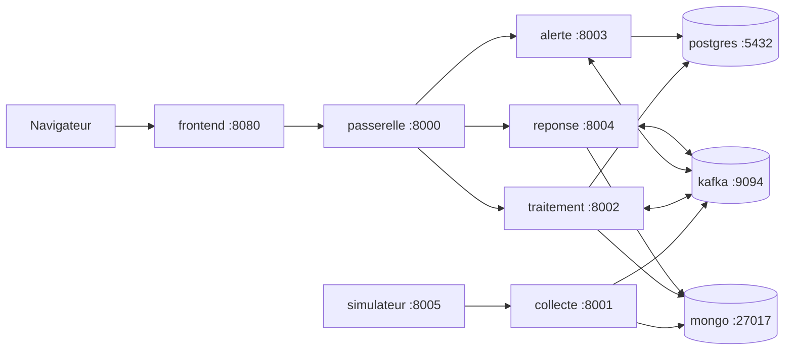

# Novaria Core

Socle de données décisionnelles et d'intelligence artificielle d'UrbanHub.
Projet de Master 2 EADL (Expert en Architectures et Développement Logiciels) — MCCI Business School.
Référentiel : BC05. Soutenance : 10 décembre 2026.

| Couche | Technologie |
|---|---|
| Front-end | React + Vite (TypeScript) |
| Back-end | Python + FastAPI |
| Base relationnelle | PostgreSQL (métier et entrepôt décisionnel) |
| Base non relationnelle | MongoDB (journaux, statistiques, événements bruts, suivi des modèles) |
| Exécution | **Docker Compose en local** ([ADR-023](docs/01-architecture/adr/ADR-023-execution-locale-d-abord.md)) ; cible AWS (Amazon Web Services : ECS Fargate, ECR, RDS, S3, CloudWatch) documentée, non exécutée |
| Qualité et sécurité | SonarQube (qualité du code), Snyk (dépendances, code, conteneurs, IaC), gitleaks (secrets) |
| CI/CD | GitHub Actions |

## Démarrer en local

Prérequis : Docker, Git, Python 3.12. Le même lanceur sert sous Linux et sous Windows ([guide du poste](docs/08-exploitation/poste-de-travail.md)).

| Étape | Linux (Ubuntu) | Windows (PowerShell) |
|---|---|---|
| Vérifier le poste | `python3 scripts/dev/dev.py check-tools` | `py -3 scripts/dev/dev.py check-tools` |
| Créer `.env` (mots de passe aléatoires, une seule fois) | `python3 scripts/dev/dev.py init-env` | `py -3 scripts/dev/dev.py init-env` |
| Démarrer PostgreSQL, MongoDB et les migrations | `python3 scripts/dev/dev.py db-up` | `py -3 scripts/dev/dev.py db-up` |
| Vérifier rôles et droits | `python3 scripts/dev/dev.py db-check` | `py -3 scripts/dev/dev.py db-check` |
| Vérifier l'écriture dans MongoDB | `python3 scripts/dev/dev.py db-check-events` | `py -3 scripts/dev/dev.py db-check-events` |
| **Tout démarrer** (bases, bus, 4 services, simulateur, passerelle, front-end) et vérifier chaque `/health` | `python3 scripts/dev/dev.py up` | `py -3 scripts/dev/dev.py up` |
| Revérifier les sondes | `python3 scripts/dev/dev.py health` | `py -3 scripts/dev/dev.py health` |
| Tout arrêter (données conservées) | `python3 scripts/dev/dev.py down` | `py -3 scripts/dev/dev.py down` |

Sous Linux, `make up`, `make down`, `make health`, `make db-up`, `make test`, `make lint` sont des raccourcis (`make help` liste tout). Front-end : <http://localhost:8080> · API, par la passerelle : <http://localhost:8000/api/v1/>.

### Ce qui tourne et sur quels ports

| Conteneur | Port sur le poste (127.0.0.1) | Variable de `.env` |
|---|---|---|
| frontend | 8080 | `FRONTEND_PORT` |
| passerelle (point d'entrée de l'API) | 8000 | `GATEWAY_PORT` |
| collecte, traitement, alerte, reponse | 8001, 8002, 8003, 8004 | `COLLECTE_PORT`, `TRAITEMENT_PORT`, `ALERTE_PORT`, `REPONSE_PORT` |
| simulateur | 8005 | `SIMULATOR_PORT` |
| postgres, mongo, kafka | 5432, 27017, 9094 | `POSTGRES_PORT`, `MONGO_PORT`, `KAFKA_PORT` |

Rien n'est publié hors de `127.0.0.1`. Ordre de démarrage, sondes de santé, preuve et dépannage : [pile locale](docs/08-exploitation/pile-locale.md).

Guides : [pile locale](docs/08-exploitation/pile-locale.md) · [bases de données locales](docs/03-donnees/base-de-donnees-locale.md) · [sauvegarde et restauration](docs/08-exploitation/sauvegarde-restauration-locale.md) · [dictionnaire de données](docs/03-donnees/dictionnaire-de-donnees.md) · [démarrage du binôme](docs/07-gestion/demarrage-binome.md).

## Structure

| Dossier | Contenu |
|---|---|
| `services/` | Un dossier par service FastAPI : `collecte/`, `traitement/`, `alerte/`, `reponse/` et `_gabarit/`, le modèle des nouveaux services |
| `simulator/` | Simulateur de capteurs IoT (squelette, MS-07) |
| `gateway/` | Passerelle d'API : configuration nginx (routage, MS-06 ; authentification, MS-13) |
| `frontend/` | Dashboard React + Vite |
| `db/` | Bases locales : initialisation, migrations SQL, sauvegarde (PostgreSQL, MongoDB) |
| `contracts/` | Contrats d'événements (schémas JSON), validateur et tests |
| `data/` | ETL, entrepôt (SQL), prototypes flux et Big Data |
| `ml/` | Modèle de prévision, évaluation, registre |
| `automation/rpa/` | Robot Framework (RPA : Robotic Process Automation) |
| `infra/` | Terraform, définitions de tâches ECS (cible AWS documentée, non exécutée) |
| `docs/` | Cadrage, architecture (C4, ADR), spécifications, exploitation, soutenance |
| `planning/` | Fichiers ProjectLibre |
| `scripts/` | Création des issues GitHub, paramètres, secrets |

Règles de contribution : voir [CONTRIBUTING.md](CONTRIBUTING.md).
