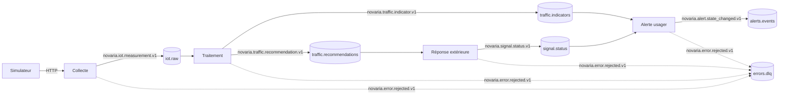

# Contrats

Les contrats décrivent exactement ce qui circule entre les composants. Une source de vérité par format, relue en pull request et testée ([ADR-012](../docs/01-architecture/adr/ADR-012-validation-contrats-zod.md)). Issue de suivi : MS-03.

| Dossier ou fichier | Contenu | État |
|---|---|---|
| `events/` | Schémas JSON (version 2020-12) des événements du bus Kafka : enveloppe, définitions communes et **un schéma par sujet** | **v1 : 6 sujets** |
| `events/examples/` | Un exemple valide par cas d'usage | 19 exemples |
| `topics.json` | Matrice des sujets : type d'événement, schéma, clé, producteurs, consommateurs | 6 sujets, 4 services |
| `openapi/` | **Un contrat OpenAPI par service** (API REST) et les composants partagés | 5 services, voir [openapi/README.md](openapi/README.md) |
| `validate_events.py` | Valide un événement : schéma **et** règles entre champs | outil |
| `conformance.py` | Banc de conformité par service et par sujet | outil et bibliothèque |
| `check_compat.py` | Contrôle de compatibilité ascendante entre deux versions des schémas | outil |
| `tests/` | Tests : 19 exemples valides, 92 cas invalides refusés pour la bonne raison, matrice par service, compatibilité | à lancer avant toute modification |
| `services/_gabarit/app/schemas/events.py` | Modèles Pydantic des six événements, alignés sur les schémas, copiés dans chaque service (test de parité dans `tests/contract/` de chaque service) | MS-03 |

## Événements v1



| Type d'événement | Sujet Kafka | Producteur | Consommateurs | Schéma | Grain |
|---|---|---|---|---|---|
| `novaria.iot.measurement.v1` | `iot.raw` | collecte | traitement | `iot-measurement.schema.json` | un capteur, un intervalle |
| `novaria.traffic.indicator.v1` | `traffic.indicators` | traitement | alerte | `traffic-indicator.schema.json` | un tronçon, une fenêtre de 1 ou 5 min |
| `novaria.traffic.recommendation.v1` | `traffic.recommendations` | traitement | réponse extérieure | `traffic-recommendation.schema.json` | un carrefour, un instant de calcul |
| `novaria.alert.state_changed.v1` | `alerts.events` | alerte usager | alerte usager (diffusion) | `alert-event.schema.json` | un changement d'état d'une alerte |
| `novaria.signal.status.v1` | `signal.status` | réponse extérieure | alerte usager (diffusion) | `signal-status.schema.json` | un carrefour, une décision |
| `novaria.error.rejected.v1` | `errors.dlq` | les quatre services | aucun service (revue manuelle) | `error-rejected.schema.json` | un message rejeté |

« Diffusion » : le flux SSE (Server-Sent Events) `GET /api/v1/events/stream` du tableau de bord est servi par le service d'alerte, qui lit `alerts.events` et `signal.status` à la place du navigateur (le navigateur ne lit pas le bus, [ADR-008](../docs/01-architecture/adr/ADR-008-microservices.md)). **Proposition** : si la passerelle sert le flux, la consommation passe à la passerelle ; la matrice `topics.json` et le contrat `alerte.openapi.yaml` changent ensemble.

Chaque schéma s'appuie sur `envelope.schema.json` (attributs communs, inspirés de CloudEvents) et `common.schema.json` (identifiants, dates UTC (Coordinated Universal Time, temps universel coordonné), provenance, états). Le sens de chaque champ est dans le [dictionnaire de données](../docs/03-donnees/dictionnaire-de-donnees.md).

### Clé de partition

La clé de chaque message est le champ `subject` de l'enveloppe : un message d'un même carrefour va toujours dans la même partition, donc l'ordre est conservé par carrefour. `contracts/validate_events.py` impose `subject` = `data.intersection_id`. Exception : sur `errors.dlq`, le sujet est le carrefour du message rejeté, ou `UNKNOWN` quand il est illisible ou inconnu.

| Écart avec l'[ADR-009](../docs/01-architecture/adr/ADR-009-bus-evenements.md) §4.1 | Contrat | À trancher |
|---|---|---|
| `alerts.events` : l'ADR indique la clé `alert_id` | `intersection_id` (comme l'issue LOC-04 et le test des contrats) | Daddy et Manoa, puis corriger l'ADR |
| `errors.dlq` : l'ADR indique la clé `source_topic` | `intersection_id` ou `UNKNOWN` ; le sujet d'origine est dans `data.source_topic` | idem |

## Valider un événement

Dépendances, une seule fois : `pip install jsonschema referencing`.

| Besoin | Linux | Windows (PowerShell) |
|---|---|---|
| Valider des fichiers | `python3 contracts/validate_events.py contracts/events/examples/*.json` | `py -3 contracts/validate_events.py (Get-ChildItem contracts/events/examples/*.json)` |
| Lancer les tests | `python3 -m unittest discover -s contracts/tests` (ou `make test-contracts`) | `py -3 -m unittest discover -s contracts/tests` |
| Publier un événement sur son sujet, le relire et le valider | `python3 scripts/dev/dev.py kafka-roundtrip --topic traffic.recommendations --file contracts/events/examples/recommandation-plan.json` | `py -3 scripts/dev/dev.py kafka-roundtrip --topic traffic.recommendations --file contracts/events/examples/recommandation-plan.json` |

Le validateur applique le schéma **et** les règles que le schéma ne sait pas exprimer (comparaison entre champs) :

| Type | Règles entre champs |
|---|---|
| tous | `subject` égal à `data.intersection_id` |
| mesure | identifiant `<run_id>:<sensor_id>:<instant en millisecondes>` ; qualité PARTIAL ⇒ drapeau MISSING_SPEED ou MISSING_OCCUPANCY ; qualité SUSPECT ⇒ drapeau IMPLAUSIBLE_VALUE |
| indicateur | identifiant `<run_id>:<road_segment_id>:<window_size_s>:<début de fenêtre en millisecondes>` ; fenêtre alignée sur sa taille ; `time` = fin de fenêtre ; `sample_count` au plus deux fois l'attendu |
| alerte | résolution postérieure à l'ouverture ; `previous_state` null si et seulement si l'état est CREATED, sinon un état antérieur (l'état n'avance que vers l'avant) |
| recommandation | `id` = `recommendation_id` ; `valid_until` postérieur à `time` ; `cycle_s` = somme des durées de phase ; phases distinctes |
| état des feux | phases distinctes ; phase courante dans le plan ; début de phase au plus tard à `time` ; `duration_s` ≥ `min_duration_s` |
| rejet | `time` = `rejected_at` ; `subject` = `intersection_id`, ou `UNKNOWN` s'il est `null` |

## Conformité par service

Critère de MS-03 : **chaque service publie et consomme uniquement des messages conformes au contrat ; le test échoue sinon.** La matrice `topics.json` dit qui publie et consomme quoi ; `conformance.py` applique trois contrôles à chaque message :

| Contrôle | Refus quand |
|---|---|
| Droit | le service n'est pas producteur (ou consommateur) du sujet |
| Type | le type du message n'est pas celui du sujet (un indicateur sur `iot.raw`) |
| Contrat | le schéma ou une règle entre champs est violé |
| Signature | sur `errors.dlq`, `source` n'est pas le service qui publie |

Dans le test d'un service (une fois le service écrit, MS-08 à MS-12) :

```python
from conformance import assert_publication, assert_consumption

assert_publication("traitement", "traffic.indicators", message)   # lève ContractViolation sinon
assert_consumption("reponse", "traffic.recommendations", message)
```

| Besoin | Linux | Windows (PowerShell) |
|---|---|---|
| Contrôler les exemples de chaque service | `python3 contracts/conformance.py` | `py -3 contracts/conformance.py` |
| Afficher la matrice service par sujet | `python3 contracts/conformance.py --matrix` | `py -3 contracts/conformance.py --matrix` |

Côté services, les modèles Pydantic de `app/schemas/events.py` (dans le gabarit `services/_gabarit` et copiés dans chaque service, comme le veut `CONTRIBUTING.md`) sont alignés sur les schémas : `tests/contract/test_event_models.py` compare leurs champs, bornes et énumérations, vérifie sur tous les exemples et cas invalides que le modèle accepte exactement ce que le schéma accepte, et tourne dans le job `backend` de la CI (Continuous Integration, intégration continue). Le modèle couvre la structure et les règles conditionnelles du schéma ; les règles entre champs restent dans `validate_events.py`.

## Règles de versionnement

| Élément | Règle |
|---|---|
| `type` | `novaria.<domaine>.<sujet>.v<majeure>` : la majeure est la version du contrat |
| `schema_version` | `majeure.mineure`, dans chaque message ; la majeure est celle du type (test) |
| Compatibilité ascendante | Un schéma d'une même majeure **accepte tout message que la version précédente acceptait** |
| Version mineure (`1.0` à `1.1`) | Ajouter un champ facultatif, élargir une borne, ajouter une valeur d'énumération. Le schéma accepte alors `1.0` et `1.1` (énumération dans `schema_version`), le type reste `.v1`. Les consommateurs en mode strict sont mis à jour avant les producteurs |
| Version majeure (`.v2`) | Retirer ou renommer un champ, rendre un champ obligatoire, resserrer une règle, changer une unité. Un nouveau fichier de schéma ; les deux types coexistent le temps de la migration |
| Toute modification | Mettre à jour le schéma, l'exemple, le test et le dictionnaire de données dans la même pull request |
| Les exemples | Ne sont jamais réécrits pour passer un schéma plus strict : ils sont le filet de la compatibilité |

Le contrôle automatique compare les schémas à ceux d'une révision Git :

| Besoin | Linux | Windows (PowerShell) |
|---|---|---|
| Comparer à `main` | `python3 contracts/check_compat.py --against origin/main` | `py -3 contracts/check_compat.py --against origin/main` |
| Comparer à un dossier | `python3 contracts/check_compat.py --old dossier-ancien` | `py -3 contracts/check_compat.py --old dossier-ancien` |

Une **rupture** (champ devenu obligatoire, champ retiré d'un schéma fermé, valeur d'énumération retirée, type restreint, borne resserrée, règle ajoutée) fait échouer la commande (code 1). Un `pattern`, un `format` ou une `$ref` modifié est signalé « à vérifier » : on ne sait pas comparer deux motifs, un humain tranche en relecture (option `--strict` pour échouer aussi). Lancer cette commande avant d'ouvrir une pull request qui touche `contracts/events/`.

## Correspondance `errors.dlq` et collection `rejects`

L'événement `novaria.error.rejected.v1` contient les champs de la collection MongoDB `rejects` ([dictionnaire](../docs/03-donnees/dictionnaire-de-donnees.md), section 10.2) et quelques champs de plus.

| Événement | Collection `rejects` |
|---|---|
| `data.source_topic`, `data.rejected_at`, `data.reason`, `data.attempts`, `data.original_payload` | mêmes champs |
| `source` | `service` |
| `data.reason_code`, `data.original_key`, `data.intersection_id` | non archivés (le validateur MongoDB les accepte, sans les exiger) |

## Contrats OpenAPI

Un fichier par service dans `openapi/`, plus `common.yaml` pour les composants partagés. Ils remplacent le contrat unique de BE-01 : aucune des 25 opérations n'est perdue, une est ajoutée (`POST /api/v1/measurements`, dépôt des mesures par le simulateur). Conventions, routage et points ouverts : [openapi/README.md](openapi/README.md).

| Besoin | Linux | Windows (PowerShell) |
|---|---|---|
| Installer PyYAML (une fois) | `python3 -m pip install pyyaml` | `py -3 -m pip install pyyaml` |
| Tester les contrats | `python3 -m unittest discover -s scripts/dev -p "test_openapi.py"` | `py -3 -m unittest discover -s scripts/dev -p "test_openapi.py"` |

## Limites connues

| Limite | Conséquence |
|---|---|
| Les contrats ne figurent pas dans la CI, sauf la parité des modèles Pydantic et la sonde de chaque service (job `backend`, qui parcourt `services/*/`) | Ajouter `contracts/tests` à la CI modifie les contrôles obligatoires : pas fait sans accord des deux membres |
| Les services n'existent pas encore | Le banc `conformance.py` est prêt ; chaque service l'appelle dans son test dès MS-08 à MS-12 |
| Les contrats OpenAPI ne sont pas vérifiés par un validateur OpenAPI complet | À lancer, par exemple : `npx @redocly/cli lint contracts/openapi/traitement.openapi.yaml`. La référence externe `../events/iot-measurement.schema.json` demande un outil qui suive les références de fichier |
| Le validateur MongoDB de `raw_events` est une description proche du schéma JSON, pas identique (types BSON (Binary JSON, JSON binaire de MongoDB)) | Vérifié sur la mesure d'exemple : acceptée ; origine inconnue, provenance absente et type mal formé : refusés |
| Les bornes de durée de phase (1 à 600 s) et le plan de 2 à 8 phases sont des valeurs de départ | Les règles de sécurité des feux (EXG-REP-02, MS-12) les remplaceront |
| `check_compat.py` compare la structure sans résoudre les références | Voir « à vérifier » plus haut |
