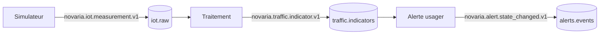

# Contrats

Les contrats décrivent exactement ce qui circule entre les composants. Une source de vérité par format, relue en pull request et testée ([ADR-012](../docs/01-architecture/adr/ADR-012-validation-contrats-zod.md)).

| Dossier | Contenu | État |
|---|---|---|
| `events/` | Schémas JSON (version 2020-12) des événements du bus Kafka | **v0 : enveloppe, mesure, indicateur, alerte** |
| `events/examples/` | Un exemple valide par cas d'usage | 9 exemples |
| `tests/` | Tests : exemples valides, 35 cas invalides refusés pour la bonne raison | à lancer avant toute modification |
| `openapi/` | API (Application Programming Interface, interface de programmation) REST (Representational State Transfer) de chaque service | à venir (MS-03, FE-02) |

## Événements v0

| Type d'événement | Sujet Kafka | Producteur | Schéma | Grain |
|---|---|---|---|---|
| `novaria.iot.measurement.v1` | `iot.raw` | collecte | `iot-measurement.schema.json` | un capteur, un intervalle |
| `novaria.traffic.indicator.v1` | `traffic.indicators` | traitement | `traffic-indicator.schema.json` | un tronçon, une fenêtre de 1 ou 5 min |
| `novaria.alert.state_changed.v1` | `alerts.events` | alerte usager | `alert-event.schema.json` | un changement d'état d'une alerte |

Hors v0 (sujets `traffic.recommendations` et `signal.status`, `errors.dlq`) : contrats à écrire avec le service de réponse extérieure (MS-11 et suivants).

Chaque schéma s'appuie sur `envelope.schema.json` (attributs communs, inspirés de CloudEvents) et `common.schema.json` (identifiants, dates UTC (Coordinated Universal Time, temps universel coordonné), provenance, états). Le sens de chaque champ est dans le [dictionnaire de données](../docs/03-donnees/dictionnaire-de-donnees.md).

## Valider un événement

Dépendances, une seule fois : `pip install jsonschema referencing`.

| Besoin | Linux | Windows (PowerShell) |
|---|---|---|
| Valider des fichiers | `python3 contracts/validate_events.py contracts/events/examples/*.json` | `py -3 contracts/validate_events.py (Get-ChildItem contracts/events/examples/*.json)` |
| Lancer les tests | `python3 -m unittest discover -s contracts/tests` (ou `make test-contracts`) | `py -3 -m unittest discover -s contracts/tests` |

Le validateur applique le schéma **et** les règles que le schéma ne sait pas exprimer (comparaison entre champs) : `subject` égal à `data.intersection_id`, identifiant de mesure conforme à la convention, fenêtre alignée, résolution postérieure à l'ouverture.

## Règles de modification

| Changement | Version |
|---|---|
| Ajouter un champ facultatif, élargir une borne | Mineure : `schema_version` passe de `1.0` à `1.1`, le type reste `.v1`. Les consommateurs en mode strict doivent être mis à jour avant les producteurs. |
| Retirer ou renommer un champ, resserrer une règle, changer une unité | Majeure : nouveau type `.v2`, les deux versions coexistent le temps de la migration |
| Toute modification | Mettre à jour le schéma, l'exemple, le test et le dictionnaire de données dans la même pull request |

## Limites connues

| Limite | Conséquence |
|---|---|
| Les modèles Pydantic du backend ne sont pas encore générés à partir de ces schémas | À faire dans MS-03 : le contrat doit être testé en CI (Continuous Integration, intégration continue) contre les modèles |
| Le validateur MongoDB de `raw_events` est une description proche du schéma JSON, pas identique (types BSON (Binary JSON, JSON binaire de MongoDB)) | Vérifié sur la mesure d'exemple : acceptée ; origine inconnue, provenance absente et type mal formé : refusés |
| Les contrats ne figurent pas encore dans la CI | Ajout à décider avec le professeur et le binôme (modification des contrôles obligatoires : pas fait sans accord) |
