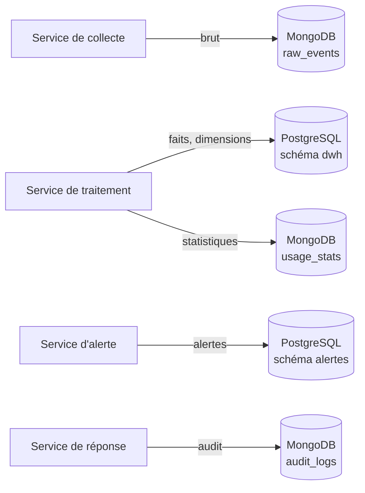

# ADR-002 — PostgreSQL pour le métier et l'entrepôt, MongoDB pour les journaux, statistiques et événements bruts

| Champ | Valeur |
|---|---|
| Date | 17/10/2026 |
| Statut | Acceptée |
| Décideurs | Daddy Luciano, Manoa Robel |
| Validation du professeur | À consigner (exigences R-03 et R-04 du registre des demandes) |
| Issues liées | DAT-02, DAT-05, BE-02, BE-05, MS-08, MS-10, CLD-11, CLD-15 |
| Compétences BC05 | Architectures de données décisionnelles, ETL (Extract, Transform, Load), Processus décisionnels |
| Complété par | [ADR-014](ADR-014-architecture-decisionnelle.md), [ADR-022](ADR-022-hebergement-mongodb.md) |

> **Mise à jour du 20/10/2026 ([ADR-023](ADR-023-execution-locale-d-abord.md)).** Les deux bases tournent en local dans Docker ; la mise en œuvre est décrite dans l'[ADR-024](ADR-024-bases-de-donnees-locales.md). Le choix des deux moteurs ne change pas.

## 1. Problème

Novaria Core manipule des données de natures différentes :

| Donnée | Caractéristiques |
|---|---|
| Utilisateurs, rôles, cycle de vie des alertes, configuration | Relationnelle, intégrité forte, transactions |
| Faits et dimensions des indicateurs (entrepôt) | Analytique, agrégations, historique |
| Événements bruts des capteurs | Écriture continue, forme qui évolue, rejeu possible |
| Journaux d'audit, statistiques d'usage, suivi des modèles | Écriture seule (append-only), schéma souple, conservation limitée |

Un seul moteur peut-il servir ces besoins sans compromis excessif ?

## 2. Forces de décision

- Intégrité référentielle et migrations versionnées pour le métier (exigence R-03).
- Base NoSQL (Not Only SQL (Structured Query Language)) pour les statistiques et les journaux d'audit (exigence R-04).
- Coût AWS (Amazon Web Services) maîtrisé : peu d'instances, arrêt après chaque essai.
- Chaque service possède ses données ([ADR-008](ADR-008-microservices.md)).

## 3. Options comparées

| Option | Avantages | Inconvénients | Verdict |
|---|---|---|---|
| A. PostgreSQL seul (colonnes JSONB (JSON binaire de PostgreSQL) pour le brut) | Un seul moteur à exploiter, sauvegarder, sécuriser ; coût minimal | Ne démontre pas la compétence NoSQL ; volumes d'événements bruts dans la même instance que le métier | Écartée |
| B. MongoDB seul | Schéma souple, un seul moteur | Intégrité référentielle et agrégations analytiques moins naturelles ; entrepôt en étoile peu adapté | Écartée |
| **C. PostgreSQL + MongoDB** | Chaque moteur pour ce qu'il fait le mieux ; couvre SQL et NoSQL | Deux moteurs à exploiter ; pas de transaction entre les deux | **Retenue** |
| D. PostgreSQL + DynamoDB | Service géré, sans serveur | Verrouillage AWS, modèle d'accès rigide, hors de portée du poste local | Écartée |
| E. PostgreSQL + S3 (fichiers Parquet) | Très économique pour l'historique | Pas de requête directe sans moteur supplémentaire (Athena) ; utile plus tard pour le Big Data ([ADR-016](ADR-016-big-data.md)) | Complément éventuel |
| F. Redshift ou Timestream | Entrepôt ou séries temporelles managés | Coût fixe élevé pour un volume simulé | Écartée |

Réserve assumée : l'option A serait plus simple et moins chère. L'option C est retenue parce que le besoin de données brutes en écriture continue, de journaux à schéma souple et d'index d'expiration (TTL, Time To Live) correspond au modèle documentaire, et parce que le bloc BC05 demande de démontrer les deux familles de bases.

## 4. Choix

**PostgreSQL 16**

- Schéma `app` : métier du service concerné (utilisateurs, alertes, configuration).
- Schéma `dwh` : entrepôt en étoile (faits et dimensions), modélisé dans [ADR-014](ADR-014-architecture-decisionnelle.md).
- Migrations Alembic versionnées (BE-02).

**MongoDB 7**

- `raw_events` : événements bruts des capteurs (rejouables).
- `audit_logs` : qui, quoi, quand.
- `usage_stats` : compteurs d'usage.
- `model_runs` : suivi des entraînements ([ADR-017](ADR-017-mlops-mlsecops.md)).

Règle de propriété : un service n'écrit que dans ses propres schémas et collections (une base logique par service, dans les mêmes instances pour limiter le coût).

## 5. Conséquences

**Positives**

- Les contraintes d'intégrité protègent le métier ; le brut reste rejouable.
- Les deux familles de bases sont démontrées avec un usage justifié.

**Compromis acceptés**

- Pas de transaction entre PostgreSQL et MongoDB. Parade : écriture idempotente et publication d'événements fiable (motif « outbox », décrit dans [ADR-009](ADR-009-bus-evenements.md)).
- Deux moteurs à sauvegarder et à restaurer (CLD-15), à chiffrer et à surveiller.
- Pas de jointure entre les deux : les rapprochements se font dans l'entrepôt.

**Risques et parades**

| Risque | Parade |
|---|---|
| Données dupliquées entre bases et divergentes | Source de vérité unique par donnée, consignée dans le dictionnaire de données (DAT-02) |
| Collection `raw_events` qui grossit sans limite | Index TTL et durée de conservation fixée ; archivage éventuel vers S3 |
| Coût de l'hébergement de MongoDB | Voir [ADR-022](ADR-022-hebergement-mongodb.md) |

## 6. Plan de repli

Si l'exploitation de MongoDB dépasse le budget ou le temps disponible, les quatre collections migrent vers des tables PostgreSQL à colonnes JSONB (option A). Les services accèdent aux données par des dépôts (couche d'accès, [ADR-010](ADR-010-architecture-hexagonale.md)) : seul l'adaptateur change.

## 7. Vérification

- Les scripts SQL créent le schéma sur une base vide (DAT-02).
- Rejouer un chargement ne change pas les totaux (DAT-05).
- Restauration vérifiée des deux bases avec totaux identiques (CLD-15).

## 8. Conditions de réexamen

- Le coût mensuel d'hébergement des deux moteurs dépasse la part du plafond AWS qui leur est allouée ([ADR-007](ADR-007-compte-aws.md)).
- Une requête analytique sur l'entrepôt dépasse l'objectif de délai malgré index et partitionnement.
