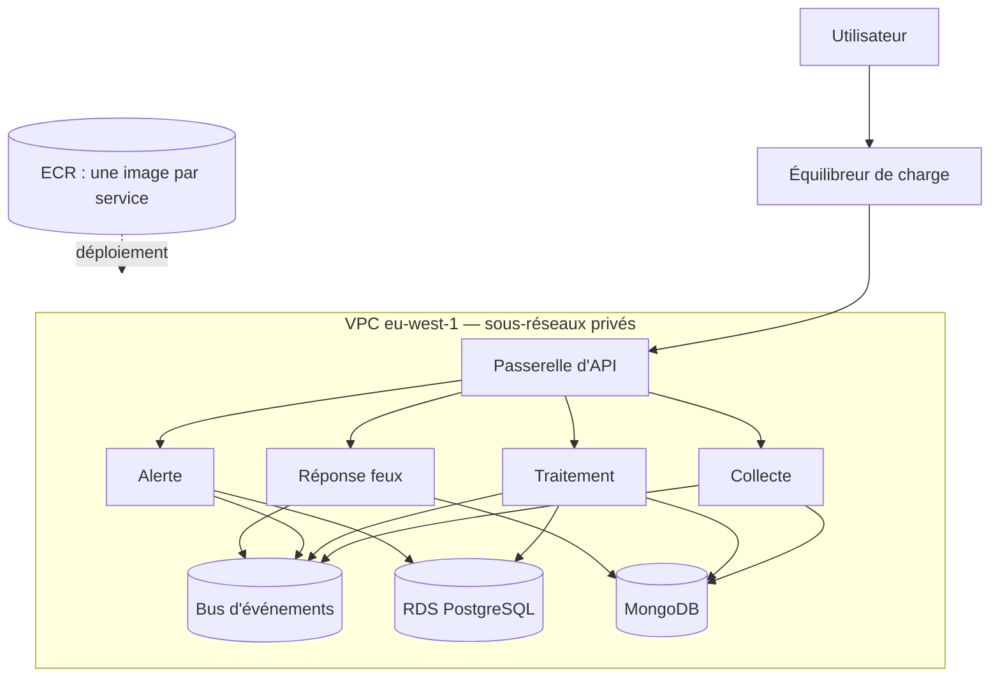

# ADR-003 — Hébergement sur AWS (Amazon Web Services) avec ECS (Elastic Container Service) Fargate et Docker

| Champ | Valeur |
|---|---|
| Date | 17/10/2026 |
| Statut | Acceptée (déploiement réel conditionné par [ADR-007](ADR-007-compte-aws.md)) |
| Décideurs | Daddy Luciano, Manoa Robel |
| Validation du professeur | À consigner |
| Issues liées | CLD-09, CLD-10, CLD-11, CLD-12, MS-06, MS-17 |
| Compétences BC05 | Architectures de données décisionnelles, Documentation |
| Complété par | [ADR-020](ADR-020-terraform.md), [ADR-021](ADR-021-docker-deploiement.md) |

> **Mise à jour du 20/10/2026 ([ADR-023](ADR-023-execution-locale-d-abord.md)).** Le déploiement sur AWS (Amazon Web Services) est **suspendu** : le projet s'exécute en local avec Docker Compose, d'après la consigne du professeur. Cette ADR reste la cible documentée, non exécutée. Équivalents locaux : [ADR-025](ADR-025-equivalents-locaux-des-services-aws.md).

## 1. Problème

Les quatre services, le bus d'événements, les bases et le tableau de bord doivent tourner dans un environnement reproductible, détruit après chaque essai pour contenir le coût. Quel service de calcul AWS les héberge ?

## 2. Forces de décision

| Critère | Poids |
|---|---|
| Faible charge d'exploitation (2 personnes) | Fort |
| Un déploiement indépendant par service | Fort |
| Coût mesurable et arrêtable | Fort |
| Parité avec le poste local (Docker Compose) | Fort |
| Compétence demandée par le bloc BC05 | Moyen |

## 3. Options comparées

| Option | Avantages | Inconvénients | Verdict |
|---|---|---|---|
| **A. ECS Fargate (Elastic Container Service, mode sans serveur)** | Aucun serveur à administrer, une définition de tâche par service, rôle IAM (Identity and Access Management) par tâche, intégration CloudWatch et Terraform | Coût par vCPU supérieur à EC2 (Elastic Compute Cloud) en charge continue ; volumes persistants limités (EFS, EBS (Elastic Block Store)) | **Retenue** |
| B. ECS sur EC2 | Moins cher en charge continue, volumes locaux | Parc de machines à patcher, capacité à gérer | Écartée |
| C. EKS (Kubernetes) | Standard de l'industrie, portabilité | Frais fixes du plan de contrôle, complexité sans rapport avec 4 services | Écartée |
| D. Lambda | Facturation à l'appel | Consommateurs de flux, connexions longues (WebSocket) et Flink hors de son modèle | Écartée pour les services ; possible pour des tâches planifiées courtes |
| E. App Runner / Elastic Beanstalk | Très simple | Peu adapté à plusieurs services reliés par un bus ; moins de contrôle réseau | Écartée |
| F. Machine virtuelle + Docker Compose | Identique au poste local, très économique | Aucune démonstration d'orchestration ; sécurité et reprise manuelles | Écartée (sert de plan B local) |

## 4. Choix

Chaque service est une **image Docker** ([ADR-021](ADR-021-docker-deploiement.md)) publiée dans ECR (Elastic Container Registry) et exécutée comme **service ECS Fargate**. Le réseau est un VPC (Virtual Private Cloud) à sous-réseaux privés ; seule la passerelle d'API (Application Programming Interface, interface de programmation) est exposée par un équilibreur de charge. L'infrastructure est décrite en Terraform ([ADR-020](ADR-020-terraform.md)). Région : eu-west-1 ([ADR-006](ADR-006-region-eu-west-1.md)).

## 5. Conséquences

**Positives**

- Un service se déploie, se met à l'échelle et se rétablit seul.
- Le rôle IAM de chaque tâche suit le moindre privilège (matrice d'accès CLD-18).
- `terraform destroy` supprime l'ensemble après la démonstration (CLD-21).

**Compromis acceptés**

- Le coût par heure de calcul est plus élevé qu'avec EC2 : acceptable pour des essais courts, à contrôler si l'environnement reste allumé.
- Le démarrage d'une tâche prend de quelques dizaines de secondes : le déploiement attend la stabilité du service (`wait-for-service-stability`).
- Les volumes persistants sont contraints, ce qui pèse sur MongoDB ([ADR-022](ADR-022-hebergement-mongodb.md)).
- Verrouillage partiel à ECS : les images restent portables, les définitions de tâches ne le sont pas.

**Risques et parades**

| Risque | Parade |
|---|---|
| Passerelle NAT (Network Address Translation) facturée à l'heure, oubliée active | Décision chiffrée dans GES-09 avant création ; destruction après chaque essai ; alertes AWS Budgets à 50 %, 80 %, 100 % |
| Ressources laissées actives | Étiquette `projet=novaria` sur toutes les ressources et revue de facturation en fin de séance |
| Compte AWS indisponible à temps | Plan B de l'[ADR-007](ADR-007-compte-aws.md) |

## 6. Plan de repli

Sans compte AWS, la démonstration s'exécute localement avec Docker Compose (`python3 scripts/dev/dev.py up` sous Linux, `py -3 scripts/dev/dev.py up` sous Windows) ; Terraform reste écrit et validé statiquement (`fmt`, `validate`, `tflint`, analyse Snyk IaC), sans déploiement ; le `plan` exige des identifiants AWS ([ADR-020](ADR-020-terraform.md)).

## 7. Vérification

- `terraform apply` crée l'environnement, `terraform destroy` le supprime (CLD-11).
- `/api/v1/health` de chaque service renvoie la révision du commit déployé (CLD-12, MS-17).
- Seule la passerelle est joignable depuis Internet (test d'accès, CLD-18).

## 8. Conditions de réexamen

- Le coût Fargate d'un essai dépasse la part du plafond qui lui est réservée.
- Un service exige un volume local rapide ou un processeur spécialisé.
