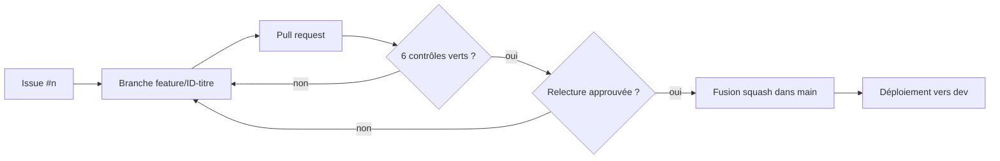

# ADR-004 — Branche `main` protégée et branches courtes

| Champ | Valeur |
|---|---|
| Date | 17/10/2026 |
| Statut | Acceptée |
| Décideurs | Daddy Luciano, Manoa Robel |
| Validation du professeur | Non requise |
| Issues liées | GES-02, GES-17, CLD-03, CLD-08, MS-05 |
| Compétences BC05 | Documentation (processus), DevSecOps transversal |
| Complété par | [ADR-005](ADR-005-sonarqube-snyk-controles-bloquants.md), [ADR-018](ADR-018-devsecops.md) |

## 1. Problème

Deux personnes livrent en parallèle sur un même dépôt public pendant 9 semaines. Sans règle, une erreur atteint `main` sans relecture, une branche longue diverge et la fusion tardive coûte plus que le développement.

## 2. Forces de décision

- Relecture croisée de tout code (exigence R-16).
- Intégration fréquente pour éviter les conflits.
- Preuve visible : un test en échec bloque la fusion (CLD-08).
- Historique lisible pour la soutenance.

## 3. Options comparées

| Option | Avantages | Inconvénients | Verdict |
|---|---|---|---|
| A. Git Flow (develop, release, hotfix) | Cadre complet | Branches longues, cérémonie disproportionnée pour 2 personnes | Écartée |
| B. Commits directs sur `main` | Rapide | Aucun contrôle, aucune preuve de relecture | Écartée |
| **C. Développement sur tronc commun : `main` protégée, branches courtes, pull request relue** | Intégration fréquente, historique linéaire, preuves automatiques | Une approbation requise : dépend de la disponibilité de l'autre | **Retenue** |
| D. Dépôts forkés par personne | Isolation | Frottement inutile à deux | Écartée |

## 4. Choix

| Règle | Valeur |
|---|---|
| Branche protégée | `main`, y compris pour les administrateurs |
| Nom de branche | `feature/<ID>-court-titre`, `fix/...`, `docs/...` |
| Fusion | Squash (une pull request = un commit), historique linéaire, branche supprimée après fusion |
| Approbations | 1, donnée par l'autre membre du binôme |
| Contrôles obligatoires | `backend`, `frontend`, `gitleaks`, `snyk`, `docker`, `sonarqube` |
| Commits | `type(portée): résumé` (feat, fix, docs, test, chore, ci, refactor) |
| Lien | Chaque pull request contient `Closes #n` |

## 5. Conséquences

**Positives**

- Aucun code n'atteint `main` sans relecture et sans contrôles verts.
- L'historique `main` raconte le projet : un commit par issue.

**Compromis acceptés**

- Une absence de l'autre membre bloque la fusion. Parade : délai de relecture convenu et point hebdomadaire (GES-17).
- Aucun contournement : même en urgence, la correction passe par une pull request (correction en avant, pas de désactivation de règle).
- Le travail inachevé doit pouvoir rester invisible sur `main` : migrations de base en deux temps (ajouter, migrer, retirer) et fonctionnalités incomplètes derrière un réglage de configuration.

**Leçons déjà vécues**

- La protection a été activée après la première CI (Continuous Integration, intégration continue) verte, sinon aucune fusion n'était possible.
- Un contrôle obligatoire ne doit jamais être filtré par chemin : un contrôle ignoré reste « en attente » et bloque la fusion. Il en découle que la CI multi-services garde un travail agrégateur nommé exactement `backend` (MS-05).
- Dependabot ouvrait 21 pull requests : régime mensuel et groupé (CLD-22).

## 6. Plan de repli

Si la relecture croisée devient un goulot d'étranglement, la règle passe à « relecture sous 24 h ouvrées, sinon fusion par l'auteur après accord écrit de l'autre », consignée dans le journal des changements. La protection de `main` et les six contrôles ne se désactivent pas.

## 7. Vérification

- Un push direct sur `main` est refusé (capture, GES-02).
- Une pull request avec un test volontairement faux est bloquée (CLD-08).
- `git log --oneline main` ne contient aucun commit de fusion.

## 8. Conditions de réexamen

- Un troisième contributeur rejoint le projet (CODEOWNERS et nombre d'approbations à revoir).
- Le délai moyen de relecture dépasse 24 h ouvrées sur deux semaines.
