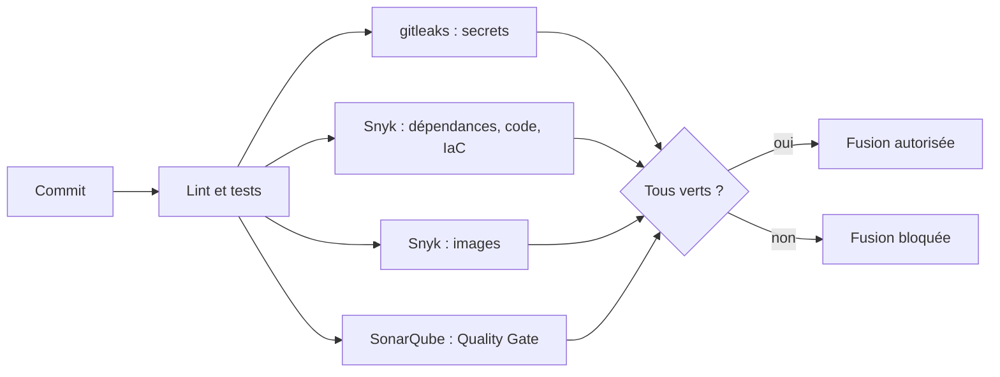

# ADR-005 — SonarQube Cloud et Snyk comme contrôles bloquants

| Champ | Valeur |
|---|---|
| Date | 17/10/2026 |
| Statut | Acceptée |
| Décideurs | Daddy Luciano, Manoa Robel |
| Validation du professeur | Non requise |
| Issues liées | CLD-04, CLD-05, CLD-06, CLD-19, CLD-22, CLD-23, CLD-24, GES-16 |
| Compétences BC05 | Documentation, DevSecOps transversal |
| Complété par | [ADR-018](ADR-018-devsecops.md) |

## 1. Problème

Le projet est public et reçoit du code de deux personnes. Comment empêcher qu'une faille connue, un secret ou un code de faible qualité atteigne `main`, sans ralentir la livraison ?

## 2. Forces de décision

- Détecter tôt (décaler la sécurité vers la gauche, *shift-left*).
- Couvrir : qualité du code, dépendances, code source, images de conteneurs, infrastructure, secrets.
- Blocage réel : un contrôle qui n'empêche rien n'est pas un contrôle.
- Coût nul ou faible, plans gratuits de leurs limites.

## 3. Options comparées

| Option | Avantages | Inconvénients | Verdict |
|---|---|---|---|
| **A. SonarQube Cloud + Snyk + gitleaks** | Couverture complète, tableaux de bord, seuils configurables | Dépendance à des services tiers ; quotas des plans gratuits | **Retenue** |
| B. Outils intégrés à GitHub (CodeQL, Dependabot, secret scanning) | Aucun compte supplémentaire | Pas d'analyse d'images ni d'Infrastructure as Code ; Quality Gate moins fin | Utilisés en complément (secret scanning, push protection, Dependabot) |
| C. Outils libres auto-hébergés (Trivy, Semgrep, SonarQube Community) | Gratuits, sans quota | Exploitation et mises à jour à notre charge | Écartée ; SonarQube local reste disponible (`make quality-up`) |
| D. Contrôles consultatifs seulement | Aucun blocage | Aucune garantie | Écartée |

## 4. Choix

| Contrôle | Outil | Seuil de blocage |
|---|---|---|
| Qualité et sécurité du code, couverture | SonarQube Cloud | Quality Gate : couverture ≥ 70 % sur le nouveau code, 0 faille, fiabilité non C |
| Dépendances Python et npm (Software Composition Analysis, SCA) | Snyk | Gravité haute ou critique |
| Code source (Static Application Security Testing, SAST) | Snyk Code | Gravité haute, sur `main` seulement (quota mensuel du plan gratuit) |
| Images Docker | Snyk Container | Gravité haute ou critique |
| Terraform | Snyk IaC | Gravité haute ou critique |
| Secrets | gitleaks sur tout l'historique + secret scanning de GitHub | Toute détection |

Ces six contrôles portent les noms `backend`, `frontend`, `gitleaks`, `snyk`, `docker`, `sonarqube` et sont obligatoires sur `main` ([ADR-004](ADR-004-main-protegee-branches-courtes.md)).

## 5. Conséquences

**Positives**

- Les failles hautes et les secrets sont arrêtés avant la fusion.
- Les rapports servent de preuves pour la matrice BC05.

**Compromis acceptés**

- Une faille amont sans correctif bloque la CI (Continuous Integration, intégration continue). Procédure d'exception (CLD-23) : raison écrite, responsable, expiration avant le 10/12/2026, entrée dans le registre des risques. Une exception se déclare dans `.snyk` ; aucun contrôle ne se désactive silencieusement.
- Les plans gratuits imposent des limites (Snyk Code : 100 analyses par mois, d'où l'exécution sur `main` seulement).
- Les faux positifs se trient à la main (CLD-19).

**Leçons déjà vécues**

| Constat | Décision |
|---|---|
| Le contrôle Snyk échouait en 401 : le secret `SNYK_TOKEN` existait mais était vide | Valider la longueur et un appel d'API (Application Programming Interface, interface de programmation) avant d'enregistrer le secret ; ne jamais coller un jeton dans une conversation |
| Le contrôle d'images a révélé de vraies failles dans les images de base (python:3.12-slim sur Debian 13 ; nginx-unprivileged sur Alpine 3.21) | Mettre à jour les images de base plutôt que baisser le seuil ; documenter chaque faille sans correctif |
| Un jeton personnel Snyk expire mi-janvier 2027 | Renouvellement inscrit à l'inventaire des secrets (GES-16) |
| Dependabot ouvrait 21 pull requests d'un coup | Régime mensuel, mises à jour groupées, versions majeures ignorées (CLD-22) |

**Risques et parades**

| Risque | Parade |
|---|---|
| Dépendance à un fournisseur ou arrêt d'un plan gratuit | Les règles sont portables : Trivy et Semgrep remplacent Snyk, SonarQube Community remplace Sonar Cloud |
| Contrôle bloqué par une panne du service tiers | Relancer ; si la panne dure, décision écrite et consignée, jamais de désactivation de la protection |

## 6. Plan de repli

Remplacer un outil tiers par son équivalent libre en conservant le nom du contrôle obligatoire (le nom du job reste, seul son contenu change).

## 7. Vérification

- Le job `snyk` échoue sur une vulnérabilité de gravité haute introduite volontairement (CLD-05).
- Le job `sonarqube` échoue quand le Quality Gate échoue (CLD-04).
- Un faux secret poussé sur une branche de test fait échouer `gitleaks` (CLD-06).
- `docs/04-devsecops/exceptions.md` : chaque exception porte raison et date d'expiration.

## 8. Conditions de réexamen

- Les quotas gratuits deviennent insuffisants.
- Le nombre de faux positifs dépasse la capacité de tri du binôme.
