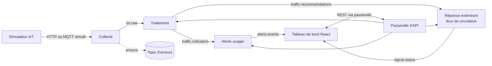

# ADR-008 — Architecture en microservices : quatre services indépendants

| Champ | Valeur |
|---|---|
| Date | 17/10/2026 |
| Statut | Acceptée par le binôme, validation du professeur attendue (point 5 de GES-06) |
| Décideurs | Daddy Luciano, Manoa Robel |
| Validation du professeur | À demander : la topologie présentée décrit un seul back-end (écart E-01 du registre des demandes) |
| Issues liées | MS-01 à MS-17, DOC-03, C-01 à C-04 (registre des demandes) |
| Compétences BC05 | Architectures de données décisionnelles, Documentation |
| Complété par | [ADR-009](ADR-009-bus-evenements.md), [ADR-010](ADR-010-architecture-hexagonale.md) |

## 1. Problème

Le traitement de données urbaines comporte des étapes de natures différentes : recevoir des mesures de capteurs, les nettoyer et les agréger, alerter des usagers, piloter un équipement extérieur. Elles n'ont ni le même rythme, ni les mêmes contraintes de fiabilité, ni les mêmes technologies idéales. Un bloc unique les couple : une panne de l'une arrête les autres, et ajouter un domaine (pollution de l'eau, énergie) oblige à rouvrir tout le code.

## 2. Forces de décision

| Critère | Poids |
|---|---|
| Blocs de traitement grands et indépendants | Fort |
| Isolation des pannes (la réponse aux feux survit à l'arrêt de l'alerte) | Fort |
| Facilité d'ajouter des services et des domaines | Fort |
| Architecture adaptée à chaque service | Fort |
| Délai : 9 semaines pour 2 personnes | Fort |
| Coût AWS (Amazon Web Services) et complexité d'exploitation | Fort |

## 3. Options comparées

| Option | Avantages | Inconvénients | Verdict |
|---|---|---|---|
| A. Monolithe en couches (squelette actuel `backend/`) | Le plus rapide à construire, une seule image | Couplage, technologie unique, aucune démonstration d'indépendance | Écartée |
| B. Monolithe modulaire (modules isolés, un seul déploiement) | Peu de coût d'exploitation, frontières nettes | Pannes non isolées, un seul rythme de déploiement | Plan de repli |
| **C. Quatre microservices + passerelle + simulateur** | Indépendance de panne, de déploiement et de technologie ; extension par ajout de services | Complexité réseau, cohérence des données, tests de bout en bout, coût de plus d'images | **Retenue** |
| D. Beaucoup de petits services (nano-services) | Découpage fin | Charge d'exploitation hors de proportion | Écartée |
| E. Fonctions Lambda par étape | Facturation à l'usage | Flux continus et connexions longues mal adaptés | Écartée |

## 4. Choix

### 4.1 Découpage

| Service | Rôle | Données possédées | Architecture interne |
|---|---|---|---|
| **Collecte** | Recevoir, valider, dédoublonner, publier les mesures brutes | MongoDB : `raw_events` | Chaîne de traitement sans état (*pipes and filters*) ; un adaptateur d'entrée, un adaptateur de sortie |
| **Traitement** (cœur) | Nettoyer, agréger par fenêtres, alimenter l'entrepôt, produire indicateurs et recommandations | PostgreSQL : schéma `dwh` ; MongoDB : statistiques | Hexagonale ([ADR-010](ADR-010-architecture-hexagonale.md)) + séparation écriture/lecture (CQRS, Command Query Responsibility Segregation) + moteur de flux ([ADR-011](ADR-011-temps-reel-et-batch.md)) |
| **Alerte usager** | Évaluer des règles, gérer le cycle de vie d'une alerte (créée, notifiée, acquittée, résolue), diffuser en direct | PostgreSQL : schéma `alertes` | Hexagonale + moteur de règles + machine à états |
| **Réponse extérieure** | Appliquer les recommandations au contrôleur de feux simulé, avec garde-fous | MongoDB : `audit_logs` des commandes | Hexagonale + machine à états + garde-fous de sécurité + mode dégradé à plan fixe |

Hors de ces quatre services : la **passerelle d'API (Application Programming Interface, interface de programmation)** (routage, authentification JWT (JSON Web Token) — JSON (JavaScript Object Notation) Web Token —, limitation de débit), le **simulateur IoT** (outil de test, MS-07) et le **tableau de bord** React.

### 4.2 Règles de l'architecture

1. **Propriété des données** : un service est seul à écrire dans ses schémas et collections. Pas de base partagée entre services.
2. **Flux de données par événements** ([ADR-009](ADR-009-bus-evenements.md)), **requêtes du tableau de bord par REST (Representational State Transfer)** via la passerelle.
3. **Pas de chaîne d'appels synchrones entre services** : un service ne répond jamais en attendant un autre service (sinon le système devient un monolithe distribué).
4. **Contrats d'abord** : schéma JSON par sujet d'événement, OpenAPI par service (MS-03, [ADR-012](ADR-012-validation-contrats-zod.md)).
5. **Un dépôt, plusieurs services** (`services/<nom>`) : une seule CI (Continuous Integration, intégration continue) en matrice, une seule version `v1.0.0` pour la démonstration.
6. **Sécurité de la commande** : le service de réponse refuse toute commande dangereuse, journalise tout, et revient au plan fixe si les recommandations manquent.

### 4.3 Ajouter un domaine : exemple de la qualité de l'eau

Le découpage est un gabarit qui se duplique, sans rouvrir les services existants.

| Étape | Action |
|---|---|
| 1 | Créer les services depuis `services/_gabarit` (MS-04) |
| 2 | Ajouter les contrats `contracts/events/water.*.json` |
| 3 | Ajouter un profil de capteurs au simulateur |
| 4 | Publier `water.indicators` et `water.recommendations` ; le service d'alerte consomme les nouveaux indicateurs par ajout de règles |
| 5 | Ajouter les routes à la passerelle et les vues au tableau de bord |

## 5. Conséquences

**Positives**

- Une panne du service d'alerte n'arrête ni la collecte ni la commande des feux.
- Chaque service évolue, se teste et se déploie séparément.
- Le projet démontre une architecture réaliste pour UrbanHub.

**Compromis acceptés**

- Plus d'images, de définitions de tâches et de tests : 17 issues supplémentaires (MS-01 à MS-17).
- Cohérence éventuelle (*eventual consistency*) : une valeur affichée peut retarder de quelques secondes sur la source.
- Tests de bout en bout indispensables (MS-15) : un test unitaire vert ne prouve pas que le flux fonctionne.
- Exploitation : journaux corrélés, surveillance par service (MS-16).

**Correspondance avec le backlog existant**

| Issue existante | Devenir |
|---|---|
| BE-01 (un seul contrat OpenAPI) | Un contrat par service (MS-03) |
| BE-02, BE-04, BE-05, BE-06, BE-07, BE-08 | Répartis dans MS-08, MS-10, MS-11, MS-12, MS-13 |
| DAT-03 à DAT-05, DAT-07, DAT-09 | Cœur de MS-08, MS-09, MS-10 |
| FE-02, FE-04, FE-08 | Étendues par MS-14 |
| CLD-07, CLD-13, CLD-14 | Multi-services : MS-06, MS-15, MS-16 |

**Risques et parades**

| Risque | Parade |
|---|---|
| Surcharge : la charge cumulée dépasse la capacité du binôme | Priorités P0/P1 respectées ; point de décision à la fin de M2 (voir plan de repli) |
| Monolithe distribué (appels synchrones en chaîne) | Règle 3 vérifiée en revue de code |
| Divergence de contrats entre services | Test de conformité automatique en CI (MS-03) |
| Coût AWS multiplié par le nombre de services | Une instance de base partagée par plusieurs bases logiques ; arrêt hors essais |

## 6. Plan de repli

**Point de décision : fin de M2 (15/11/2026).** Si le parcours capteur → collecte → traitement → alerte → réponse ne fonctionne pas de bout en bout en local, le projet bascule vers le **monolithe modulaire** : les quatre modules (déjà isolés par ports, [ADR-010](ADR-010-architecture-hexagonale.md)) se déploient dans un seul processus, le bus devient en mémoire. Aucune ligne de domaine ne change, seuls les adaptateurs de communication sont remplacés.

## 7. Vérification

- Le test de bout en bout (MS-15) rejoue le parcours nominal et les cas d'échec (message invalide, service arrêté, broker indisponible, indicateurs en retard).
- L'arrêt volontaire du service d'alerte ne perturbe ni la collecte ni la commande des feux.
- Un service créé depuis le gabarit passe lint, tests et build sans modifier la CI (MS-04).

## 8. Conditions de réexamen

- Le professeur refuse le découpage en quatre services.
- Le point de décision de fin de M2 n'est pas atteint.
- Le coût AWS des quatre services dépasse la part du plafond qui leur est réservée ([ADR-007](ADR-007-compte-aws.md)).
