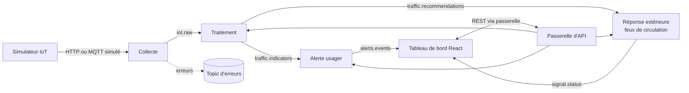

# ADR-008 — Architecture en microservices : quatre services indépendants

| Champ | Valeur |
|---|---|
| Date | 17/10/2026 |
| Statut | Acceptée par le binôme ; **validation du professeur non obtenue à ce jour** (point 5 de GES-06) |
| Décideurs | Daddy Luciano, Manoa Robel |
| Validation du professeur | À demander : la topologie présentée décrit un seul back-end (écart E-01 du registre des demandes) |
| Issues liées | MS-01 (cette révision), MS-02 à MS-17, DOC-03, C-01 à C-04 (registre des demandes) |
| Compétences BC05 | Architectures de données décisionnelles, Documentation |
| Complété par | [ADR-009](ADR-009-bus-evenements.md), [ADR-010](ADR-010-architecture-hexagonale.md), [ADR-024](ADR-024-bases-de-donnees-locales.md) (réalisation des bases) |
| Influencé par | [ADR-023](ADR-023-execution-locale-d-abord.md) (exécution locale d'abord : l'hébergement AWS est suspendu) |

**Révisions.** Les décisions du 17/10/2026 ne changent pas ; les révisions ajoutent des précisions et ne réécrivent rien.

| Date | Révision |
|---|---|
| 17/10/2026 | Version initiale : problème, options, découpage en quatre services, règles, conséquences |
| 27/10/2026 | MS-01 : tableau des mécanismes d'échange (4.2), une base logique par service et ses exceptions (4.4), architecture interne de chaque service et raison du choix (4.5), risques détaillés (5), demande de validation au professeur (9) |

## 1. Problème

Le traitement de données urbaines comporte des étapes de natures différentes : recevoir des mesures de capteurs, les nettoyer et les agréger, alerter des usagers, piloter un équipement extérieur. Elles n'ont ni le même rythme, ni les mêmes contraintes de fiabilité, ni les mêmes technologies idéales. Un bloc unique les couple : une panne de l'une arrête les autres, et ajouter un domaine (pollution de l'eau, énergie) oblige à rouvrir tout le code.

## 2. Forces de décision

| Critère | Poids |
|---|---|
| Blocs de traitement grands et indépendants | Fort |
| Isolation des pannes (la réponse aux feux survit à l'arrêt de l'alerte) | Fort |
| Facilité d'ajouter des services et des domaines | Fort |
| Architecture adaptée à chaque service | Fort |
| Délai : 9 semaines pour 2 personnes | Fort |
| Coût AWS (Amazon Web Services) et complexité d'exploitation | Fort |

## 3. Options comparées

| Option | Avantages | Inconvénients | Verdict |
|---|---|---|---|
| A. Monolithe en couches (squelette actuel `services/traitement/`) | Le plus rapide à construire, une seule image | Couplage, technologie unique, aucune démonstration d'indépendance | Écartée |
| B. Monolithe modulaire (modules isolés, un seul déploiement) | Peu de coût d'exploitation, frontières nettes | Pannes non isolées, un seul rythme de déploiement | Plan de repli |
| **C. Quatre microservices + passerelle + simulateur** | Indépendance de panne, de déploiement et de technologie ; extension par ajout de services | Complexité réseau, cohérence des données, tests de bout en bout, coût de plus d'images | **Retenue** |
| D. Beaucoup de petits services (nano-services) | Découpage fin | Charge d'exploitation hors de proportion | Écartée |
| E. Fonctions Lambda par étape | Facturation à l'usage | Flux continus et connexions longues mal adaptés | Écartée |

## 4. Choix

### 4.1 Découpage

| Service | Rôle | Données possédées | Architecture interne |
|---|---|---|---|
| **Collecte** | Recevoir, valider, dédoublonner, publier les mesures brutes | MongoDB : `raw_events` | Chaîne de traitement sans état (*pipes and filters*) ; un adaptateur d'entrée, un adaptateur de sortie |
| **Traitement** (cœur) | Nettoyer, agréger par fenêtres, alimenter l'entrepôt, produire indicateurs et recommandations | PostgreSQL : schéma `dwh` ; MongoDB : statistiques | Hexagonale ([ADR-010](ADR-010-architecture-hexagonale.md)) + séparation écriture/lecture (CQRS, Command Query Responsibility Segregation) + moteur de flux ([ADR-011](ADR-011-temps-reel-et-batch.md)) |
| **Alerte usager** | Évaluer des règles, gérer le cycle de vie d'une alerte (créée, notifiée, acquittée, résolue), diffuser en direct | PostgreSQL : schéma `alertes` | Hexagonale + moteur de règles + machine à états |
| **Réponse extérieure** | Appliquer les recommandations au contrôleur de feux simulé, avec garde-fous | MongoDB : `audit_logs` des commandes | Hexagonale + machine à états + garde-fous de sécurité + mode dégradé à plan fixe |

Hors de ces quatre services : la **passerelle d'API (Application Programming Interface, interface de programmation)** (routage, authentification JWT (JSON Web Token) — JSON (JavaScript Object Notation) Web Token —, limitation de débit), le **simulateur IoT** (outil de test, MS-07) et le **tableau de bord** React.

### 4.2 Règles de l'architecture

1. **Propriété des données** : un service est seul à écrire dans ses schémas et collections. Pas de base partagée entre services.
2. **Flux de données par événements** ([ADR-009](ADR-009-bus-evenements.md)), **requêtes du tableau de bord par REST (Representational State Transfer)** via la passerelle.
3. **Pas de chaîne d'appels synchrones entre services** : un service ne répond jamais en attendant un autre service (sinon le système devient un monolithe distribué).
4. **Contrats d'abord** : schéma JSON par sujet d'événement, OpenAPI par service (MS-03, [ADR-012](ADR-012-validation-contrats-zod.md)).
5. **Un dépôt, plusieurs services** (`services/<nom>`) : une seule CI (Continuous Integration, intégration continue) en matrice, une seule version `v1.0.0` pour la démonstration.
6. **Sécurité de la commande** : le service de réponse refuse toute commande dangereuse, journalise tout, et revient au plan fixe si les recommandations manquent.

Quel mécanisme pour quel échange (règles 2 et 3) :

| Échange | Mécanisme | Pourquoi |
|---|---|---|
| Mesures, indicateurs, recommandations, alertes, état des feux, entre services | **Événements** sur le bus (`iot.raw`, `traffic.indicators`, `traffic.recommendations`, `alerts.events`, `signal.status`) | Le flux est continu ; un consommateur arrêté rattrape son retard ([ADR-009](ADR-009-bus-evenements.md)) |
| Le tableau de bord lit indicateurs, alertes, état des feux | **API REST** via la passerelle ([contrats](../../../contracts/openapi/README.md)) | Une requête appelle une réponse ; le tableau de bord n'est pas un service du flux |
| Le tableau de bord envoie une commande manuelle de feux | **API REST** vers le service de réponse extérieure, via la passerelle | C'est la requête d'un humain, soumise aux mêmes garde-fous que les recommandations |
| L'alerte arrive au tableau de bord sans rechargement | Flux SSE (Server-Sent Events, du serveur vers le navigateur) de `GET /events/stream`, alimenté par `alerts.events` | Le navigateur ne lit pas le bus |
| Un service appelle un autre service | **Jamais** en REST synchrone | Évite la chaîne de pannes (règle 3) |

### 4.3 Ajouter un domaine : exemple de la qualité de l'eau

Le découpage est un gabarit qui se duplique, sans rouvrir les services existants.

| Étape | Action |
|---|---|
| 1 | Créer les services depuis `services/_gabarit` (MS-04) |
| 2 | Ajouter les contrats `contracts/events/water.*.json` |
| 3 | Ajouter un profil de capteurs au simulateur |
| 4 | Publier `water.indicators` et `water.recommendations` ; le service d'alerte consomme les nouveaux indicateurs par ajout de règles |
| 5 | Ajouter les routes à la passerelle et les vues au tableau de bord |

### 4.4 Une base logique par service

Pour limiter coût et charge d'exploitation, il y a **une instance** de chaque moteur et **une base logique par propriétaire** : un schéma PostgreSQL et un ensemble de collections MongoDB, chacun avec son compte de connexion à droits minimaux. La réalisation est décidée dans [ADR-024](ADR-024-bases-de-donnees-locales.md) (option B) ; ses scripts sont dans `db/`.

| Propriétaire | PostgreSQL (schéma et compte) | MongoDB (collections et compte) |
|---|---|---|
| Collecte | aucun | `raw_events`, `rejects` : lire, insérer (`svc_collecte`) |
| Traitement | `dwh` : lire, écrire (`svc_traitement`) | `processing_stats` : lire, insérer, modifier ; `rejects` : lire, insérer ; `raw_events` : lire (`svc_traitement`) |
| Alerte usager | `alertes` : lire, écrire (`svc_alerte`) | aucune |
| Réponse extérieure | aucun | `audit_logs` : lire, insérer (`svc_reponse`) |
| API métier (hors des quatre services) | `app` (`svc_app`) | `audit_logs` : lire, insérer ; `usage_stats` : lire, insérer, modifier (`svc_backend`) |
| Module d'apprentissage (hors des quatre services) | aucun | `model_runs` : lire, insérer, modifier ; `raw_events`, `processing_stats` : lire (`svc_ml`) |

Aucune clé étrangère ne traverse deux services : `alertes.alert` désigne un tronçon ou un épisode de `dwh` par un identifiant textuel. Les schémas `ops` (suivi des migrations) et le compte `svc_lecture` (lecture seule de `dwh` et `alertes`, pour la consultation et les analyses) sont transversaux par nature.

**Exceptions à la règle 1, constatées dans les scripts le 27/10/2026.** Elles sont assumées, pas cachées :

| Exception | Raison | Parade ou piste |
|---|---|---|
| `rejects` est écrite par la collecte **et** par le traitement | C'est l'archive commune du sujet `errors.dlq` ; chacun y range ses propres rejets, en ajout seulement | Si cela gêne, un seul consommateur de `errors.dlq` écrit la collection : changement de deux comptes, sans effet sur les contrats |
| `raw_events` est lue par le traitement et le module d'apprentissage | Rejeu par lots et construction du jeu d'entraînement ([ADR-011](ADR-011-temps-reel-et-batch.md)) | Lecture seule, imposée par les droits du compte ; aucun service n'y écrit en dehors de la collecte |
| `svc_lecture` lit deux schémas | Consultation et analyses sans pouvoir d'écriture | Lecture seule, imposée par les droits SQL |

**Vérification.** Les droits de chaque compte sont contrôlés par `db-check`. Le 27/10/2026, 11 cas de droits SQL et 29 cas MongoDB (accès accordés et refusés) ont été exécutés sur des bases créées à vide sous Windows : voir [bases locales](../../03-donnees/base-de-donnees-locale.md), section 9.

**Si le coût ou l'isolation l'exigent**, la séparation en instances distinctes ne demande aucun changement de code : chaque service a déjà sa propre chaîne de connexion et son compte.

### 4.5 Architecture interne de chaque service et raison du choix

Chaque service reçoit l'architecture qui convient à sa nature, au lieu d'un modèle unique. Le principe général est dans [ADR-010](ADR-010-architecture-hexagonale.md) : l'hexagone (ports et adaptateurs) sert là où la logique métier est riche et critique, une chaîne légère suffit ailleurs.

| Service | Architecture interne | Raison du choix | Ce qu'on accepte en échange |
|---|---|---|---|
| **Collecte** | Chaîne sans état (*pipes and filters*) : recevoir, valider, dédoublonner, publier, stocker le brut | Le service ne porte aucune règle métier riche ; l'hexagone complet serait disproportionné pour un relais. Sans état, il redémarre et se duplique sans précaution | Le dédoublonnage s'appuie sur un index unique de MongoDB (`id` de l'événement) |
| **Traitement** | Hexagonale + séparation écriture/lecture (CQRS) + moteur de flux | C'est le cœur : fenêtres, états de congestion, recommandations. La logique critique doit se tester sans broker ni base ; l'écriture est un flux continu, la lecture sert le tableau de bord sans la ralentir ([ADR-014](ADR-014-architecture-decisionnelle.md)) ; le temps d'événement l'impose ([ADR-011](ADR-011-temps-reel-et-batch.md)) | Plus de couches ; Flink demande des compétences et des versions épinglées, avec un consommateur Python en repli |
| **Alerte usager** | Hexagonale + moteur de règles + machine à états | Le cycle CREATED, NOTIFIED, ACKNOWLEDGED, RESOLVED et les règles configurables doivent être explicites et testables ; le motif *outbox* évite de perdre un événement ([ADR-009](ADR-009-bus-evenements.md)) | Une table de plus (`outbox_event`) et un relais de publication |
| **Réponse extérieure** | Hexagonale + machine à états + garde-fous + mode dégradé à plan fixe | Une commande dangereuse ne doit jamais atteindre le contrôleur de feux. Les garde-fous sont du domaine pur, testés en millisecondes ; le contrôleur est un adaptateur remplaçable (simulé en v1) | Le service refuse des commandes que le modèle jugeait bonnes : c'est voulu |

Hors des quatre services : la **passerelle d'API** (routage, jeton, limitation de débit) est de la configuration, pas du domaine ; l'**API métier** (`backend/`, utilisateurs et audit) garde des couches simples. L'avenir de `backend/` face au service de traitement est un point ouvert ([diagrammes C4](../c4/README.md), point 1).

## 5. Conséquences

**Positives**

- Une panne du service d'alerte n'arrête ni la collecte ni la commande des feux.
- Chaque service évolue, se teste et se déploie séparément.
- Le projet démontre une architecture réaliste pour UrbanHub.

**Compromis acceptés**

- Plus d'images, de définitions de tâches et de tests : 17 issues supplémentaires (MS-01 à MS-17).
- Cohérence éventuelle (*eventual consistency*) : une valeur affichée peut retarder de quelques secondes sur la source.
- Tests de bout en bout indispensables (MS-15) : un test unitaire vert ne prouve pas que le flux fonctionne.
- Exploitation : journaux corrélés, surveillance par service (MS-16).

**Correspondance avec le backlog existant**

| Issue existante | Devenir |
|---|---|
| BE-01 (un seul contrat OpenAPI) | Un contrat par service (MS-03) |
| BE-02, BE-04, BE-05, BE-06, BE-07, BE-08 | Répartis dans MS-08, MS-10, MS-11, MS-12, MS-13 |
| DAT-03 à DAT-05, DAT-07, DAT-09 | Cœur de MS-08, MS-09, MS-10 |
| FE-02, FE-04, FE-08 | Étendues par MS-14 |
| CLD-07, CLD-13, CLD-14 | Multi-services : MS-06, MS-15, MS-16 |

**Risques et parades**

Probabilité et impact sont une estimation du binôme au 27/10/2026, à réviser à chaque jalon. Les risques R11 et R12 sont ajoutés au [registre des risques](../../07-gestion/registre-risques.md) ; R1, R3 et R6 y figurent déjà.

| Risque | Probabilité · Impact | Parade | Signal de suivi | Registre |
|---|---|---|---|---|
| **Complexité d'exploitation** : quatre services, passerelle, bus, deux bases et simulateur à démarrer, déboguer et tester sur deux postes | Élevée · Moyen | Gabarit de service (MS-04), un seul fichier Compose (MS-06), lanceur commun `dev.py`, journaux corrélés par `correlation_id` (MS-16), tests de bout en bout (MS-15) | `docker compose up` ne démarre pas l'ensemble sur l'un des deux postes | R11 |
| **Délai du 10/12/2026** : la charge cumulée dépasse la capacité de deux personnes (les durées du planning excèdent déjà cette capacité) | Élevée · Élevé | Priorités P0/P1 respectées ; **point de décision le 15/11/2026** avec bascule vers le monolithe modulaire (section 6) ; ordre d'abandon : prototypes P1, puis Flink au profit d'un consommateur Python | Le parcours capteur, collecte, traitement, alerte, réponse ne fonctionne pas de bout en bout en local au 15/11 | R12, R1 |
| **Coût AWS** : plus d'images, de tâches et de bases à héberger si le projet quittait le local | Faible tant que le projet reste local · Moyen | Aucune ressource AWS n'est créée ([ADR-023](ADR-023-execution-locale-d-abord.md)) : le coût est un **projeté** étiqueté « non déployé » (GES-09), calculé sur l'inventaire prévu. Une instance par moteur, bases logiques partagées (4.4), arrêt hors essais. Reprise d'AWS seulement sur autorisation écrite du professeur | Une autorisation de reprise d'AWS ; un inventaire (GES-09) qui dépasse le plafond fixé alors | R3 (suspendu), R6 |
| Monolithe distribué : appels synchrones en chaîne entre services | Moyenne · Élevé | Règle 3 vérifiée en revue de code ; pas de client REST vers un autre service dans le gabarit | Un service qui attend la réponse d'un autre pour répondre | R11 |
| Divergence de contrats entre services | Moyenne · Moyen | Test de conformité automatique en CI (MS-03) | Un test de contrat qui échoue ou qu'on désactive | — |
| Cohérence éventuelle : une valeur affichée retarde sur la source | Élevée · Faible | Délai capteur vers affichage mesuré et publié ([exigence EXG-NFR-03](../../02-specifications/exigences.md)) | Délai mesuré au-delà de l'objectif proposé | — |
| Exceptions à la règle 1 qui se multiplient (4.4) | Faible · Moyen | Liste fermée dans cet ADR ; toute nouvelle exception passe par une révision | Un compte de service qui obtient un droit hors de son schéma | — |

## 6. Plan de repli

**Point de décision : fin de M2 (15/11/2026).** Si le parcours capteur → collecte → traitement → alerte → réponse ne fonctionne pas de bout en bout en local, le projet bascule vers le **monolithe modulaire** : les quatre modules (déjà isolés par ports, [ADR-010](ADR-010-architecture-hexagonale.md)) se déploient dans un seul processus, le bus devient en mémoire. Aucune ligne de domaine ne change, seuls les adaptateurs de communication sont remplacés.

## 7. Vérification

- Le test de bout en bout (MS-15) rejoue le parcours nominal et les cas d'échec (message invalide, service arrêté, broker indisponible, indicateurs en retard).
- L'arrêt volontaire du service d'alerte ne perturbe ni la collecte ni la commande des feux.
- Un service créé depuis le gabarit passe lint, tests et build sans modifier la CI (MS-04).
- Chaque service n'écrit que dans ses propres schémas et collections : `db-check`, et les 40 cas d'accès accordés et refusés du 27/10/2026 (4.4).

## 8. Conditions de réexamen

- Le professeur refuse le découpage en quatre services.
- Le point de décision de fin de M2 n'est pas atteint.
- Le coût AWS des quatre services dépasse la part du plafond qui leur est réservée ([ADR-007](ADR-007-compte-aws.md)), si l'exécution sur AWS est autorisée.
- Une troisième exception à la règle 1 devient nécessaire (4.4).

## 9. Validation par le professeur

**État au 27/10/2026 : non validée.** Le critère d'acceptation de MS-01 (« le professeur a validé le découpage ») n'est pas rempli. La topologie présentée au professeur décrit un seul back-end : c'est l'écart E-01 du [registre des demandes](../../07-gestion/registre-des-demandes.md).

Question à poser, avec cet ADR et les [diagrammes C4](../c4/README.md) en pièces jointes :

> Acceptez-vous que Novaria Core soit réalisé en quatre services (collecte, traitement, alerte usager, réponse extérieure) avec une passerelle et un simulateur, au lieu d'un back-end unique ? Sinon, préférez-vous un monolithe modulaire ?

| Réponse | Conséquence |
|---|---|
| Oui | Statut « Acceptée » et date dans cet ADR ; ligne dans [decisions-professeur.md](../../07-gestion/decisions-professeur.md) ; E-01 clos dans le registre des demandes |
| Oui, sous condition | La condition s'ajoute à cet ADR et au registre ; le point de décision du 15/11/2026 reste en vigueur |
| Non, monolithe modulaire | Bascule décrite à la section 6 : les modules déjà isolés par ports ([ADR-010](ADR-010-architecture-hexagonale.md)) se déploient dans un seul processus ; cet ADR devient « Remplacée par » une nouvelle ADR |
| Pas de réponse | L'écart E-01 reste ouvert et le risque est porté au registre ; le projet continue sur la décision du binôme jusqu'au 15/11/2026 |

Une réponse orale s'inscrit comme telle, avec la mention « oral », jusqu'à réception d'un écrit (même règle que pour la consigne « localhost »).
