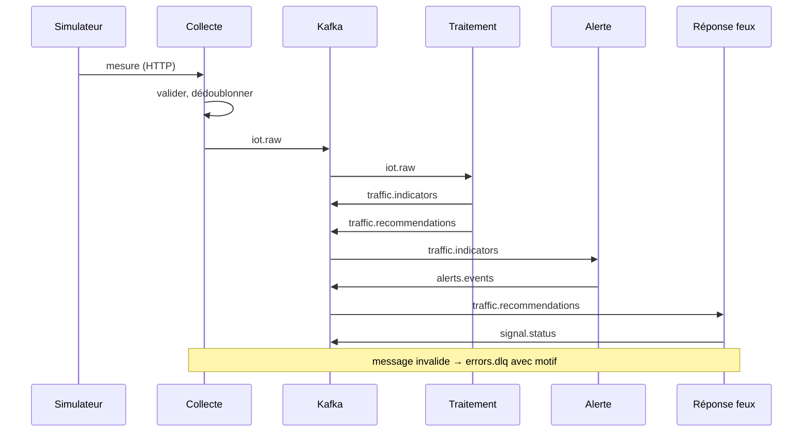

# ADR-009 — Architecture événementielle et bus d'événements Apache Kafka

| Champ | Valeur |
|---|---|
| Date | 17/10/2026 |
| Statut | Acceptée sous condition : validation par le professeur de l'exigence de temps réel (point 6 du registre des demandes, B-03) |
| Décideurs | Daddy Luciano, Manoa Robel |
| Validation du professeur | À demander |
| Issues liées | MS-02, MS-03, MS-06, MS-08 à MS-12, MS-15, MS-17 |
| Compétences BC05 | Traitement de flux en temps réel, Architectures de données décisionnelles |
| Complété par | [ADR-011](ADR-011-temps-reel-et-batch.md), [ADR-012](ADR-012-validation-contrats-zod.md) |

> **Mise à jour du 20/10/2026 ([ADR-023](ADR-023-execution-locale-d-abord.md)).** Le bus Kafka tourne en local dans Docker Compose (mode KRaft, issue LOC-04) ; MSK (Managed Streaming for Apache Kafka) est documenté, non exécuté.

## 1. Problème

Les quatre services échangent un flux continu de faits (mesures, indicateurs, recommandations, alertes, état des feux). Il faut choisir le **style de communication** (appels directs ou événements) et le **bus** qui transporte ces événements, avec des garanties sur l'ordre, la perte, les doublons et le rejeu.

## 2. Forces de décision

| Critère | Poids |
|---|---|
| Découplage : un producteur ignore ses consommateurs | Fort |
| Ordre des mesures d'un même carrefour | Fort |
| Rejeu des événements (correction d'un bug, entraînement) | Fort |
| Débit et latence faibles | Moyen (volume simulé modeste) |
| Intégration avec Flink ([ADR-011](ADR-011-temps-reel-et-batch.md)) | Fort |
| Coût AWS (Amazon Web Services) et charge d'exploitation | Fort |
| Compétence du bloc BC05 (Kafka) | Moyen |

## 3. Options comparées

### 3.1 Style de communication

| Option | Verdict |
|---|---|
| Appels REST (Representational State Transfer) synchrones entre services | Écartée : couplage temporel, chaîne de pannes |
| **Événements asynchrones (chorégraphie)** | **Retenue** pour le flux de données |
| Orchestrateur central (flux de travail piloté) | Écartée : point unique, sans besoin de transaction distribuée ici |
| Sourçage d'événements (*event sourcing*) | Hors périmètre : les événements notifient des faits, l'état vit dans les bases |

### 3.2 Bus

| Option | Avantages | Inconvénients | Verdict |
|---|---|---|---|
| **Apache Kafka** (mode KRaft, Kafka Raft, sans ZooKeeper) | Journal rejouable, ordre par clé de partition, groupes de consommateurs, connecteur Flink de référence | Plus lourd à exploiter, coût d'un cluster managé sur AWS | **Retenue sous condition** |
| RabbitMQ (Amazon MQ) | Léger, routage riche | Pas de rejeu durable naturel, ordre moins garanti avec plusieurs consommateurs | Repli 1 |
| Redis Streams (ElastiCache) | Très simple, rapide, journal rejouable | Durabilité et écosystème de flux plus limités | Repli 2 |
| Amazon Kinesis Data Streams | Géré, intégré à AWS | Verrouillage AWS, hors de portée du poste local, BC05 nomme Kafka | Écartée |
| SNS (Simple Notification Service) + SQS (Simple Queue Service) / EventBridge | Sans serveur | Pas de rejeu ni d'ordre global par clé, flux continu mal adapté | Écartée |

Réserve assumée : le volume simulé (de l'ordre de dizaines de messages par seconde) tient largement dans RabbitMQ ou Redis Streams. Kafka est retenu pour le rejeu, l'ordre par clé, la sémantique de journal sur laquelle s'appuie Flink, et parce que le bloc BC05 le désigne. La condition de validation du professeur protège contre un excès de complexité.

## 4. Choix

**Apache Kafka** en mode KRaft. En local : un seul broker dans Docker Compose (MS-06). Sur AWS : Amazon MSK (Managed Streaming for Apache Kafka) ou conteneur sur ECS (Elastic Container Service), décidé après chiffrage (GES-09, [ADR-007](ADR-007-compte-aws.md)).

### 4.1 Sujets (topics)

| Topic | Producteur | Consommateurs | Clé de partition | Contenu |
|---|---|---|---|---|
| `iot.raw` | Collecte | Traitement | `intersection_id` | Mesure brute validée |
| `traffic.indicators` | Traitement | Alerte, tableau de bord | `intersection_id` | Indicateurs par fenêtre |
| `traffic.recommendations` | Traitement | Réponse extérieure | `intersection_id` | Plan de feux recommandé |
| `alerts.events` | Alerte | Tableau de bord (par diffusion) | `alert_id` | Cycle de vie d'une alerte |
| `signal.status` | Réponse extérieure | Tableau de bord | `intersection_id` | État des phases et commandes |
| `errors.dlq` | Tous | Revue manuelle | `source_topic` | Message rejeté, motif, charge d'origine |

Règle pour un nouveau domaine : `<domaine>.indicators` et `<domaine>.recommendations` (par exemple `water.indicators`) ; l'entrée brute reste `iot.raw`, le champ `domain` de l'enveloppe route vers le bon schéma.

### 4.2 Enveloppe de l'événement

Tout événement porte les attributs CloudEvents (norme d'enveloppe) : `id`, `source`, `type` (par exemple `novaria.iot.measurement.v1`), `time`, `subject`, plus `schema_version`, `correlation_id` et `domain`. Le corps est décrit par un schéma JSON (JavaScript Object Notation) versionné ([ADR-012](ADR-012-validation-contrats-zod.md)).

### 4.3 Garanties et motifs

| Sujet | Règle |
|---|---|
| Livraison | Au moins une fois (*at-least-once*), consommateurs **idempotents** : un `id` déjà traité est ignoré |
| Ordre | Garanti par partition, donc par carrefour grâce à la clé |
| Écriture base + événement | Motif *outbox* : l'événement est écrit dans la même transaction que la donnée, puis publié (service d'alerte) |
| Échec | Nouvelles tentatives avec attente croissante, puis `errors.dlq` avec le motif ; aucun message n'est perdu en silence |
| Évolution des schémas | Compatibilité ascendante dans une version ; rupture = nouveau `type` (`…v2`), publication double pendant la transition |
| Configuration initiale (à ajuster par mesure) | 3 partitions par topic en local ; réplication 3 sur MSK ; rétention de 7 jours pour `iot.raw` |
| Sécurité | TLS (Transport Layer Security) en transit ; authentification et droits par service sur chaque topic (producteur ou consommateur seulement) ; matrice d'accès versionnée (CLD-18) |

## 5. Conséquences

**Positives**

- Un producteur ne connaît pas ses consommateurs : ajouter un domaine ne modifie pas les services existants.
- Le journal rejouable sert à la correction, aux tests et au rejeu pour l'entraînement.
- Les pannes sont absorbées : un consommateur arrêté rattrape son retard à son retour.

**Compromis acceptés**

- Cohérence éventuelle : l'affichage retarde de quelques secondes sur la source.
- Le flux est plus difficile à suivre qu'une chaîne d'appels : identifiant de corrélation propagé dans chaque événement et diagramme de flux tenu à jour (MS-16).
- Un cluster Kafka est un composant lourd : sur AWS, un cluster géré est facturé à l'heure (voir [ADR-007](ADR-007-compte-aws.md)).

**Risques et parades**

| Risque | Parade |
|---|---|
| Doublons ou pertes | Consommateurs idempotents, tests de reprise après redémarrage sans perte ni doublon (MS-15) |
| Retard de consommation non détecté | Métrique de retard (*consumer lag*) dans le tableau CloudWatch (MS-16) |
| Messages « empoisonnés » qui bloquent un consommateur | Rejet vers `errors.dlq` après N tentatives, consommation poursuivie |
| Dérive de schémas | Test de conformité en CI (MS-03) |

## 6. Plan de repli

**Décision au plus tard le 01/11/2026 (fin de M1)**, après la réponse du professeur sur l'exigence de temps réel. Sans exigence formelle : Redis Streams (ou RabbitMQ) avec le même découpage en sujets, les mêmes enveloppes et les mêmes contrats. Le code de domaine ne change pas : les ports de publication et de consommation ([ADR-010](ADR-010-architecture-hexagonale.md)) isolent le bus.

## 7. Vérification

- Tous les messages valides arrivent sur `iot.raw`, tous les invalides sur `errors.dlq`, les doublons sont ignorés (MS-08).
- Redémarrer un consommateur ne perd ni ne duplique de message (MS-15).
- Le test de conformité aux schémas échoue sur un message non conforme (MS-03).

## 8. Conditions de réexamen

- Le professeur ne pose pas d'exigence de temps réel.
- Le chiffrage montre que le broker dépasse sa part du plafond de dépense.
- Le débit simulé monte au point de saturer un broker unique en local.
