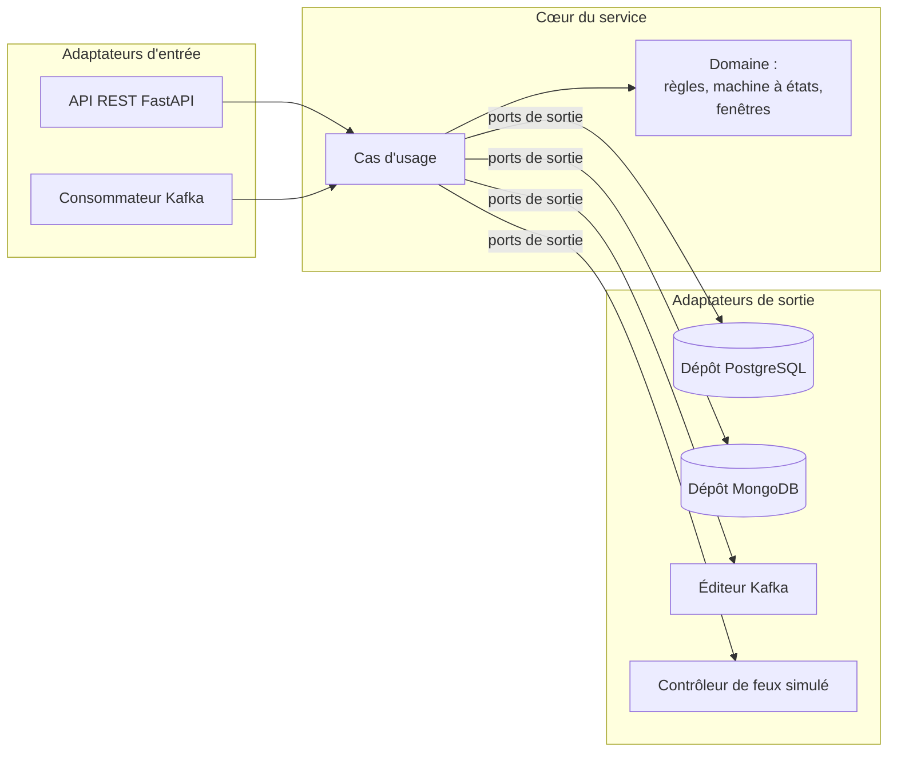

# ADR-010 — Architecture hexagonale (ports et adaptateurs) pour les services à logique métier

| Champ | Valeur |
|---|---|
| Date | 17/10/2026 |
| Statut | Acceptée |
| Décideurs | Daddy Luciano, Manoa Robel |
| Validation du professeur | Non requise (choix interne à chaque service) |
| Issues liées | MS-04, MS-09 à MS-12, BE-07 |
| Compétences BC05 | Architectures de données décisionnelles, Documentation |
| Complète | [ADR-008](ADR-008-microservices.md), [ADR-009](ADR-009-bus-evenements.md) |

## 1. Problème

Les services doivent résister au changement de technologie (bus, base de données, contrôleur de feux simulé puis réel), se tester sans infrastructure et accueillir de nouveaux domaines sans réécriture. Le squelette actuel de `backend/` est en couches (`api`, `services`, `repositories`, `models`) : la logique métier y dépend directement de FastAPI, de SQLAlchemy ou du pilote Kafka, ce qui la rend difficile à tester et à déplacer.

## 2. Forces de décision

- Robustesse : la logique métier (règles d'alerte, garde-fous des feux, fenêtres) est la partie critique ; elle doit se tester sans broker ni base.
- Faible couplage : remplacer Kafka, PostgreSQL ou MongoDB ne doit toucher que des adaptateurs.
- Ajout rapide de services et de domaines.
- Délai court : l'architecture ne doit pas ralentir la livraison.

## 3. Options comparées

| Option | Avantages | Inconvénients | Verdict |
|---|---|---|---|
| A. Couches classiques (contrôleur, service, dépôt) | Simple, connue | Le domaine dépend des détails techniques ; tests lourds | Écartée pour les services à logique |
| **B. Hexagonale (ports et adaptateurs)** | Domaine isolé, adaptateurs interchangeables, tests rapides | Plus de fichiers, correspondances entre modèles | **Retenue** |
| C. Architecture « Clean » à anneaux (entités, cas d'usage, interfaces, frameworks) | Même idée, découpage plus fin | Cérémonie supérieure à l'hexagonale pour un gain faible ici | Écartée |
| D. Script de transaction (une fonction par route) | Très rapide pour du CRUD (Create, Read, Update, Delete) | Ne tient pas une machine à états ni un moteur de règles | Retenue seulement pour la collecte et la passerelle |

## 4. Choix

**Hexagonale** pour **traitement**, **alerte usager** et **réponse extérieure**. Le service **collecte** garde une chaîne de traitement légère (ports d'entrée et de sortie, sans domaine riche) : appliquer l'hexagone complet à un simple relais serait de la cérémonie inutile.



### 4.1 Structure d'un service (gabarit MS-04)

```text
services/<nom>/
  app/
    domain/          # entités, règles, machine à états : Python pur
    application/     # cas d'usage ; dépend des ports uniquement
    ports/           # interfaces de sortie (typing.Protocol)
    adapters/
      inbound/       # http (FastAPI), kafka_consumer
      outbound/      # postgres, mongo, kafka_publisher, signal_controller
    config.py        # lecture de la configuration
    main.py          # assemblage : choisit les adaptateurs (point de composition)
  tests/
    unit/            # domaine et cas d'usage avec adaptateurs factices
    contract/        # même suite de tests sur l'adaptateur factice et le réel
    integration/     # avec PostgreSQL, MongoDB, broker en conteneur
```

### 4.2 Règles

1. Le dossier `domain/` n'importe ni FastAPI, ni SQLAlchemy, ni le pilote Kafka. Il n'utilise que la bibliothèque standard Python (classes de données).
2. Pydantic reste dans les adaptateurs : il valide l'entrée, puis les données sont converties en objets du domaine.
3. Les règles d'import sont vérifiées automatiquement en CI (outil de contrats d'import, par exemple `import-linter`).
4. Le code de domaine ne se partage pas entre services : seuls les contrats et de petits utilitaires techniques (journaux JSON (JavaScript Object Notation), identifiant de corrélation, lecture de configuration) sont communs. Recopier vaut mieux que coupler.
5. Un service ajouté pour un nouveau domaine (eau, énergie) naît du gabarit et réutilise la plate-forme commune (passerelle, bus, authentification) sans modifier les services existants.

## 5. Conséquences

**Positives**

- Les règles d'alerte, les garde-fous des feux et les fenêtres se testent en millisecondes, sans infrastructure.
- Remplacer l'adaptateur Kafka par Redis Streams ([ADR-009](ADR-009-bus-evenements.md)) ou le contrôleur simulé par un contrôleur réel ne touche pas au domaine.
- Le repli vers un monolithe modulaire ([ADR-008](ADR-008-microservices.md)) reste possible : les modules existent déjà.

**Compromis acceptés**

- Plus de fichiers et des correspondances entre modèles (adaptateur ↔ domaine).
- Une discipline d'équipe : sans la vérification des imports, l'hexagone se dégrade.
- Le squelette actuel `backend/app/...` est migré vers `services/traitement` (MS-04) : un travail de déplacement de quelques heures.

**Risques et parades**

| Risque | Parade |
|---|---|
| Excès d'abstraction | Une interface seulement quand un second adaptateur existe ou quand le test l'exige |
| Domaine pollué par Pydantic ou FastAPI | Règle 3 en CI |
| Doublons de code entre services | Accepté et surveillé en revue ; un utilitaire n'est mutualisé qu'au troisième usage |

## 6. Plan de repli

Si l'hexagone ralentit trop un service, il retombe en couches simples tout en conservant deux ports : l'entrée du bus et le dépôt de données. Le service concerné et la décision sont consignés dans le journal des changements.

## 7. Vérification

- Les tests unitaires du domaine s'exécutent sans Docker.
- La suite de tests de contrat passe sur l'adaptateur factice et sur l'adaptateur réel.
- La vérification des imports échoue si `domain/` importe un module technique.

## 8. Conditions de réexamen

- Un service n'a plus de logique métier propre (il redevient un relais).
- Le temps de développement d'un service dépasse sa part du planning de M2.
