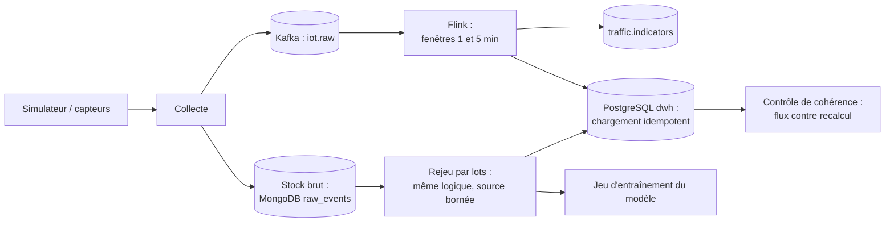

# ADR-011 — Traitement en temps réel (flux) et par lots (batch) : Apache Flink et Kafka

| Champ | Valeur |
|---|---|
| Date | 17/10/2026 |
| Statut | Acceptée sous condition : validation par le professeur de l'exigence de temps réel (B-03) |
| Décideurs | Daddy Luciano, Manoa Robel |
| Validation du professeur | À demander |
| Issues liées | MS-09, MS-10, MS-15, MS-16, DAT-09, DAT-04, DAT-05, DAT-06 |
| Compétences BC05 | Traitement de flux en temps réel, ETL (Extract, Transform, Load), Architectures décisionnelles |
| S'appuie sur | [ADR-009](ADR-009-bus-evenements.md), [ADR-014](ADR-014-architecture-decisionnelle.md) |

> **Mise à jour du 20/10/2026 ([ADR-023](ADR-023-execution-locale-d-abord.md)).** L'exécution sur AWS (service géré, ECS) est documentée, non exécutée : Flink, Kafka et les tâches par lots tournent en local dans Docker Compose.

## 1. Problème

Les alertes et les recommandations de feux perdent leur valeur si elles arrivent en retard : la **latence** compte. Dans le même temps, il faut recalculer l'historique (correction d'un défaut, entraînement du modèle, contrôle de cohérence) : un traitement **par lots** reste nécessaire. Comment organiser les deux sans écrire la logique deux fois ?

## 2. Forces de décision

| Critère | Poids |
|---|---|
| Latence de bout en bout du capteur à l'alerte | Fort |
| Exactitude des fenêtres malgré les messages tardifs ou en désordre | Fort |
| Une seule logique de calcul pour le flux et le rejeu | Fort |
| Charge d'exploitation et coût | Fort |
| Compétence du bloc BC05 (Kafka, Flink) | Moyen |

## 3. Options comparées

### 3.1 Architecture de traitement

| Option | Description | Verdict |
|---|---|---|
| A. Lots seuls | Un ETL planifié toutes les N minutes | Écartée : latence en minutes, pas de réaction rapide |
| B. Architecture Lambda | Deux chemins de code, un en flux et un par lots | Écartée : logique dupliquée, divergence des résultats |
| **C. Flux d'abord, rejeu par lots** (style Kappa) | Le journal Kafka et le stock brut sont rejouables ; le même code recalcule l'historique en mode borné | **Retenue** |

### 3.2 Moteur de flux

| Option | Avantages | Inconvénients | Verdict |
|---|---|---|---|
| **Apache Flink** (Flink SQL (Structured Query Language) / Table API (Application Programming Interface, interface de programmation) via PyFlink) | Temps d'événement, filigranes (*watermarks*), fenêtres, état avec points de contrôle, sémantique « exactement une fois » avec Kafka, même code en mode flux et en mode lot borné | Machine virtuelle Java requise, déploiement et réglage plus lourds, API Python moins riche que Java | **Retenue sous condition** |
| Spark Structured Streaming | Outil déjà prévu pour le Big Data ([ADR-016](ADR-016-big-data.md)) | Micro-lots : latence plus élevée, moins naturel pour le temps d'événement | Écartée pour le flux |
| Kafka Streams | Bibliothèque légère, sans cluster | Java ou Scala seulement | Écartée (langage) |
| Consommateur Python maison (ou bibliothèque Python de flux) | Léger, dans le service | Fenêtres, retards et état à écrire à la main | **Repli** |

Réserve assumée : le volume simulé est faible (de l'ordre de dizaines de messages par seconde). **Flink n'est pas justifié par la charge**. Il est retenu pour trois raisons : la sémantique du temps d'événement (messages tardifs et en désordre), le même code pour le flux et le rejeu, et l'exigence du bloc BC05. La montée en charge se démontre avec le simulateur à débit réglable (MS-07).

## 4. Choix

### 4.1 Chemin en flux (temps réel)

- Moteur : **Apache Flink**, écrit en **Flink SQL / Table API** (via PyFlink) autant que possible : fenêtres déclaratives (`TUMBLE`, `HOP`), moins de code Python.
- Fenêtres initiales : 1 minute (alertes) et 5 minutes (tendances).
- Gestion du retard : délai maximal d'avance désordonnée de 10 secondes, retard autorisé de 30 secondes ; au-delà, le message part vers `errors.dlq` et un compteur l'enregistre. *(Valeurs de départ, à régler par mesure sur MS-15.)*
- Garanties : points de contrôle Flink et écriture transactionnelle vers Kafka ; les écritures vers PostgreSQL et MongoDB sont **idempotentes** (clé : tronçon, début de fenêtre, taille de fenêtre, run ; voir le [dictionnaire de données](../../03-donnees/dictionnaire-de-donnees.md)).
- Exécution : en local, JobManager et TaskManager dans Docker Compose ; sur AWS (Amazon Web Services), service géré Amazon Managed Service for Apache Flink ou conteneurs sur ECS (Elastic Container Service), selon le chiffrage ([ADR-007](ADR-007-compte-aws.md)).

### 4.2 Chemin par lots

| Tâche par lots | Fréquence | Rôle |
|---|---|---|
| Recalcul des agrégats depuis le stock brut | À la demande (après correction) et chaque nuit | Rattrapage et vérité de référence |
| Contrôle de cohérence flux contre recalcul | Chaque nuit | Prouver l'exactitude du flux : l'écart est tracé et alerte au-delà d'un seuil |
| Construction du jeu d'entraînement du modèle | Avant chaque entraînement | Alimenter [ADR-015](ADR-015-modeles-ia.md) |
| Chargement ETL vers l'entrepôt | Planifié | Reprend DAT-05 ([ADR-013](ADR-013-integration-donnees.md)) |

Exécution : tâches ECS planifiées par EventBridge Scheduler en cible, une commande de `dev.py` ou le planificateur du système en local (cron sous Linux, Planificateur de tâches sous Windows). L'orchestrateur de flux de travail dédié (comme Airflow) est écarté : volume et nombre de tâches trop faibles pour justifier son exploitation.

### 4.3 Objectifs de latence (proposés, à confirmer par le professeur et à mesurer)

| Mesure | Objectif proposé |
|---|---|
| Capteur → `iot.raw` | ≤ 1 s au 95e centile (p95) |
| Fermeture d'une fenêtre → `traffic.indicators` | ≤ 2 s |
| Capteur → alerte visible au tableau de bord | ≤ 10 s en p95 hors délai de fenêtre |
| Débit soutenu en local | Au moins 10 fois le débit nominal du simulateur |

Ces valeurs sont des **hypothèses de travail**. Elles se remplacent par l'exigence formelle du professeur dès qu'elle est posée, puis par les mesures de MS-15.

## 5. Conséquences

**Positives**

- Un seul code de calcul pour le temps réel et pour le rejeu.
- La cohérence du flux se prouve par comparaison avec un recalcul par lots.
- Les messages tardifs sont traités selon des règles écrites, pas laissés au hasard.

**Compromis acceptés**

- Flink demande une machine virtuelle Java, des connecteurs Kafka à empaqueter et des points de contrôle à régler : charge d'apprentissage et d'exploitation supérieure au consommateur Python.
- Les fonctions Python personnalisées (UDF) ralentissent un job : la logique se garde en SQL autant que possible.
- Sur AWS, le moteur géré et un broker géré sont facturés à l'heure : essais courts, destruction après usage.

**Risques et parades**

| Risque | Parade |
|---|---|
| Flink prend trop de temps à mettre en place | Point de décision au 01/11/2026 avec repli prêt (consommateur Python) |
| Fenêtres incorrectes à cause de retards | Tests avec le simulateur d'anomalies (messages en retard, doublons) |
| Divergence entre flux et rejeu | Contrôle de cohérence nocturne, seuil d'alerte |
| Version de Flink ou de PyFlink incompatible avec le connecteur Kafka | Épingler les versions dans MS-06 et tester l'image en CI (Continuous Integration, intégration continue) |

## 6. Plan de repli

**Si l'exigence de temps réel n'est pas formelle ou si Flink n'est pas opérationnel au 01/11/2026** : le service de traitement utilise un consommateur Python avec fenêtres écrites dans l'adaptateur d'entrée (MS-09 le prévoit). Le domaine, les contrats et les sujets restent identiques ; l'écart est consigné dans les limites. Le prototype Flink (DAT-09) reste alors un essai documenté à part.

## 7. Vérification

- Les indicateurs par fenêtre sont publiés dans le délai défini ; les cas tardifs et aberrants sont comptés et tracés (MS-09).
- Le contrôle de cohérence nocturne montre un écart nul ou expliqué.
- Mesure de latence et de débit rejouée avec le simulateur à plusieurs débits (MS-15, MS-16).

## 8. Conditions de réexamen

- Le professeur pose une exigence de latence plus stricte ou plus lâche que les objectifs proposés.
- Le volume réel du jeu de données choisi (DAT-01) change l'ordre de grandeur.
- Le chiffrage AWS rend le moteur géré inabordable.
