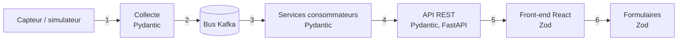

# ADR-012 — Validation des données et contrats partagés : Pydantic côté Python, Zod côté TypeScript

| Champ | Valeur |
|---|---|
| Date | 17/10/2026 |
| Statut | Acceptée |
| Décideurs | Daddy Luciano, Manoa Robel |
| Validation du professeur | Contrats d'API (Application Programming Interface, interface de programmation) et d'événements à valider (point 5 de GES-06) |
| Issues liées | BE-01, BE-06, FE-02, FE-08, MS-03, MS-08, MS-13 |
| Compétences BC05 | Documentation et spécifications techniques, ETL (Extract, Transform, Load) |
| S'appuie sur | [ADR-001](ADR-001-python-fastapi.md), [ADR-009](ADR-009-bus-evenements.md) |

## 1. Problème

Les données traversent cinq frontières : capteur → collecte, services ↔ bus d'événements, service → API REST (Representational State Transfer), API → navigateur, navigateur → utilisateur (formulaires). À chacune, une donnée mal formée (type erroné, unité différente, date sans fuseau, champ manquant) peut corrompre le calcul ou faire planter l'affichage. Le binôme veut savoir exactement à quoi s'attendre des deux côtés, backend et frontend, et normaliser les données une fois pour toutes.

Précision de cadrage : **Zod est une bibliothèque TypeScript**. Elle s'exécute dans le navigateur ou dans Node.js ; elle ne peut pas valider dans un service Python. Les services FastAPI valident déjà avec **Pydantic**, son équivalent Python. La décision porte donc sur la façon de faire dire la même chose aux deux bibliothèques.

## 2. Forces de décision

| Critère | Poids |
|---|---|
| Une seule définition du format, pas deux qui divergent | Fort |
| Échec visible et immédiat à la frontière, pas plus loin | Fort |
| Typage statique côté TypeScript lié au format réel | Fort |
| Coût de mise en place (2 personnes, 9 semaines) | Fort |
| Poids du code envoyé au navigateur | Faible |

## 3. Options comparées

| Option | Avantages | Inconvénients | Verdict |
|---|---|---|---|
| A. Pydantic côté serveur seul, types TypeScript générés | Simple | Les types TypeScript disparaissent à l'exécution : une réponse inattendue passe sans alerte jusqu'à l'affichage | Écartée |
| **B. Contrat commun OpenAPI et schéma JSON (JavaScript Object Notation) + Pydantic côté Python + Zod côté TypeScript, schémas Zod générés depuis le contrat** | Une source de vérité, validation réelle aux deux extrémités, types déduits (`z.infer`) | Une étape de génération dans la CI (Continuous Integration, intégration continue) ; deux bibliothèques à connaître | **Retenue** |
| C. Zod partout (réécrire les services en Node.js) | Une seule bibliothèque | Perd l'écosystème Python (ETL, ML (Machine Learning), Flink) ([ADR-001](ADR-001-python-fastapi.md)) | Écartée |
| D. Validation par schéma JSON seul (ajv côté TypeScript, jsonschema côté Python) | Standard, neutre | Moins ergonomique que Pydantic et Zod, pas de types déduits | Écartée comme outil principal ; le schéma JSON reste le format du contrat |
| E. Avro ou Protobuf avec registre de schémas | Compatibilité imposée par le registre, messages compacts | Registre à exploiter, outillage plus lourd | Reportée (voir conditions de réexamen) |

## 4. Choix

### 4.1 Source de vérité

```text
contracts/
  openapi/<service>.yaml     # API REST de chaque service
  events/<sujet>.schema.json # un schéma JSON par sujet d'événement
```

Les contrats sont versionnés dans Git, relus en pull request et testés en CI (MS-03).

### 4.2 Qui valide quoi



| Frontière | Validateur | Si invalide |
|---|---|---|
| 1. Capteur → collecte | Pydantic + schéma JSON de l'événement | Message vers `errors.dlq` avec le motif ; compteur de rejets |
| 2–3. Bus → consommateur | Pydantic (chaque consommateur revalide : le bus n'est pas une zone de confiance) | Rejet vers `errors.dlq` |
| 4. Requête → API | Pydantic (FastAPI) | Réponse 422 au format d'erreur unique (BE-06) |
| 5. Réponse API → front-end | **Zod** (`safeParse` à la frontière du service d'appel) | État d'erreur visible, entrée de journal ; l'écran ne plante pas |
| 6. Formulaire → front-end | **Zod** | Message de champ en français |

### 4.3 Normalisation (écrite une fois, appliquée partout)

| Règle | Valeur |
|---|---|
| Dates et heures | ISO 8601 en UTC (Coordinated Universal Time, temps universel coordonné), avec fuseau explicite |
| Unités | Vitesse en km/h, débit en véhicules par minute, taux d'occupation de 0 à 1 |
| Identifiants | Chaînes opaques (`intersection_id`, `sensor_id`), jamais des nombres devinés |
| Nombres | Valeurs bornées (par exemple vitesse entre 0 et 200) |
| Champs inconnus | Rejetés dans les entrées (mode strict), tolérés dans les sorties du contrat suivant |
| Version | `schema_version` dans chaque événement ; `/api/v1` dans chaque route |

### 4.4 Génération

- Python : les modèles Pydantic sont écrits ou générés à partir des schémas ; le test de contrat compare le `/openapi.json` produit au fichier versionné.
- TypeScript : les schémas Zod et les types sont **générés** depuis OpenAPI par un générateur choisi à FE-02 (plusieurs outils existent : orval, openapi-zod-client, hey-api). Aucun type de donnée n'est recopié à la main.

## 5. Conséquences

**Positives**

- Un changement de contrat provoque une erreur de compilation visible côté front-end (critère de FE-02) et un test en échec côté service.
- Une réponse inattendue est détectée à l'exécution au lieu d'afficher « undefined » à l'écran.
- La normalisation est écrite une fois et s'applique à l'entrée, au bus et à l'affichage.

**Compromis acceptés**

- Deux bibliothèques à maintenir en cohérence ; la génération automatique réduit le risque, elle ne l'élimine pas.
- Le parsing Zod coûte du temps de calcul : il s'applique à la frontière, une fois par réponse, pas dans les boucles d'affichage ni sur de très grandes séries (celles-ci arrivent déjà agrégées).
- Zod n'ajoute rien de sécurité côté serveur : un client malveillant contourne le navigateur. La validation serveur de Pydantic reste la seule qui protège.

**Risques et parades**

| Risque | Parade |
|---|---|
| Dérive entre contrat et code | Test de conformité en CI (MS-03) |
| Générateur Zod qui ne couvre pas un cas | Écrire le schéma à la main pour ce cas, avec test de contrat |
| Rejet excessif qui masque des données utiles | Compteur de rejets par motif, taux de rejet journalisé (DAT-04) |

## 6. Plan de repli

Si la génération de schémas Zod pose problème, les types TypeScript sont générés seuls (option A) et la validation d'exécution est écrite à la main uniquement pour les trois réponses critiques (indicateurs, alertes, état des feux).

## 7. Vérification

- Modifier un champ du contrat fait échouer la compilation du front-end et le test de conformité.
- Un message invalide est présent dans `errors.dlq` avec son motif (MS-08).
- Test de composant : une réponse volontairement mal formée affiche un état d'erreur, pas une page blanche.

## 8. Conditions de réexamen

- Plus de trois services publient des événements dont l'évolution casse des consommateurs : étudier Avro ou Protobuf avec un registre de schémas.
- Le générateur choisi n'est plus maintenu.
