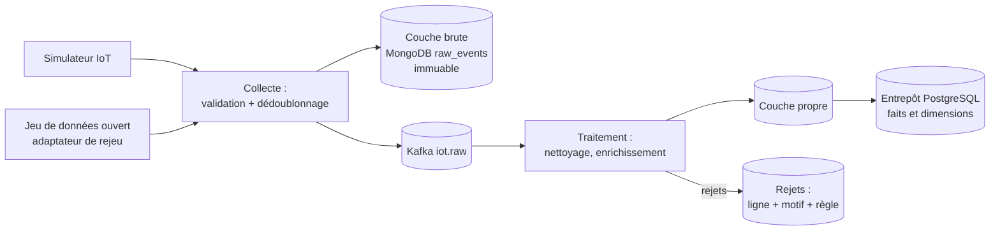

# ADR-013 — Intégration des données : ingestion, ETL (Extract, Transform, Load), qualité et rejeu

| Champ | Valeur |
|---|---|
| Date | 17/10/2026 |
| Statut | Acceptée |
| Décideurs | Daddy Luciano, Manoa Robel |
| Validation du professeur | À consigner (choix du jeu de données, point 2 de GES-06) |
| Issues liées | DAT-01, DAT-03 à DAT-06, MS-07, MS-08, MS-09, MS-10 |
| Compétences BC05 | Processus ETL et intégration de données |
| S'appuie sur | [ADR-002](ADR-002-postgresql-mongodb.md), [ADR-011](ADR-011-temps-reel-et-batch.md), [ADR-012](ADR-012-validation-contrats-zod.md) |

## 1. Problème

Des données de sources différentes (capteurs simulés, éventuellement un jeu de données ouvert) doivent devenir des indicateurs fiables. Il faut décider **comment elles entrent, comment elles sont nettoyées, ce qui est conservé tel quel, comment on prouve qu'aucune ligne n'est perdue ni comptée deux fois**, et comment l'ETL (Extract, Transform, Load, extraire-transformer-charger) s'articule avec le flux en temps réel.

## 2. Forces de décision

- Fiabilité : une ligne n'est ni perdue, ni dupliquée, ni modifiée sans trace.
- Rejouabilité : corriger une règle puis retraiter l'historique.
- Une seule chaîne pour le simulateur et pour un jeu de données ouvert (écart E-04 du registre des demandes).
- Effort limité : pas d'outil lourd à installer.
- Preuve par les tests (DAT-03 à DAT-05).

## 3. Options comparées

| Option | Avantages | Inconvénients | Verdict |
|---|---|---|---|
| **A. Python (fonctions pures + SQL (Structured Query Language)) avec chargement idempotent** | Testable, léger, même langage que les services | Pas de planificateur ni de lignée fournis | **Retenue** |
| B. ELT (Extract, Load, Transform) avec dbt dans PostgreSQL | Tests de données et lignée intégrés | Outil et concepts supplémentaires à apprendre | Reporté ; réexamen à la fin de M2 |
| C. Apache Spark pour tout | Montée en charge | Disproportionné pour le volume ([ADR-016](ADR-016-big-data.md)) | Écartée comme chaîne principale |
| D. AWS (Amazon Web Services) Glue | Géré, sans serveur | Coût, dépendance AWS, boucle de développement lente | Cible d'exécution optionnelle (DAT-06) |
| E. Airbyte, NiFi, Fivetran | Connecteurs prêts | Sans objet : sources simples, un seul jeu de données | Écartée |

## 4. Choix

### 4.1 Une chaîne, deux sources

Le jeu de données ouvert (s'il est retenu en DAT-01) est **rejoué comme s'il était émis par des capteurs** : un adaptateur lit l'historique et envoie les mêmes messages au service de collecte. Le simulateur (MS-07) et le jeu ouvert empruntent donc la même chaîne, avec le même contrat.

### 4.2 Couches de données

| Couche | Contenu | Règle |
|---|---|---|
| Brute | Message tel que reçu, après validation de forme | Écrite une fois, jamais modifiée, conservation limitée par index TTL (Time To Live, durée de vie) |
| Propre | Données typées, bornées, dédoublonnées, enrichies par le référentiel des carrefours | Reconstruite à volonté depuis la couche brute |
| Entrepôt | Faits et dimensions ([ADR-014](ADR-014-architecture-decisionnelle.md)) | Chargement incrémental idempotent |
| Rejets | Ligne d'origine, règle violée, horodatage | Comptés et consultables |

### 4.3 Règles de qualité (DAT-04)

| Règle | Exemple | Sort d'une ligne qui échoue |
|---|---|---|
| Type | Vitesse numérique | Rejet avec motif `type` |
| Borne | Vitesse entre 0 et 200 km/h | Rejet `borne` |
| Doublon | Même `id` d'événement | Ignorée, comptée |
| Valeur manquante | Débit absent | Rejet ou imputation documentée, jamais silencieuse |
| Fraîcheur | Capteur muet depuis N minutes | Signal d'état du capteur, pas un rejet |
| Cohérence | Horodatage dans le futur | Rejet `horloge` |

Mise en œuvre pour le comptage routier de Paris (DAT-04) : sept règles, codes `MISSING_REQUIRED`, `TYPE_INVALID`, `OUT_OF_RANGE`, `NOT_ON_THE_HOUR`, `FUTURE_TIMESTAMP`, `STATE_MISMATCH` et `DUPLICATE_KEY`, motifs et chiffres observés dans [le nettoyage de Paris](../../03-donnees/nettoyage-paris.md). Écart assumé : un doublon est écrit comme un rejet `DUPLICATE_KEY` (la première ligne est gardée) au lieu d'être seulement compté.

### 4.4 Garanties

- **Idempotence** : clé naturelle (`event_id`, ou carrefour + début de fenêtre + taille) et écriture par « insérer ou mettre à jour » ; rejouer un chargement ne change pas les totaux (critère de DAT-05).
- **Réconciliation** : à chaque exécution, `lignes lues = lignes chargées + lignes rejetées + doublons ignorés` ; l'écart déclenche une alerte.
- **Lignée** : chaque ligne de l'entrepôt porte l'identifiant d'exécution et la source.
- **Évolution de schéma** : colonnes ajoutées en deux temps (ajouter, migrer, retirer), versions des schémas d'événement ([ADR-012](ADR-012-validation-contrats-zod.md)).
- **Données personnelles** : aucune donnée personnelle dans les flux ; la licence du jeu ouvert est vérifiée avant usage (DAT-01).

### 4.5 Exécution

| Contexte | Mécanisme |
|---|---|
| Flux continu | Service de traitement ([ADR-011](ADR-011-temps-reel-et-batch.md)) |
| Lots et rattrapage | Tâches Python planifiées (EventBridge Scheduler et ECS (Elastic Container Service) en cible ; une commande de `dev.py` ou le planificateur du système en local) |
| AWS Glue (DAT-06) | Même logique empaquetée, exécution comparée au local : mêmes totaux exigés |

## 5. Conséquences

**Positives**

- Tout est rejouable depuis la couche brute.
- La réconciliation chiffre ce qui est perdu, rejeté ou dupliqué.
- Changer de source de données ne change pas la chaîne.

**Compromis acceptés**

- Écrire soi-même la planification et la lignée (limites légères) plutôt que s'appuyer sur un outil dédié.
- Stocker trois copies d'une même donnée (brute, propre, entrepôt) : espace supplémentaire contre traçabilité.

**Risques et parades**

| Risque | Parade |
|---|---|
| Règle trop stricte qui rejette des données valables | Taux de rejet par règle journalisé ; seuil d'alerte |
| Rejeu qui modifie des totaux | Test d'idempotence en CI (Continuous Integration, intégration continue) |
| Jeu ouvert dont la licence interdit l'usage | Vérification de licence avant adoption (DAT-01) |

## 6. Plan de repli

Si le jeu ouvert est inadapté (risque R2), le simulateur calibré sur des profils horaires documentés devient la seule source ; la chaîne ne change pas. Si Glue dépasse le budget, l'exécution reste locale et DAT-06 est documentée comme non réalisée.

## 7. Vérification

- Le script d'ingestion s'exécute deux fois sans doublon (DAT-03).
- Chaque règle de qualité a un test ; le taux de rejet est journalisé (DAT-04).
- Rejouer le chargement ne change pas les totaux (DAT-05).
- Le test de réconciliation passe sur un jeu contenant des anomalies injectées (MS-07).

## 8. Conditions de réexamen

- Le nombre de transformations SQL grandit au point de justifier dbt.
- Le volume du jeu choisi impose un moteur distribué.
