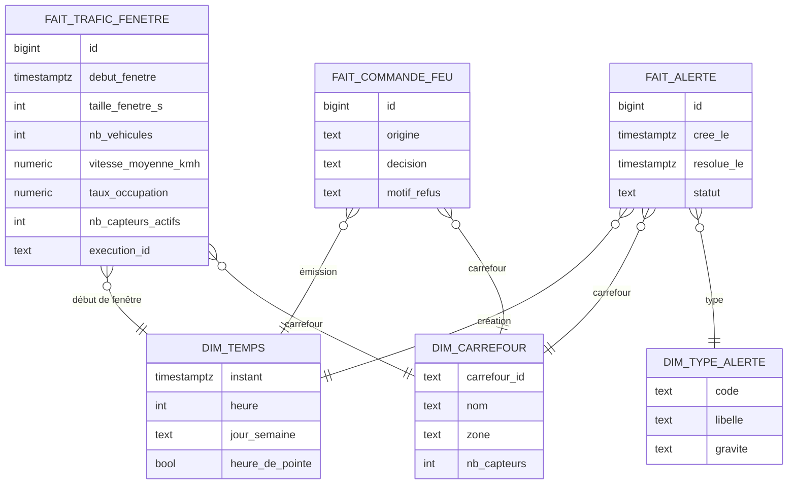
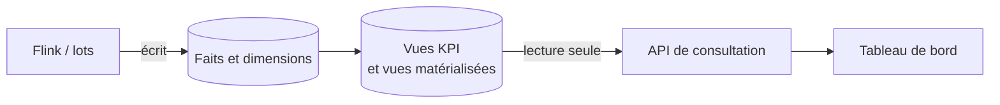
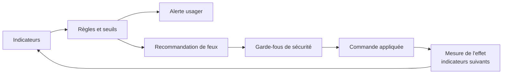

# ADR-014 — Architecture décisionnelle : entrepôt en étoile PostgreSQL, indicateurs et séparation écriture/lecture

| Champ | Valeur |
|---|---|
| Date | 17/10/2026 |
| Statut | Acceptée |
| Décideurs | Daddy Luciano, Manoa Robel |
| Validation du professeur | À consigner (définition des indicateurs) |
| Issues liées | DAT-02, DAT-05, DAT-07, BE-04, MS-10, FE-04 |
| Compétences BC05 | Architectures de données décisionnelles, Processus décisionnels et modèles de données |
| S'appuie sur | [ADR-002](ADR-002-postgresql-mongodb.md), [ADR-013](ADR-013-integration-donnees.md) |

## 1. Problème

Les données collectées n'aident à décider que si elles sont organisées pour être interrogées : indicateurs fiables, historique, comparaison dans le temps. Il faut choisir le modèle de l'entrepôt, le moteur, la façon de servir les indicateurs et la façon de relier un indicateur à une décision (alerte, recommandation de feux).

## 2. Forces de décision

- Modèle simple à expliquer et à interroger (SQL).
- Une définition unique par indicateur.
- Lecture rapide pour le tableau de bord sans ralentir l'écriture du flux.
- Coût AWS (Amazon Web Services) faible.

## 3. Options comparées

### 3.1 Modèle

| Option | Avantages | Inconvénients | Verdict |
|---|---|---|---|
| **Étoile (faits et dimensions)** | Lisible, standard de l'analytique, jointures simples | Dénormalisation, modélisation initiale | **Retenue** |
| Flocon (dimensions normalisées) | Moins de redondance | Jointures plus nombreuses | Écartée |
| Tables plates par indicateur | Rapide à écrire | Redondance, définitions dispersées | Écartée |

### 3.2 Moteur

| Option | Avantages | Inconvénients | Verdict |
|---|---|---|---|
| **PostgreSQL, schéma `dwh` (même instance que le métier)** | Déjà présent, coût nul de plus, partitionnement natif, vues matérialisées | Ne passe pas à l'échelle massive | **Retenue** |
| Amazon Redshift | Entrepôt colonne géré | Coût fixe élevé pour un volume simulé | Écartée |
| S3 (Simple Storage Service) + Athena | Économique, sans serveur | Latence, outillage supplémentaire | Complément éventuel ([ADR-016](ADR-016-big-data.md)) |
| ClickHouse ou extension de séries temporelles | Très rapide sur séries | Composant supplémentaire à exploiter | Écartée |

## 4. Choix

### 4.1 Modèle en étoile

Grain des faits : **un carrefour × une fenêtre de temps × une taille de fenêtre**.

- Dimensions de type 1 (écrasement) au départ ; `dim_carrefour` passe en type 2 (historique avec dates de validité) si la configuration d'un carrefour évolue pendant le projet.
- Faits partitionnés par mois ; index sur la dimension temps et le carrefour.

### 4.2 Indicateurs (définition finale dans DAT-07)

Un indicateur = une définition écrite, une vue SQL, un point d'accès d'API (Application Programming Interface, interface de programmation), un test de recalcul.

| Indicateur proposé | Source | Décision qu'il éclaire | Limite connue |
|---|---|---|---|
| Minutes de congestion par carrefour et par jour | `fait_trafic_fenetre` | Où ajuster les plans de feux | Seuils de congestion arbitraires, à justifier |
| Vitesse moyenne par rapport à la référence horaire | `fait_trafic_fenetre` | Détecter une dégradation | Référence calculée sur peu de jours |
| Délai moyen de résolution d'une alerte | `fait_alerte` | Qualité de la réponse | Sensible aux alertes ouvertes |
| Part de capteurs muets | `fait_trafic_fenetre` | Fiabilité du réseau de capteurs | Dépend de la règle de silence |
| Taux de rejet de qualité | Couche des rejets ([ADR-013](ADR-013-integration-donnees.md)) | Confiance dans les chiffres | Dépend des règles de nettoyage |

> **Définition finale (DAT-07, 30/10/2026).** Cinq indicateurs, dont les quatre de congestion demandés par l'issue #61, sont définis dans [`docs/03-donnees/kpi.md`](../../03-donnees/kpi.md) avec leurs vues SQL (`data/dwh/sql/kpi/`) et un recalcul indépendant sur les sources. Trois propositions du tableau ci-dessus ne sont pas retenues (délai de résolution, part de capteurs muets, taux de rejet) : raisons dans la section 5 de la fiche. Les vues matérialisées ne sont pas introduites : à ce volume, des vues simples suffisent.

### 4.3 Séparation écriture / lecture (CQRS)

Le **pipeline** écrit dans les faits ; l'**API de consultation** lit des vues (ou vues matérialisées rafraîchies par le pipeline) en lecture seule. Le tableau de bord ne lit jamais les tables d'écriture.

### 4.4 Du chiffre à la décision

## 5. Conséquences

**Positives**

- Une définition d'indicateur = une requête vérifiable : « chaque indicateur se recalcule à partir de la source annoncée » (DAT-07).
- Le tableau de bord reste fluide quand le pipeline charge.
- Le cycle indicateur → décision → effet est documenté et mesurable.

**Compromis acceptés**

- Un entrepôt dans la même instance PostgreSQL que le métier partage ses ressources ; au-delà d'un seuil de charge, une instance dédiée est nécessaire.
- La fraîcheur des vues matérialisées dépend de leur rafraîchissement.
- Limite d'échelle assumée : l'entrepôt sert un volume simulé, pas un volume métropolitain.

**Risques et parades**

| Risque | Parade |
|---|---|
| Indicateurs mal définis, donc débats sans fin | Fiche par indicateur : source, formule, limites ; relecture croisée |
| Requêtes lentes | Partitionnement, index, vues matérialisées ; mesures dans MS-16 |
| Résultats différents entre flux et recalcul | Contrôle de cohérence nocturne ([ADR-011](ADR-011-temps-reel-et-batch.md)) |

## 6. Plan de repli

Si une requête dépasse l'objectif malgré les optimisations, déplacer l'historique ancien vers S3 (Parquet) et l'interroger avec Athena, en gardant dans PostgreSQL la fenêtre récente. Les vues exposées à l'API ne changent pas.

## 7. Vérification

- Les scripts SQL créent le schéma `dwh` sur une base vide (DAT-02).
- Les valeurs servies par l'API sont identiques à un recalcul SQL de référence sur un jeu de test (MS-10).
- Chaque indicateur a sa fiche dans `docs/03-donnees/kpi.md`.

## 8. Conditions de réexamen

- Un indicateur demandé exige un grain plus fin que la fenêtre d'une minute.
- Le volume dépasse ce que supporte l'instance partagée.
