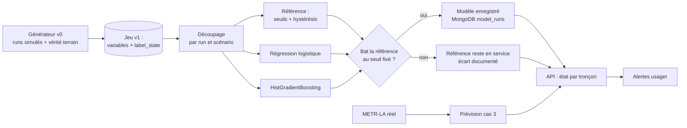

# ADR-015 — Modèles d'intelligence artificielle pour l'analyse du trafic : la congestion d'abord, la prévision ensuite

| Champ | Valeur |
|---|---|
| Date | 17/10/2026, réécrite le 20/10/2026 (la version du 17/10, statut « Proposée », donnait la prévision en premier) |
| Statut | Proposée : choix fondé sur le cadrage ML (IA-01) à écrire avant tout entraînement |
| Décideurs | Manoa Robel (responsable de l'intelligence artificielle), Daddy Luciano (relecture) |
| Validation du professeur | À consigner (niveau Machine Learning : Implémenté ou Prototype, point 1 de GES-06) |
| Issues liées | IA-01, IA-02, IA-03, IA-06, IA-08, IA-09, IA-10, IA-11, MS-10, MS-11, MS-12 |
| Compétences BC05 | Machine Learning et modélisation des données |
| S'appuie sur | [ADR-014](ADR-014-architecture-decisionnelle.md), [ADR-027](ADR-027-jeux-de-donnees-et-provenance.md), [ADR-028](ADR-028-etats-de-congestion-et-alertes.md) ; complété par [ADR-017](ADR-017-mlops-mlsecops.md) |

## 1. Problème

L'IA (Intelligence Artificielle) apporte-t-elle de la valeur à Novaria Core, où, dans quel ordre, et avec quels modèles ? La question appelle une réponse mesurable : un modèle qui ne bat pas une règle simple n'a pas sa place.

Ce qui a changé depuis la version du 17/10 : le produit repose sur **l'état de circulation d'un tronçon** (fluide, ralenti, congestionné) et sur les **alertes** qui en découlent ([ADR-028](ADR-028-etats-de-congestion-et-alertes.md)). Le premier usage de l'IA est donc de reconnaître cet état, pas de prévoir une vitesse. La prévision vient en second, sur des données réelles quand elles existent.

## 2. Forces de décision

| Critère | Poids |
|---|---|
| Valeur démontrable face à une référence simple | Fort |
| Sécurité : un modèle ne commande jamais seul un équipement | Fort |
| Explicabilité devant le professeur | Fort |
| Réponse connue et vérifiable (vérité terrain) | Fort |
| Temps disponible (jalon M4, 5 semaines après le début) | Fort |
| Volume de données simulé modeste | Moyen |

## 3. Options comparées : cas d'usage et ordre

### 3.1 Quatre cas d'usage

| N° | Cas d'usage | Objectif | Approche retenue | Alternatives écartées |
|---|---|---|---|---|
| **1** | **État de congestion d'un tronçon** (cible de IA-01) | Dire si un tronçon est fluide, ralenti ou congestionné, vite et sans clignoter | Règle de seuils avec hystérésis en **référence** ; modèles comparés en 3.2 | Réseau de neurones : peu de données, faible explicabilité |
| **2** | **Anomalie de capteur ou de circulation** (IA-09) | Repérer un capteur défaillant, une valeur aberrante, une chute de débit inexpliquée | Règles robustes (écart à la médiane glissante, silence) d'abord ; *Isolation Forest* en comparaison | Autoencodeur : disproportionné |
| **3** | **Prévision de vitesse à court terme** (IA-10) | Anticiper la vitesse sur les 15 à 60 prochaines minutes | Modèles comparés en 3.3, entraînés sur un **jeu réel ouvert** (METR-LA) et testés sur le simulateur | Réseaux récurrents ou Transformer : coût de réglage, explicabilité |
| **4** | **Recommandation de plan de feux** | Proposer des durées de phases | Calcul déterministe de référence (formule de Webster pour la durée de cycle) ; le score du cas 1 ou 3 n'est qu'une entrée ; **toujours soumis aux garde-fous** ([ADR-008](ADR-008-microservices.md)) | Apprentissage par renforcement : fidélité du simulateur insuffisante, risque de sécurité |

Pourquoi la congestion avant la prévision :

| Raison | Détail |
|---|---|
| La réponse est connue | Le simulateur sait quand un tronçon est congestionné (vérité terrain) : l'évaluation est honnête, sans dépendre d'un calcul de seuil |
| Le produit en dépend | L'alerte usager part d'un état, pas d'une vitesse future |
| Le risque est borné | Une règle de seuils fonctionne dès le premier jour et reste la solution de repli |
| La prévision gagne à attendre | Elle a besoin de longues séries ; le jeu réel METR-LA les fournit, le simulateur v0 non |

### 3.2 Congestion (cas 1) : modèles comparés

| Rang | Modèle | Rôle |
|---|---|---|
| Référence 1 | Seuils sur le ratio de vitesse avec hystérésis ([ADR-028](ADR-028-etats-de-congestion-et-alertes.md)) | Seuil à battre ; solution de repli en service |
| Candidat 1 | Régression logistique multiclasse sur variables du jeu v1 | Modèle simple et explicable |
| Candidat 2 | Gradient boosting sur arbres (HistGradientBoosting de scikit-learn) | Modèle non linéaire robuste |
| Optionnel | Forêt aléatoire | Comparaison si le temps le permet |

Évaluation (IA-02, IA-03) :

| Mesure | Pourquoi |
|---|---|
| F1 macro et rappel de la classe CONGESTED | Les classes sont déséquilibrées : la précision globale masquerait l'échec sur la congestion |
| Matrice de confusion | Voir quelles confusions coûtent (ralenti pris pour fluide, congestionné pour ralenti) |
| **Délai de détection** (minutes entre le début réel et l'état annoncé) | C'est ce que l'usager ressent |
| **Fausses alertes par tronçon et par jour** | Une alerte qui crie au loup est abandonnée |

Découpage **par run et par scénario**, jamais par lignes tirées au hasard ([dictionnaire de données](../../03-donnees/dictionnaire-de-donnees.md), section 9) ; seuil d'acceptation fixé **avant** l'entraînement dans `docs/06-ia-mlops/cadrage-ml.md`.

### 3.3 Prévision (cas 3) : modèles comparés

| Rang | Modèle | Rôle |
|---|---|---|
| Référence 1 | Persistance (dernière valeur) et moyenne glissante | Seuil à battre |
| Référence 2 | Naïf saisonnier (même heure la veille ou la semaine précédente) | Seuil plus exigeant pour des données à profil horaire |
| Candidat 1 | Régression linéaire régularisée (Ridge) sur variables décalées et calendaires | Modèle simple et explicable |
| Candidat 2 | HistGradientBoosting | Modèle non linéaire robuste |
| Optionnel | SARIMAX (modèle statistique de séries temporelles) | Comparaison si le temps le permet |

Découpage dans l'ordre du temps (`TimeSeriesSplit`), métriques MAE (Mean Absolute Error, erreur absolue moyenne) et RMSE (Root Mean Square Error, racine de l'erreur quadratique moyenne) par horizon (5, 15, 30 minutes).

## 4. Choix

1. **Cas 1 d'abord** : le projet livre la reconnaissance de l'état de congestion, avec la règle de seuils en référence et au plus deux modèles candidats.
2. **Cas 2 ensuite**, par règles ; *Isolation Forest* en comparaison si le temps le permet.
3. **Cas 3 en dernier** : la prévision s'entraîne sur le jeu réel METR-LA (vitesses seules, historique ouvert) et se **teste** aussi sur un run simulé pour montrer la chaîne complète ; elle ne s'entraîne pas sur du simulé seul.
4. **Cas 4 déterministe** : aucune décision de commande ne dépend d'un modèle sans passer par les garde-fous et le mode dégradé.
5. Pas de grand modèle de langage (LLM, Large Language Model) dans le produit : hors périmètre.
6. Entraînement sur CPU (Central Processing Unit, processeur) **en local** ([ADR-023](ADR-023-execution-locale-d-abord.md)) ; l'entraînement sur SageMaker reste documenté, non exécuté ([ADR-025](ADR-025-equivalents-locaux-des-services-aws.md)).
7. Données : générateur Python v0 d'abord, SUMO (Simulation of Urban MObility) seulement si le v0 est livré et le temps le permet (IA-11) ; la provenance de chaque jeu est tracée ([ADR-027](ADR-027-jeux-de-donnees-et-provenance.md)).

## 5. Conséquences

**Positives**

- Un résultat présentable même si le modèle ne gagne pas : l'honnêteté de la comparaison fait la valeur.
- La vérité terrain du simulateur permet une évaluation qui ne se contente pas de recopier la règle.
- Des modèles simples, entraînables en quelques minutes, explicables par l'importance des variables.
- La sécurité de la commande des feux ne dépend pas d'un modèle.

**Compromis acceptés**

- **Limite de validité** : un modèle entraîné sur le simulateur apprend le simulateur. Le résultat prouve la chaîne (données → modèle → service → surveillance), pas la précision en conditions réelles ; le rapport l'écrit en toutes lettres. Le jeu réel (METR-LA) ne contient que des vitesses : il sert la prévision, pas la reconnaissance de l'état.
- Pas de réseau profond : choix assumé au nom de l'explicabilité et du volume.
- La détection par règles est moins sensible qu'un modèle sur des anomalies subtiles.
- La licence et les conditions de redistribution du jeu METR-LA se vérifient avant tout usage (fiche de provenance).

**Risques et parades**

| Risque | Parade |
|---|---|
| Modèle sans valeur démontrée (risque R4) | Référence servie ; documentation du résultat négatif |
| Modèle qui apprend la règle de seuils qui a produit le label | Label = vérité terrain du simulateur, pas la sortie du classificateur |
| Fuite d'information entre lignes voisines | Découpage par run et par scénario, testé (IA-02) |
| Dérive des données | Surveillance de distribution ([ADR-017](ADR-017-mlops-mlsecops.md)) |
| Modèle qui influence une commande dangereuse | Garde-fous et mode dégradé du service de réponse |

## 6. Plan de repli

Si l'entraînement n'aboutit pas à temps, la **règle de seuils avec hystérésis** est servie comme classificateur (indication « modèle de référence » dans la réponse de l'API (Application Programming Interface, interface de programmation)) et le pipeline MLOps est démontré avec elle. Pour la prévision, la persistance ou la moyenne glissante est servie par `GET /api/v1/forecasts`.

## 7. Vérification

- Le cadrage ML est écrit et daté avant le premier entraînement (IA-01).
- Le découpage par run est testé et reproductible (IA-02).
- Le tableau comparatif et le choix argumenté sont dans `ml/evaluation/` (IA-03).
- Chaque entraînement laisse un document `model_runs` (version du code, empreinte du jeu de données, graine, métriques).

## 8. Conditions de réexamen

- Le professeur retient le niveau « Prototype » pour le Machine Learning.
- Un jeu réel avec comptages remplace le simulateur : refaire l'évaluation complète.
- Le générateur v0 ne produit pas de congestion réaliste : passer à SUMO (IA-11).
