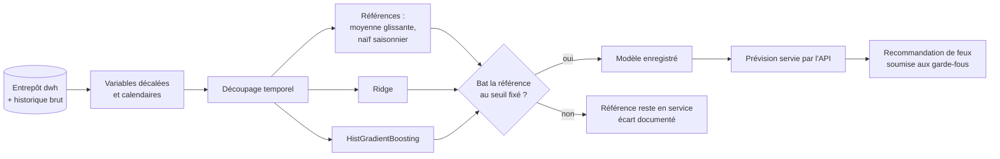

# ADR-015 — Modèles d'intelligence artificielle pour l'analyse du trafic

| Champ | Valeur |
|---|---|
| Date | 17/10/2026 |
| Statut | Proposée : choix fondé sur le cadrage ML (IA-01) à écrire avant tout entraînement |
| Décideurs | Manoa Robel (responsable de l'intelligence artificielle), Daddy Luciano (relecture) |
| Validation du professeur | À consigner (niveau Machine Learning : Implémenté ou Prototype, point 1 de GES-06) |
| Issues liées | IA-01, IA-02, IA-03, IA-06, MS-10, MS-11, MS-12 |
| Compétences BC05 | Machine Learning et modélisation des données |
| S'appuie sur | [ADR-014](ADR-014-architecture-decisionnelle.md) ; complété par [ADR-017](ADR-017-mlops-mlsecops.md) |

## 1. Problème

L'IA (Intelligence Artificielle) apporte-t-elle de la valeur à Novaria Core, où, et avec quels modèles ? La question appelle une réponse mesurable : un modèle qui ne bat pas une règle simple n'a pas sa place.

## 2. Forces de décision

| Critère | Poids |
|---|---|
| Valeur démontrable face à une référence simple | Fort |
| Sécurité : un modèle ne commande jamais seul un équipement | Fort |
| Explicabilité devant le professeur | Fort |
| Volume de données simulé modeste | Fort |
| Temps disponible (jalon M4, 5 semaines après le début) | Fort |

## 3. Options comparées : cas d'usage et modèles

### 3.1 Trois cas d'usage

| Cas d'usage | Objectif | Approche retenue | Alternatives écartées |
|---|---|---|---|
| **A. Prévision de trafic à court terme** (cible de IA-01) | Anticiper débit et vitesse par carrefour sur les 15 à 60 prochaines minutes | Modèles comparés : voir 3.2 | Réseaux de neurones récurrents ou Transformer : peu de données, faible explicabilité, coût de réglage |
| **B. Détection d'anomalie de capteur** | Repérer un capteur défaillant ou une valeur aberrante | Règles robustes (écart à la médiane glissante, absence de message) d'abord ; *Isolation Forest* en comparaison | Autoencodeur : disproportionné |
| **C. Recommandation de plan de feux** | Proposer des durées de phases | Calcul déterministe de référence (formule de Webster pour la durée de cycle) ; score du modèle A comme entrée ; **toujours soumis aux garde-fous** ([ADR-008](ADR-008-microservices.md)) | Apprentissage par renforcement : fidélité du simulateur insuffisante et risque de sécurité |

### 3.2 Prévision (cas A) : modèles comparés

| Rang | Modèle | Rôle |
|---|---|---|
| Référence 1 | Moyenne glissante (cadrage IA-01) | Seuil à battre |
| Référence 2 | Naïf saisonnier (même heure la veille ou la semaine précédente) | Seuil plus exigeant pour des données à profil horaire |
| Candidat 1 | Régression linéaire régularisée (Ridge) sur variables décalées et calendaires | Modèle simple et explicable |
| Candidat 2 | Gradient boosting sur arbres (HistGradientBoosting de scikit-learn) | Modèle non linéaire robuste |
| Optionnel | Forêt aléatoire, modèle statistique de séries temporelles (SARIMAX) | Comparaison si le temps le permet |

Évaluation (IA-02, IA-03) :

- découpage **dans l'ordre du temps** (entraînement / validation / test) et validation croisée temporelle (`TimeSeriesSplit`), aucune fuite d'information du futur ;
- métriques : erreur absolue moyenne (MAE, Mean Absolute Error) et racine de l'erreur quadratique moyenne (RMSE) ; éviter l'erreur en pourcentage quand les valeurs approchent zéro ;
- **seuil d'acceptation fixé avant l'entraînement** dans `docs/06-ia-mlops/cadrage-ml.md` ; si le meilleur modèle ne bat pas les références, l'écart est documenté et la référence reste en service (résultat honnête, pas un échec du projet).

## 4. Choix

1. Le projet livre la **prévision** (cas A) avec scikit-learn, des références simples et un seul modèle retenu, plus la **détection d'anomalie par règles** (cas B) avec *Isolation Forest* en comparaison.
2. La **recommandation de feux** (cas C) reste déterministe ; le modèle de prévision n'est qu'une entrée parmi d'autres. Aucune décision de commande ne dépend d'un modèle sans passer par les garde-fous et le mode dégradé.
3. Pas de grand modèle de langage (LLM, Large Language Model) dans le produit : hors périmètre.
4. Entraînement sur CPU (Central Processing Unit, processeur) en local ; SageMaker uniquement comme démonstration AWS (Amazon Web Services) si le plafond de dépense le permet ([ADR-007](ADR-007-compte-aws.md), [ADR-017](ADR-017-mlops-mlsecops.md)).

## 5. Conséquences

**Positives**

- Un résultat présentable même si le modèle ne gagne pas : l'honnêteté de la comparaison fait la valeur.
- Des modèles simples, entraînables en quelques minutes, explicables par l'importance des variables.
- La sécurité de la commande des feux ne dépend pas d'un modèle.

**Compromis acceptés**

- **Limite de validité** : les données sont simulées. Un modèle entraîné sur le simulateur apprend le simulateur ; le résultat prouve la chaîne (données → modèle → service → surveillance), pas la précision en conditions réelles. Le rapport l'écrit en toutes lettres. Pour réduire l'écart, le simulateur est calibré sur un jeu ouvert si DAT-01 en retient un (des jeux publics de trafic routier existent, comme PeMS ou METR-LA, à confirmer pour la licence).
- Pas de réseau profond : choix assumé au nom de l'explicabilité et du volume.
- La détection par règles est moins sensible qu'un modèle sur des anomalies subtiles.

**Risques et parades**

| Risque | Parade |
|---|---|
| Modèle sans valeur démontrée (risque R4) | Comparaison à deux références ; documentation du résultat négatif |
| Fuite d'information du futur | Découpage temporel testé (IA-02) |
| Dérive des données | Surveillance de distribution ([ADR-017](ADR-017-mlops-mlsecops.md)) |
| Modèle qui influence une commande dangereuse | Garde-fous et mode dégradé du service de réponse |

## 6. Plan de repli

Si l'entraînement n'aboutit pas à temps, la **référence** (moyenne glissante ou naïf saisonnier) est servie par l'endpoint `GET /api/v1/forecasts` avec l'indication « modèle de référence » ; le pipeline MLOps est démontré avec cette référence comme « modèle ».

## 7. Vérification

- Le cadrage ML est écrit et daté avant le premier entraînement (IA-01).
- Le découpage temporel est testé et reproductible (IA-02).
- Le tableau comparatif et le choix argumenté sont dans `ml/evaluation/` (IA-03).

## 8. Conditions de réexamen

- Le professeur retient le niveau « Prototype » pour le Machine Learning.
- Un jeu de données réel remplace le simulateur : refaire l'évaluation complète.
