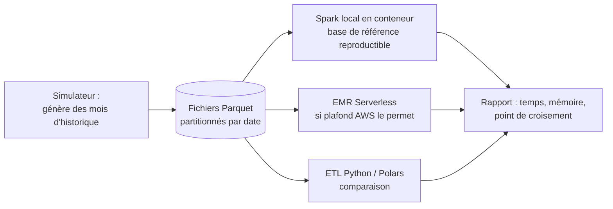

# ADR-016 — Big Data : prototype Apache Spark, sans cluster Hadoop

| Champ | Valeur |
|---|---|
| Date | 17/10/2026 |
| Statut | Proposée : brique à arbitrer avec le professeur (B-07 du registre des demandes) |
| Décideurs | Daddy Luciano, Manoa Robel |
| Validation du professeur | À demander (niveau « Prototype ciblé ») |
| Issues liées | DAT-08, DAT-05, CLD-11, GES-09 |
| Compétences BC05 | Big Data et traitement massif (Hadoop, Spark) |
| S'appuie sur | [ADR-002](ADR-002-postgresql-mongodb.md), [ADR-013](ADR-013-integration-donnees.md) |

> **Mise à jour du 20/10/2026 ([ADR-023](ADR-023-execution-locale-d-abord.md)).** Le prototype Spark s'exécute en mode local (PySpark) ; le traitement sur EMR (Elastic MapReduce) est documenté, non exécuté ([ADR-025](ADR-025-equivalents-locaux-des-services-aws.md)).

## 1. Problème

Le bloc BC05 cite Hadoop et Spark. Le volume simulé de Novaria Core (dizaines de messages par seconde) ne **nécessite** pas de traitement massif. Faut-il quand même une brique Big Data, laquelle, et que démontre-t-elle réellement ?

## 2. Forces de décision

- Respect du référentiel BC05 sans gonfler le périmètre.
- Honnêteté : ne pas prétendre qu'un besoin de Big Data existe.
- Coût AWS (Amazon Web Services) contenu (pas de cluster laissé actif).
- Priorité P1 : jamais au détriment du parcours de bout en bout.

## 3. Options comparées

| Option | Avantages | Inconvénients | Verdict |
|---|---|---|---|
| A. Aucune brique Big Data | Aucun coût | Compétence BC05 non couverte | Écartée |
| B. Cluster Hadoop (HDFS + YARN (Yet Another Resource Negotiator)) | Fidèle au sens littéral du référentiel | Technologie historique, exploitation lourde, hors budget | Écartée |
| **C. Apache Spark (PySpark) sur fichiers Parquet, stockage S3 (Simple Storage Service) à la place de HDFS** | Moteur de référence du traitement distribué, même langage Python, S3 remplace HDFS | Hadoop n'est démontré qu'au niveau des concepts | **Retenue** |
| D. Spark sur Amazon EMR (cluster EC2 (Elastic Compute Cloud)) | Fidèle à la proposition initiale | Un cluster à démarrer et à arrêter, coût horaire | Écartée au profit de E |
| **E. EMR Serverless** | Pas de cluster à arrêter, facturation à l'usage | Compte AWS requis, configuration IAM (Identity and Access Management) propre | **Cible AWS préférée** (variante de DAT-08) |
| F. AWS Glue (Spark géré) | Déjà prévu pour l'ETL (DAT-06) | Mêmes limites de coût | Alternative |
| G. Polars ou Dask sur un poste | Très rapide à ce volume | Ne démontre pas Spark | Utilisé comme **point de comparaison** |

## 4. Choix

**Prototype ciblé** (non intégré au parcours principal) :

1. Générer un historique volumineux avec le simulateur (le volume est choisi pour que l'ETL Python devienne mesurablement lent).
2. Calculer les mêmes agrégats avec PySpark (local en conteneur) et avec l'ETL Python ou Polars.
3. Si le plafond de dépense le permet ([ADR-007](ADR-007-compte-aws.md)), exécuter une fois sur EMR Serverless, noter durée et coût réels, puis supprimer l'application.
4. Rédiger le rapport : **ce que le prototype démontre, ce qu'il ne démontre pas**.

## 5. Conséquences

**Positives**

- La compétence Spark est démontrée par un résultat mesuré et reproductible en local.
- Aucun cluster à surveiller ni à oublier.

**Compromis acceptés**

- Le rapport indiquera sans détour que, à ce volume, l'ETL Python ou Polars suffit et peut être plus rapide : le prototype établit la maîtrise de l'outil et un **point de croisement** estimé, pas un besoin de Big Data.
- Hadoop n'est pas déployé ; HDFS est remplacé par S3 et YARN par le planificateur du service géré. L'écart avec le référentiel est consigné dans la matrice de preuves BC05 (DOC-08).
- Plusieurs dépendances lourdes (JVM, Spark, connecteur S3) pèsent sur les images et la CI (Continuous Integration, intégration continue) : le prototype vit dans son propre dossier `data/bigdata/` et son image dédiée, hors des quatre services.

**Risques et parades**

| Risque | Parade |
|---|---|
| Coût EMR imprévu | EMR Serverless, durée plafonnée, budget d'alerte, suppression immédiate |
| Temps consommé au détriment du parcours principal | P1 : démarre après le parcours de bout en bout ; abandonné si M4 glisse |
| Conclusion mal interprétée | Rapport structuré « démontre / ne démontre pas » |

## 6. Plan de repli

Spark local en conteneur seulement : le rapport inclut les mesures locales et décrit l'exécution EMR comme non réalisée (avec le script Terraform ou la commande prête).

## 7. Vérification

- Les agrégats Spark et Python sont identiques sur le même jeu (totaux comparés).
- Le rapport `docs/03-donnees/prototype-bigdata.md` contient mesures, limites et coût.
- Aucune application EMR n'existe après l'essai (revue de la console, CLD-21).

## 8. Conditions de réexamen

- Le professeur impose un niveau « Implémenté » pour Big Data.
- Le jeu de données retenu (DAT-01) est volumineux de manière réelle.
