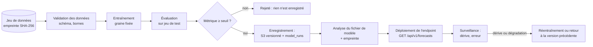

# ADR-017 — MLOps et MLSecOps : pipeline de modèles sûr et traçable

| Champ | Valeur |
|---|---|
| Date | 17/10/2026 |
| Statut | Proposée |
| Décideurs | Manoa Robel (responsable de l'intelligence artificielle), Daddy Luciano (relecture) |
| Validation du professeur | À consigner (niveau MLOps, point 1 de GES-06) |
| Issues liées | IA-04, IA-05, IA-06, DAT-02, CLD-09, CLD-19 |
| Compétences BC05 | Gestion et déploiement des pipelines MLOps, Machine Learning |
| S'appuie sur | [ADR-015](ADR-015-modeles-ia.md), [ADR-018](ADR-018-devsecops.md) |

## 1. Problème

Un modèle n'est utile que s'il est **reproductible**, **tracé jusqu'à ses données et son code**, **déployé sans surprise** et **surveillé**. Il constitue aussi une surface d'attaque particulière : données empoisonnées, fichier de modèle piégé, entrées hostiles, dérive silencieuse. MLOps (Machine Learning Operations) organise le cycle de vie ; MLSecOps (Machine Learning Security Operations) y intègre la sécurité dès la conception, dans le prolongement du DevSecOps ([ADR-018](ADR-018-devsecops.md)).

## 2. Forces de décision

- Relier chaque modèle en service à son entraînement, son jeu de données et sa révision Git (critère de IA-04).
- Un modèle sous le seuil n'est jamais enregistré (critère de IA-05).
- Aucun secret ni donnée personnelle dans le cycle.
- Coût et complexité limités : pas de plate-forme MLOps lourde.

## 3. Options comparées

| Option | Avantages | Inconvénients | Verdict |
|---|---|---|---|
| **A. Suivi dans MongoDB (`model_runs`) + modèles versionnés dans S3 (Simple Storage Service) + workflow GitHub Actions** (cadrage actuel du backlog) | Aucun service supplémentaire, simple à auditer | Interface de suivi à construire, fonctions de registre minimales | **Retenue** |
| B. MLflow (suivi et registre) | Interface, comparaison de runs, registre prêt | Un serveur et sa base à exploiter | Alternative si le temps le permet |
| C. SageMaker (pipelines, registre, points de terminaison) | Complet et géré | Coût, complexité IAM (Identity and Access Management), verrouillage AWS (Amazon Web Services) | Démonstration d'entraînement possible ([ADR-007](ADR-007-compte-aws.md)) |
| D. Aucune traçabilité (notebooks) | Immédiat | Contraire au bloc MLOps | Écartée |

## 4. Choix

### 4.1 Pipeline

### 4.2 Enregistrement et traçabilité (IA-04)

Chaque entrée de `model_runs` contient : identifiant du run, révision Git, empreinte du jeu de données, paramètres, graine, métriques, chemin et empreinte du fichier de modèle, date, auteur du déclenchement. Le modèle en service porte l'identifiant du run : de l'endpoint on remonte au code, aux données et aux métriques.

### 4.3 Surveillance (IA-06)

| Signal | Méthode | Réaction |
|---|---|---|
| Dérive des entrées | Comparaison de distribution entre entraînement et service (indice de stabilité de population, PSI, ou test de Kolmogorov-Smirnov) | Alarme CloudWatch, bascule vers la référence |
| Dégradation de l'erreur | Erreur de prévision recalculée sur les valeurs observées | Alarme, réentraînement manuel |
| Modèle indisponible | Contrôle de santé de l'endpoint | Servir la référence ([ADR-015](ADR-015-modeles-ia.md)) |

### 4.4 Menaces et contrôles MLSecOps

Les menaces suivent les catalogues de référence du domaine (OWASP Machine Learning Security Top 10, MITRE ATLAS, NIST AI Risk Management Framework), ramenées à l'échelle du projet.

| Menace | Où | Contrôle | Preuve |
|---|---|---|---|
| Empoisonnement des données d'entraînement | Collecte, couche brute | Validation de schéma et de bornes à l'entrée ; détection d'anomalie ; bucket du jeu d'entraînement en écriture réservée au pipeline ; empreinte du jeu enregistrée | Test d'injection d'anomalies (MS-07) |
| Capteur falsifié (message d'un faux capteur) | Collecte | Authentification du producteur, contrôles de plausibilité | Test de message rejeté |
| Fichier de modèle piégé (la désérialisation d'un fichier `pickle` exécute du code) | Chargement du modèle | Ne charger que des artefacts produits par notre pipeline, depuis notre bucket, après vérification de l'empreinte ; préférer un format sans exécution de code (ONNX, skops) ; jamais de modèle téléchargé d'une source tierce | Test : un fichier altéré est refusé |
| Registre altéré | S3, `model_runs` | Versionnement S3, écriture réservée au rôle du pipeline, lecture seule pour l'inférence | Matrice d'accès (CLD-18) |
| Chaîne d'approvisionnement des bibliothèques ML (Machine Learning) | Dépendances | Versions épinglées avec empreintes, analyse Snyk, mises à jour mensuelles ([ADR-018](ADR-018-devsecops.md)) | Rapport Snyk |
| Entrées hostiles sur l'endpoint | API (Application Programming Interface, interface de programmation) d'inférence | Validation stricte (Pydantic), bornes, limitation de débit, aucune donnée brute renvoyée | Tests de contrat |
| Fuite de secrets ou de données dans les notebooks | Notebooks | Les notebooks servent à l'exploration seulement et n'entrent pas dans le pipeline ; contrôle gitleaks | Contrôle CI (Continuous Integration, intégration continue) |
| Modèle utilisé hors de son domaine | Gouvernance | Fiche du modèle (usage prévu, données, métriques, limites) ; journal d'usage de l'IA (DOC-02) | `docs/06-ia-mlops/fiche-modele.md` |
| Décision dangereuse issue du modèle | Service de réponse | Le modèle ne commande jamais : garde-fous et mode dégradé ([ADR-008](ADR-008-microservices.md)) | Tests du service de réponse (MS-12) |

## 5. Conséquences

**Positives**

- Reproductibilité : même graine, mêmes données, mêmes dépendances donnent les mêmes métriques.
- Un modèle douteux se retire en rétablissant la version précédente.
- Les contrôles de sécurité du cycle ML sont visibles et testés.

**Compromis acceptés**

- Fonctions de registre limitées (pas d'interface graphique de comparaison) : à compenser par un tableau dans `ml/evaluation/`.
- Le workflow `mlops.yml` déclenché à la main dépend de la disponibilité du compte AWS pour les étapes SageMaker ; l'entraînement local reste complet.
- Les surveillances de dérive reposent sur des seuils à régler par l'expérience.

**Risques et parades**

| Risque | Parade |
|---|---|
| Surcharge de travail du pipeline MLOps | Premier niveau : suivi et seuil de blocage ; surveillance de dérive en second |
| Seuils de dérive mal réglés | Valeurs de départ documentées, révisées après essai avec dérive simulée |

## 6. Plan de repli

Sans SageMaker, l'entraînement et l'évaluation tournent en local avec les mêmes scripts dans GitHub Actions ou sur un poste, et l'enregistrement s'effectue dans MongoDB et S3 (ou un dossier local si S3 est indisponible). MLflow peut remplacer le suivi si le temps le permet.

## 7. Vérification

- Un modèle sous le seuil n'est pas enregistré (IA-05).
- Un modèle en service est relié à son entraînement et à son jeu de données (IA-04).
- La dérive simulée déclenche l'alarme (IA-06).
- Un artefact de modèle modifié est refusé au chargement.

## 8. Conditions de réexamen

- Plus de deux modèles à gérer en parallèle : adopter MLflow.
- Le professeur retient un niveau « Prototype » pour MLOps.
