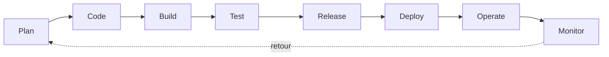

# ADR-018 — DevSecOps : la sécurité à chaque étape de la livraison

| Champ | Valeur |
|---|---|
| Date | 17/10/2026 |
| Statut | Acceptée (contrôles de base actifs ; étapes marquées « à ajouter » planifiées) |
| Décideurs | Daddy Luciano, Manoa Robel |
| Validation du professeur | À consigner (exigence R-08) |
| Issues liées | CLD-02 à CLD-06, CLD-08, CLD-19, CLD-22, CLD-23, CLD-24, GES-16, MS-05 |
| Compétences BC05 | Documentation (processus), pratiques transversales |
| S'appuie sur | [ADR-004](ADR-004-main-protegee-branches-courtes.md), [ADR-005](ADR-005-sonarqube-snyk-controles-bloquants.md) ; complété par [ADR-021](ADR-021-docker-deploiement.md) |

## 1. Problème

[ADR-004](ADR-004-main-protegee-branches-courtes.md) et [ADR-005](ADR-005-sonarqube-snyk-controles-bloquants.md) fixent les règles de fusion et les contrôles. Il manque la vue d'ensemble : où la sécurité intervient depuis l'idée jusqu'à l'exploitation, ce qui protège réellement les actifs du projet, et ce qui reste à faire.

## 2. Actifs à protéger

| Actif | Risque principal |
|---|---|
| Commande des feux de circulation (même simulée) | Commande dangereuse ou prise de contrôle |
| Compte AWS (Amazon Web Services) et facturation | Fuite d'identifiants, dépense non voulue |
| Jetons (GitHub, Snyk, SonarQube) | Exposition dans un dépôt public ou une conversation |
| Chaîne de livraison | Dépendance, action ou image compromise |
| Données | Corruption, empoisonnement (voir [ADR-017](ADR-017-mlops-mlsecops.md)) |

## 3. Options comparées

| Option | Verdict |
|---|---|
| Sécurité en fin de projet (audit final) | Écartée : coût de correction élevé, surprises au moment du gel du code |
| **Sécurité à chaque étape (DevSecOps), contrôles automatiques bloquants et exceptions datées** | **Retenue** |
| Sécurité déléguée à un seul outil | Écartée : aucune couverture complète |

## 4. Choix : contrôles par étape

| Étape | Contrôle | Outil | État |
|---|---|---|---|
| Plan | Modèle de menaces léger par service (méthode STRIDE : usurpation, falsification, répudiation, divulgation, déni de service, élévation de privilèges) | Tableau dans `docs/04-devsecops/` | À ajouter (M1) |
| Code | Hooks locaux (formatage, secrets) ; branche protégée ; relecture croisée | ruff, ESLint, gitleaks, protection de `main` | Actif |
| Build | Dépendances figées avec empreintes (fichiers de verrouillage) ; images non-root à base épinglée ; inventaire des composants (SBOM, Software Bill of Materials) | `pip-compile --generate-hashes` ou équivalent, `npm ci`, Syft ou CycloneDX | Verrouillage et SBOM à ajouter |
| Test | Tests unitaires, contrat, intégration ; SAST (Static Application Security Testing, analyse du code), SCA (Software Composition Analysis, dépendances), analyse d'images, analyse Terraform, secrets | Sonar, Snyk, gitleaks | Actif |
| Test | DAST (Dynamic Application Security Testing, attaque de l'application en marche) : balayage de base de l'API (Application Programming Interface, interface de programmation) locale | OWASP (Open Worldwide Application Security Project) ZAP (mode « baseline ») | À ajouter, P1 |
| Release | Étiquette de version ; images **signées** avec preuve de provenance | cosign (signature sans clé via OIDC (OpenID Connect) GitHub) | À ajouter ([ADR-021](ADR-021-docker-deploiement.md)) |
| Deploy | Authentification par OIDC sans clé longue durée ; moindre privilège ; relecteur obligatoire sur `demo` ; plan Terraform relu avant application | IAM (Identity and Access Management), environnements GitHub | Actif / à brancher à AWS |
| Operate | Secrets dans AWS Secrets Manager ; journaux d'audit ; sauvegardes testées | Secrets Manager, CloudWatch, CloudTrail | À brancher |
| Monitor | Analyse planifiée hebdomadaire sur `main` ; alarmes ; revue des exceptions | `schedule` dans la CI (Continuous Integration, intégration continue), CloudWatch | À ajouter (CLD-23) |

### 4.1 Politique de vulnérabilités (CLD-23, valeurs proposées)

| Gravité | Délai de correction | Si non corrigeable |
|---|---|---|
| Critique | 7 jours | Exception datée, mesure compensatoire, décision des deux membres |
| Haute | 14 jours | Exception datée dans `.snyk`, entrée au registre des risques |
| Moyenne ou basse | Au fil des jalons | Suivi, pas de blocage |

Toute exception porte : raison, responsable, date d'expiration antérieure au 10/12/2026. Aucun contrôle ne se désactive.

### 4.2 Secrets

Jamais dans le dépôt, les captures, les journaux ni une conversation. GitHub Secrets pour la CI, AWS Secrets Manager pour l'exécution, `.env` ignoré par Git en local. Inventaire avec propriétaire et date de renouvellement (GES-16) ; un jeton exposé est révoqué immédiatement.

### 4.3 Écarts constatés dans la CI actuelle (à corriger, nouvelle issue proposée)

| Constat | Risque | Correction |
|---|---|---|
| `snyk/actions/setup@master` et `zricethezav/gitleaks:latest` ne sont pas épinglés | Une version compromise ou cassée s'exécute sans contrôle | Épingler par numéro de version ou empreinte (SHA) de commit |
| Actions GitHub référencées par balise (`@v4`) | Balise déplaçable | Épingler par SHA pour les actions tierces, mises à jour groupées via Dependabot |
| Dépendances Python sans fichier de verrouillage | Build non reproductible, dérive silencieuse | Verrouillage avec empreintes |
| Pas d'inventaire des composants (SBOM) | Pas de réponse rapide à « sommes-nous touchés par la faille X ? » | Génération en CI, jointe à chaque version |

## 5. Conséquences

**Positives**

- Une faille est arrêtée à l'étape la moins chère à corriger.
- Les preuves (rapports, captures, exceptions) alimentent la matrice BC05.
- Le projet démontre une chaîne de livraison complète et réaliste.

**Compromis acceptés**

- Chaque contrôle ajoute du temps de CI et du tri de faux positifs.
- Les plans gratuits des outils imposent des quotas ([ADR-005](ADR-005-sonarqube-snyk-controles-bloquants.md)).
- La signature d'image est vérifiée à la chaîne de déploiement, non à l'exécution (ECS ne contrôle pas les signatures).

**Risques et parades**

| Risque | Parade |
|---|---|
| Les contrôles ralentissent trop les fusions | Exécuter en parallèle, mettre en cache ; garder le même nombre de contrôles obligatoires |
| Trop de tâches de sécurité pour la capacité du binôme | Priorité : épinglage, verrouillage, signature ; DAST et STRIDE en P1 |
| Fausse impression de sécurité | La matrice d'accès et les essais de refus prouvent ce que les contrôles automatiques ne voient pas (CLD-18) |

## 6. Plan de repli

Les étapes « à ajouter » sont classées par priorité ; si le temps manque, seuls l'épinglage, le verrouillage et la signature des images sont maintenus, le reste est documenté comme limite.

## 7. Vérification

- `docs/04-devsecops/exceptions.md` : chaque exception a raison et expiration (CLD-19).
- Un test volontairement faux, un faux secret et une dépendance vulnérable bloquent chacun la fusion (CLD-05, CLD-06, CLD-08).
- La version publiée contient un SBOM et des images signées dont la signature se vérifie.

## 8. Conditions de réexamen

- Un incident de sécurité réel ou simulé révèle une étape non couverte.
- Un outil change de conditions d'utilisation.
