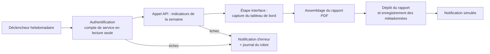

# ADR-019 — RPA (Robotic Process Automation) et automatisation : Robot Framework pour le rapport hebdomadaire

| Champ | Valeur |
|---|---|
| Date | 17/10/2026 |
| Statut | Proposée |
| Décideurs | Manoa Robel (responsable), Daddy Luciano (relecture) |
| Validation du professeur | À consigner (niveau RPA, point 1 de GES-06) |
| Issues liées | IA-07, FE-06, DOC-06 |
| Compétences BC05 | RPA et automatisation des tâches |
| S'appuie sur | [ADR-018](ADR-018-devsecops.md) |

## 1. Problème

La RPA (Robotic Process Automation, automatisation robotisée des processus) reproduit les gestes d'une personne devant une interface. Le référentiel BC05 la demande « uniquement si une tâche répétitive le justifie ». Novaria Core expose des API (Application Programming Interface, interface de programmation) complètes : l'automatisation par API est presque toujours supérieure à la RPA. Quelle tâche justifie un robot, avec quel outil, et dans quelles limites ?

## 2. Forces de décision

- Une tâche réellement répétitive et utile : le rapport hebdomadaire des indicateurs.
- Robustesse et sécurité : un robot n'a jamais plus de droits que nécessaire.
- Coût nul : outil libre.
- Preuve : un rapport produit sans intervention manuelle (critère de IA-07).

## 3. Options comparées

| Option | Avantages | Inconvénients | Verdict |
|---|---|---|---|
| A. Script Python + cron (automatisation par API) | Simple, robuste | Ne démontre pas la RPA | Sert de **partie API** du robot |
| **B. Robot Framework** (bibliothèques API et navigateur) | Libre, écrit en Python, rapports d'exécution intégrés, mots-clés lisibles | Étapes d'interface fragiles si l'écran change | **Retenue** |
| C. UiPath Community, Power Automate | Outils RPA du marché | Licences, environnement Windows, hors dépôt | Écartée |
| D. Playwright seul | Excellent pour l'interface | Pas de langage de processus ni de rapport d'exécution intégré | Utilisé comme moteur du navigateur |
| E. n8n, Airflow, Step Functions | Orchestration de flux | Orchestration, pas RPA | Écartée |

## 4. Choix

Un robot Robot Framework, `automation/rpa/`, produit chaque semaine un rapport :

| Sujet | Décision |
|---|---|
| Part API | Appel de l'API d'indicateurs : rapide, fiable |
| Part interface | Une capture de l'écran du tableau de bord : la seule étape qui relève réellement de la RPA ; sélecteurs stables basés sur des attributs de test dédiés (`data-testid`) |
| Déclenchement | Cible AWS (Amazon Web Services) : EventBridge Scheduler lance une tâche ECS (Elastic Container Service) ; repli sans coût : workflow GitHub Actions planifié ou cron local |
| Idempotence | Un seul rapport par semaine ; une relance remplace, ne duplique pas |
| Sécurité | Compte de service dédié en lecture seule ; secrets hors du code ; journaux du robot (`output.xml`, `log.html`) sans secret |
| Gestion d'échec | Nouvelle tentative limitée, puis notification d'erreur à une personne (supervision humaine) |
| Limites strictes | Le robot ne **pilote jamais** les feux ni aucun système de commande ; il ne modifie aucune donnée métier |

## 5. Conséquences

**Positives**

- Un rapport est produit sans intervention (critère de IA-07) et apparaît dans la page des rapports (FE-06).
- Les journaux du robot servent de preuves d'exécution.
- La partie API garantit que la panne d'un écran n'empêche pas l'essentiel du rapport.

**Compromis acceptés**

- Les étapes d'interface sont fragiles : un changement de mise en page peut casser le robot. Les attributs de test dédiés et un test de fumée du robot en CI (Continuous Integration, intégration continue) réduisent ce risque.
- La RPA est ici une démonstration : le gain réel est faible, les API suffiraient. Le rapport final le dit.
- Un navigateur sans écran (mode *headless*) alourdit l'image du robot.

**Risques et parades**

| Risque | Parade |
|---|---|
| Robot cassé après une évolution du front-end | Test de fumée en CI à chaque modification du tableau de bord |
| Identifiants du robot exposés | Secret dans GitHub Secrets ou AWS Secrets Manager, rôle en lecture seule, jeton à courte durée |
| Robot qui accumule des doublons | Idempotence par semaine |

## 6. Plan de repli

Si l'étape d'interface est instable, le robot se limite à la partie API (appel, assemblage, dépôt) et la capture d'écran est documentée comme prototype non intégré.

## 7. Vérification

- Un rapport est produit sans intervention manuelle (IA-07).
- Relancer le robot la même semaine ne crée pas de doublon.
- Un échec volontaire (API arrêtée) déclenche la notification d'erreur.

## 8. Conditions de réexamen

- Le professeur retient un niveau « Implémenté » pour la RPA : ajouter un second processus.
- Aucune étape d'interface ne se justifie : requalifier la brique en automatisation par API.
