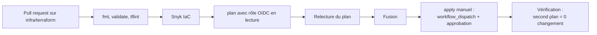

# ADR-020 — Infrastructure as Code avec Terraform

| Champ | Valeur |
|---|---|
| Date | 17/10/2026 |
| Statut | Acceptée |
| Décideurs | Daddy Luciano, Manoa Robel |
| Validation du professeur | À consigner |
| Issues liées | CLD-09, CLD-10, CLD-11, CLD-17, CLD-21, MS-17, GES-09 |
| Compétences BC05 | Architectures de données décisionnelles, Documentation |
| S'appuie sur | [ADR-003](ADR-003-aws-ecs-fargate-docker.md), [ADR-006](ADR-006-region-eu-west-1.md), [ADR-007](ADR-007-compte-aws.md) |

## 1. Problème

Un environnement créé à la main dans la console AWS (Amazon Web Services) ne se reproduit pas, ne se relit pas, ne se détruit pas proprement et ne se vérifie pas. Le projet doit créer et détruire son infrastructure à volonté (maîtrise des coûts, risque R3), en laissant une trace relue en pull request.

## 2. Forces de décision

- Reproductibilité : `apply` puis `destroy` sans reste.
- Relecture et analyse de sécurité avant application.
- Coût d'apprentissage et outillage déjà en place (`terraform.yml`).
- Indépendance vis-à-vis de l'éditeur.

## 3. Options comparées

| Option | Avantages | Inconvénients | Verdict |
|---|---|---|---|
| Console AWS manuelle | Rapide à essayer | Aucune trace, aucune reproductibilité | Écartée |
| AWS CloudFormation | Natif AWS, sans état à gérer | Verbeux, propre à AWS | Écartée |
| AWS CDK (Cloud Development Kit) | Langages de programmation | Génère du CloudFormation, abstraction supplémentaire | Écartée |
| Pulumi | Langages de programmation | Moins répandu, service d'état par défaut | Écartée |
| **Terraform** | Standard répandu, grand écosystème de modules, analyse Snyk IaC, `plan` lisible | Licence à usage restreint (BSL, Business Source License) depuis 2023 ; gestion de l'état à soigner | **Retenue** |
| OpenTofu | Fork libre, compatible avec Terraform | Écosystème plus jeune | Voie de sortie (commandes quasi identiques) |

## 4. Choix

### 4.1 Organisation

```text
infra/terraform/
  envs/
    base/    # ne se détruit pas pendant le projet : état distant, OIDC GitHub, budget, dépôts ECR
    dev/     # environnement de développement
    demo/    # détruit après chaque séance et après la soutenance (CLD-21)
  modules/
    network/ ecr/ ecs-service/ rds-postgres/ mongodb/ broker/ observability/ iam/ scheduler/
```

- Le module `ecs-service` est appelé une fois **par service** (boucle sur une liste de services) : ajouter un service ou un domaine revient à ajouter une entrée ([ADR-008](ADR-008-microservices.md)).
- Versions épinglées : `required_version`, fournisseurs avec contraintes de version, fichier `.terraform.lock.hcl` versionné.
- Étiquettes communes (`projet=novaria`, `env`, `proprietaire`) appliquées par défaut au fournisseur.
- Aucun `*.tfvars` ni fichier d'état dans Git (déjà dans `.gitignore`).

### 4.2 État

Bucket S3 (Simple Storage Service) chiffré et versionné, accès restreint au rôle de la CI (Continuous Integration, intégration continue) et aux administrateurs. Verrouillage de l'état : natif S3 dans les versions récentes de Terraform, ou table DynamoDB dans les versions plus anciennes ; mécanisme à confirmer sur la version épinglée en CLD-10. Le bucket est créé par une configuration d'amorçage à état local, documentée dans `infra/terraform/README.md`.

### 4.3 Flux de travail



- `plan` sur chaque pull request ; **`apply` jamais automatique** : déclenchement manuel avec approbation de l'environnement (déjà prévu dans `terraform.yml`).
- Les secrets ne sont pas écrits dans le code : mots de passe de base gérés par le service (`manage_master_user_password` pour RDS (Relational Database Service)) ou générés et stockés dans Secrets Manager ; les valeurs sensibles sont marquées `sensitive`.
- Les composants facturés à l'heure (broker, moteur Flink, NAT (Network Address Translation)) sont dans `demo`, jamais dans `base`.

## 5. Conséquences

**Positives**

- `terraform destroy` supprime tout le coût de `demo` en une commande (CLD-21).
- Une seconde exécution du plan sans changement prouve l'absence de dérive (CLD-17).
- Les revues de pull request couvrent l'infrastructure comme le code.

**Compromis acceptés**

- Le fichier d'état contient des informations sensibles : bucket privé, chiffré, accès minimal.
- L'amorçage de l'état distant est une étape manuelle documentée.
- Sans identifiants AWS, **`terraform plan` ne s'exécute pas** (le fournisseur AWS a besoin de s'authentifier) ; seuls `fmt`, `validate`, `tflint` et l'analyse Snyk IaC fonctionnent hors ligne. Le plan B de [ADR-007](ADR-007-compte-aws.md) en tient compte : l'infrastructure y est validée statiquement, et le `plan` n'est démontré qu'avec un compte (bac à sable inclus).
- Licence BSL de Terraform : usage interne autorisé ; OpenTofu reste disponible.

**Risques et parades**

| Risque | Parade |
|---|---|
| `destroy` supprime des données utiles | Sauvegarde vérifiée avant destruction (CLD-15) ; ressources durables dans `base` ; instantané final de la base avant suppression |
| Ressource orpheline hors Terraform | Étiquette obligatoire et revue de la facturation à chaque séance |
| État verrouillé ou corrompu | Versionnement du bucket, procédure de reprise documentée |
| Coût d'un plan d'application raté | Relecture du plan, `apply` manuel |

## 6. Plan de repli

Sans AWS : validation statique seulement (`fmt`, `validate`, `tflint`, Snyk IaC) et, en option, un plan contre un émulateur local. Si Terraform pose problème de licence, bascule vers OpenTofu en remplaçant l'exécutable.

## 7. Vérification

- `terraform plan` s'exécute depuis un poste propre (CLD-10).
- `apply` puis `destroy` laissent un compte sans ressource facturée (CLD-11, CLD-21).
- Le second plan indique 0 changement (CLD-17).
- Snyk IaC ne signale aucune alerte haute non justifiée.

## 8. Conditions de réexamen

- Le nombre de ressources justifie un découpage de l'état en plusieurs piles.
- Un changement de licence ou d'outillage de Terraform nuit au projet.
