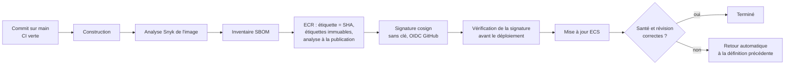

# ADR-021 — Docker, images et stratégie de déploiement (code, données et modèles)

| Champ | Valeur |
|---|---|
| Date | 17/10/2026 |
| Statut | Acceptée (signature des images : à ajouter) |
| Décideurs | Daddy Luciano, Manoa Robel |
| Validation du professeur | À consigner (exigence R-09 : image immuable, versionnée et signée) |
| Issues liées | CLD-07, CLD-12, CLD-15, CLD-16, MS-05, MS-06, MS-17, GES-13 |
| Compétences BC05 | Architectures de données décisionnelles, Documentation |
| S'appuie sur | [ADR-003](ADR-003-aws-ecs-fargate-docker.md), [ADR-018](ADR-018-devsecops.md), [ADR-020](ADR-020-terraform.md) |

> **Mise à jour du 20/10/2026 ([ADR-023](ADR-023-execution-locale-d-abord.md)).** Les images se construisent et s'exécutent en local. La publication dans ECR (Elastic Container Registry) et le déploiement sur ECS (Elastic Container Service) sont documentés, non exécutés. La signature des images devient utile avec un registre : elle reste à ajouter à ce moment.

## 1. Problème

Quatre services, un bus, deux bases, un moteur de flux et un tableau de bord doivent démarrer de la même façon sur un poste et sur AWS (Amazon Web Services), se déployer sans interruption visible, et pouvoir revenir en arrière. Les **données** (schémas, référentiels, modèles) se déploient aussi, et un retour de code ne les restaure pas.

## 2. Forces de décision

- Même artefact du poste à la production.
- Images petites, sans privilèges, sans faille connue de gravité haute.
- Déploiement vérifiable : la révision en service est celle du commit.
- Retour arrière rapide.
- Poste de travail limité : Kafka, Flink, deux bases et quatre services ne tiennent pas forcément ensemble.

## 3. Options comparées

### 3.1 Images

| Option | Verdict |
|---|---|
| Image unique pour tous les services | Écartée : couplage de versions |
| **Une image par service, construction en plusieurs étapes, utilisateur non-root, base épinglée** | **Retenue** |
| Images « distroless » (sans shell) | Cible d'amélioration si le temps le permet : surface d'attaque minimale, débogage plus difficile |

### 3.2 Déploiement

| Option | Avantages | Inconvénients | Verdict |
|---|---|---|---|
| **Mise à jour progressive ECS (Elastic Container Service) avec disjoncteur et retour automatique** | Déjà gérée par ECS, aucun outil de plus | Pas de trafic de test avant bascule | **Retenue** |
| Bleu/vert avec CodeDeploy | Bascule instantanée et trafic de test | Configuration supplémentaire par service | Écartée (charge hors proportion) |
| Remplacement brutal (arrêt puis démarrage) | Simple | Coupure visible | Écartée |

## 4. Choix

### 4.1 Normes d'image

| Règle | Détail |
|---|---|
| Construction | Plusieurs étapes ; seule l'étape finale part en production |
| Utilisateur | Non-root (identifiant 10001), système de fichiers en lecture seule dans la définition de tâche ECS, privilèges système retirés |
| Base | Étiquette de version **et** empreinte (digest) ; mise à jour planifiée ; aucune étiquette flottante en production |
| Secrets | Aucun dans les couches ni les variables par défaut ; injection à l'exécution depuis Secrets Manager |
| Processus | Un processus par conteneur, forme `exec`, journaux JSON (JavaScript Object Notation) sur la sortie standard |
| Santé | Sonde `HEALTHCHECK` et route `/health` renvoyant la révision (`GIT_SHA`) |
| Étiquettes | Révision Git et date de construction |

Leçon vécue : le contrôle d'images a révélé de vraies failles dans les images de base (python:3.12-slim, nginx-unprivileged sur Alpine 3.21). La parade est une base mise à jour et reconstruite chaque semaine (analyse planifiée, CLD-23), jamais un seuil abaissé.

### 4.2 Registre, signature, provenance

- Étiquette d'image = SHA (Secure Hash Algorithm) du commit ; **aucune étiquette `latest`**. ECR (Elastic Container Registry) : étiquettes immuables, analyse à la publication, règle de rétention des anciennes images.
- Signature avec cosign et vérification **dans la chaîne de déploiement** (ECS ne vérifie pas les signatures à l'exécution). Cela ferme l'écart E-02 du registre des demandes ; une issue de suivi est proposée (CLD-25).

### 4.3 Environnement local

Docker Compose avec des **profils** pour tenir sur un poste :

| Profil | Contenu | Usage |
|---|---|---|
| `core` | PostgreSQL, MongoDB, 4 services, passerelle, front-end | Développement courant |
| `streaming` | Kafka (KRaft), Flink | Essais de flux ([ADR-011](ADR-011-temps-reel-et-batch.md)) |
| `quality` | SonarQube local | Analyse locale (`docker compose -f compose.quality.yml up -d`) |

Limites de mémoire déclarées par service ; sondes de santé et `depends_on` avec `condition: service_healthy`.

### 4.4 Déploiement des données

| Élément | Mécanisme | Retour arrière |
|---|---|---|
| Schéma PostgreSQL | Migrations Alembic exécutées par une **tâche ECS ponctuelle avant** la mise à jour des services (jamais au démarrage d'un service) ; changements en deux temps (ajouter, migrer, retirer) | Migration inverse ou restauration de la sauvegarde prise juste avant |
| Référentiels (carrefours, capteurs) | Jeu de départ versionné, chargement idempotent | Rechargement de la version précédente |
| Collections MongoDB | Index et validations créés par script idempotent | Script inverse, sauvegarde |
| Modèles ML (Machine Learning) | Fichier versionné dans S3 (Simple Storage Service), relié à un run ([ADR-017](ADR-017-mlops-mlsecops.md)) | Servir la version précédente |
| Contrats d'événements | Compatibilité ascendante ; deux versions publiées pendant une transition ([ADR-009](ADR-009-bus-evenements.md)) | Revenir à l'ancien `type` |

Règle : **une sauvegarde vérifiée est prise avant toute migration** (CLD-15). Un retour de code ne restaure pas les données ; la procédure le dit (CLD-16).

## 5. Conséquences

**Positives**

- La révision déployée se vérifie à chaque service (`/health`) et se lit dans l'image.
- Un déploiement raté revient seul à la version précédente.
- Le même artefact tourne au poste et sur AWS.

**Compromis acceptés**

- Pas de trafic de test avant la bascule (contrepartie du choix de la mise à jour progressive).
- La signature ajoute une étape à la chaîne et une vérification à maintenir.
- Les images épinglées par empreinte exigent des mises à jour régulières (automatisées par Dependabot en mode mensuel groupé).
- Un environnement complet ne tient pas toujours sur un poste : d'où les profils.

**Risques et parades**

| Risque | Parade |
|---|---|
| Faille dans l'image de base | Analyse à chaque construction et chaque semaine |
| Migration qui casse le schéma | Sauvegarde avant migration, essai sur base vide et sur copie |
| Signature contournée | Vérification obligatoire avant la mise à jour du service |
| Poste saturé | Profils Compose, limites de mémoire |

## 6. Plan de repli

Sans signature (temps insuffisant), l'immuabilité des étiquettes ECR et la vérification de la révision restent actives, et l'absence de signature est consignée dans les limites. Sans AWS, les mêmes images tournent en Compose local.

## 7. Vérification

- `docker compose --profile core up --build` démarre l'ensemble et chaque `/health` répond (CLD-07, MS-06).
- Après un merge, la révision renvoyée par l'API (Application Programming Interface, interface de programmation) est celle du commit (CLD-12).
- La révision précédente est de nouveau en service après un retour de version (CLD-16).
- La signature d'une image se vérifie ; une image modifiée est refusée.

## 8. Conditions de réexamen

- Une exigence de zéro coupure impose le déploiement bleu/vert.
- Les images « distroless » deviennent praticables pour tous les services.
