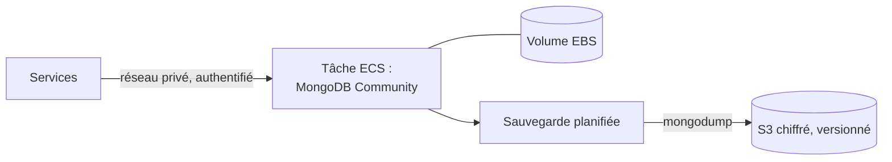

# ADR-022 — Hébergement de MongoDB sur AWS (Amazon Web Services)

| Champ | Valeur |
|---|---|
| Date | 17/10/2026 |
| Statut | Proposée : à valider par un essai de persistance (CLD-11) |
| Décideurs | Daddy Luciano, Manoa Robel |
| Validation du professeur | Non requise |
| Issues liées | CLD-11, CLD-15, MS-17, BE-05, MS-08, MS-12 |
| Compétences BC05 | Architectures de données décisionnelles |
| S'appuie sur | [ADR-002](ADR-002-postgresql-mongodb.md), [ADR-003](ADR-003-aws-ecs-fargate-docker.md), [ADR-007](ADR-007-compte-aws.md) |

> **Mise à jour du 20/10/2026 ([ADR-023](ADR-023-execution-locale-d-abord.md)).** L'hébergement de MongoDB sur AWS n'est pas exécuté ; MongoDB tourne dans un conteneur local ([ADR-024](ADR-024-bases-de-donnees-locales.md)). L'essai de persistance (CLD-11) est différé.

## 1. Problème

MongoDB porte les événements bruts, les journaux d'audit, les statistiques et le suivi des modèles. Sur AWS, ECS (Elastic Container Service) Fargate n'offre pas de disque local persistant par défaut. Où et comment héberger MongoDB à faible coût sans perdre de données ?

## 2. Forces de décision

| Critère | Poids |
|---|---|
| Persistance : les données survivent à un redémarrage de tâche | Fort |
| Coût | Fort |
| Réseau privé : pas d'exposition à Internet | Fort |
| Sauvegarde et restauration vérifiées (CLD-15) | Fort |
| Charge d'exploitation | Moyen |
| Compatibilité complète avec MongoDB | Moyen |

## 3. Options comparées

| Option | Avantages | Inconvénients | Verdict |
|---|---|---|---|
| **A. Conteneur MongoDB Community sur ECS Fargate avec volume EBS (Elastic Block Store) géré + sauvegarde `mongodump` vers S3 (Simple Storage Service)** | Même image qu'en local, coût faible, réseau privé | Un seul nœud (pas de haute disponibilité) ; durée de vie du volume et remplacement de tâche à valider par essai | **Retenue, sous réserve de l'essai** |
| B. MongoDB sur EC2 (EBS) | Disque persistant classique | Machine à patcher, hors de la logique conteneur | Repli 2 |
| C. Amazon DocumentDB | Géré, sauvegardes intégrées | Compatible avec l'interface MongoDB, pas MongoDB complet ; coût horaire fixe d'une instance | Écartée |
| D. MongoDB Atlas (service du fournisseur) | Géré, offre gratuite limitée | Accès par Internet avec liste d'adresses autorisées, données hors du réseau privé AWS, quota réduit | Repli 1 |
| E. Tout dans PostgreSQL (JSONB) | Un seul moteur | Perd la démonstration NoSQL | Repli 3 ([ADR-002](ADR-002-postgresql-mongodb.md)) |
| F. EFS (disque réseau) comme stockage | Persistant et partagé | Les systèmes de fichiers réseau de type NFS (Network File System) sont déconseillés pour les fichiers de données de MongoDB (moteur WiredTiger) | Écartée |

## 4. Choix

Un conteneur MongoDB sur ECS Fargate, avec :

- un **volume EBS** géré par ECS pour les données ; l'essai CLD-11 vérifie la durée de vie du volume lors d'un arrêt ou d'un remplacement de tâche (le comportement de conservation est à confirmer sur la configuration utilisée) ;
- **authentification activée**, aucun accès depuis Internet (sous-réseau privé, groupe de sécurité limité aux services propriétaires) ;
- **sauvegarde** par `mongodump` planifié vers S3 chiffré et versionné, plus instantanés EBS ; restauration testée en environnement isolé (CLD-15) ;
- **index TTL (Time To Live, durée de vie)** sur `raw_events` pour borner la taille.

## 5. Conséquences

**Positives**

- Parité avec le poste local (même image `mongo:7`).
- Coût limité à une tâche et un volume, détruits avec l'environnement `demo`.

**Compromis acceptés**

- Pas de haute disponibilité : un seul nœud, redémarrage et rattrapage par le bus ; acceptable pour la démonstration, signalé comme limite.
- Responsabilité des mises à jour et de la sécurité du moteur à notre charge.
- La licence de MongoDB Community (SSPL) autorise l'usage interne ; elle interdit de proposer MongoDB comme service à des tiers, ce qui n'est pas notre cas.

**Risques et parades**

| Risque | Parade |
|---|---|
| Perte de volume au remplacement de la tâche | Essai de persistance obligatoire avant d'y mettre des données ; sauvegarde avant chaque destruction |
| Saturation du disque | Index TTL, alarme d'espace (CloudWatch) |
| Données exposées | Sous-réseau privé, authentification, groupe de sécurité minimal, secrets en Secrets Manager |

## 6. Plan de repli

Ordre : Atlas (repli 1), EC2 + EBS (repli 2), PostgreSQL JSONB (repli 3). La couche d'accès est un adaptateur ([ADR-010](ADR-010-architecture-hexagonale.md)) : le changement d'hébergement ne touche pas au domaine.

## 7. Vérification

- Écrire des données, arrêter la tâche, laisser ECS la remplacer : les données sont présentes (essai de CLD-11).
- Restauration de la sauvegarde dans un environnement isolé : totaux identiques (CLD-15).
- Aucun accès depuis Internet (test d'accès, CLD-18).

## 8. Conditions de réexamen

- L'essai de persistance échoue.
- Le besoin de haute disponibilité devient une exigence.
