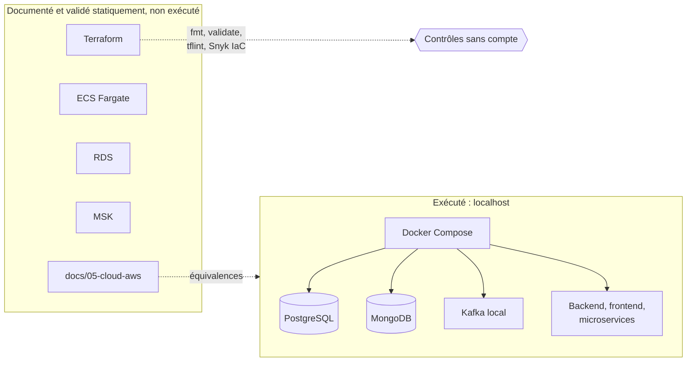

# ADR-023 — Exécution locale d'abord : AWS documenté et préparé, non exécuté

| Champ | Valeur |
|---|---|
| Date | 20/10/2026 |
| Statut | Acceptée : instruction du professeur transmise **oralement** par Manoa Robel ; confirmation écrite à obtenir (voir section 7) |
| Décideurs | Manoa Robel, Daddy Luciano, d'après la consigne du professeur |
| Validation du professeur | Donnée oralement le 20/10/2026 ; à consigner par écrit dans `docs/07-gestion/decisions-professeur.md` : **aucune réponse écrite n'est consignée au 20/11/2026** (risque R7 ouvert) |
| Relecture | 20/11/2026 (DOC-11) : écarts avec le dépôt corrigés, voir la section 9 |
| Issues liées | GES-06, GES-09, CLD-01, CLD-09 à CLD-12, CLD-14 à CLD-18, CLD-21, LOC-01 à LOC-06, DAT-06, DAT-08, DAT-09, IA-04, IA-05, IA-06, BE-08, MS-16, MS-17 |
| Compétences BC05 | Architectures de données décisionnelles, Documentation |
| Remplace en partie | [ADR-003](ADR-003-aws-ecs-fargate-docker.md), [ADR-007](ADR-007-compte-aws.md) (la décision d'exécuter sur AWS est suspendue) |
| Complété par | [ADR-024](ADR-024-bases-de-donnees-locales.md), [ADR-025](ADR-025-equivalents-locaux-des-services-aws.md), [ADR-026](ADR-026-postes-de-travail-windows-et-linux.md) |

## 1. Problème

Les ADR (Architecture Decision Record, enregistrement de décision d'architecture) du 17/10/2026 supposaient un déploiement sur AWS (Amazon Web Services) : ECS (Elastic Container Service) Fargate, RDS (Relational Database Service), MSK (Managed Streaming for Apache Kafka), SageMaker, CloudWatch. Le professeur indique que **le projet peut tourner sur `localhost` pour le moment, mais pas sur des services AWS**. Sans décision écrite, le planning garde des tâches impossibles à exécuter et la documentation promet ce que le projet ne fera pas.

## 2. Forces de décision

| Critère | Poids |
|---|---|
| Respect de la consigne du professeur | Fort |
| Aucune dépense, aucun compte, aucun secret cloud | Fort |
| Conserver le travail de conception AWS déjà fait (documents, Terraform, ADR) | Fort |
| Un parcours de bout en bout démontrable le 10/12/2026 | Fort |
| Pouvoir reprendre AWS si l'autorisation arrive plus tard | Moyen |

## 3. Options comparées

| Option | Avantages | Inconvénients | Verdict |
|---|---|---|---|
| A. Poursuivre le plan AWS | Compétence cloud démontrée par un déploiement | Contraire à la consigne ; coût et risque | Écartée |
| **B. Exécuter en local, garder AWS documenté et validé statiquement** | Respecte la consigne ; rien n'est perdu ; reprise possible | Les compétences cloud se démontrent par le code et les documents, pas par un déploiement | **Retenue** |
| C. Supprimer toute trace d'AWS | Dépôt plus simple | Perte du travail fait ; contredit la consigne de garder les documents | Écartée |

Réserve la plus forte contre B : le bloc BC05 mentionne des architectures cloud ; sans déploiement réel, la démonstration repose sur la documentation et le code Terraform. Parade : chaque service AWS a un **équivalent local documenté** ([ADR-025](ADR-025-equivalents-locaux-des-services-aws.md)) et le code AWS se valide sans compte.

## 4. Choix

| N° | Règle |
|---|---|
| 1 | Tout s'exécute sur `localhost` avec Docker Compose : `python3 scripts/dev/dev.py up` (Linux) ou `py -3 scripts/dev/dev.py up` (Windows). |
| 2 | **Aucune ressource AWS n'est créée** : pas de compte ouvert pour le projet, pas d'identifiant AWS dans le dépôt, dans GitHub Actions ni dans une conversation. |
| 3 | Les documents AWS (`docs/05-cloud-aws`, ADR 003, 006, 007, 020, 021, 022) sont **conservés**. Le code Terraform n'existait pas encore (dossiers vides au 06/11/2026) : LOC-06 a écrit un **squelette minimal** dans `infra/terraform/` (modules `ecr`, un dépôt d'images par service, et `observability`, un groupe de journaux par service ; environnements `dev` et `demo`) pour que les contrôles portent sur du code. Le tout porte la mention « cible documentée, non exécutée ». |
| 4 | Le code Terraform se contrôle sans compte : `terraform fmt -check`, `terraform init -backend=false` puis `terraform validate`, `tflint`, analyse Snyk IaC. Le `terraform plan` exige des identifiants : il n'est **pas** exécuté contre AWS. Ces contrôles statiques se lancent **à la main** avec `python3 scripts/dev/dev.py terraform-check` (Linux) ou `py -3 scripts/dev/dev.py terraform-check` (Windows), dans des conteneurs ([détail](../../05-cloud-aws/controles-terraform-sans-compte.md)) ; le job `plan` de `terraform.yml` ne démarre pas sans `AWS_ROLE_ARN`. Seule l'analyse Snyk IaC tourne en CI (job `snyk` de `ci.yml`) ; un job CI pour `fmt`, `validate` et `tflint` sans identifiants n'existe pas (proposition de LOC-06, à approuver puisqu'elle touche la CI). **Depuis CLD-17 (19/11/2026)**, le code est aussi appliqué à un émulateur d'API AWS local, *Moto*, puis le plan est rejoué : `python3 scripts/dev/dev.py terraform-emulateur` (Linux) ou `py -3 scripts/dev/dev.py terraform-emulateur` (Windows) ; cela ne prouve rien sur le vrai AWS ([ADR-025](ADR-025-equivalents-locaux-des-services-aws.md), addendum). |
| 5 | Les workflows `deploy.yml` et `terraform.yml` restent **inactifs** : ils ne démarrent que si la variable `AWS_ROLE_ARN` existe ; cette variable n'est pas créée. |
| 6 | Le chiffrage (GES-09) devient un **coût projeté**, calculé sur l'inventaire prévu et étiqueté « non déployé ». |
| 7 | Chaque composant qui dépendait d'un service AWS a un équivalent local ([ADR-025](ADR-025-equivalents-locaux-des-services-aws.md)) et un adaptateur remplaçable ([ADR-010](ADR-010-architecture-hexagonale.md)). |
| 8 | Reprise d'AWS : uniquement sur **autorisation écrite** du professeur, puis décision de l'[ADR-007](ADR-007-compte-aws.md) (compte, plafond, budget d'alerte). |

### Effet sur le planning

Colonne de gauche : ce qui a été décidé le 20/10/2026. Colonne de droite : l'état au 20/11/2026, relevé sur GitHub (état de l'issue) et dans le dépôt (document de preuve).

| Issue | Traitement décidé | État au 20/11/2026 |
|---|---|---|
| CLD-01 (compte AWS) | Partie compte reportée ; reste la rédaction de la procédure | Fermée : aucun compte créé ; procédure de reprise dans [le dossier AWS](../../05-cloud-aws/README.md) |
| CLD-09 (OIDC), CLD-10 (réseau), CLD-11 (MongoDB sur ECS), CLD-12 (ECS) | **Différées** : étiquette `aws:differe`, documents conservés | Fermées avec l'étiquette `aws:differe` : la cible reste documentée, **rien n'est exécuté sur AWS** |
| CLD-21 (nettoyage AWS) | **Différée** | **Ouverte** : à reformuler en contrôle que rien n'a été créé ([remplacer AWS en local](../../05-cloud-aws/remplacer-aws-en-local.md)) |
| CLD-14, CLD-15, CLD-16, CLD-17, CLD-18 | **Différées** | **Réalisées en local** (fermées du 17 au 20/11/2026) : [diagnostic](../../08-exploitation/diagnostic.md), [restauration](../../08-exploitation/restauration.md), [retour de version](../../08-exploitation/rollback.md), [Terraform sur émulateur](../../05-cloud-aws/ressources-persistantes.md), [matrice d'accès](../../05-cloud-aws/matrice-acces.md) |
| DAT-06 (Glue), DAT-08 (EMR), IA-04 (S3), IA-05 (SageMaker), IA-06 (CloudWatch), BE-08 (Secrets Manager), MS-16 (CloudWatch), MS-17 | **Réorientées** vers l'équivalent local | Fermées : [ETL planifié](../../03-donnees/etl-planifie-local.md), [prototype Big Data](../../03-donnees/prototype-bigdata.md), [stockage d'objets](../../03-donnees/stockage-objets.md), [pipeline MLSecOps](../../06-ia-mlops/pipeline-mlsecops.md), [surveillance de la dérive](../../03-donnees/surveillance-derive.md), [sécurité applicative](../../04-devsecops/securite-applicative.md), [observabilité](../../08-exploitation/observabilite.md) ; MS-17 : un conteneur par service, déploiement AWS documenté |
| DAT-09 (MSK) | **Réorientée** | Prototype Kafka et Flink SQL réalisé (rapport `docs/03-donnees/prototype-flux.md`, sur la branche `feature/dat-09-prototype-flux`) ; **non fusionné dans `main` au 20/11/2026**, donc sans lien ici |
| GES-09 | Coût projeté, rien n'est créé | Fermée le 19/11/2026 ; le document de coût projeté n'est **pas** dans le dépôt (annoncé « à venir » dans [remplacer AWS en local](../../05-cloud-aws/remplacer-aws-en-local.md)) |
| GES-14 (démonstration) | Plan A : démonstration locale | Ouverte |
| LOC-01 à LOC-06 | **Nouvelles** : bases locales, sauvegarde, Kafka local, équivalents locaux, contrôles Terraform sans compte | Toutes fermées |

Les corps des issues ne sont pas effacés : un commentaire d'amendement et l'étiquette expliquent le changement.

## 5. Conséquences

**Positives**

- Zéro dépense, zéro secret cloud, zéro compte à protéger.
- Le temps libéré par les tâches AWS (installation, réseau, droits) va au parcours de bout en bout et à la qualité des données.
- La démonstration ne dépend ni d'internet ni d'un service tiers.

**Compromis acceptés**

- Aucune preuve de déploiement cloud réel : la compétence se démontre par le code, les contrôles statiques et les documents.
- Écarts possibles entre le local et AWS (versions, réseau, droits) : consignés dans le registre des risques (R6).
- Les performances mesurées en local ne valent pas celles d'un service géré.

**Risques et parades**

| Risque | Parade |
|---|---|
| Écart entre local et AWS que personne ne voit | Adaptateurs et variables de configuration ; tableau d'équivalences ([ADR-025](ADR-025-equivalents-locaux-des-services-aws.md)) ; risque R6 suivi à chaque jalon |
| Instruction orale mal comprise ou oubliée | Confirmation écrite demandée ; consignée dans le registre des demandes (risque R7) |
| Documents AWS qui se périment | Mention de statut en tête de chaque document ; relecture si le projet reprend AWS |
| Dérive : une ressource AWS créée par erreur | Aucune clé AWS dans le dépôt ni dans GitHub ; workflow de déploiement inactif |

## 6. Plan de repli

Si le professeur autorise AWS plus tard : décider selon l'[ADR-007](ADR-007-compte-aws.md), rouvrir dans cet ordre CLD-01, CLD-09, CLD-10, CLD-12, CLD-11, puis les services de données ; les adaptateurs de l'[ADR-025](ADR-025-equivalents-locaux-des-services-aws.md) évitent de réécrire les services.

## 7. Vérification

| Contrôle | Preuve |
|---|---|
| Le parcours tourne en local | `dev.py up`, `dev.py db-check`, puis `dev.py parcours` (bout en bout, [tests d'intégration](../../04-devsecops/tests-integration.md)) et `dev.py flux-complet` (du capteur à la commande de feux) |
| Aucune ressource AWS | Pas de variable `AWS_*` dans GitHub ; `deploy.yml` et `terraform.yml` sans exécution |
| Le code Terraform reste valide | Contrôles statiques lancés à la main (LOC-06) ; Snyk IaC en CI ; application à Moto et plan à 0 changement (CLD-17) ; un job CI sans identifiants pour `fmt`, `validate` et `tflint` reste à approuver |
| L'instruction est tracée | Ligne dans `docs/07-gestion/decisions-professeur.md` et dans le registre des demandes ; **confirmation écrite non reçue au 20/11/2026** (R7 ouvert) : l'envoi de la demande n'est pas consigné dans le dépôt |

## 8. Conditions de réexamen

- Le professeur autorise un usage d'AWS (même limité à une démonstration).
- Le professeur exige une preuve de déploiement cloud pour valider une compétence.
- Un écart local/AWS bloque une fonction.

## 9. Relecture du 20/11/2026 (DOC-11)

Relu contre le dépôt, la liste des issues GitHub et les commandes de `dev.py`. Écarts corrigés :

| Point | Avant | Après |
|---|---|---|
| Squelette Terraform (règle 3) | « dossiers vides », contenu décrit au futur | Modules `ecr` et `observability`, environnements `dev` et `demo` : écrits |
| Contrôles Terraform (règle 4) | Tous à la main, en attendant un job CI | Snyk IaC tourne déjà en CI ; `fmt`, `validate`, `tflint` restent à la main ; Moto ajouté (CLD-17) |
| Planning | CLD-14 à CLD-18 « différées » | Réalisées en local ; tableau avec l'état de chaque issue |
| Confirmation écrite | « demande envoyée » | Aucune réponse écrite consignée ; R7 ouvert |

**Non modifié, parce que toujours vrai** : le principe (aucune ressource AWS, règles 1, 2, 5, 7 et 8) et les conditions de réexamen. **Non vérifié** : l'absence de variables `AWS_*` dans les paramètres GitHub (relevé du 13/11/2026 dans [remplacer AWS en local](../../05-cloud-aws/remplacer-aws-en-local.md), à refaire par une personne ayant accès au dépôt).
