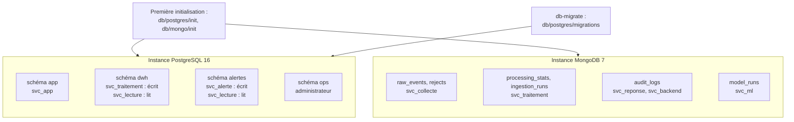

# ADR-024 — Bases de données locales : PostgreSQL et MongoDB dans Docker

| Champ | Valeur |
|---|---|
| Date | 20/10/2026 |
| Statut | Acceptée |
| Décideurs | Manoa Robel, Daddy Luciano |
| Validation du professeur | Non requise (réalise [ADR-002](ADR-002-postgresql-mongodb.md) en local, dans le cadre de [ADR-023](ADR-023-execution-locale-d-abord.md)) |
| Issues liées | LOC-01, LOC-02, LOC-03, DAT-02, DAT-10, BE-02, BE-05, MS-08, MS-10 |
| Compétences BC05 | Architectures de données décisionnelles, Documentation et spécifications techniques |
| S'appuie sur | [ADR-002](ADR-002-postgresql-mongodb.md), [ADR-008](ADR-008-microservices.md), [ADR-009](ADR-009-bus-evenements.md), [ADR-014](ADR-014-architecture-decisionnelle.md) |
| Complété par | [Guide des bases locales](../../03-donnees/base-de-donnees-locale.md), [sauvegarde et restauration](../../08-exploitation/sauvegarde-restauration-locale.md) |

## 1. Problème

Sans RDS (Relational Database Service) ni hébergement MongoDB sur AWS (Amazon Web Services), les deux bases doivent tourner sur chaque poste, identiques sous Linux et sous Windows, avec la même séparation des droits que le ferait un environnement partagé. Il faut décider : combien de bases, quel découpage, quels comptes, comment créer et faire évoluer les tables, comment sauvegarder.

## 2. Forces de décision

| Critère | Poids |
|---|---|
| Respect de la règle « un service n'écrit que dans ses propres données » ([ADR-008](ADR-008-microservices.md), règle 1) | Fort |
| Démarrage en une commande, identique sous Windows et sous Linux | Fort |
| Migrations rejouables, sans modification silencieuse d'un historique | Fort |
| Aucun secret dans le dépôt | Fort |
| Sauvegarde dont la restauration est **prouvée** | Fort |
| Légèreté (deux postes, 7 semaines) | Fort |

## 3. Options comparées

### 3.1 Découpage de PostgreSQL

| Option | Avantages | Inconvénients | Verdict |
|---|---|---|---|
| A. Un schéma `public` unique, un seul compte | Simple | Aucune frontière entre services ; un défaut d'un service peut tout lire et tout écrire | Écartée |
| **B. Une base `novaria`, quatre schémas (`app`, `dwh`, `alertes`, `ops`), un compte par service** | Frontières réelles par les droits SQL (Structured Query Language) ; une seule instance à exploiter ; sauvegarde unique | Les services partagent le même moteur (pas d'isolation de ressources) | **Retenue** |
| C. Une instance PostgreSQL par service | Isolation complète | 4 conteneurs, mémoire, sauvegardes multiples : disproportionné pour deux postes | Écartée pour l'instant ; la frontière par schéma permet d'y passer |

### 3.2 Création et évolution des tables

| Option | Avantages | Inconvénients | Verdict |
|---|---|---|---|
| Alembic pour tout | Un seul outil | Alembic suit les modèles SQLAlchemy du backend ; l'entrepôt et les alertes appartiennent à d'autres services, écrits sans ORM (Object-Relational Mapping, mappage objet-relationnel) | Écartée |
| Flyway ou Liquibase | Outils éprouvés | Machine virtuelle Java en plus | Écartée |
| **Alembic pour `app` ; exécuteur SQL maison pour `dwh`, `alertes`, `ops`** | Chaque service garde son outil ; l'exécuteur tient en 100 lignes de shell, sans dépendance | Deux mécanismes à connaître | **Retenue** |

L'exécuteur (`db/postgres/migrate.sh`) applique `NNNN_description.sql` dans l'ordre, **une transaction par fichier**, enregistre l'empreinte SHA-256 (*Secure Hash Algorithm*) de chaque fichier appliqué dans `ops.schema_migrations`, et **refuse** un fichier déjà appliqué dont le contenu a changé.

## 4. Choix

| N° | Règle |
|---|---|
| 1 | Images officielles `postgres:16-alpine` et `mongo:7`, épinglées dans `docker-compose.yml`. |
| 2 | Les ports ne sont publiés que sur `127.0.0.1` : aucune base joignable depuis le réseau. |
| 3 | Les mots de passe sont **générés au hasard** dans `.env` par `dev.py init-env` (ignoré par Git, jamais affiché). `.env.example` ne contient que des valeurs factices. |
| 4 | **Un compte de connexion par service**, sans droit d'administration ; l'administrateur local ne sert qu'à l'initialisation, aux migrations et aux sauvegardes. |
| 5 | Dates en UTC (Coordinated Universal Time) : `timezone = UTC` sur la base ; colonnes `timestamptz`. |
| 6 | Les contraintes vivent dans la base (clés, `CHECK`, index uniques partiels) : une règle du [dictionnaire de données](../../03-donnees/dictionnaire-de-donnees.md) violée est refusée à l'écriture. |
| 7 | MongoDB : validateurs `$jsonSchema` en mode strict (erreur à l'écriture), index à durée de vie (14 jours pour `raw_events`, 30 jours pour `rejects`), rôles à droits minimaux. |
| 8 | Sauvegarde : `pg_dump` (format personnalisé, droits inclus) et `mongodump`, fichier de comptage, rotation à 7, `restore-check` dans une base jetable, `restore` après confirmation. |
| 9 | Aucune clé étrangère entre schémas de services différents : les liens sont des identifiants textuels. |
| 10 | Les scripts d'initialisation ne s'exécutent qu'au premier démarrage d'un volume vide ; un changement de droits ou de collections passe par une migration ou par `db-reset`. |

## 5. Conséquences

**Positives**

- `python3 scripts/dev/dev.py db-up` (Linux) ou `py -3 scripts/dev/dev.py db-up` (Windows) suffit ; `db-check` rejoue 23 vérifications de droits, positives et négatives.
- Les droits sont testables : un service qui lit ce qui ne le concerne pas est refusé.
- L'historique des migrations est protégé contre les modifications silencieuses.
- La restauration est exercée, pas supposée.

**Compromis acceptés**

- Une seule instance par moteur : pas d'isolation de ressources entre services.
- Deux mécanismes de migration (Alembic et exécuteur SQL).
- Ajouter une collection MongoDB sur une base existante demande une procédure dédiée (le script d'initialisation ne s'exécute qu'une fois).
- Pas de journal de transactions : la sauvegarde est un instantané.
- Le comportement de MongoDB sous Docker n'a pas pu être exécuté pendant la rédaction (voir section 7).

**Risques et parades**

| Risque | Parade |
|---|---|
| Écart avec RDS ou l'hébergement MongoDB prévu sur AWS ([ADR-022](ADR-022-hebergement-mongodb.md)) | Versions épinglées, SQL standard, adaptateurs ([ADR-025](ADR-025-equivalents-locaux-des-services-aws.md)) ; risque R6 |
| Mots de passe changés alors que les volumes gardent les anciens | Message et procédure dans le guide (`db-reset`) |
| Fins de ligne Windows dans un script exécuté par le conteneur | `.gitattributes` impose LF ([ADR-026](ADR-026-postes-de-travail-windows-et-linux.md)) |
| Perte du volume | Sauvegarde régulière ; les jeux de données se régénèrent par graine ([ADR-027](ADR-027-jeux-de-donnees-et-provenance.md)) |

## 6. Plan de repli

Si MongoDB pose un problème de démarrage ou de droits sur un poste, l'application peut écrire `raw_events` dans PostgreSQL (colonne `jsonb`) le temps de corriger : les contrats d'événements ne changent pas. Si l'exécuteur de migrations pose problème, Alembic peut le remplacer pour tous les schémas.

## 7. Vérification

| Contrôle | État |
|---|---|
| Initialisation, migrations, idempotence, refus d'une migration modifiée, droits, contraintes, sauvegarde, restauration sur PostgreSQL 16 réel | **Exécutés** le 20/10/2026 |
| Script MongoDB : syntaxe et appels simulés ; exemple de mesure accepté par le validateur | **Exécutés** |
| Démarrage de MongoDB sous Docker, `db-check` complet (21 `[OK]`), mesure conforme acceptée, mesure sans provenance refusée, index de durée de vie de 14 jours | **Exécutés** le 27/10/2026 sous Windows, volumes neufs ([preuve LOC-02](../../03-donnees/preuve-loc-02-mongodb.md)) |
| Sauvegarde et restauration MongoDB ; mêmes contrôles sous Linux | **À exécuter sur un poste avec Docker** (critère de LOC-03 ; poste Linux) |
| Tests des commandes `dev.py` | 17 tests |

## 8. Conditions de réexamen

- Un service a besoin d'isolation de ressources : une instance PostgreSQL par service.
- Le volume de `raw_events` dépasse ce qu'un poste supporte : réduire la durée de conservation ou archiver en fichiers.
- Le projet reprend AWS : appliquer l'[ADR-022](ADR-022-hebergement-mongodb.md).
