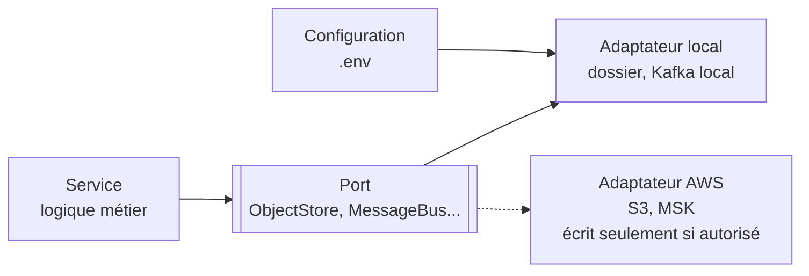

# ADR-025 — Équivalents locaux des services AWS et adaptateurs remplaçables

| Champ | Valeur |
|---|---|
| Date | 20/10/2026 |
| Statut | Acceptée |
| Décideurs | Manoa Robel, Daddy Luciano |
| Validation du professeur | Non requise (conséquence de [ADR-023](ADR-023-execution-locale-d-abord.md)) |
| Issues liées | LOC-04, LOC-05, DAT-06, DAT-08, DAT-09, IA-04, IA-05, IA-06, BE-08, MS-16, MS-17 |
| Compétences BC05 | Architectures de données décisionnelles, Traitement de flux en temps réel, Big Data, MLOps |
| S'appuie sur | [ADR-010](ADR-010-architecture-hexagonale.md), [ADR-023](ADR-023-execution-locale-d-abord.md) |

## 1. Problème

Plusieurs ADR (Architecture Decision Record, enregistrement de décision d'architecture) et issues nomment des services AWS (Amazon Web Services) précis. Sans AWS, chacun a besoin d'un remplaçant local, et le code ne doit pas dépendre du remplaçant au point d'empêcher le retour vers AWS.

## 2. Forces de décision

| Critère | Poids |
|---|---|
| Aucun appel AWS pendant le projet | Fort |
| Pouvoir reprendre AWS sans réécrire les services | Fort |
| Même comportement observable en local et en cible | Moyen |
| Peu de code supplémentaire | Fort |

## 3. Options comparées

| Option | Avantages | Inconvénients | Verdict |
|---|---|---|---|
| A. Émulateur AWS local (LocalStack) | Mêmes appels de kit de développement que sur AWS | Conteneur lourd, couverture partielle, nouvelle dépendance à apprendre | Écartée |
| **B. Services libres équivalents + adaptateurs derrière les ports de l'architecture hexagonale** | Code simple, aucune dépendance AWS, retour possible en écrivant un adaptateur | Il faut écrire l'adaptateur AWS le jour où il est autorisé | **Retenue** |
| C. Écrire directement pour le service local | Le plus rapide | Réécriture complète au retour vers AWS | Écartée |

## 4. Choix

### 4.1 Table d'équivalences

| Service AWS prévu | Usage dans Novaria Core | Équivalent local retenu | Adaptateur ou configuration |
|---|---|---|---|
| ECS (Elastic Container Service) Fargate | Exécuter les conteneurs | Docker Compose | Mêmes images ([ADR-021](ADR-021-docker-deploiement.md)) |
| ECR (Elastic Container Registry) | Stocker les images | Images construites localement (`docker compose build`) | Étiquette = SHA (Secure Hash Algorithm) du commit |
| RDS (Relational Database Service) PostgreSQL | Base métier et entrepôt | Conteneur `postgres:16-alpine` ([ADR-024](ADR-024-bases-de-donnees-locales.md)) | `POSTGRES_URL` |
| Hébergement MongoDB ([ADR-022](ADR-022-hebergement-mongodb.md)) | Journaux, événements bruts | Conteneur `mongo:7` | `MONGO_URL` |
| S3 (Simple Storage Service) | Jeux de données, modèles, sauvegardes | Dossier `var/` (volume), `backups/` | Port `ObjectStore` : `STORAGE_BACKEND=local` |
| MSK (Managed Streaming for Apache Kafka) | Bus d'événements | Kafka en mode KRaft dans Docker Compose (LOC-04) | `KAFKA_BOOTSTRAP_SERVERS` |
| Service géré Flink | Fenêtres temps réel | Flink dans Docker Compose, ou consommateur Python en repli ([ADR-011](ADR-011-temps-reel-et-batch.md)) | Même code de fenêtre |
| EMR (Elastic MapReduce) | Prototype Big Data | PySpark en mode local (DAT-08) | Même programme, maître `local[*]` |
| Glue | Catalogue et ETL (Extract, Transform, Load) | Scripts Python d'ETL, catalogue = [dictionnaire de données](../../03-donnees/dictionnaire-de-donnees.md) | Documenté ; Glue non exécuté |
| SageMaker | Entraînement et service de modèles | Entraînement local (scikit-learn), registre dans MongoDB `model_runs` ([ADR-017](ADR-017-mlops-mlsecops.md)) | Même script d'entraînement |
| CloudWatch | Journaux, métriques, alarmes | Journaux JSON (JavaScript Object Notation) sur la sortie standard, point `/metrics` des services (MS-16) | Format de journal identique |
| Secrets Manager | Secrets d'exécution | `.env` généré, ignoré par Git | `Settings` de `services/traitement/app/core/config.py` |
| IAM (Identity and Access Management) et OIDC (OpenID Connect) | Identités, accès du CI (Continuous Integration, intégration continue) | Comptes de base de données par service ; aucun accès cloud | Aucun jeton AWS dans GitHub |
| EventBridge Scheduler | Tâches planifiées | `cron`, Planificateur de tâches Windows, ou profil Compose `ops` | Commande `dev.py` |
| VPC (Virtual Private Cloud, réseau privé virtuel), ALB (Application Load Balancer, répartiteur de charge) | Réseau et entrée | Réseau Compose, ports sur `127.0.0.1` | Documenté |

### 4.2 Règles

| N° | Règle |
|---|---|
| 1 | Le domaine et les cas d'usage n'importent **aucun** kit de développement AWS (SDK, Software Development Kit). |
| 2 | Chaque dépendance externe (stockage d'objets, bus, secrets) passe par un port défini dans le service ([ADR-010](ADR-010-architecture-hexagonale.md)) ; le choix de l'adaptateur vient de la configuration. |
| 3 | L'adaptateur AWS n'est écrit que sur autorisation écrite ([ADR-023](ADR-023-execution-locale-d-abord.md), règle 8). Jusque-là, seule la **table ci-dessus** garde la trace de la cible. |
| 4 | Un équivalent local ne prétend pas égaler le service géré : les écarts connus sont dans la section 4.3 et dans le registre des risques (R6). |

### 4.3 Écarts assumés

| Sujet | Écart |
|---|---|
| Durabilité | Un volume Docker n'a ni réplication ni sauvegarde automatique |
| Sécurité | Pas d'IAM ni de chiffrement géré ; compensé par ports en `127.0.0.1` et comptes de service |
| Mise à l'échelle | Pas de mise à l'échelle automatique ; la montée en charge se démontre avec le simulateur à débit réglable |
| Observabilité | Pas d'alarmes gérées ; contrôles et tableaux de bord locaux |

## 5. Conséquences

**Positives**

- Chaque issue AWS a un chemin d'exécution local explicite.
- Le retour vers AWS coûte un adaptateur par port, pas une réécriture.
- La table sert de support à la soutenance : « voici la cible, voici ce qui a tourné ».

**Compromis acceptés**

- Les ports ajoutent un peu de code (une interface et un adaptateur) pour le stockage d'objets et le bus.
- Les performances locales ne prouvent rien sur AWS.

**Risques et parades**

| Risque | Parade |
|---|---|
| Un SDK AWS s'infiltre dans le domaine | Revue de code ; règle 1 vérifiée en pull request (CONTRIBUTING) |
| Table d'équivalences périmée | Relecture à chaque jalon (DOC-11) |
| Comportement différent entre Kafka local et MSK | Versions et paramètres notés ; test de contrat de bus |

## 6. Plan de repli

Si un port s'avère trop lourd à maintenir, le service utilise directement l'équivalent local derrière une fonction unique, et l'écart est consigné dans le registre des risques.

## 7. Vérification

| Contrôle | Preuve |
|---|---|
| Aucune importation AWS dans le domaine | Recherche de `boto3` dans `services/` et `ml/` : aucun résultat (relancée le 27/10/2026) |
| Chaque ligne de la table a une issue | LOC-04, LOC-05 et les issues réorientées |
| Les variables de configuration sont dans `.env.example` | Test de `dev.py` |

## 8. Conditions de réexamen

- Autorisation d'utiliser AWS.
- Un équivalent local devient inutilisable sur un des deux postes (Windows ou Linux).
