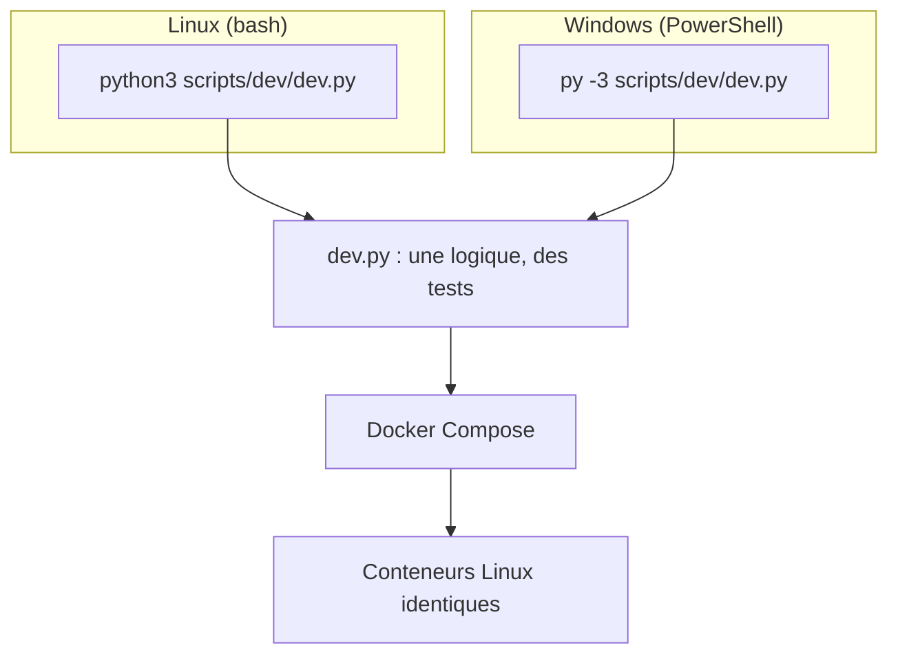

# ADR-026 — Postes de travail Windows et Linux : Docker et un lanceur Python commun

| Champ | Valeur |
|---|---|
| Date | 20/10/2026 |
| Statut | Acceptée |
| Décideurs | Manoa Robel (Linux, Ubuntu), Daddy Luciano (Windows) |
| Validation du professeur | Non requise |
| Issues liées | LOC-01, LOC-02, LOC-03, GES-19, DOC-11 |
| Compétences BC05 | Documentation et spécifications techniques, DevSecOps |
| S'appuie sur | [ADR-018](ADR-018-devsecops.md), [ADR-021](ADR-021-docker-deploiement.md), [ADR-023](ADR-023-execution-locale-d-abord.md) |
| Complété par | [Guide du poste de travail](../../08-exploitation/poste-de-travail.md) |

## 1. Problème

Les deux membres du binôme ont des systèmes différents : Linux (Ubuntu) pour Manoa, Windows pour Daddy. Une commande de terminal, un chemin de fichier ou une fin de ligne qui marche chez l'un échoue chez l'autre. Il faut qu'une consigne, un script ou une documentation donne le même résultat sur les deux postes, sans demander à l'un de changer de système.

## 2. Forces de décision

| Critère | Poids |
|---|---|
| Le même résultat sur les deux postes | Fort |
| Ne pas imposer de changement de système | Fort |
| Un seul endroit où la procédure est écrite | Fort |
| Peu d'outils à installer | Moyen |
| Documentation honnête sur ce qui diffère | Fort |

## 3. Options comparées

| Option | Avantages | Inconvénients | Verdict |
|---|---|---|---|
| A. Tout le monde sous WSL 2 (Windows Subsystem for Linux, sous-système Windows pour Linux) | Commandes identiques (bash) | Installation et fichiers à gérer dans deux mondes ; demande à Daddy de changer ses habitudes | Possible, **facultative** |
| **B. Docker sur les deux postes + un lanceur Python (`scripts/dev/dev.py`) + documentation à deux colonnes** | Rien à changer ; Python et Docker sont déjà nécessaires ; une logique, deux terminaux | Chaque tutoriel doit donner les deux variantes | **Retenue** |
| C. Environnement de développement dans un conteneur (devcontainer) | Poste jetable et identique | Configuration et temps de démarrage ; éditeurs différents | Écartée pour l'instant |
| D. Scripts shell (`.sh`) pour tout | Simple sous Linux | Inutilisables nativement sous Windows | Écartée pour les outils communs |

Réserve la plus forte contre B : deux colonnes de commandes doublent la charge de documentation et peuvent diverger. Parade : la logique est dans `dev.py` et testée ; la documentation ne répète que la forme d'appel.

## 4. Choix

| N° | Règle |
|---|---|
| 1 | **Docker** est l'environnement d'exécution commun. Les scripts shell (`.sh`) ne s'exécutent **que dans un conteneur** ou dans Git Bash. |
| 2 | Tout outil utilisé par les deux membres est écrit en **Python (bibliothèque standard)** : `scripts/dev/dev.py`, `scripts/dev/gen_reseau.py`, `contracts/validate_events.py`. Il ne dépend pas d'un shell. |
| 3 | Toute documentation technique donne **les deux variantes** (Linux et Windows PowerShell) dès que la commande diffère. |
| 4 | Fins de ligne : **LF partout** (`.gitattributes` et `.editorconfig`), y compris sous Windows. |
| 5 | Les fichiers écrits par un outil le sont en UTF-8 par l'outil lui-même (option `--out`), jamais par la redirection `>` de PowerShell. |
| 6 | Les chemins dans les fichiers du dépôt s'écrivent avec `/`. |
| 7 | `make` est un **raccourci Linux** facultatif ; il appelle `dev.py` et ne contient aucune logique. |
| 8 | Python 3.12 et Node.js 22 sont les versions de référence ; `dev.py check-tools` vérifie le poste. |
| 9 | Chaque membre annonce son système à Claude (voir `CLAUDE.md`) pour obtenir les bonnes commandes. |

## 5. Conséquences

**Positives**

- Une commande de référence ; le comportement est testé sans Docker (17 tests).
- Daddy garde son poste ; Manoa le sien.
- Les erreurs classiques de Windows (CRLF, UTF-16, chemins) sont traitées à la source.

**Compromis acceptés**

- Docker Desktop sous Windows consomme de la mémoire et exige WSL 2 ou Hyper-V.
- Les scripts d'administration GitHub (`scripts/github/*.sh`) se lancent depuis Git Bash sous Windows.
- Les temps de lecture/écriture des volumes montés sont plus lents sous Windows.

**Risques et parades**

| Risque | Parade |
|---|---|
| Une documentation ne donne qu'une variante | Revue en pull request (liste de contrôle du gabarit) |
| Fin de ligne CRLF dans un script monté dans un conteneur | `.gitattributes` ; dépannage dans le guide du poste |
| Une fonction de `dev.py` marche sous Linux seulement | Appels `subprocess` sans shell ; test sous Windows par Daddy au premier démarrage |
| Version de Python trop ancienne | `check-tools` signale le manque |

## 6. Plan de repli

Si Docker Desktop est inutilisable sur le poste Windows (mémoire, virtualisation désactivée), Daddy travaille dans WSL 2 ou sur une machine Linux prêtée ; les commandes sont celles de la colonne Linux.

## 7. Vérification

| Contrôle | Preuve |
|---|---|
| `dev.py` ne dépend d'aucun shell | Tests unitaires avec appels simulés |
| Premier démarrage sous Windows | Daddy exécute `check-tools`, `init-env`, `db-up`, `db-check` et note le résultat dans l'issue LOC-01 |
| Fins de ligne | `git ls-files --eol` ne montre aucun `w/crlf` pour les `.sh` |

## 8. Conditions de réexamen

- Un des postes change de système.
- Un outil ne fonctionne que sur un système et ne peut pas être réécrit en Python.
