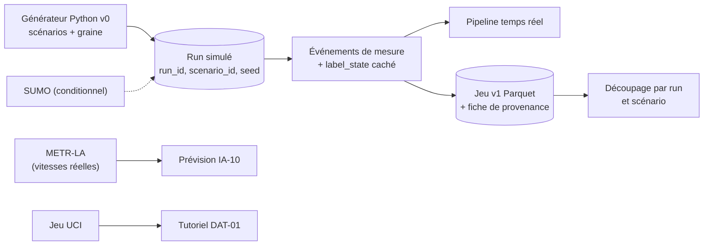

# ADR-027 — Jeux de données et provenance : simulateur Python d'abord, jeux réels pour la prévision

| Champ | Valeur |
|---|---|
| Date | 20/10/2026 |
| Statut | Proposée : jeu de données à valider par le professeur (point 2 de GES-06) |
| Décideurs | Manoa Robel (données et IA (intelligence artificielle)), Daddy Luciano (relecture) |
| Validation du professeur | À demander (simulateur seul ou calé sur un jeu ouvert) |
| Issues liées | DAT-01, DAT-10, IA-08, IA-09, IA-10, IA-11, MS-07 |
| Compétences BC05 | ETL (Extract, Transform, Load), Machine Learning et modélisation des données, Documentation |
| S'appuie sur | [ADR-013](ADR-013-integration-donnees.md), [ADR-015](ADR-015-modeles-ia.md) |
| Complété par | [Dictionnaire de données](../../03-donnees/dictionnaire-de-donnees.md) |

## 1. Problème

Un modèle vaut ce que valent ses données. Le projet n'a pas de capteurs réels : il faut décider d'où viennent les données, comment on sait **ce qui est simulé et ce qui est réel**, et comment éviter qu'un modèle ne réussisse que parce que l'évaluation l'y autorise. Un jeu de données simulé présenté comme réel serait une faute grave devant le jury.

## 2. Forces de décision

| Critère | Poids |
|---|---|
| Honnêteté sur l'origine de chaque donnée | Fort |
| Reproductibilité d'un jeu (même graine, mêmes données) | Fort |
| Réponse connue pour évaluer (vérité terrain) | Fort |
| Temps de mise en place avant le jalon M4 | Fort |
| Réalisme du comportement du trafic | Moyen |
| Licence et redistribution des jeux ouverts | Fort |

## 3. Options comparées

### 3.1 Source des données de congestion

| Option | Avantages | Inconvénients | Verdict |
|---|---|---|---|
| A. Générateur Python (modèle simple de flux, scénarios, incidents) | Livrable en quelques jours ; contrôle total ; vérité terrain exacte ; reproductible par graine | Réalisme limité : le modèle apprend le générateur | **Retenue en premier (v0)** |
| B. Simulateur de trafic SUMO (Simulation of Urban MObility) | Comportement microscopique réaliste, feux, files | Installation et apprentissage ; temps de calcul ; risque de calendrier | **Conditionnel** : seulement si le v0 est livré et testé (IA-11) |
| C. Jeux réels ouverts uniquement | Réalisme | Pas de comptages ni de vérité terrain de congestion, pas de contrôle des scénarios | Écartée comme source unique |

### 3.2 Rôle des jeux réels

| Jeu | Contenu | Usage retenu |
|---|---|---|
| METR-LA | Vitesses de capteurs routiers de Los Angeles, pas de 5 minutes, historique ouvert | **Prévision uniquement** (IA-10) : séries longues, vitesses seules ; licence et conditions à vérifier avant usage |
| Jeu de l'UCI (University of California, Irvine) retenu dans DAT-01 | Jeu tabulaire de trafic | **Tutoriel de prise en main** (ETL, qualité, premiers modèles) ; ne remplace pas les runs |

Les jeux réels ne contiennent pas de comptages de véhicules par fenêtre ni d'état de congestion. Ils **ne sont pas chargés dans l'entrepôt** `dwh.fact_traffic_window` (qui exige un comptage) : ils restent des fichiers sous `data/datasets/`, avec leur fiche de provenance.

### 3.3 Origine du label « congestionné »

| Option | Verdict |
|---|---|
| Sortie de la règle de seuils appliquée aux mêmes variables | Écartée : le modèle apprendrait la règle, et son score mesurerait la fidélité à la règle |
| **Vérité terrain du générateur** (état défini par le scénario : pointe, incident, journée calme) | **Retenue** : la réponse est indépendante de la règle de seuils |
| Annotation manuelle | Écartée : trop longue |

## 4. Choix

| N° | Règle |
|---|---|
| 1 | Chaque donnée porte sa **provenance** : `SIMULATED`, `REAL_HISTORICAL` ou `REAL_LIVE`, plus `run_id` ; une donnée simulée a aussi `scenario_id` et `seed`, une donnée historique a `dataset_id`. |
| 2 | Un run est **reproductible** : mêmes graine et scénario, mêmes événements. |
| 3 | Une donnée simulée n'est **jamais** présentée comme réelle : les rapports, tableaux et graphiques portent la mention de provenance. |
| 4 | Le découpage entraînement / validation / test se fait **par run et par scénario**, pas par lignes. |
| 5 | Le jeu v1 est un fichier Parquet accompagné d'une **fiche de provenance** (modèle ci-dessous) et de son empreinte SHA-256, consignée dans MongoDB `model_runs`. |
| 6 | Les gros jeux ne sont **pas versionnés** dans Git : le dépôt garde le générateur, la graine et un échantillon de moins de 1 Mo. |
| 7 | Les jeux réels ne sont **pas redistribués** dans le dépôt (public) tant que leur licence ne l'autorise pas ; un script de téléchargement contrôle l'empreinte. |
| 8 | Scénarios minimaux du v0 : journée calme, heure de pointe du matin, incident ponctuel sur un tronçon, capteur muet, messages en retard ou en doublon. |

Fiche de provenance d'un jeu (`data/datasets/<jeu>/PROVENANCE.md`) :

| Rubrique | Contenu |
|---|---|
| Identifiant et version | `dataset_id`, numéro de version |
| Origine | Simulé (générateur, version du code, graine, scénarios) ou réel (producteur, adresse, date de téléchargement) |
| Licence et conditions | Texte exact et lien ; redistribution oui/non |
| Période et couverture | Dates, capteurs, pas de temps |
| Variables et unités | Renvoi au dictionnaire de données |
| Qualité mesurée | Taux de valeurs manquantes, de rejets, de mesures suspectes |
| Limites | Ce que le jeu ne permet pas de conclure |
| Empreinte | SHA-256 du fichier |

## 5. Conséquences

**Positives**

- Une évaluation indépendante de la règle de seuils.
- Des runs rejouables : un résultat se reproduit à l'identique.
- Le jury voit tout de suite ce qui est simulé et ce qui est réel.

**Compromis acceptés**

- Un modèle entraîné sur le générateur apprend le générateur : le résultat prouve la chaîne, pas la précision réelle (limite écrite dans le rapport).
- METR-LA ne donne que des vitesses : pas de reconnaissance de la congestion sur données réelles.
- Le v0 est simple : trafic modélisé par des profils et du bruit, pas une simulation microscopique.

**Risques et parades**

| Risque | Parade |
|---|---|
| Le générateur ne produit pas de congestion crédible | Calibrage sur les profils horaires de METR-LA ; passage à SUMO (IA-11) |
| Licence d'un jeu réel incompatible avec un dépôt public | Pas de redistribution ; script de téléchargement |
| Fuite entre entraînement et test | Découpage par run, testé (IA-02) |
| Jeu de données modifié sans trace | Empreinte SHA-256 dans la fiche et dans `model_runs` |

## 6. Plan de repli

Si le générateur v0 prend du retard, un jeu minimal (une journée, deux scénarios) suffit à démontrer la chaîne ; la règle de seuils reste le classificateur en service ([ADR-015](ADR-015-modeles-ia.md), section 6).

## 7. Vérification

| Contrôle | Preuve |
|---|---|
| Toute donnée porte sa provenance | Contrat d'événements : `provenance` obligatoire, 3 règles conditionnelles testées |
| Reproductibilité | Deux exécutions avec la même graine donnent la même empreinte SHA-256 (test de IA-08) |
| Fiche de provenance | Présente pour chaque jeu utilisé |
| Découpage par run | Test de non-recouvrement des `run_id` entre entraînement et test |

## 8. Conditions de réexamen

- Le professeur impose un jeu réel avec comptages.
- La licence d'un jeu change.
- Le générateur v0 est jugé trop peu réaliste.
