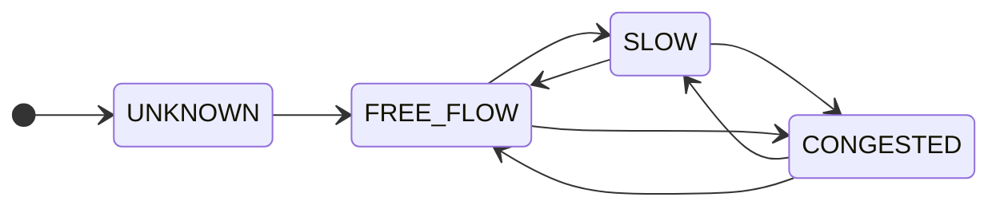
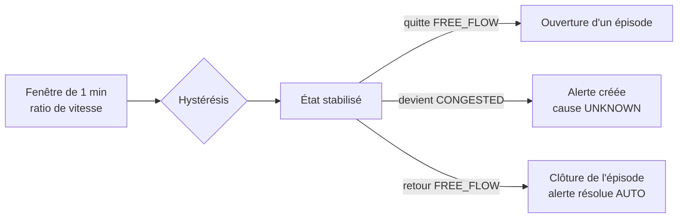

# ADR-028 — États de congestion, hystérésis et alertes par épisode

| Champ | Valeur |
|---|---|
| Date | 20/10/2026 |
| Statut | Proposée : seuils de départ, à fixer définitivement dans le cadrage ML (IA-01) |
| Décideurs | Manoa Robel, Daddy Luciano |
| Validation du professeur | À demander avec les indicateurs (ADR-014) |
| Issues liées | IA-01, IA-08, MS-09, MS-10, MS-11, DAT-10 |
| Compétences BC05 | Processus décisionnels, Traitement de flux en temps réel, Machine Learning |
| S'appuie sur | [ADR-009](ADR-009-bus-evenements.md), [ADR-011](ADR-011-temps-reel-et-batch.md), [ADR-014](ADR-014-architecture-decisionnelle.md) |
| Complété par | [Dictionnaire de données](../../03-donnees/dictionnaire-de-donnees.md), section 7 (valeurs) |

## 1. Problème

L'usager reçoit une alerte quand la circulation se dégrade. Deux erreurs coûtent cher : l'alerte qui **clignote** (une vitesse qui passe et repasse sous un seuil provoque dix alertes) et l'alerte qui **accuse à tort** (« accident » alors qu'il s'agit d'un ralentissement). Il faut définir ce qu'est « congestionné », comment l'état change, et quand une alerte naît.

## 2. Forces de décision

| Critère | Poids |
|---|---|
| Pas d'alerte qui clignote | Fort |
| Délai de détection court | Fort |
| Explicabilité devant le professeur et l'usager | Fort |
| Pas d'affirmation non prouvée sur la cause | Fort |
| Indépendance de la règle et du modèle | Moyen |

## 3. Options comparées

| Option | Avantages | Inconvénients | Verdict |
|---|---|---|---|
| A. Un seuil de vitesse unique | Simple | Clignote autour du seuil ; ne tient pas compte de la route | Écartée |
| B. Ratio de vitesse (vitesse / vitesse fluide) avec seuils différents à la montée et à la descente (hystérésis) et durée minimale | Comparable d'un tronçon à l'autre ; stable ; explicable | Délai de 2 à 3 minutes ; seuils à régler | **Retenue comme référence** |
| C. Modèle d'apprentissage seul | Peut capter des motifs complexes | Boîte noire, pas de référence, besoin de données | Candidat comparé à B ([ADR-015](ADR-015-modeles-ia.md)) |

## 4. Choix

1. L'état d'un tronçon est calculé sur des fenêtres de **1 minute** à partir du **ratio de vitesse** (vitesse moyenne ÷ vitesse en circulation fluide du tronçon).
2. Quatre états ordonnés : `UNKNOWN` (données insuffisantes), `FREE_FLOW` (fluide), `SLOW` (ralenti), `CONGESTED` (congestionné).
3. Les transitions utilisent des **seuils différents à la montée et à la descente** et exigent un **nombre de fenêtres consécutives** (valeurs de départ dans le tableau).
4. Un **épisode** s'ouvre quand l'état quitte `FREE_FLOW` pour `SLOW` ou `CONGESTED`, et se ferme au retour à `FREE_FLOW`.
5. **Une alerte par épisode** de congestion : un index unique garantit au plus une alerte non résolue par type, tronçon et run.
6. La **cause** d'une alerte reste `UNKNOWN` tant qu'aucun événement confirmé n'existe : une baisse de vitesse ne prouve pas un accident.
7. Un classificateur appris est **comparé** à cette règle ; il la remplace seulement s'il la bat au seuil fixé avant l'entraînement. Le label d'apprentissage est la **vérité terrain** du générateur, pas la sortie de la règle ([ADR-027](ADR-027-jeux-de-donnees-et-provenance.md)).

| Transition | Condition de départ (à fixer dans `cadrage-ml.md`) |
|---|---|
| FREE_FLOW → SLOW | ratio < 0,60 pendant 2 fenêtres |
| SLOW → CONGESTED | ratio < 0,35 pendant 2 fenêtres |
| FREE_FLOW → CONGESTED | ratio < 0,35 pendant 2 fenêtres |
| CONGESTED → SLOW | ratio > 0,45 pendant 3 fenêtres |
| SLOW → FREE_FLOW et CONGESTED → FREE_FLOW | ratio > 0,70 pendant 3 fenêtres |
| tout état → UNKNOWN | complétude de la fenêtre < 0,5 |

## 5. Conséquences

**Positives**

- Peu d'alertes parasites : l'état ne change qu'après confirmation.
- Comparable d'un tronçon à l'autre (le ratio neutralise la vitesse limite).
- Chaque seuil est une valeur nommée et testable ; le cadrage ML peut la modifier sans toucher au code.

**Compromis acceptés**

- Délai de détection de 2 à 3 minutes : la stabilité coûte du retard.
- Le ratio dépend de la vitesse fluide, connue pour le simulateur (égale à la vitesse limite), estimée pour des données réelles.
- Les seuils de départ sont des hypothèses : ils se règlent après un premier run.

**Risques et parades**

| Risque | Parade |
|---|---|
| Seuils mal réglés (trop d'alertes ou détection trop tardive) | Mesure du délai de détection et des fausses alertes par jour (IA-03) ; réglage avant l'entraînement |
| Route vide prise pour une route arrêtée | Vitesse `null` quand aucun véhicule ; fenêtre vide comptée comme fluide |
| Capteur défaillant vu comme congestion | Complétude < 0,5 ⇒ `UNKNOWN` ; alerte `SENSOR_FAULT` distincte |
| Accusation de cause | Cause `UNKNOWN` par défaut |

## 6. Plan de repli

Si l'hystérésis s'avère difficile à régler, un seuil unique avec durée minimale (2 fenêtres) est utilisé en attendant ; le schéma des données ne change pas.

## 7. Vérification

| Contrôle | Preuve |
|---|---|
| Le classificateur de référence applique le tableau de transitions | Tests unitaires sur des séries de ratios (IA-01) |
| Pas de clignotement | Test : une série qui oscille autour du seuil produit au plus une transition |
| Une alerte par épisode | Contrainte d'unicité testée sur PostgreSQL (20/10/2026) ; test de service (MS-10) |
| Cause par défaut | Contrainte `DEFAULT 'UNKNOWN'` en base |

## 8. Conditions de réexamen

- Le premier run montre un délai de détection ou un taux de fausses alertes inacceptable.
- Le professeur définit autrement « congestion ».
- Un jeu réel avec comptages permet de calibrer les seuils.
