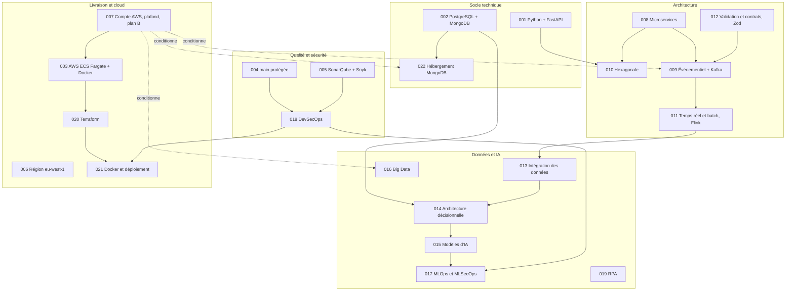

# Décisions d'architecture (ADR)

Une ADR (Architecture Decision Record, fiche de décision d'architecture) consigne **une décision**, le **problème** qui l'impose, les **options** étudiées, le **choix** et ses **conséquences**. Ce dossier est la preuve de l'issue DOC-04 et la référence des arbitrages techniques de Novaria Core, socle d'UrbanHub.

Responsables : Daddy Luciano et Manoa Robel (relecture croisée).
Dernière mise à jour : 17/10/2026.

## Comment lire

1. Commencer par la carte des décisions ci-dessous.
2. Lire l'ADR concernée : le tableau d'en-tête donne le statut, les issues et les compétences BC05 touchées.
3. Chaque ADR se termine par un **plan de repli** (que faire si la décision échoue), une **vérification** (comment la prouver) et des **conditions de réexamen** (quand la rouvrir).

## Carte des décisions

## Index

| ADR | Décision | Statut | Validation du professeur |
|---|---|---|---|
| [001](ADR-001-python-fastapi.md) | Python 3.12 et FastAPI pour les services | Acceptée | Non requise |
| [002](ADR-002-postgresql-mongodb.md) | PostgreSQL (métier, entrepôt) et MongoDB (journaux, statistiques, événements bruts) | Acceptée | À consigner |
| [003](ADR-003-aws-ecs-fargate-docker.md) | Hébergement AWS avec ECS Fargate et Docker | Acceptée (déploiement conditionné par 007) | À consigner |
| [004](ADR-004-main-protegee-branches-courtes.md) | Branche `main` protégée et branches courtes | Acceptée | Non requise |
| [005](ADR-005-sonarqube-snyk-controles-bloquants.md) | SonarQube Cloud et Snyk comme contrôles bloquants | Acceptée | Non requise |
| [006](ADR-006-region-eu-west-1.md) | Région AWS eu-west-1 | Acceptée | À consigner |
| [007](ADR-007-compte-aws.md) | Compte AWS, plafond de dépense et plan B | **À décider** avant le 24/10/2026 | Requise |
| [008](ADR-008-microservices.md) | Architecture en microservices (4 services) | Acceptée par le binôme | À demander (écart E-01) |
| [009](ADR-009-bus-evenements.md) | Architecture événementielle et bus Apache Kafka | Acceptée sous condition | À demander (B-03) |
| [010](ADR-010-architecture-hexagonale.md) | Architecture hexagonale pour les services à logique métier | Acceptée | Non requise |
| [011](ADR-011-temps-reel-et-batch.md) | Temps réel (Flink) et batch, rejeu par le même code | Acceptée sous condition | À demander (B-03) |
| [012](ADR-012-validation-contrats-zod.md) | Validation et contrats : Pydantic, schémas JSON, Zod | Acceptée | Contrats à valider |
| [013](ADR-013-integration-donnees.md) | Intégration des données : ingestion, ETL, qualité, rejeu | Acceptée | Jeu de données à valider |
| [014](ADR-014-architecture-decisionnelle.md) | Architecture décisionnelle : étoile, indicateurs, CQRS | Acceptée | Indicateurs à valider |
| [015](ADR-015-modeles-ia.md) | Modèles d'IA pour l'analyse du trafic | Proposée | À consigner (niveau ML) |
| [016](ADR-016-big-data.md) | Big Data : prototype Spark, sans cluster Hadoop | Proposée | À demander (B-07) |
| [017](ADR-017-mlops-mlsecops.md) | MLOps et MLSecOps | Proposée | À consigner (niveau MLOps) |
| [018](ADR-018-devsecops.md) | DevSecOps de bout en bout | Acceptée (étapes à ajouter planifiées) | À consigner |
| [019](ADR-019-rpa-automatisation.md) | RPA : Robot Framework, rapport hebdomadaire | Proposée | À consigner (niveau RPA) |
| [020](ADR-020-terraform.md) | Infrastructure as Code avec Terraform | Acceptée | À consigner |
| [021](ADR-021-docker-deploiement.md) | Docker, images signées, déploiement du code, des données et des modèles | Acceptée (signature à ajouter) | À consigner (R-09) |
| [022](ADR-022-hebergement-mongodb.md) | Hébergement de MongoDB sur AWS | Proposée (essai de persistance) | Non requise |

Vocabulaire des statuts : **Acceptée** (décidée) · **Acceptée sous condition** (décidée, avec une porte de sortie datée) · **Proposée** (analysée, confirmation attendue) · **À décider** (décision ouverte) · **Remplacée par ADR-XXX**.

## Portes de décision datées

| Date | Décision à prendre | ADR | Repli si la porte échoue |
|---|---|---|---|
| 24/10/2026 | Ouverture du compte AWS, plafond de dépense | [007](ADR-007-compte-aws.md) | Démonstration locale, Terraform validé statiquement |
| 01/11/2026 (fin de M1) | Kafka et Flink ou bus léger, selon l'exigence de temps réel du professeur | [009](ADR-009-bus-evenements.md), [011](ADR-011-temps-reel-et-batch.md) | Redis Streams ou RabbitMQ, consommateur Python |
| Avant le premier entraînement (M4) | Cadrage ML : cible, métrique, seuil | [015](ADR-015-modeles-ia.md) | Modèle de référence servi |
| 15/11/2026 (fin de M2) | Parcours de bout en bout en microservices opérationnel ? | [008](ADR-008-microservices.md) | Monolithe modulaire |
| 15/11/2026 (fin de M2) | Essai de persistance de MongoDB sur ECS | [022](ADR-022-hebergement-mongodb.md) | Atlas, EC2 ou PostgreSQL JSONB |

## Décisions attendues du professeur (issue GES-06)

1. Niveau de chaque compétence BC05 : Implémenté ou Prototype ciblé (ADR 015, 016, 017, 019).
2. Jeu de données : simulateur seul ou calé sur un jeu ouvert (ADR 013, 015).
3. Topologie et contrats : microservices, contrats d'API et d'événements (ADR 008, 009, 012).
4. Taux journalier, devise et plafond de dépense AWS (ADR 007).
5. Exigence formelle de temps réel, qui conditionne Kafka et Flink (ADR 009, 011).

## ADR à rédiger

| Sujet | Issue | Jalon |
|---|---|---|
| Observabilité et résilience entre services | MS-16 | M4 |
| Authentification et passerelle d'API (JWT, rôles) | MS-13, BE-03 | M2 |
| Sauvegarde et restauration | CLD-15 | M4 |
| Signature des images (proposition d'issue CLD-25) | écart E-02 | M4 |

## Charge de travail et simplifications prévues

Les durées estimées dans le planning (`planning/novaria-core-projectlibre.xml`) dépassent la capacité des deux membres jusqu'au 10/12/2026. Chaque ADR indique donc un repli. Ordre d'abandon proposé si le planning glisse : prototypes P1 (Big Data, RPA, AWS Glue) ; Flink au profit d'un consommateur Python ; microservices au profit du monolithe modulaire à la porte du 15/11/2026. Les contrôles de sécurité et le parcours de bout en bout ne se retirent pas.

## Règles de vie du dossier

- Nom de fichier : `ADR-NNN-sujet-en-minuscules.md` ; le modèle est [`000-modele.md`](000-modele.md).
- Une ADR acceptée ne se réécrit pas : une nouvelle décision la **remplace** (statut « Remplacée par ADR-XXX », date, motif).
- Tout changement de statut ou de périmètre s'inscrit aussi dans `docs/07-gestion/journal-changements.md`.
- Les décisions du professeur s'inscrivent dans `docs/07-gestion/decisions-professeur.md`, puis dans l'ADR concernée.
- Diagrammes en Mermaid : GitHub les affiche sans outil supplémentaire.

## Glossaire

| Abréviation | Signification |
|---|---|
| ADR | Architecture Decision Record, fiche de décision d'architecture |
| API | Application Programming Interface, interface de programmation |
| AWS | Amazon Web Services |
| BC05 | Bloc de compétences 5 du référentiel RNCP39765 |
| CI/CD | Continuous Integration / Continuous Delivery (intégration et livraison continues) |
| CQRS | Command Query Responsibility Segregation (séparation écriture/lecture) |
| DAST | Dynamic Application Security Testing |
| DLQ | Dead Letter Queue, file des messages rejetés |
| ECR | Elastic Container Registry |
| ECS | Elastic Container Service |
| ETL | Extract, Transform, Load |
| IAM | Identity and Access Management |
| IaC | Infrastructure as Code |
| IoT | Internet of Things, internet des objets |
| JWT | JSON Web Token |
| KRaft | Kafka Raft, mode de Kafka sans ZooKeeper |
| MFA | Multi-Factor Authentication |
| ML / MLOps / MLSecOps | Machine Learning / Machine Learning Operations / Machine Learning Security Operations |
| MSK | Managed Streaming for Apache Kafka |
| OIDC | OpenID Connect |
| RPA | Robotic Process Automation |
| SAST | Static Application Security Testing |
| SBOM | Software Bill of Materials |
| SCA | Software Composition Analysis |
| TTL | Time To Live, durée de vie |
| VPC | Virtual Private Cloud |
