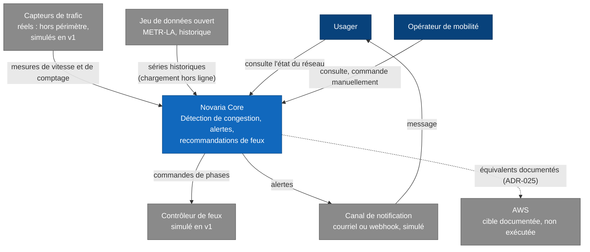

# Vue 1 : contexte

Novaria Core vu de l'extérieur : qui l'utilise, avec quels systèmes il échange. Légende et noms : [README](README.md).

## Échanges

| De | Vers | Contenu | Remarque |
|---|---|---|---|
| Capteurs de trafic | Novaria Core | Mesures par intervalle de 10 s : véhicules, vitesse | En v1 produites par le Simulateur IoT, qui fait partie de Novaria Core. Une donnée simulée n'est jamais présentée comme réelle. |
| Jeu de données ouvert | Novaria Core | Vitesses historiques pour entraîner la prévision | Chargé hors ligne ; aucun jeu réel n'est redistribué dans le dépôt public |
| Novaria Core | Contrôleur de feux | Plan de phases | Toujours soumis aux garde-fous : le modèle ne commande jamais seul |
| Novaria Core | Canal de notification | Alerte, une par épisode de congestion | Simulé |
| Canal de notification | Usager | Message d'alerte | |
| Usager | Novaria Core | Consultation de l'état de la circulation | Via le Tableau de bord |
| Opérateur de mobilité | Novaria Core | Indicateurs, prévisions, commande manuelle des feux | Commande protégée par rôle |
| Novaria Core | AWS | Aucun échange | Le projet s'exécute avec Docker Compose sur le poste ([ADR-023](../adr/ADR-023-execution-locale-d-abord.md)) |

## Hors périmètre de cette vue

| Sujet | Où le trouver |
|---|---|
| Éléments internes | [02-conteneurs.md](02-conteneurs.md) |
| Outils de développement (GitHub Actions, SonarQube, Snyk, gitleaks) | [ADR-005](../adr/ADR-005-sonarqube-snyk-controles-bloquants.md), [ADR-018](../adr/ADR-018-devsecops.md) |
