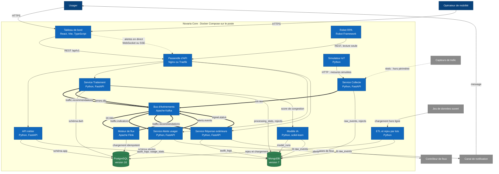

# Vue 2 : conteneurs

Les éléments exécutables de Novaria Core et leurs échanges. Un « conteneur » C4 est un processus ou une base qui tourne séparément ; ici chacun est un conteneur Docker (Compose, local). Légende et noms : [README](README.md).

L'état visé est celui des ADR ([008](../adr/ADR-008-microservices.md), [009](../adr/ADR-009-bus-evenements.md), [011](../adr/ADR-011-temps-reel-et-batch.md), [013](../adr/ADR-013-integration-donnees.md)). Le tableau d'état du [README](README.md) dit ce qui existe déjà.

## Diagramme

Le Moteur de flux est celui de [ADR-011](../adr/ADR-011-temps-reel-et-batch.md), retenu **sous condition**. S'il est abandonné, le calcul des fenêtres passe dans le Service Traitement (consommateur Python) et les flèches du Moteur de flux deviennent celles du Service Traitement. Les noms des sujets Kafka sont ceux de [ADR-009](../adr/ADR-009-bus-evenements.md), section 4.1.

## Qui écrit où

Règle d'architecture n° 1 ([ADR-008](../adr/ADR-008-microservices.md)) : un conteneur seul écrit dans ses schémas et collections.

| Conteneur | PostgreSQL (rôle) | MongoDB (utilisateur) |
|---|---|---|
| API métier | `app` (`svc_app`) | `audit_logs`, `usage_stats` (`svc_backend`) |
| Service Collecte | aucun | `raw_events`, `rejects` (`svc_collecte`) |
| Service Traitement et Moteur de flux | `dwh` (`svc_traitement`) | `processing_stats`, `rejects` (`svc_traitement`) |
| Service Alerte usager | `alertes` (`svc_alerte`) | aucun |
| Service Réponse extérieure | aucun | `audit_logs` (`svc_reponse`) |
| Modèle IA | aucun | `model_runs` (`svc_ml`) |
| ETL et rejeu par lots | `dwh` (`svc_traitement`, **non vérifié**) | lecture de `raw_events` |

Source : [bases locales](../../03-donnees/base-de-donnees-locale.md), sections 4 et 5.

## Flux d'événements

| Sujet | Producteur | Consommateurs |
|---|---|---|
| `iot.raw` | Service Collecte | Moteur de flux |
| `traffic.indicators` | Moteur de flux | Service Alerte usager, Tableau de bord |
| `traffic.recommendations` | Service Traitement | Service Réponse extérieure |
| `alerts.events` | Service Alerte usager | Tableau de bord (diffusion) |
| `signal.status` | Service Réponse extérieure | Tableau de bord |
| `errors.dlq` | tous les services | revue manuelle |

Le Tableau de bord ne se connecte pas à Kafka : les événements `alerts.events` et `signal.status` lui parviennent par la Passerelle d'API (WebSocket ou événements serveur, MS-11). Sans Moteur de flux, le producteur de `traffic.indicators` est le Service Traitement.

## Règles lues sur le diagramme

| Règle | Où elle se voit |
|---|---|
| Entrée unique | Seuls le Tableau de bord et le Robot RPA appellent la Passerelle d'API |
| Pas d'appel synchrone entre services | Les services ne s'appellent que par le Bus d'événements ; seule exception visible, `Service Traitement` → `Modèle IA`, à justifier (point ouvert n° 3 du README) |
| Propriété des données | Chaque base reçoit ses flèches d'écriture d'un seul conteneur par schéma |
| Robustesse | Un service arrêté laisse les autres tourner : les événements l'attendent dans le Bus d'événements |

## Équivalents AWS

Cible documentée, non exécutée ([ADR-025](../adr/ADR-025-equivalents-locaux-des-services-aws.md)).

| Élément local | Équivalent AWS |
|---|---|
| Docker Compose | ECS (Elastic Container Service) Fargate, ECR (Elastic Container Registry) |
| PostgreSQL | RDS (Relational Database Service) |
| Bus d'événements | MSK (Managed Streaming for Apache Kafka) |
| Moteur de flux | Managed Service for Apache Flink |
| Modèle IA | SageMaker |
