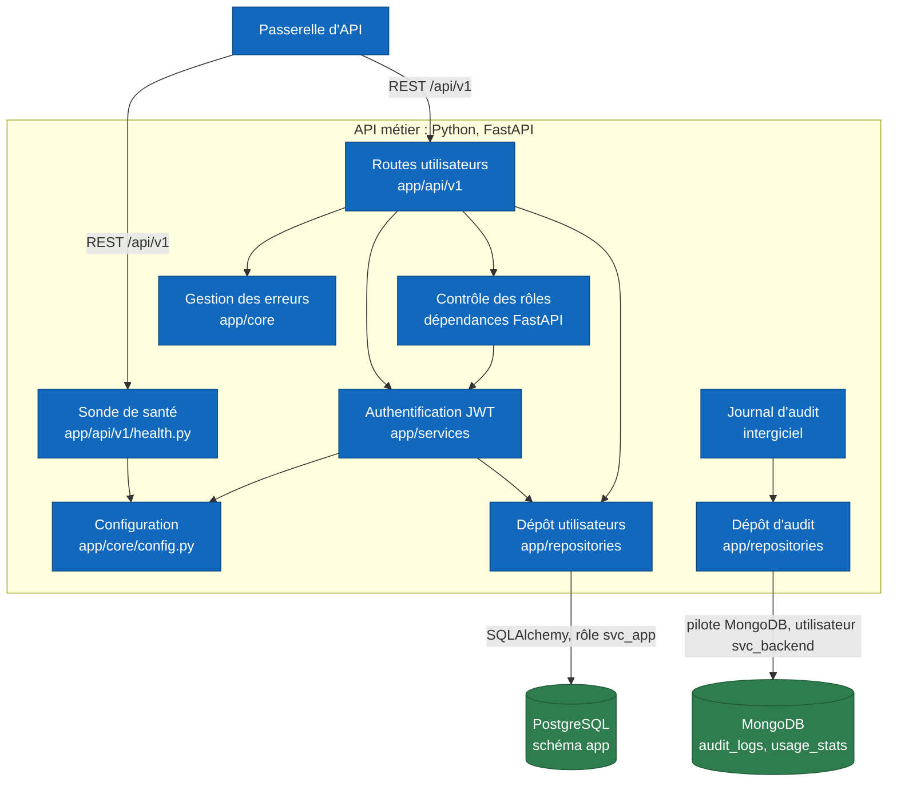
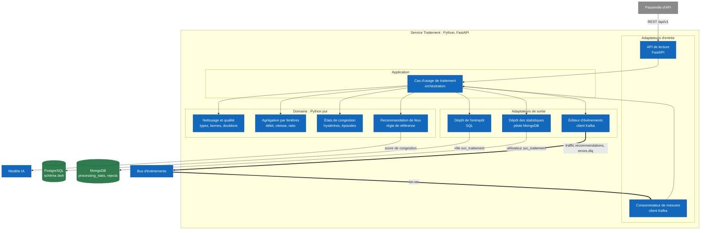

# Vue 3 : composants du back-end

Le contenu de deux conteneurs de la [vue 2](02-conteneurs.md) : l'**API métier** (dossier `services/traitement/`, ancien `backend/`, la partie de Daddy) et le **Service Traitement** (cœur des données). Les autres services suivent le même gabarit, résumé en fin de document. Légende et noms : [README](README.md).

Un composant C4 est un regroupement de code qui a une responsabilité (un module, un paquet), pas une classe.

## 3.1 API métier

Dossier `services/traitement/app/` (ancien `backend/app/`, déplacé par MS-04). Architecture en couches simples (`api`, `services`, `repositories`, `models`, `schemas`, `core`) : l'API métier ne porte pas de logique de domaine riche, [ADR-010](../adr/ADR-010-architecture-hexagonale.md) réserve l'hexagone aux services à logique métier.

| Composant | Responsabilité | Entrées | Sorties | État |
|---|---|---|---|---|
| Sonde de santé | Dit que le service tourne : état, version, révision Git, environnement | `GET /api/v1/health` | JSON ; utilisée par Docker et le pipeline de déploiement | Existe, 1 test |
| Configuration | Lit les variables d'environnement (`Settings`), aucun secret dans le code | `.env`, variables | Objet `Settings` partagé | Existe |
| Authentification JWT | Vérifie identifiant et mot de passe, émet un jeton à durée limitée | Requête de connexion | Jeton d'accès (JSON Web Token) | Planifié (BE-03) |
| Contrôle des rôles | Refuse l'accès sans jeton (401) ou sans droit (403) | Jeton, rôle exigé par la route | Accès accordé ou refusé | Planifié (BE-03) |
| Routes utilisateurs | Expose gestion des utilisateurs et des rôles ; le contrat est dans OpenAPI | Requêtes REST | Réponses JSON conformes au contrat | Planifié (BE-01, BE-03) |
| Gestion des erreurs | Un seul format d'erreur, validation des entrées par Pydantic | Exceptions, données invalides | Réponse d'erreur documentée au contrat | Planifié (BE-06) |
| Journal d'audit | Pour chaque appel authentifié : qui, quoi, quand ; compteur d'usage par point d'accès ; aucun secret ni donnée personnelle | Chaque requête | Documents dans MongoDB | Planifié (BE-05) |
| Dépôt utilisateurs | Seul accès au schéma `app` | Objets métier | Lignes PostgreSQL, migrations Alembic | Planifié (BE-02) |
| Dépôt d'audit | Seul accès aux collections d'audit | Événements d'audit | Documents MongoDB | Planifié (BE-05) |

Hors de ce conteneur, mais proche : CORS, en-têtes de sécurité et limitation de débit (BE-08) sont rattachés à la **Passerelle d'API** par MS-13. Le point ouvert n° 2 du [README](README.md) dit qui valide le jeton.

## 3.2 Service Traitement

Dossier cible `services/traitement/app/`, gabarit hexagonal de [ADR-010](../adr/ADR-010-architecture-hexagonale.md) : le domaine n'importe ni FastAPI, ni SQLAlchemy, ni le pilote Kafka.

| Composant | Couche | Responsabilité | Issue |
|---|---|---|---|
| API de lecture | Adaptateur d'entrée | Sert indicateurs et prévisions depuis des vues en lecture seule ; ne lit jamais les tables d'écriture ([ADR-014](../adr/ADR-014-architecture-decisionnelle.md), séparation écriture et lecture) | MS-10 |
| Consommateur de mesures | Adaptateur d'entrée | Lit `iot.raw`, convertit le message en objet du domaine, ignore un `id` déjà traité (idempotence) | MS-09 |
| Cas d'usage de traitement | Application | Enchaîne nettoyage, agrégation, état, recommandation, puis écrit via les ports ; ne dépend que des ports | MS-09, MS-10 |
| Nettoyage et qualité | Domaine | Rejette avec motif (`type`, `borne`, `horloge`), compte les doublons | DAT-04 |
| Agrégation par fenêtres | Domaine | Fenêtres de 1 et 5 minutes, messages tardifs, vitesse `null` sur route vide | MS-09 |
| États de congestion | Domaine | Ratio de vitesse, seuils de montée et de descente, un épisode par période ([ADR-028](../adr/ADR-028-etats-de-congestion-et-alertes.md)) | IA-01 |
| Recommandation de feux | Domaine | Calcul déterministe de référence ; le score du modèle n'est qu'une entrée | MS-10, IA-06 |
| Dépôt de l'entrepôt | Adaptateur de sortie | Écriture idempotente dans `dwh` (clé : tronçon, début, taille, run) | DAT-05 |
| Dépôt des statistiques | Adaptateur de sortie | Écrit `processing_stats` (qualité, retards, rejets) et `rejects` | MS-09 |
| Éditeur d'événements | Adaptateur de sortie | Publie `traffic.recommendations` et les rejets vers `errors.dlq` ; sans Moteur de flux, publie aussi `traffic.indicators` | MS-09 |

## 3.3 Autres services

Même gabarit hexagonal, mêmes noms de couches. Seul le Service Collecte reste une chaîne légère ([ADR-010](../adr/ADR-010-architecture-hexagonale.md), section 4).

| Service | Adaptateurs d'entrée | Cœur | Adaptateurs de sortie |
|---|---|---|---|
| Service Collecte | Réception HTTP des mesures | Validation de forme, dédoublonnage | Éditeur d'événements (`iot.raw`), stock brut MongoDB |
| Service Alerte usager | Consommateur de `traffic.indicators`, API des alertes | Moteur de règles, machine à états de l'alerte (créée, notifiée, acquittée, résolue) | Dépôt `alertes`, *outbox* puis `alerts.events`, canal de notification |
| Service Réponse extérieure | Consommateur de `traffic.recommendations`, commande manuelle | Garde-fous, machine à états des phases, mode dégradé à plan fixe | Contrôleur de feux simulé, `signal.status`, `audit_logs` |

## Cohérence avec les vues 1 et 2

| Élément de cette vue | Même nom dans la vue 2 | Même responsabilité |
|---|---|---|
| API métier | oui | Utilisateurs, rôles, jetons, audit |
| Service Traitement | oui | Nettoyer, agréger, alimenter l'entrepôt, recommander |
| Passerelle d'API, Bus d'événements, Modèle IA | oui | Voir le catalogue du [README](README.md) |
| PostgreSQL, MongoDB | oui | Les sous-titres citent le schéma ou les collections concernés |

Le test `scripts/dev/test_c4.py` vérifie que chaque nom employé dans les trois vues figure dans le catalogue.
