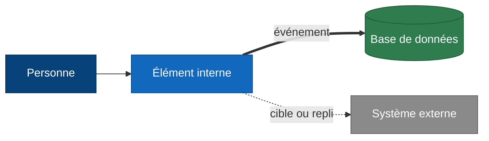

# Diagrammes C4 de Novaria Core

Issue : DOC-03. Responsables : Daddy Luciano (rédaction), Manoa Robel (relecture croisée). Dernière mise à jour : 26/10/2026.

Le modèle C4 (*Context, Containers, Components, Code*) décrit un système en vues de plus en plus fines. Ce dossier couvre les trois premiers niveaux. Les diagrammes sont en Mermaid : GitHub les affiche sans outil.

| Vue | Question à laquelle elle répond | Fichier |
|---|---|---|
| 1. Contexte | Qui utilise Novaria Core et avec quels systèmes échange-t-il ? | [01-contexte.md](01-contexte.md) |
| 2. Conteneurs | Quels éléments exécutables le composent, et comment communiquent-ils ? | [02-conteneurs.md](02-conteneurs.md) |
| 3. Composants | De quoi sont faits l'API métier et le service de traitement ? | [03-composants.md](03-composants.md) |

Sources : [ADR-008](../adr/ADR-008-microservices.md) (4 services), [ADR-009](../adr/ADR-009-bus-evenements.md) (Kafka), [ADR-010](../adr/ADR-010-architecture-hexagonale.md) (hexagonale), [ADR-023](../adr/ADR-023-execution-locale-d-abord.md) (local d'abord), [bases locales](../../03-donnees/base-de-donnees-locale.md), [dictionnaire de données](../../03-donnees/dictionnaire-de-donnees.md).

## Légende

Valable pour les trois vues.

| Symbole | Sens |
|---|---|
| Bleu foncé | Personne |
| Bleu | Élément interne à Novaria Core (conteneur ou composant) |
| Vert, cylindre | Base de données |
| Gris | Système externe, hors du dépôt |
| Flèche pleine `-->` | Appel synchrone : HTTP (HyperText Transfer Protocol), SQL (Structured Query Language) ou pilote MongoDB |
| Flèche épaisse `==>` | Événement publié ou consommé sur le bus Kafka |
| Flèche pointillée `-.->` | Cible documentée non exécutée, ou solution de repli |

Chaque élément porte son **nom canonique** sur la première ligne de son étiquette ; la seconde ligne donne la technologie.

## Catalogue des noms et des responsabilités

Source unique : un nom ou une responsabilité se modifie **ici d'abord**, puis dans les vues. Le test `scripts/dev/test_c4.py` refuse un diagramme qui emploie un nom absent de ces tableaux.

Colonne « État » : **Existe** (présent dans le dépôt au 26/10/2026) ou **Planifié** (issue citée, rien d'écrit).

### Système

| Nom | Responsabilité | État |
|---|---|---|
| Novaria Core | Détecte la congestion, alerte les usagers, recommande des plans de feux ; socle de données décisionnelles et d'IA d'UrbanHub | En construction |

### Personnes

| Nom | Responsabilité | État |
|---|---|---|
| Usager | Se déplace dans la ville, reçoit les alertes de congestion | Cible |
| Opérateur de mobilité | Surveille le réseau, consulte indicateurs et prévisions, peut commander manuellement les feux | Cible |

Les deux noms sont déduits de [ADR-008](../adr/ADR-008-microservices.md) et de MS-14 : à confirmer avec Manoa (voir « Points ouverts »).

### Systèmes externes

| Nom | Responsabilité | État |
|---|---|---|
| Capteurs de trafic | Comptent les véhicules et mesurent la vitesse. **Réels : hors périmètre ; en v1 le Simulateur IoT les remplace** | Cible |
| Jeu de données ouvert | Séries réelles historiques de vitesses (METR-LA) pour la prévision ([ADR-015](../adr/ADR-015-modeles-ia.md), [ADR-027](../adr/ADR-027-jeux-de-donnees-et-provenance.md)) | Cible |
| Contrôleur de feux | Applique les phases de feux. Simulé en v1 | Cible |
| Canal de notification | Courriel ou webhook qui transporte l'alerte à l'usager. Simulé en v1 (MS-11) | Cible |
| AWS | Amazon Web Services : cible documentée, **jamais exécutée** ([ADR-023](../adr/ADR-023-execution-locale-d-abord.md)) | Documenté |

### Conteneurs

| Nom | Technologie | Dossier | Responsabilité | État |
|---|---|---|---|---|
| Tableau de bord | React, Vite, TypeScript | `frontend/` | Affiche indicateurs, alertes, état des feux ; envoie la commande manuelle | Existe (socle FE-01) |
| Passerelle d'API | Nginx ou Traefik | `gateway/` | Point d'entrée unique : routage `/api/<service>`, authentification, limitation de débit, CORS | Planifié (MS-13) |
| API métier | Python, FastAPI | `services/traitement/` (ancien `backend/`) | Utilisateurs, rôles et jetons ; audit et statistiques d'usage | Existe (squelette : `/health`), dossier partagé avec le Service Traitement tant que le point ouvert 1 n'est pas tranché |
| Simulateur IoT | Python | `simulator/` | Génère des mesures de capteurs reproductibles (graine) avec anomalies injectables | Planifié (MS-07) |
| Service Collecte | Python, FastAPI | `services/collecte/` | Reçoit, valide, dédoublonne, stocke le brut, publie `iot.raw` | Planifié (MS-08) |
| Service Traitement | Python, FastAPI | `services/traitement/` | Nettoie, agrège par fenêtres, alimente l'entrepôt, publie indicateurs et recommandations, sert l'API de lecture | Planifié (MS-09, MS-10) |
| Service Alerte usager | Python, FastAPI | `services/alerte/` | Évalue les règles, gère le cycle de vie d'une alerte, diffuse en direct | Planifié (MS-11) |
| Service Réponse extérieure | Python, FastAPI | `services/reponse/` | Applique les recommandations au contrôleur de feux avec garde-fous et mode dégradé | Planifié (MS-12) |
| Bus d'événements | Apache Kafka (KRaft) | `docker-compose.yml` | Transporte les événements, ordre par carrefour, rejeu | Planifié (LOC-04) |
| Moteur de flux | Apache Flink | `data/streaming/` | Fenêtres de 1 et 5 minutes en temps d'événement. Repli : consommateur Python dans le Service Traitement | Planifié, sous condition ([ADR-011](../adr/ADR-011-temps-reel-et-batch.md)) |
| ETL et rejeu par lots | Python | `data/etl/` | Ingestion, nettoyage, chargement idempotent, recalcul nocturne, jeu d'entraînement | Planifié (DAT-03 à DAT-05) |
| Modèle IA | Python, scikit-learn | `ml/` | Entraîne, évalue, enregistre et sert le classificateur de congestion et la prévision | Planifié (IA-04 à IA-06) |
| Robot RPA | Robot Framework | `automation/rpa/` | Produit chaque semaine le rapport d'indicateurs, en lecture seule | Planifié (IA-07) |
| PostgreSQL | PostgreSQL 16 | `db/postgres/` | Schémas `app`, `dwh`, `alertes`, `ops` | Existe |
| MongoDB | MongoDB 7 | `db/mongo/` | Événements bruts, rejets, audit, statistiques, suivi des modèles | Existe |

### Composants de l'API métier

| Nom | Responsabilité | Fichier ou issue | État |
|---|---|---|---|
| Configuration | Lit les variables d'environnement, aucun secret dans le code | `app/core/config.py` | Existe |
| Sonde de santé | Répond à `/api/v1/health` avec version et révision | `app/api/v1/health.py` | Existe |
| Authentification JWT | Vérifie les identifiants et émet le jeton d'accès | `app/services/auth.py`, `app/core/security.py` (BE-03) | Existe |
| Contrôle des rôles | Refuse l'accès sans droit (403) ou sans jeton (401) | `app/api/deps.py` (BE-03) | Existe |
| Routes utilisateurs | Expose la gestion des utilisateurs et des rôles | `app/api/v1/users.py` (BE-03) | Partiel : liste, création, lecture ; la modification reste à faire |
| Gestion des erreurs | Format d'erreur unique, validation des entrées | BE-06 | Planifié |
| Journal d'audit | Enregistre qui fait quoi et quand, et compte l'usage par point d'accès | BE-05 | Planifié |
| Dépôt utilisateurs | Lit et écrit le schéma `app` | `app/repositories/users.py` (BE-02, BE-03) | Existe |
| Dépôt d'audit | Écrit `audit_logs` et `usage_stats` dans MongoDB | BE-05 | Planifié |

### Composants du Service Traitement

| Nom | Responsabilité | Couche | État |
|---|---|---|---|
| API de lecture | Sert indicateurs et prévisions en lecture seule | Adaptateur d'entrée | Partiel : les trois routes d'indicateurs existent (BE-04, `app/api/v1/indicators.py`) ; prévisions et référentiel planifiés (MS-10) |
| Consommateur de mesures | Lit `iot.raw` | Adaptateur d'entrée | Planifié (MS-09) |
| Cas d'usage de traitement | Orchestre nettoyage, agrégation, recommandation | Application | Planifié |
| Nettoyage et qualité | Types, bornes, doublons, rejets avec motif | Domaine | Planifié (DAT-04) |
| Agrégation par fenêtres | Calcule débit, vitesse, ratio de vitesse | Domaine | Planifié (MS-09) |
| États de congestion | Hystérésis et épisodes ([ADR-028](../adr/ADR-028-etats-de-congestion-et-alertes.md)) | Domaine | Planifié |
| Recommandation de feux | Règle de référence, puis score du modèle | Domaine | Planifié (MS-10) |
| Dépôt de l'entrepôt | Écrit et lit le schéma `dwh` | Adaptateur de sortie | Planifié (DAT-05) |
| Dépôt des statistiques | Écrit `processing_stats` et `rejects` | Adaptateur de sortie | Planifié |
| Éditeur d'événements | Publie `traffic.indicators`, `traffic.recommendations`, `errors.dlq` | Adaptateur de sortie | Planifié (MS-09) |

## Points ouverts

À trancher avant la relecture croisée. Ils ne bloquent pas les diagrammes, qui montrent l'état visé par les ADR.

| N° | Point | Constat | Qui |
|---|---|---|---|
| 1 | Avenir de l'API métier | Le squelette `backend/` a été déplacé vers `services/traitement` le 27/10/2026 (MS-04, prévu par l'[ADR-010](../adr/ADR-010-architecture-hexagonale.md)). Or le schéma `app` (utilisateurs) et les rôles de base `svc_app` et `svc_backend` existent déjà pour un service à part. Ces vues le montrent comme **API métier**, distincte du Service Traitement. Le 30/10/2026 (BE-03), l'authentification est réalisée **dans `services/traitement`**, avec un second contrat déclaré dans son `pyproject.toml` ; le point reste ouvert. | Daddy et Manoa |
| 2 | Qui valide le jeton ? | [MS-13](../../../scripts/github/issues_microservices.py) place l'authentification à la **passerelle** ; BE-03 la place dans le back-end. Mécanisme non décidé (ADR « Authentification et passerelle d'API » à rédiger). Ces vues : l'API métier émet le jeton, la passerelle le contrôle. | Daddy |
| 3 | Où est servi le modèle ? | IA-06 parle d'un « endpoint d'inférence » sans dire dans quel conteneur. Ces vues : conteneur **Modèle IA** séparé, appelé par le Service Traitement. | Manoa |
| 4 | Noms des personnes | « Usager » et « Opérateur de mobilité » ne figurent pas tels quels dans la note de cadrage. | Manoa |
| 5 | Compte de l'ETL | L'ETL écrit dans `dwh` : il doit utiliser `svc_traitement`. Non vérifié. | Daddy |

## Maintenir ces diagrammes

| Règle | Raison |
|---|---|
| Changer le catalogue avant les vues | Le nom canonique est unique |
| Une décision qui change une vue met à jour l'ADR concernée | Les ADR font foi |
| Passer l'état de « Planifié » à « Existe » quand le code arrive dans le dépôt | La légende ne doit pas promettre ce qui n'est pas écrit |

| Contrôle | Linux (bash) | Windows (PowerShell) |
|---|---|---|
| Cohérence des noms | `python3 -m unittest discover -s scripts/dev -p "test_c4.py"` | `py -3 -m unittest discover -s scripts/dev -p "test_c4.py"` |
| Tous les tests du poste | `python3 -m unittest discover -s scripts/dev` | `py -3 -m unittest discover -s scripts/dev` |
