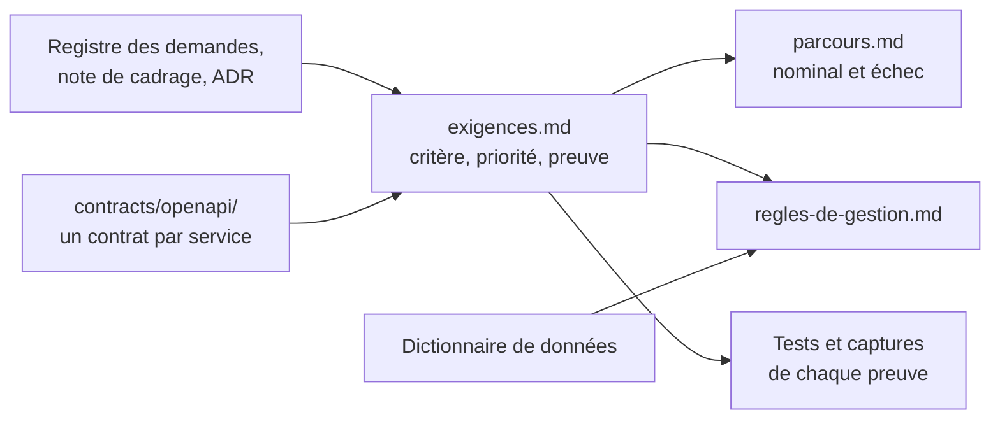
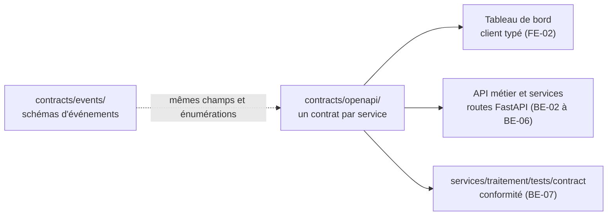

# Spécifications

Les spécifications répondent à trois questions : **que doit faire le système** (exigences), **que se passe-t-il quand tout va bien ou mal** (parcours), **que doivent respecter les données** (règles de gestion). Le contrat d'API dit **comment on le demande**.

| Fichier | Contenu | Issue | État |
|---|---|---|---|
| [exigences.md](exigences.md) | 53 exigences vérifiables : contexte, critère mesurable, priorité (Doit, Devrait, Pourrait), preuve attendue, état constaté | DOC-05 | v1, relecture croisée à faire |
| [parcours.md](parcours.md) | 6 parcours nominaux et 29 cas d'échec, chacun rattaché à ses exigences | DOC-05 | v1, relecture croisée à faire |
| [regles-de-gestion.md](regles-de-gestion.md) | 28 règles sur l'identité, la provenance, le calcul, les alertes, les droits et la conservation des données | DOC-05 | v1, relecture croisée à faire |
| [contracts/openapi/](../../contracts/openapi/README.md) | Un contrat REST `/api/v1` par service : ressources, entrées, sorties, erreurs, authentification, versionnement (issu du contrat unique de BE-01) | BE-01, MS-03 | Brouillon, validation du professeur attendue (GES-06) |

La version finale des spécifications est l'issue DOC-07 (jalon M5) : elle reprend ces fichiers et décrit **ce qui est livré**, pas ce qui était prévu.

## Place du contrat dans le projet

Les contrats décrivent l'API **vue par le Tableau de bord**, c'est-à-dire derrière la passerelle : tous les chemins restent sous `/api/v1`, la passerelle route par préfixe vers le service propriétaire. MS-03 a découpé le contrat unique de BE-01 en un contrat par service dans `contracts/openapi/` (aucune opération perdue, une ajoutée : le dépôt des mesures par le simulateur). Les schémas `Indicator` et `Alert` reprennent les champs obligatoires des événements `novaria.traffic.indicator.v1` et `novaria.alert.state_changed.v1` ; le test ci-dessous le vérifie.

## Points d'accès

La liste des points d'accès, avec le service propriétaire, le rôle minimal et l'issue d'implémentation de chacun, est dans [contracts/openapi/README.md](../../contracts/openapi/README.md). Tous les chemins commencent par `/api/v1`.

## Vérifier les contrats d'API

Dépendance, une seule fois : PyYAML.

| Étape | Linux (bash) | Windows (PowerShell) |
|---|---|---|
| Installer PyYAML | `python3 -m pip install pyyaml` | `py -3 -m pip install pyyaml` |
| Tester les contrats | `python3 -m unittest discover -s scripts/dev -p "test_openapi.py"` | `py -3 -m unittest discover -s scripts/dev -p "test_openapi.py"` |

Le test charge chaque contrat de `contracts/openapi/`, résout chaque référence, contrôle les identifiants d'opération, la sécurité, le format d'erreur unique, la concordance avec `contracts/events/` et le découpage (aucune des 25 opérations de BE-01 perdue). Il ne remplace pas un validateur OpenAPI complet : non exécuté ici, à lancer par exemple avec `npx @redocly/cli lint contracts/openapi/traitement.openapi.yaml`.

## Vérifier les spécifications

Aucune dépendance : bibliothèque standard de Python.

| Étape | Linux (bash) | Windows (PowerShell) |
|---|---|---|
| Tester les spécifications | `python3 -m unittest discover -s scripts/dev -p "test_specifications.py"` | `py -3 -m unittest discover -s scripts/dev -p "test_specifications.py"` |

Le test échoue si une exigence n'a pas de critère, de priorité, de preuve ou d'état valides, si une issue citée n'existe pas au backlog, si un cas d'échec ou une règle renvoie à une exigence inexistante, si un lien est cassé, si le bilan chiffré de `exigences.md` ne correspond pas au tableau, ou si un travail de code ou de données du backlog n'est couvert par aucune exigence. Il ne dit pas que les exigences sont **justes** : c'est le rôle de la relecture croisée et de la validation du professeur.

## Points ouverts des spécifications

| N° | Point | Position dans la v1 | Qui |
|---|---|---|---|
| S1 | Validation du cahier des charges fonctionnel par le professeur (point 5 de GES-06) et des valeurs chiffrées (latences, seuils d'hystérésis, retard autorisé) | Valeurs de départ marquées comme telles ; à mesurer (MS-15) | Binôme et professeur |
| S2 | Règles de sécurité des feux (durée minimale et maximale d'une phase, phases conflictuelles) | À écrire avant le code de MS-12 ; exigence EXG-REP-02 | Daddy |
| S3 | Délai sans recommandation avant le retour au plan fixe | Non fixé ; exigence EXG-REP-03 | Daddy |
| S4 | Comportement en cas de panne du bus, de PostgreSQL ou de MongoDB (CE-23 à CE-25) | Propositions, en attente de l'ADR « Observabilité et résilience » (MS-16) | Daddy et Manoa |
| S5 | Données personnelles d'un usager final (RG-23) | Aucune en v1, canal de notification simulé ; à confirmer avec MS-11 | Daddy et Manoa |
| S6 | Contrats des sujets `traffic.recommendations`, `signal.status` et `errors.dlq` | Écrits en MS-03 (v1, exemples, cas invalides, banc de conformité) ; bornes de durée de phase à remplacer par les règles de sécurité de MS-12 ; exigence EXG-COL-04 | Daddy et Manoa |
| S7 | Le schéma en étoile de l'[ADR-014](../01-architecture/adr/ADR-014-architecture-decisionnelle.md) (section 4.1) emploie d'anciens noms (`fait_trafic_fenetre`, `dim_carrefour`, `fait_alerte`, `fait_commande_feu`) et deux faits que l'entrepôt ne contient pas. Le [dictionnaire](../03-donnees/dictionnaire-de-donnees.md) et les migrations font foi | L'ADR est à corriger, sans nouvelle décision | Manoa |
| S8 | Relecture croisée de ces trois documents | Non faite : toutes les lignes sont de la rédaction de Daddy Luciano | Manoa |

## Points ouverts du contrat

Ils sont tenus avec les contrats : [contracts/openapi/README.md](../../contracts/openapi/README.md), section « Points ouverts ».
