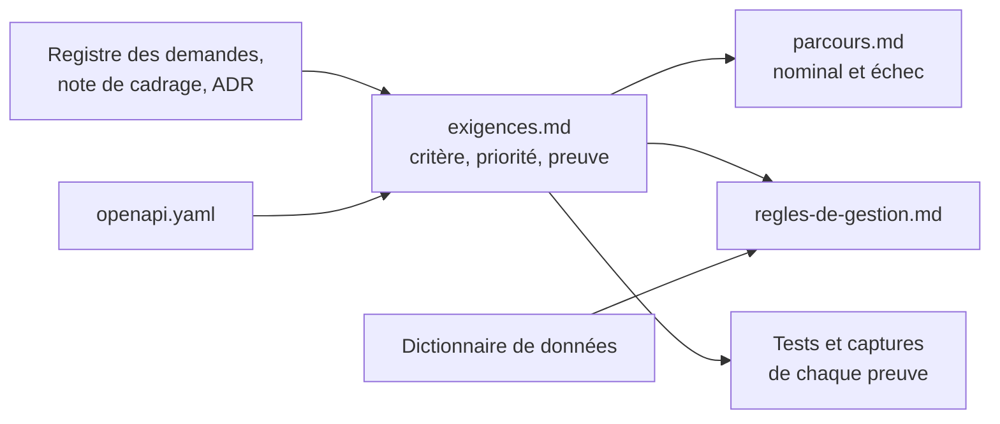
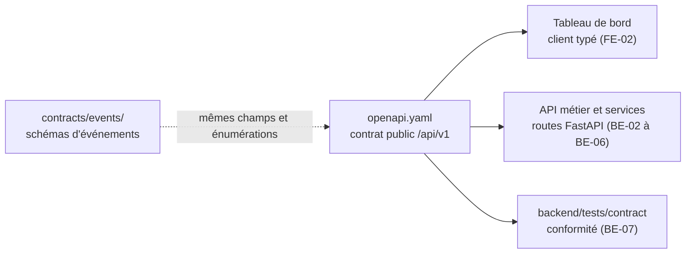

# Spécifications

Les spécifications répondent à trois questions : **que doit faire le système** (exigences), **que se passe-t-il quand tout va bien ou mal** (parcours), **que doivent respecter les données** (règles de gestion). Le contrat d'API dit **comment on le demande**.

| Fichier | Contenu | Issue | État |
|---|---|---|---|
| [exigences.md](exigences.md) | 53 exigences vérifiables : contexte, critère mesurable, priorité (Doit, Devrait, Pourrait), preuve attendue, état constaté | DOC-05 | v1, relecture croisée à faire |
| [parcours.md](parcours.md) | 6 parcours nominaux et 29 cas d'échec, chacun rattaché à ses exigences | DOC-05 | v1, relecture croisée à faire |
| [regles-de-gestion.md](regles-de-gestion.md) | 28 règles sur l'identité, la provenance, le calcul, les alertes, les droits et la conservation des données | DOC-05 | v1, relecture croisée à faire |
| [openapi.yaml](openapi.yaml) | Contrat REST `/api/v1` : ressources, entrées, sorties, erreurs, authentification, versionnement | BE-01 | Brouillon, validation du professeur attendue (GES-06) |

La version finale des spécifications est l'issue DOC-07 (jalon M5) : elle reprend ces fichiers et décrit **ce qui est livré**, pas ce qui était prévu.

## Place du contrat dans le projet

Ce fichier décrit l'API **vue par le Tableau de bord**, c'est-à-dire derrière la passerelle. MS-03 prévoit ensuite un contrat par service dans `contracts/openapi/` ; ils se déduiront de celui-ci en le découpant par étiquette. Les schémas `Indicator` et `Alert` reprennent les champs obligatoires des événements `novaria.traffic.indicator.v1` et `novaria.alert.state_changed.v1` ; le test ci-dessous le vérifie.

## Points d'accès

| Étiquette | Point d'accès | Rôle minimal | Issue d'implémentation |
|---|---|---|---|
| Santé | `GET /health` | public | existe |
| Authentification | `POST /auth/login` (public), `GET /auth/me` | `viewer` | BE-03 |
| Utilisateurs | `GET`, `POST /users` ; `GET`, `PATCH /users/{user_id}` | `admin` | BE-02, BE-03 |
| Référentiel | `GET /intersections`, `/intersections/{id}`, `/road-segments` | `viewer` | MS-10 |
| Indicateurs | `GET /indicators`, `/indicators/latest`, `/indicators/{id}` | `viewer` | BE-04, MS-10 |
| Alertes | `GET /alerts`, `/alerts/{id}` ; `POST /alerts/{id}/acknowledge`, `/resolve` ; `GET /alert-rules` ; `PATCH /alert-rules/{id}` | `viewer`, `operator`, `admin` | MS-11 |
| Feux | `GET /signals`, `/signals/{id}`, `/signals/{id}/commands` ; `POST /signals/{id}/commands` | `viewer`, `operator` | MS-12 |
| Prévisions | `GET /forecasts` | `viewer` | IA-06 |
| Flux | `GET /events/stream` (SSE) | `viewer` | MS-11 |

Tous les chemins commencent par `/api/v1`.

## Vérifier le contrat

Dépendance, une seule fois : PyYAML.

| Étape | Linux (bash) | Windows (PowerShell) |
|---|---|---|
| Installer PyYAML | `python3 -m pip install pyyaml` | `py -3 -m pip install pyyaml` |
| Tester le contrat | `python3 -m unittest discover -s scripts/dev -p "test_openapi.py"` | `py -3 -m unittest discover -s scripts/dev -p "test_openapi.py"` |

Le test charge le fichier, résout chaque référence, contrôle les identifiants d'opération, la sécurité, le format d'erreur unique et la concordance avec `contracts/events/`. Il ne remplace pas un validateur OpenAPI complet : non exécuté ici, à lancer par exemple avec `npx @redocly/cli lint docs/02-specifications/openapi.yaml`.

## Vérifier les spécifications

Aucune dépendance : bibliothèque standard de Python.

| Étape | Linux (bash) | Windows (PowerShell) |
|---|---|---|
| Tester les spécifications | `python3 -m unittest discover -s scripts/dev -p "test_specifications.py"` | `py -3 -m unittest discover -s scripts/dev -p "test_specifications.py"` |

Le test échoue si une exigence n'a pas de critère, de priorité, de preuve ou d'état valides, si une issue citée n'existe pas au backlog, si un cas d'échec ou une règle renvoie à une exigence inexistante, si un lien est cassé, si le bilan chiffré de `exigences.md` ne correspond pas au tableau, ou si un travail de code ou de données du backlog n'est couvert par aucune exigence. Il ne dit pas que les exigences sont **justes** : c'est le rôle de la relecture croisée et de la validation du professeur.

## Points ouverts des spécifications

| N° | Point | Position dans la v1 | Qui |
|---|---|---|---|
| S1 | Validation du cahier des charges fonctionnel par le professeur (point 5 de GES-06) et des valeurs chiffrées (latences, seuils d'hystérésis, retard autorisé) | Valeurs de départ marquées comme telles ; à mesurer (MS-15) | Binôme et professeur |
| S2 | Règles de sécurité des feux (durée minimale et maximale d'une phase, phases conflictuelles) | À écrire avant le code de MS-12 ; exigence EXG-REP-02 | Daddy |
| S3 | Délai sans recommandation avant le retour au plan fixe | Non fixé ; exigence EXG-REP-03 | Daddy |
| S4 | Comportement en cas de panne du bus, de PostgreSQL ou de MongoDB (CE-23 à CE-25) | Propositions, en attente de l'ADR « Observabilité et résilience » (MS-16) | Daddy et Manoa |
| S5 | Données personnelles d'un usager final (RG-23) | Aucune en v1, canal de notification simulé ; à confirmer avec MS-11 | Daddy et Manoa |
| S6 | Contrats des sujets `traffic.recommendations`, `signal.status` et `errors.dlq` | Non écrits ; exigence EXG-COL-04 | Daddy et Manoa |
| S7 | Le schéma en étoile de l'[ADR-014](../01-architecture/adr/ADR-014-architecture-decisionnelle.md) (section 4.1) emploie d'anciens noms (`fait_trafic_fenetre`, `dim_carrefour`, `fait_alerte`, `fait_commande_feu`) et deux faits que l'entrepôt ne contient pas. Le [dictionnaire](../03-donnees/dictionnaire-de-donnees.md) et les migrations font foi | L'ADR est à corriger, sans nouvelle décision | Manoa |
| S8 | Relecture croisée de ces trois documents | Non faite : toutes les lignes sont de la rédaction de Daddy Luciano | Manoa |

## Points ouverts du contrat

| N° | Point | Position dans le brouillon | Qui |
|---|---|---|---|
| 1 | Rôles | Trois rôles hiérarchiques `viewer`, `operator`, `admin` ; aucun document ne les définissait | Daddy et Manoa |
| 2 | Signature du jeton | HS256 avec `JWT_SECRET` ; pas de jeton de renouvellement | Daddy |
| 3 | Qui valide le jeton | L'API métier l'émet ; la passerelle ou le service le contrôle (README des diagrammes C4, point 2) | Daddy |
| 4 | Diffusion en direct | SSE plutôt que WebSocket. `EventSource` ne pose pas d'en-tête `Authorization` : fetch en flux ou jeton à usage unique | Daddy |
| 5 | Feux | Schémas `SignalState` et `SignalCommand` **provisoires** : les contrats `signal.status` et `traffic.recommendations` ne sont pas écrits (MS-03, MS-12) | Daddy et Manoa |
| 6 | Page « Rapports » du front | Aucun point d'accès : le besoin n'est pas défini | Manoa |
| 7 | Indicateurs agrégés (KPI) | Aucun point d'accès tant que les définitions de DAT-07 ne sont pas figées | Manoa |
| 8 | Format d'erreur | FastAPI renvoie `{"detail": ...}` par défaut : un gestionnaire d'exceptions doit produire `application/problem+json` (BE-06) | Daddy |
| 9 | Découpage par service | MS-03 remplace ce fichier unique par un contrat par service | Daddy |
