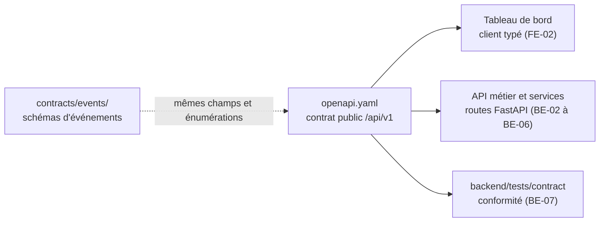

# Spécifications

| Fichier | Contenu | Issue | État |
|---|---|---|---|
| [openapi.yaml](openapi.yaml) | Contrat REST `/api/v1` : ressources, entrées, sorties, erreurs, authentification, versionnement | BE-01 | Brouillon, validation du professeur attendue (GES-06) |

## Place du contrat dans le projet

Ce fichier décrit l'API **vue par le Tableau de bord**, c'est-à-dire derrière la passerelle. MS-03 prévoit ensuite un contrat par service dans `contracts/openapi/` ; ils se déduiront de celui-ci en le découpant par étiquette. Les schémas `Indicator` et `Alert` reprennent les champs obligatoires des événements `novaria.traffic.indicator.v1` et `novaria.alert.state_changed.v1` ; le test ci-dessous le vérifie.

## Points d'accès

| Étiquette | Point d'accès | Rôle minimal | Issue d'implémentation |
|---|---|---|---|
| Santé | `GET /health` | public | existe |
| Authentification | `POST /auth/login` (public), `GET /auth/me` | `viewer` | BE-03 |
| Utilisateurs | `GET`, `POST /users` ; `GET`, `PATCH /users/{user_id}` | `admin` | BE-02, BE-03 |
| Référentiel | `GET /intersections`, `/intersections/{id}`, `/road-segments` | `viewer` | MS-10 |
| Indicateurs | `GET /indicators`, `/indicators/latest`, `/indicators/{id}` | `viewer` | BE-04, MS-10 |
| Alertes | `GET /alerts`, `/alerts/{id}` ; `POST /alerts/{id}/acknowledge`, `/resolve` ; `GET /alert-rules` ; `PATCH /alert-rules/{id}` | `viewer`, `operator`, `admin` | MS-11 |
| Feux | `GET /signals`, `/signals/{id}`, `/signals/{id}/commands` ; `POST /signals/{id}/commands` | `viewer`, `operator` | MS-12 |
| Prévisions | `GET /forecasts` | `viewer` | IA-06 |
| Flux | `GET /events/stream` (SSE) | `viewer` | MS-11 |

Tous les chemins commencent par `/api/v1`.

## Vérifier le contrat

Dépendance, une seule fois : PyYAML.

| Étape | Linux (bash) | Windows (PowerShell) |
|---|---|---|
| Installer PyYAML | `python3 -m pip install pyyaml` | `py -3 -m pip install pyyaml` |
| Tester le contrat | `python3 -m unittest discover -s scripts/dev -p "test_openapi.py"` | `py -3 -m unittest discover -s scripts/dev -p "test_openapi.py"` |

Le test charge le fichier, résout chaque référence, contrôle les identifiants d'opération, la sécurité, le format d'erreur unique et la concordance avec `contracts/events/`. Il ne remplace pas un validateur OpenAPI complet : non exécuté ici, à lancer par exemple avec `npx @redocly/cli lint docs/02-specifications/openapi.yaml`.

## Points ouverts

| N° | Point | Position dans le brouillon | Qui |
|---|---|---|---|
| 1 | Rôles | Trois rôles hiérarchiques `viewer`, `operator`, `admin` ; aucun document ne les définissait | Daddy et Manoa |
| 2 | Signature du jeton | HS256 avec `JWT_SECRET` ; pas de jeton de renouvellement | Daddy |
| 3 | Qui valide le jeton | L'API métier l'émet ; la passerelle ou le service le contrôle (README des diagrammes C4, point 2) | Daddy |
| 4 | Diffusion en direct | SSE plutôt que WebSocket. `EventSource` ne pose pas d'en-tête `Authorization` : fetch en flux ou jeton à usage unique | Daddy |
| 5 | Feux | Schémas `SignalState` et `SignalCommand` **provisoires** : les contrats `signal.status` et `traffic.recommendations` ne sont pas écrits (MS-03, MS-12) | Daddy et Manoa |
| 6 | Page « Rapports » du front | Aucun point d'accès : le besoin n'est pas défini | Manoa |
| 7 | Indicateurs agrégés (KPI) | Aucun point d'accès tant que les définitions de DAT-07 ne sont pas figées | Manoa |
| 8 | Format d'erreur | FastAPI renvoie `{"detail": ...}` par défaut : un gestionnaire d'exceptions doit produire `application/problem+json` (BE-06) | Daddy |
| 9 | Découpage par service | MS-03 remplace ce fichier unique par un contrat par service | Daddy |
