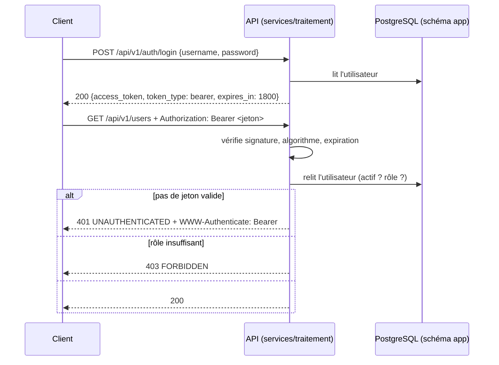

# Authentification, jetons et rôles (BE-03)

> Issue #63. Critère : **un accès sans droit renvoie 403, un accès sans jeton renvoie 401.** Preuve : les tests de
> [`services/traitement/tests/contract/`](../../services/traitement/tests/contract/test_auth_contract.py). Contrat :
> [`api-metier.openapi.yaml`](../../contracts/openapi/api-metier.openapi.yaml) ; conventions :
> [README des contrats](../../contracts/openapi/README.md) (sections « Authentification » et « Rôles »).

## 1. Où c'est, et pourquoi là

L'authentification est dans **`services/traitement/`**, avec le modèle `User` et les migrations de BE-02, parce que le point ouvert n° 1 des
[diagrammes C4](../01-architecture/c4/README.md) (l'API métier est-elle un service à part ?) n'est pas tranché. Conséquences, assumées :

- le service a deux contrats, déclarés dans son `pyproject.toml` (`[tool.novaria] contrats = ["traitement", "api-metier"]`) ; le test de
  contrat commun à tous les services accepte alors une route décrite dans l'un ou l'autre (le code du test est le même dans les cinq dossiers de `services/`) ;
- Docker Compose donne au service `traitement` un second compte de base (`svc_app`, schéma `app`) et le secret `JWT_SECRET` ; **aucun autre service ne les reçoit** (un test le vérifie) ;
- la passerelle envoie `/api/v1/auth` et `/api/v1/users` au service `traitement`.

Séparer plus tard l'API métier = déplacer `app/models`, `app/api/v1/auth.py`, `users.py` et leurs tests, et changer une ligne de la passerelle.

## 2. Parcours

## 3. Le jeton

| Élément | Valeur |
|---|---|
| Format | JWT (JSON Web Token), signé HS256 (HMAC-SHA256). **L'algorithme est fixé dans le code** : un jeton qui annonce `none` ou un autre algorithme est refusé |
| Revendications | `sub` (identifiant de l'utilisateur), `role`, `iat`, `exp` ; toutes obligatoires |
| Durée de vie | 1800 s (`ACCESS_TOKEN_TTL_S`, de 60 à 86 400). Pas de jeton de renouvellement en v1 : se reconnecter |
| Secret | `JWT_SECRET`, lu dans l'environnement, **32 caractères au moins** (le service refuse de démarrer sinon). Aucune valeur par défaut dans le code ; `dev.py init-env` en génère un dans `.env` |
| Sans secret | La connexion et les routes protégées répondent **503** `UPSTREAM_UNAVAILABLE` (jamais un accès accordé) |

**Le compte est relu à chaque requête.** Le jeton prouve qui appelle ; la base dit s'il peut encore le faire. Un compte désactivé, supprimé, ou dont le rôle change agit **tout de suite**,
sans attendre l'expiration. Le rôle qui compte est celui de la base, pas celui écrit dans le jeton. Coût : une lecture par requête, négligeable à ce volume.

## 4. Rôles

Trois rôles hiérarchiques : `admin` inclut `operator`, qui inclut `viewer`. Une route protégée s'écrit `Depends(require_role(Role.ADMIN))` et déclare le même rôle dans
`openapi_extra={"x-required-role": "admin"}` ; un test vérifie que ce rôle est celui du contrat.

| Opération | Rôle requis | Existe |
|---|---|---|
| `GET /api/v1/health`, `POST /api/v1/auth/login` | aucun (publiques) | oui |
| `GET /api/v1/auth/me` | `viewer` | oui |
| `GET /api/v1/users`, `POST /api/v1/users`, `GET /api/v1/users/{user_id}` | `admin` | oui |
| `PATCH /api/v1/users/{user_id}` | `admin` | non (à faire) |

## 5. Réponses d'erreur

Format `application/problem+json` (schéma `Problem` du contrat) avec le `correlation_id` de la requête.

| Cas | Code HTTP | `code` |
|---|---|---|
| Pas d'en-tête `Authorization`, schéma autre que `Bearer`, jeton illisible, mal signé, expiré, sans revendication, compte inconnu ou désactivé | **401** | `UNAUTHENTICATED` (+ `WWW-Authenticate: Bearer`) |
| Jeton valide, rôle trop faible | **403** | `FORBIDDEN` (le détail nomme le rôle de l'appelant et le rôle requis) |
| Connexion : identifiant inconnu, mauvais mot de passe, compte désactivé | 401 | `INVALID_CREDENTIALS` (même message, même durée dans les trois cas) |
| Nom d'utilisateur déjà pris | 409 | `CONFLICT` |
| Utilisateur inconnu | 404 | `NOT_FOUND` |
| Curseur de pagination inconnu | 422 | `VALIDATION_ERROR` |
| Secret absent, base absente ou injoignable | 503 | `UPSTREAM_UNAVAILABLE` (sans adresse ni mot de passe) |

Un corps de requête invalide donne **422** mais pas encore au format `Problem` (FastAPI renvoie son format par défaut) : c'est BE-06. Un test marqué « échec attendu » le dit et
échouera le jour où BE-06 corrigera, pour qu'on le retire.

## 6. Mots de passe

- Stockés sous forme d'**empreinte argon2id** (`argon2-cffi`, paramètres par défaut de la bibliothèque) ; la base refuse toute valeur qui ne commence pas par `$` (BE-02).
- Création : 12 à 128 caractères, nom d'utilisateur en minuscules (`a-z`, `0-9`, `_`, `.`, `-`) : mêmes bornes que le contrat, vérifiées par le même schéma pour l'API et pour la ligne de commande.
- Aucune réponse ne contient de mot de passe ni d'empreinte ; les journaux ne contiennent ni mot de passe, ni nom d'utilisateur (seulement l'identifiant d'un compte accepté et la raison d'un refus). Un test le vérifie.
- Un identifiant inconnu coûte autant de calcul qu'un mot de passe faux (empreinte leurre) : la durée de la réponse ne dit pas si le compte existe.

## 7. Créer le premier administrateur

Personne ne peut appeler `POST /api/v1/users` sans administrateur : le premier se crée en ligne de commande, avec le compte `svc_app`. Le mot de passe est saisi sans écho, jamais en argument.

| | Linux (bash) | Windows (PowerShell) |
|---|---|---|
| Schéma (une fois) | `python3 scripts/dev/dev.py db-migrate-app` | `py -3 scripts/dev/dev.py db-migrate-app` |
| Premier compte | `python3 scripts/dev/dev.py user-create alice --role admin` | `py -3 scripts/dev/dev.py user-create alice --role admin` |

Prérequis : `db-up` lancé, `pip install -r services/traitement/requirements-dev.txt`, `.env` présent (`init-env`).

## 8. Preuves

| Preuve | Contenu |
|---|---|
| `tests/contract/test_auth_contract.py` | Pour **chaque opération protégée du contrat** que le service implémente : sans jeton, 401 ; avec **chaque rôle inférieur**, 403 ; avec le rôle requis ou un rôle supérieur, ni 401 ni 403 et un code documenté. Toute route de l'API est protégée sauf la sonde et la connexion (une route ajoutée sans garde fait échouer le test). Les corps (jeton, utilisateur, page, erreur) sont validés contre les schémas du contrat |
| `tests/unit/` | Mots de passe, jetons (altérés, expirés, `alg: none`, autre algorithme, revendications manquantes), service d'authentification, comptes, pagination, configuration, dépôt, ligne de commande |
| `tests/integration/` | Mêmes parcours contre un vrai PostgreSQL migré par Alembic : dépôt, unicité, pagination, compte désactivé ou rôle changé en cours de jeton, dates en UTC avec une session de base en fuseau de Tokyo, création du premier compte |

Résultats du 30/10/2026 (poste Windows) : 306 tests passent sans base (comme dans la CI), plus un échec attendu (le 422 au format `Problem`, BE-06), et 30 autres contre PostgreSQL 16 sous Docker, soit 336 ; couverture de `app/` et `migrations/` : 99 %.
Essai de bout en bout avec le compte `svc_app` : serveur `uvicorn`, `POST /auth/login` (viewer) → 200, `GET /users` sans jeton → 401, avec ce jeton → 403, avec un jeton administrateur → 200.
Défauts introduits volontairement dans le code d'authentification : 24, dont 22 détectés et 2 sans effet observable (PyJWT refuse déjà `alg: none` avec une clé, et une revendication manquante lève déjà une erreur de lecture).
L'un des 22 (date non convertie en UTC) n'était attrapé que par le test PostgreSQL : il a reçu un test sans base.
Preuve sous Linux : [À COMPLÉTER par Manoa Robel].

## 9. Limites et points ouverts

| Sujet | Position actuelle | Suite |
|---|---|---|
| Limitation du débit de la connexion (429 du contrat) | **Non faite** : un mot de passe peut être essayé sans limite | BE-08 |
| Qui valide le jeton | Le service le fait lui-même ; la passerelle ne le contrôle pas, et les routes des autres services n'existent pas encore | MS-13, point ouvert n° 2 des diagrammes C4 |
| Révocation | Pas de liste de jetons révoqués ; un jeton volé reste utilisable 30 minutes tant que le compte est actif. Désactiver le compte l'arrête tout de suite | À décider si le besoin apparaît |
| Secret partagé (HS256) | Quiconque connaît `JWT_SECRET` peut émettre un jeton valide : à ne mettre que dans le service qui contrôle | Passage à une clé asymétrique si la passerelle contrôle le jeton |
| `PATCH /users/{id}` (rôle, état, mot de passe) | Non fait ; règle du contrat à respecter : un administrateur ne peut pas retirer son propre rôle (409) | Prochaine issue de comptes |
| Format 422, 404 et 500 | Format par défaut de FastAPI | BE-06 |
| Audit des connexions | Seul le journal applicatif existe | BE-05 |
| Pages `/docs` et `/redoc` de FastAPI | Publiques sur le service, mais la passerelle ne les expose pas | À désactiver hors local |
| Jeton côté navigateur | Où le stocker (mémoire, cookie) n'est pas décidé | FE-03 |
