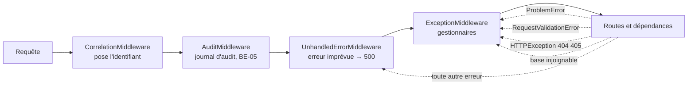

# Erreurs, validation et versionnement de l'API (BE-06)

Issue BE-06 (#66). Exigence EXG-API-02. Trois règles : **toute** erreur de l'API a le même corps ; toute entrée est validée par Pydantic avant d'atteindre le code métier ; l'API est publiée sous `/api/v1` et une rupture crée `/api/v2` à côté. Preuve : les tests de `services/traitement/tests/contract/`, pilotés par les contrats de `contracts/openapi/`.

Abréviations : **RFC** (Request For Comments, norme de l'IETF), **Problem** (corps d'erreur de la RFC 9457, `application/problem+json`), **Pydantic** (bibliothèque de validation de FastAPI), **UUID** (identifiant unique universel).

## 1. Un seul format d'erreur

Corps (schéma `Problem` de `contracts/openapi/common.yaml`) :

| Champ | Contenu | Exemple |
|---|---|---|
| `type` | Famille d'erreur, adresse stable | `https://novaria.local/problems/not-found` |
| `title` | Résumé court, identique pour un même `code` | `Ressource inconnue` |
| `status` | Code HTTP, répété | `404` |
| `code` | Code stable lisible par une machine | `NOT_FOUND` |
| `detail` | Explication en français pour une personne | `Utilisateur inconnu.` |
| `correlation_id` | Identifiant de la requête, le même que l'en-tête `X-Correlation-ID` | `7d2f0c9e-…` |
| `errors` | Pour `VALIDATION_ERROR` : un élément `{field, message}` par champ fautif | `[{field: "body.password", message: "Au moins 12 caractères."}]` |

Le type de contenu est `application/problem+json`. Le corps ne contient **jamais** de secret, de trace d'exécution, de nom d'exception, d'adresse de base de données ni la valeur saisie par l'appelant.

### Catalogue des codes produits par ce service

| Code | HTTP | Quand | Où c'est produit |
|---|---|---|---|
| `UNAUTHENTICATED` | 401 | Jeton absent, illisible, expiré, signé avec un autre secret, compte supprimé ou désactivé (en-tête `WWW-Authenticate: Bearer`) | `app/api/deps.py` |
| `INVALID_CREDENTIALS` | 401 | Connexion refusée ; même réponse pour un compte inconnu, un mot de passe faux et un compte désactivé | `app/api/v1/auth.py` |
| `FORBIDDEN` | 403 | Jeton valide, rôle insuffisant | `app/api/deps.py` |
| `NOT_FOUND` | 404 | Ressource inconnue, **route inconnue**, **version d'API inconnue**, slash final | routes, `app/core/errors.py` |
| `METHOD_NOT_ALLOWED` | 405 | Méthode non permise sur une route qui existe ; l'en-tête `Allow` liste toutes les méthodes de la route | `app/core/errors.py`, `app/core/routing.py` |
| `CONFLICT` | 409 | Nom d'utilisateur déjà pris | `app/api/v1/users.py` |
| `VALIDATION_ERROR` | 422 | Entrée invalide (section 2) | `app/core/errors.py` |
| `INTERNAL_ERROR` | 500 | Toute erreur imprévue (section 3) | `app/core/unhandled.py` |
| `UPSTREAM_UNAVAILABLE` | 503 | Base de données injoignable ou saturée, authentification non configurée | `app/core/errors.py`, `app/db/session.py` |
| `RATE_LIMITED` | 429 | **Pas encore produit** : limitation du débit de la connexion, BE-08 | |

Les codes `INVALID_STATE_TRANSITION`, `COMMAND_IN_PROGRESS`, `UNSAFE_COMMAND` et `FORECAST_UNAVAILABLE` du contrat appartiennent à d'autres services.

Autres erreurs HTTP du cadre (par exemple 400 ou 413 levées par Starlette) : le code HTTP est conservé, le `code` est `VALIDATION_ERROR` (4xx) ou `INTERNAL_ERROR` (5xx), le `detail` est « Requête refusée. » ou « Erreur interne. ». Le texte anglais du cadre n'est jamais repris.

### Comment toute erreur passe par le même corps



L'audit (BE-05) est à l'extérieur de l'intergiciel des erreurs imprévues : il voit le code que le client reçoit, 500 compris (un appel authentifié qui plante est audité `error`, statut 500).

Un `ProblemError` est levé par le code (`raise ProblemError(NOT_FOUND, "Utilisateur inconnu.")`). Les erreurs du cadre (route inconnue, validation, base) sont traduites par des gestionnaires enregistrés par `register_handlers` (`app/core/errors.py`).

## 2. Validation Pydantic

Toute entrée est décrite par un modèle ou un paramètre typé, jamais lue à la main : corps (`LoginRequest`, `UserCreate`, `extra="forbid"`), paramètres de requête (`Query(ge=…, le=…, pattern=…)`), identifiants de chemin (`uuid.UUID`). Les bornes sont celles du contrat ; un test les en tire (section 5).

| Règle | Détail |
|---|---|
| Champ fautif désigné | `body.<champ>`, `query.<paramètre>` ou `path.<paramètre>` ; un JSON illisible désigne `body` (et non une position de caractère) |
| Toutes les erreurs ensemble | `3 champs invalides.` avec les trois éléments, pas seulement la première |
| Messages en français | Une phrase par type d'erreur Pydantic (`Champ obligatoire.`, `Au moins 12 caractères.`, `Entier attendu.`, `Champ non prévu.`…) ; un type inconnu donne `Valeur invalide.` |
| Valeur jamais reprise | Le message vient du **type** de l'erreur, pas de la valeur : un mot de passe trop court n'est pas renvoyé |
| Champ non prévu | Refusé (`Champ non prévu.`) : une faute de frappe n'est pas ignorée en silence |
| Authentification d'abord | Sans jeton : 401 ; rôle insuffisant : 403 ; **avant** toute validation. Un appelant sans droit n'apprend pas les règles de saisie (`errors` absent) |
| Connexion | La saisie est validée avant de chercher le compte |

Cas particuliers :

- `GET /api/v1/users/{user_id}` avec un identifiant qui n'est pas un UUID : `422` (`path.user_id`). Le contrat ne le disait pas ; il le dit maintenant (réponse ajoutée, compatible).
- `GET /api/v1/indicators/{indicator_id}` avec un identifiant mal formé : `404` (choix de BE-04, le contrat ne prévoit pas de 422 pour cette route).
- Un curseur de pagination inventé : `422` sur `query.cursor` (« Curseur inconnu. »). Un curseur est opaque : seule sa longueur maximale est dans le contrat.

## 3. Erreurs imprévues

Une exception que personne n'a prévue donne **toujours** :

```text
HTTP/1.1 500
Content-Type: application/problem+json
X-Correlation-ID: 6f1a…

{"type": "https://novaria.local/problems/internal-error", "title": "Erreur interne", "status": 500,
 "code": "INTERNAL_ERROR", "detail": "Une erreur interne est survenue. Citez l'identifiant de corrélation pour la signaler.",
 "correlation_id": "6f1a…"}
```

Le client ne reçoit ni le type de l'exception, ni son message, ni la pile. Le journal du service reçoit une ligne d'erreur : type de l'exception, lignes de la pile, `correlation_id`. **Le message de l'exception n'est pas journalisé** : celui d'une erreur de validation de réponse reprend les valeurs lues, jusqu'à une empreinte de mot de passe.

Pourquoi un intergiciel (`UnhandledErrorMiddleware`) et pas le gestionnaire `Exception` de FastAPI : celui-ci s'exécute à l'**extérieur** de l'intergiciel qui pose l'identifiant de corrélation ; la réponse partirait sans `X-Correlation-ID` et avec `correlation_id` à `-`. Un test le vérifie.

Cas où l'erreur survient **après** l'envoi de l'en-tête de réponse : on ne peut plus changer la réponse ; l'erreur est journalisée puis relancée (la connexion est coupée).

Une réponse qui ne respecte pas son modèle (un bogue de code qui renverrait un objet incomplet) devient aussi un `500` : rien de l'objet n'est envoyé.

Une base injoignable (`sqlalchemy.exc.OperationalError`) ou saturée (`TimeoutError` du pool) donne `503` `UPSTREAM_UNAVAILABLE`, sans l'adresse ni le message de la base. Cela vaut pour la base des comptes comme pour l'entrepôt des indicateurs.

## 4. Versionnement `/api/v1`

| Question | Règle |
|---|---|
| Où est la version ? | Dans le chemin : `/api/v1/...`. Seule la version **majeure** y figure |
| Que fait changer `v1` en `v2` ? | Une **rupture** : retirer ou renommer un champ, resserrer une règle, changer une unité, ajouter un paramètre obligatoire. Les deux versions coexistent pendant la transition |
| Qu'est-ce qui reste en `v1` ? | Tout changement **compatible** : champ de réponse, paramètre facultatif, route, valeur d'énumération de réponse, code d'erreur ou réponse documentée en plus (exemples de BE-06 : `METHOD_NOT_ALLOWED`, le `422` de `GET /users/{user_id}`) |
| Version non publiée | `/api/v2/...` : `404` `NOT_FOUND`, avec « Versions disponibles : v1. » dans `detail` |
| Retrait annoncé | En-têtes `Deprecation: @<secondes>` (RFC 9745) et `Sunset: <date HTTP>` (RFC 8594) sur les réponses de la route, ajoutés par la dépendance `deprecated(since, sunset)` (`app/core/versioning.py`). Aucune route n'est dépréciée aujourd'hui |
| Slash final | `/api/v1/users/` n'est pas `/api/v1/users` : `404`, sans redirection (une adresse par route) |
| Trois numéros à ne pas confondre | **Version de l'API** (`v1`, dans l'URL) ; **version du contrat** (`info.version` : `1.0.0-draft.1`, dont la majeure suit celle de l'URL) ; **version du produit** (`GET /api/v1/health`, champ `version`) |
| Hors version | Les pages `/docs`, `/redoc` et `/openapi.json` de FastAPI (outil de développement, déjà signalées comme à désactiver hors local dans [authentification](authentification.md)) |

La constante `API_PREFIX` (`app/core/versioning.py`) est la seule source du préfixe : `main.py` y inclut chaque routeur. Un test échoue si un routeur est inclus sous un autre préfixe, si un chemin du service ou d'un contrat sort de `/api/v1`, ou si la version majeure d'un contrat n'est plus celle de l'URL.

## 5. Preuves

Critère d'acceptation : **chaque erreur documentée dans le contrat est testée.**

| Fichier | Ce qu'il prouve |
|---|---|
| `tests/contract/test_errors_contract.py` | Pour chaque opération implémentée et chaque erreur que le contrat lui attribue (401, 403, 404, 409, 422, `5XX`), un appel provoque l'erreur et la réponse a le bon code HTTP, un `code` admis, `application/problem+json`, un corps conforme au schéma `Problem` et le bon `correlation_id`. **Une erreur documentée sans test, ou un test pour une erreur retirée du contrat, fait échouer la suite.** Les erreurs déclarées dans `/openapi.json` sont exactement celles du contrat. Les `5XX` sont provoquées sur toutes les opérations (500 et 503) |
| `tests/contract/test_validation_contract.py` | Des valeurs invalides tirées des bornes du contrat (minimum, maximum, longueur, motif, énumération, type, champ inconnu, champ manquant) sont refusées avec le champ désigné ; les valeurs limites sont acceptées ; la valeur saisie n'est jamais reprise ; l'authentification passe avant la validation |
| `tests/contract/test_versioning_contract.py` | Tout est sous `/api/v1` (service et contrats), versions inconnues, routes inconnues, 405 et `Allow`, slash final, en-têtes `Deprecation` et `Sunset` |
| `tests/unit/test_errors.py`, `test_unhandled.py`, `test_versioning.py`, `test_routing.py` | Messages, traduction des erreurs du cadre, intergiciel des erreurs imprévues, règles de version, méthodes permises |

Résultats du 04/11/2026 (poste Windows, branche posée sur `dev-backend`, donc avec BE-05) : 907 tests passent sans base (comme dans la CI) et les 390 tests de `scripts/dev` aussi ; les trois fichiers d'erreurs, de versions et de routage sont couverts à 100 % ; couverture de l'ensemble : 99 %. Front-end : 305 tests, `tsc`, ESLint, Prettier et `npm run api:check` sans remarque.

Contrôle par mutations (défauts introduits à la main dans le code d'erreurs, de version, de routage et dans les déclarations de routes, aucun outil de mutation n'étant installé) : 35 défauts, tous détectés. Trois ont d'abord survécu : le gestionnaire de la saturation du pool de connexions n'avait pas de test (ajouté), une mutation visait un commentaire (corrigée) et une autre ne trouvait plus son texte après le reformatage (réécrite).

### Essai réel

Un vrai serveur `uvicorn` du service, appelé en HTTP (sans base pour la première série) :

| Appel | Réponse | Code | Remarque |
|---|---|---|---|
| `GET /api/v1/nope` | 404 `application/problem+json` | `NOT_FOUND` | `correlation_id` du corps = en-tête `X-Correlation-ID` |
| `GET /api/v2/users` | 404 | `NOT_FOUND` | « Version d'API non prise en charge : v2. Versions disponibles : v1. » |
| `GET /api/v1/users/` | 404 | `NOT_FOUND` | pas de redirection |
| `DELETE /api/v1/users` | 405 | `METHOD_NOT_ALLOWED` | `Allow: GET, POST` |
| `POST /api/v1/auth/login` avec `{oups` | 422 | `VALIDATION_ERROR` | champ `body` |
| `POST /api/v1/auth/login` avec `{"username":"ab","password":"…","x":1}` | 422 | `VALIDATION_ERROR` | `body.username` (« Au moins 3 caractères. ») et `body.x` (« Champ non prévu. ») ; le mot de passe saisi n'est pas dans la réponse |
| `POST /api/v1/users` sans jeton, corps invalide | 401 | `UNAUTHENTICATED` | pas de `errors` |
| `GET /api/v1/users?limit=0` sans jeton | 401 | `UNAUTHENTICATED` | |
| `GET /api/v1/users` avec jeton, adresse de base inutilisable (bogue de configuration) | 500 | `INTERNAL_ERROR` | la valeur de configuration n'est pas dans la réponse ; le journal donne `ArgumentError` et la pile, avec le même `correlation_id` |
| `GET /api/v1/users` avec jeton, base introuvable (nom inconnu) | 503 | `UPSTREAM_UNAVAILABLE` | en 0,4 s, sans l'adresse de la base |
| `GET /api/v1/users` avec jeton, base sur un port fermé | 503 | `UPSTREAM_UNAVAILABLE` | en 5,3 s : avant l'ajout du délai de connexion (section 7), l'appel attendait plus de 15 s |

Deux erreurs documentées n'ont **pas** de test, avec leur raison écrite dans le test lui-même :

| Erreur | Raison |
|---|---|
| `429` de `POST /auth/login` | Limitation du débit pas encore faite (BE-08). Le service ne la déclare pas dans `/openapi.json` tant qu'elle n'existe pas |
| `403` des routes ouvertes au rôle `viewer` (indicateurs) | `viewer` est le rôle le plus bas : aucun appelant authentifié n'a moins de droits. Un test échoue si un rôle plus bas apparaît |

## 6. Changements de contrat et de front-end

Deux ajouts **compatibles** (aucun client existant ne casse), à relire par l'autre membre :

| Changement | Fichier | Pourquoi |
|---|---|---|
| Code `METHOD_NOT_ALLOWED` dans `Problem.code` | `contracts/openapi/common.yaml` | Aucun code existant ne décrit un 405 |
| Réponse `422` sur `GET /api/v1/users/{user_id}` | `contracts/openapi/api-metier.openapi.yaml` | Le service refuse déjà un identifiant qui n'est pas un UUID |

Le front-end génère ses types depuis les contrats et un test échoue s'ils diffèrent : `frontend/src/types/api/*.ts` régénérés (`npm run api:generate`) et un message pour le nouveau code dans `frontend/src/services/errors.ts` (la liste des messages est exhaustive par construction).

## 7. Limites et points ouverts

| Sujet | Position actuelle | Suite |
|---|---|---|
| Limitation du débit (`429`) | Pas faite | BE-08 |
| Taille maximale d'un corps | Pas contrôlée par le service | À fixer à la passerelle |
| Route inconnue sans jeton | `404`, pas `401` : une route qui n'existe pas ne dit rien sur l'authentification | |
| `Allow` | Relu dans les routes publiées (`/openapi.json`) par `app/core/routing.py`, qui sert aussi à l'audit : si une route est ajoutée avec `include_in_schema=False`, elle n'y figure pas | Éviter ce réglage, ou étendre `app/core/routing.py` |
| Journal applicatif | Il écrit le chemin reçu (`app.access`) | Un jeton collé dans l'adresse y apparaîtrait |
| Délai de connexion | 5 s (`connect_timeout`, `app/db/session.py`) : une base éteinte donne un 503 en 5 s au plus, au lieu d'attendre le délai du système (plus de 20 s sous Windows) | Réglable par une variable si le besoin apparaît |
| Autres services | Collecte, alerte et réponse n'ont pas encore de routes : le même mécanisme est à reprendre dans le gabarit de service | MS-08, MS-11, MS-12 |
| Pages `/docs`, `/redoc`, `/openapi.json` | Publiques, hors version | À désactiver hors local |
