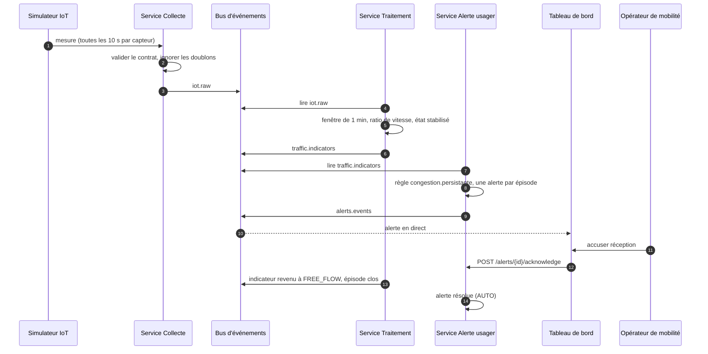

# Parcours nominaux et cas d'échec (v1)

Issue : DOC-05. Rédaction : Daddy Luciano. Relecture croisée : Manoa Robel (à faire). Version 1.0 du 27/10/2026.

Ce document décrit ce qui se passe quand tout va bien (parcours nominaux), puis ce qui doit se passer quand quelque chose va mal (cas d'échec). Chaque étape et chaque cas renvoient aux [exigences](exigences.md), qui portent le critère mesurable et la preuve. Les noms des éléments (« Service Collecte », « Bus d'événements »…) sont ceux du [catalogue des diagrammes C4](../01-architecture/c4/README.md).

## 1. Acteurs

| Acteur | Rôle | Remarque |
|---|---|---|
| Usager | Se déplace, reçoit les alertes de congestion | En v1, le canal de notification est simulé |
| Opérateur de mobilité | Surveille le réseau, accuse réception des alertes, commande manuellement les feux | Rôle d'API `operator` (proposition) |
| Administrateur | Gère les comptes et les règles d'alerte | Rôle d'API `admin` (proposition) |
| Observateur | Consulte sans agir | Rôle d'API `viewer` (proposition) |
| Capteurs de trafic | Comptent les véhicules et mesurent la vitesse | Remplacés en v1 par le Simulateur IoT |
| Contrôleur de feux | Applique les phases de feux | Simulé en v1 |

## 2. Parcours nominaux

### P1. De la mesure à l'alerte

Le parcours central : il démontre la collecte, le traitement en flux, l'alerte et l'affichage en direct.

| N° | Qui | Fait quoi | Ce qui reste comme trace | Exigences |
|---|---|---|---|---|
| 1 | Simulateur IoT | Émet une mesure par capteur et par intervalle de 10 s, avec sa provenance | Événement `novaria.iot.measurement.v1` | EXG-COL-01 |
| 2 | Service Collecte | Valide le contrat, ignore les doublons, stocke le brut, publie | `raw_events` ; sujet `iot.raw` | EXG-COL-02, EXG-COL-03 |
| 3 | Service Traitement | Agrège par fenêtres de 1 et 5 minutes, calcule le ratio de vitesse et l'état stabilisé | `dwh.fact_traffic_window` ; sujet `traffic.indicators` | EXG-TRA-01, EXG-TRA-03 |
| 4 | Service Traitement | Ouvre un épisode quand l'état quitte FREE_FLOW | `dwh.fact_congestion_episode` | EXG-TRA-03 |
| 5 | Service Alerte usager | Évalue la règle `congestion.persistante` : crée **une** alerte, cause `UNKNOWN`, écrit l'événement dans la boîte d'envoi (*outbox*) | `alertes.alert`, `alert_history`, `outbox_event` | EXG-ALE-01, EXG-ALE-03 |
| 6 | Service Alerte usager | Publie l'événement ; l'alerte passe à NOTIFIED après remise au canal simulé | Sujet `alerts.events` | EXG-ALE-02 |
| 7 | Tableau de bord | Affiche l'alerte sans rechargement (flux SSE, *Server-Sent Events*) | Écran ; délai mesuré | EXG-TDB-03, EXG-NFR-03 |
| 8 | Opérateur de mobilité | Accuse réception : l'alerte passe à ACKNOWLEDGED | `alert_history` ; `audit_logs` | EXG-ALE-02, EXG-API-01, EXG-API-03 |
| 9 | Service Traitement puis Alerte usager | Au retour à FREE_FLOW, clôt l'épisode ; l'alerte est résolue (`AUTO`) | `ended_at` renseigné ; état RESOLVED | EXG-ALE-01 |

### P2. Recommander et appliquer un plan de feux

Les contrats `traffic.recommendations` et `signal.status` ne sont pas encore écrits ([EXG-COL-04](exigences.md)) : ce parcours décrit la cible.

| N° | Qui | Fait quoi | Ce qui reste comme trace | Exigences |
|---|---|---|---|---|
| 1 | Service Traitement | Calcule une recommandation de phases (calcul de référence de Webster) à partir des indicateurs | Sujet `traffic.recommendations` | EXG-REP-01 |
| 2 | Service Réponse extérieure | Soumet la recommandation aux garde-fous ; si elle est sûre, la transmet au contrôleur de feux simulé | `audit_logs` (commande, décision) ; sujet `signal.status` | EXG-REP-02 |
| 3 | Tableau de bord | Affiche l'état des feux | Écran | EXG-TDB-03 |
| 4 | Opérateur de mobilité | Envoie une commande manuelle (`POST /signals/{id}/commands`) | Commande en `audit_logs` avec l'opérateur | EXG-REP-04, EXG-API-01 |
| 5 | Service Réponse extérieure | Applique la commande manuelle si elle passe les mêmes garde-fous | État des feux ; `audit_logs` | EXG-REP-02, EXG-REP-04 |

### P3. Se connecter et consulter les indicateurs

| N° | Qui | Fait quoi | Ce qui reste comme trace | Exigences |
|---|---|---|---|---|
| 1 | Utilisateur | Saisit son identifiant et son mot de passe ; `POST /auth/login` renvoie un jeton | `audit_logs` (résultat `ok`) | EXG-API-01, EXG-TDB-01 |
| 2 | Tableau de bord | Appelle `GET /indicators/latest` avec le jeton ; la passerelle le contrôle | `usage_stats` | EXG-API-01, EXG-API-02 |
| 3 | Tableau de bord | Affiche vitesse, débit et état, avec la mention « données simulées » quand `source_type` vaut `SIMULATED` | Écran | EXG-TDB-02, EXG-NFR-13 |

### P4. Entraîner et enregistrer un modèle (hors ligne)

| N° | Qui | Fait quoi | Ce qui reste comme trace | Exigences |
|---|---|---|---|---|
| 1 | Binôme | Fixe le cadrage : cible, métrique, seuil, seuils d'hystérésis, **avant** tout entraînement | `docs/06-ia-mlops/cadrage-ml.md` | EXG-IA-01 |
| 2 | Simulateur IoT | Génère des runs reproductibles avec la vérité terrain | Runs identifiés par `run_id`, `scenario_id`, graine | EXG-COL-01 |
| 3 | Module d'apprentissage | Exporte le jeu v1, découpé par run et par scénario, avec sa fiche de provenance et son empreinte | `data/datasets/` ; empreinte SHA-256 | EXG-IA-02 |
| 4 | Module d'apprentissage | Entraîne les candidats et les compare à la règle de seuils | `ml/evaluation/` | EXG-IA-03 |
| 5 | Pipeline MLOps | Enregistre le modèle seulement s'il atteint le seuil | `model_runs` | EXG-IA-04 |
| 6 | Module d'apprentissage | Surveille la dérive des vitesses | Alarme | EXG-IA-05 |

### P5. Charger les données et produire les indicateurs décisionnels

| N° | Qui | Fait quoi | Ce qui reste comme trace | Exigences |
|---|---|---|---|---|
| 1 | Pipeline ETL (Extract, Transform, Load) | Ingère les données sources (mesures brutes rejouées depuis `raw_events`, jeu ouvert pour le tutoriel : [ADR-027](../01-architecture/adr/ADR-027-jeux-de-donnees-et-provenance.md)) ; une seconde exécution ne crée aucun doublon | `data/etl/pipelines/` | EXG-DON-02 |
| 2 | Pipeline ETL | Nettoie et valide ; chaque ligne refusée est écrite avec sa règle et son motif | `dwh.etl_reject` ; taux de rejet journalisé | EXG-DON-03 |
| 3 | Pipeline ETL | Charge l'entrepôt de façon idempotente | `dwh.fact_traffic_window` | EXG-TRA-04 |
| 4 | Service Traitement | Compare chaque nuit les indicateurs du flux au recalcul par lots | Rapport d'écart | EXG-TRA-05 |
| 5 | API métier | Calcule et sert les indicateurs décisionnels selon leur définition écrite | Vues SQL ; réponses de l'API | EXG-DON-01, EXG-API-02 |
| 6 | Robot RPA (Robotic Process Automation) | Produit chaque semaine le rapport d'indicateurs, en lecture seule, sans intervention manuelle | Fichier de rapport dans `automation/rpa/` | EXG-IA-08 |
| 7 | Tableau de bord | Liste le rapport dans la page « Rapports » | Écran | EXG-TDB-05 |

### P6. Repérer un capteur défaillant et prévoir la vitesse

| N° | Qui | Fait quoi | Ce qui reste comme trace | Exigences |
|---|---|---|---|---|
| 1 | Simulateur IoT | Injecte une anomalie à la demande (capteur muet, valeur aberrante) | Run identifié par sa graine | EXG-COL-01 |
| 2 | Module d'apprentissage | Repère l'anomalie par une règle robuste ; la compare à Isolation Forest | `ml/evaluation/` | EXG-IA-06 |
| 3 | Service Alerte usager | Crée une alerte `SENSOR_FAULT`, distincte d'une congestion | `alertes.alert` | EXG-ALE-04 |
| 4 | Module d'apprentissage | Prévoit la vitesse (modèle entraîné sur METR-LA, testé aussi sur un run simulé) et la sert par `GET /forecasts` | `ml/evaluation/` ; réponses de l'API | EXG-IA-07 |
| 5 | Tableau de bord | Affiche la prévision avec son horizon et sa provenance | Écran | EXG-TDB-04, EXG-NFR-13 |

## 3. Cas d'échec

Colonne « Comportement » : **Défini** quand une décision (ADR, dictionnaire, contrat) le fixe ; **Proposé** quand il s'agit d'une proposition à valider par le binôme.

| ID | Situation | Comportement attendu | Trace laissée | Statut | Exigences |
|---|---|---|---|---|---|
| CE-01 | Mesure hors contrat (champ inconnu, type ou borne erronés, date sans fuseau) | Rejet vers `errors.dlq` ; archive dans `rejects` avec le chemin et le message de l'erreur | `rejects` ; compteur de rejets | Défini (DQ-01) | EXG-COL-02 |
| CE-02 | Capteur ou tronçon absent du référentiel | Rejet, motif `UNKNOWN_SENSOR` | `rejects` | Défini (DQ-02) | EXG-COL-02 |
| CE-03 | Même `id` reçu deux fois | Ignoré sans erreur, compté | `processing_stats`, `kind` = quality | Défini (DQ-03) | EXG-COL-02, EXG-COL-03 |
| CE-04 | Message sans provenance | Rejet par le contrat et par le validateur de `raw_events` | `rejects` | Défini (contrats, validateurs) | EXG-NFR-13, EXG-COL-02 |
| CE-05 | Message plus tardif que le retard autorisé (30 s, valeur de départ) | Rejet, motif `LATE` | `rejects` ; compteur | Défini (DQ-04) | EXG-TRA-02 |
| CE-06 | Horodatage dans le futur (plus de 5 s après l'horloge du consommateur, hors rejeu) | Rejet, motif `FUTURE_TIMESTAMP` | `rejects` | Défini (DQ-10) | EXG-TRA-02 |
| CE-07 | Valeur plausible mais douteuse (vitesse supérieure à 1,5 fois la vitesse fluide, vitesse nulle avec véhicules passés…) | Mesure acceptée en qualité `SUSPECT`, **exclue** des indicateurs | `processing_stats` ; drapeau `IMPLAUSIBLE_VALUE` | Défini (DQ-05) | EXG-TRA-02 |
| CE-08 | Champ facultatif absent (vitesse malgré des véhicules, occupation) | Mesure acceptée en qualité `PARTIAL` avec drapeau, retenue dans les indicateurs | `processing_stats` | Défini (DQ-06) | EXG-TRA-02 |
| CE-09 | Fenêtre incomplète (complétude inférieure à 0,5) | État `UNKNOWN` : aucune conclusion, aucune alerte de congestion | `fact_traffic_window` | Défini (DQ-07) | EXG-TRA-03 |
| CE-10 | Route vide (aucun véhicule) | Vitesse `null` ; fenêtre comptée comme fluide | `fact_traffic_window` | Défini (dictionnaire 7.1) | EXG-TRA-03 |
| CE-11 | Ratio de vitesse qui oscille autour d'un seuil | Au plus une transition d'état ; pas d'alerte qui clignote | Épisode unique | Défini (ADR-028) | EXG-TRA-03, EXG-ALE-01 |
| CE-12 | Capteur muet plus de 60 s | Alerte `SENSOR_FAULT`, distincte d'une congestion | `alertes.alert` | Défini (DQ-08) | EXG-ALE-04 |
| CE-13 | Nouvelle congestion sur un tronçon qui a déjà une alerte non résolue | Pas de seconde alerte (index d'unicité partiel) | Aucune ligne en plus | Défini (ADR-028) | EXG-ALE-01 |
| CE-14 | Accusé de réception d'une alerte déjà acquittée, ou clôture d'une alerte résolue | Réponse 409 (`CONFLICT`) au format `application/problem+json` | `audit_logs` | Défini (contrat) | EXG-ALE-02, EXG-API-02 |
| CE-15 | Appel sans jeton, ou jeton invalide ou expiré | Réponse 401 | `audit_logs` (résultat `denied`) | Défini (contrat) | EXG-API-01 |
| CE-16 | Rôle insuffisant (un `viewer` tente une commande de feux) | Réponse 403 | `audit_logs` (résultat `denied`) | Défini (contrat) | EXG-API-01 |
| CE-17 | Corps de requête invalide | Réponse 422 (`VALIDATION_ERROR`) avec la liste des champs fautifs | Aucune écriture | Défini (contrat) | EXG-API-02 |
| CE-18 | Commande de feux qui viole un garde-fou | Refus, réponse 422 (`UNSAFE_COMMAND`) ; rien n'est transmis au contrôleur | `audit_logs` avec le motif | Défini (contrat) ; règles à écrire | EXG-REP-02, EXG-REP-04 |
| CE-19 | Seconde commande manuelle pendant une commande en cours | Réponse 409 (`COMMAND_IN_PROGRESS`) | `audit_logs` | Défini (contrat) | EXG-REP-04 |
| CE-20 | Aucune recommandation reçue pendant le délai fixé | Retour au plan fixe ; reprise à la recommandation suivante | `audit_logs` | Défini (ADR-008) ; délai à fixer | EXG-REP-03 |
| CE-21 | Prévision demandée alors que le modèle et la référence sont indisponibles | Réponse 503 (`FORECAST_UNAVAILABLE`) | `audit_logs` | Défini (contrat) | EXG-TDB-04 |
| CE-22 | Service d'alerte arrêté | La collecte et la réponse extérieure continuent ; au redémarrage, le service rattrape son retard sans perte ni doublon | Décalage du consommateur | Défini (ADR-009) | EXG-NFR-05 |
| CE-23 | Bus d'événements indisponible | La collecte refuse les mesures (réponse 503) plutôt que de les perdre ; la boîte d'envoi de l'alerte garde les événements à publier | `outbox_event` (`published_at` vide) | Proposé (MS-16) | EXG-NFR-05 |
| CE-24 | PostgreSQL indisponible pendant le traitement | Le traitement ne valide pas sa lecture du bus avant d'avoir écrit ; il reprend à la même position à la reconnexion, l'écriture étant idempotente | Décalage du consommateur | Proposé (MS-16) | EXG-NFR-05, EXG-TRA-04 |
| CE-25 | MongoDB indisponible | La collecte refuse les mesures (réponse 503). Un appel d'API qui ne peut pas être audité échoue : pas d'action sans trace | Journaux de service | Proposé (MS-16) | EXG-NFR-05, EXG-API-03 |
| CE-26 | Rejeu d'un chargement ETL | Aucun doublon, totaux identiques | Totaux de `fact_traffic_window` | Défini (clé d'idempotence) | EXG-TRA-04, EXG-DON-02 |
| CE-27 | Ligne d'un chargement ETL qui viole une contrainte | Refus de la ligne ; écriture dans `dwh.etl_reject` avec la règle et le motif ; taux de rejet publié | `dwh.etl_reject` | Défini (DQ-09) | EXG-DON-03 |
| CE-28 | Modèle sous le seuil d'acceptation | Non enregistré au registre ; l'essai reste tracé avec le statut `rejected` | `model_runs` | Proposé (IA-05) | EXG-IA-04 |
| CE-29 | Dérive des vitesses par rapport au jeu d'entraînement | Alarme de dérive | Journal de surveillance | Défini (note de cadrage) | EXG-IA-05 |

Les trois cas **Proposé** liés aux pannes d'infrastructure (CE-23 à CE-25) attendent l'ADR « Observabilité et résilience entre services » (MS-16) : ils ne sont pas encore une décision.

## 4. Lecture rapide

| Question | Réponse |
|---|---|
| Que se passe-t-il avec une mesure invalide ? | Elle est rejetée, archivée avec son motif, et comptée : CE-01 à CE-08 |
| Une alerte peut-elle clignoter ? | Non : hystérésis et une alerte par épisode, CE-11 et CE-13 |
| Un modèle peut-il commander un feu seul ? | Non : calcul de référence, garde-fous, mode dégradé, CE-18 et CE-20 |
| Que devient une panne d'un composant ? | Les autres services continuent ; le service redémarré rattrape son retard : CE-22 |
