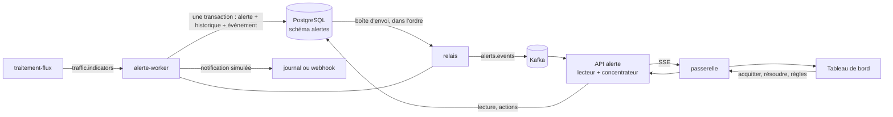
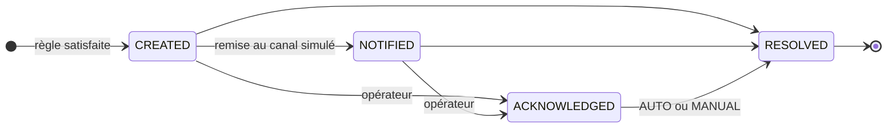
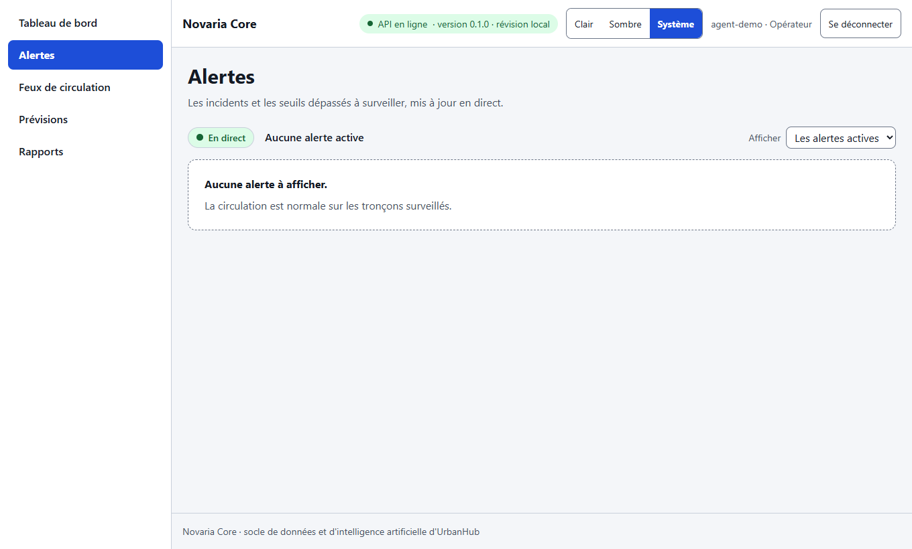
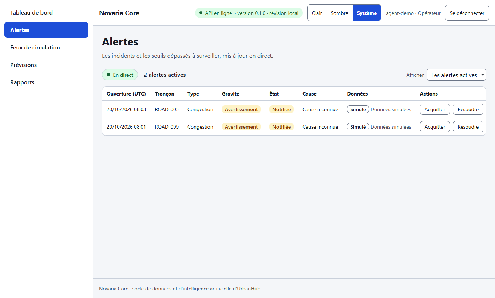
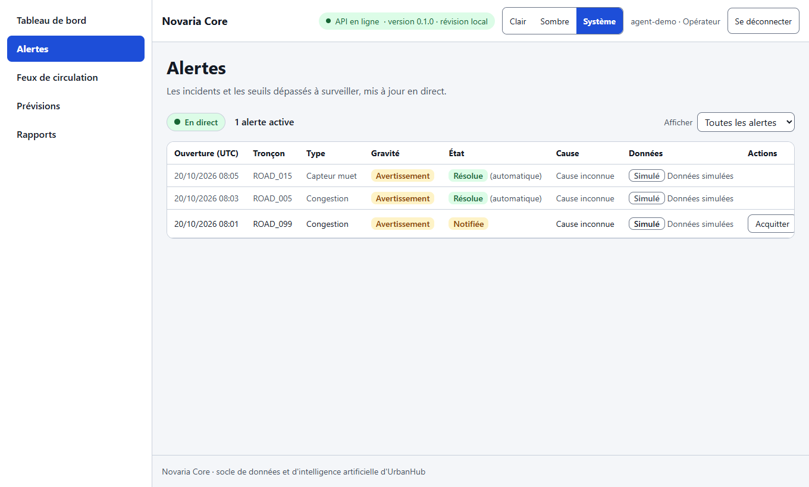

# Service d'alerte usager : règles, cycle de vie et diffusion en direct (MS-11)

| Champ | Valeur |
|---|---|
| Issue | #130 |
| Exigences | EXG-ALE-01 à EXG-ALE-04, EXG-NFR-03 (délai mesuré), EXG-NFR-05 (rattrapage), EXG-TDB-03 (alertes en direct, partiel) |
| Règles de gestion | RG-16 à RG-19 |
| Décisions | [ADR-028](../01-architecture/adr/ADR-028-etats-de-congestion-et-alertes.md) (états, épisodes, une alerte par épisode), [ADR-009](../01-architecture/adr/ADR-009-bus-evenements.md) (boîte d'envoi), [ADR-008](../01-architecture/adr/ADR-008-microservices.md) (un service, ses données) |
| Code | [`services/alerte/`](../../services/alerte/README.md), migration [`0008`](../../db/postgres/migrations/0008_alertes_provenance.sql), page [`frontend/src/features/alerts/`](../../frontend/src/features/alerts/Alerts.tsx) |
| Contrat | [`alerte.openapi.yaml`](../../contracts/openapi/alerte.openapi.yaml), [`alert-event.schema.json`](../../contracts/events/alert-event.schema.json) |

## 1. En bref

Le service lit les indicateurs d'une minute de `traitement` (`traffic.indicators`), évalue trois règles configurables (congestion, saturation, capteur muet), ouvre **une alerte par épisode**, la fait vivre (créée, notifiée, acquittée, résolue), publie chaque changement sur `alerts.events` par une boîte d'envoi (*outbox*), le diffuse en direct au tableau de bord (SSE) et remet une notification simulée.

**Critère de l'issue** : « une congestion simulée déclenche une seule alerte, visible au tableau de bord dans un délai mesuré et documenté, puis résolue automatiquement ».

| Ce qui est demandé | Résultat | Où |
|---|---|---|
| Une seule alerte pour une congestion simulée | **Atteint** : 1 alerte de congestion pour la congestion de l'épreuve avec les images réelles, et 1 alerte pour 40 indicateurs congestionnés d'un même épisode dans le test d'intégration | sections 5 et 10 |
| Visible au tableau de bord, délai mesuré | **Atteint** : alerte visible dans le flux **60 ms** en médiane, **84 ms** au 95e centile (30 mesures, objectif proposé 10 s) ; ligne visible dans le navigateur 142 ms après l'indicateur déclencheur | sections 6 et 10.3 |
| Résolue automatiquement | **Atteint** : résolution `AUTO` au retour à `FREE_FLOW`, publiée et affichée | section 10.4 |
| Preuve : test d'intégration et capture | Test d'intégration : **33 réussis sur 33 (Kafka et PostgreSQL réels)** ; captures du tableau de bord réel : section 10.4 | section 10 |

## 2. Architecture



Deux processus d'une même image (comme `traitement` et `traitement-flux`) : l'**API** (`alerte`) et le **travailleur** (`alerte-worker`). Le travailleur est seul à lire `traffic.indicators`, à évaluer les règles et à relayer la boîte d'envoi ; il n'y a qu'**une instance** car les séries de fenêtres des règles sont en mémoire. L'API écrit aussi dans la boîte d'envoi (acquitter, résoudre), et le relais du travailleur publie ces événements.

Cœur et adaptateurs (ADR-010) : `app/domain/` (modèle, règles : fonctions pures) et `app/services/` (cycle de vie, traitement d'un indicateur, relais, notification) ne connaissent ni Kafka, ni PostgreSQL, ni HTTP ; `app/adapters/` fournit les versions réelles.

## 3. Les règles

Trois lignes de `alertes.alert_rule`, réglables par l'API (`PATCH /api/v1/alert-rules/{rule_id}`, rôle `admin`) ; le travailleur relit les règles toutes les 5 s. Les paramètres, leurs valeurs de départ et leurs bornes sont au [dictionnaire](dictionnaire-de-donnees.md), section 7.3.

| Règle | Type | S'ouvre quand… | Se résout quand… |
|---|---|---|---|
| `congestion.persistante` | CONGESTION | l'état stabilisé de `traitement` est au moins `state` (`CONGESTED`) pendant `min_windows` fenêtres (1 : l'hystérésis a déjà confirmé 2 fenêtres) | l'état revient à `FREE_FLOW` (clôture de l'épisode, ADR-028) |
| `anomalie.circulation` | TRAFFIC_ANOMALY | `min_windows` (3) fenêtres **fluides mais saturées** : occupation ≥ 0,8 ou file ≥ 150 m | une fenêtre ne l'est plus (y compris dès que le tronçon ralentit : la congestion prend le relais) |
| `capteur.muet` | SENSOR_FAULT | aucune mesure pendant `silence_s` (60 s) : `traitement` publie une fenêtre vide (`sample_count` 0) | une fenêtre contient une mesure |

Choix qui évitent le bruit :

- **Seules les fenêtres d'une minute** sont lues. Celles de cinq minutes reprennent l'état du tronçon à leur fermeture ([flux](flux.md), section 5.1) : les compter ferait deux fois la même congestion.
- **L'anomalie ne regarde que les fenêtres fluides.** Pendant une congestion le simulateur sature l'occupation ; sans cette condition, une même congestion ouvrirait deux alertes. Le test `test_a_congestion_with_high_occupancy_raises_one_alert_not_two` le fixe.
- **Un état `UNKNOWN`** (données insuffisantes) n'ouvre rien et ne résout rien : il n'est ni une preuve de congestion, ni un retour au fluide.
- **Rejouer une fenêtre est sans effet** : une fenêtre déjà vue (relivraison, correction tardive d'une fenêtre republiée sous le même `id`) est ignorée par les séries ; et si l'écriture échoue, le moteur **annule** le marquage de la fenêtre pour que son rejeu soit évalué (`RuleEngine.revert`, défaut trouvé pendant ce travail, section 10.2).

## 4. Cycle de vie et anti-bruit



| Règle | Application | Preuve |
|---|---|---|
| **RG-16** une alerte par épisode | Index unique partiel de la base (un seul `INSERT ... ON CONFLICT DO NOTHING` réussit) ; la recherche d'une alerte ouverte évite d'y toucher à chaque fenêtre | `test_one_unresolved_alert_per_kind_segment_and_run_and_a_new_one_after_resolution` (vraie base) ; 40 indicateurs congestionnés → 1 alerte |
| **RG-17** historique et événement dans la même transaction | `AlertService._move` et `open` écrivent l'alerte, `alert_history` et `outbox_event` dans une seule transaction | `test_a_failed_event_write_leaves_no_alert_and_no_history_in_the_real_database` (la violation `UNIQUE` de l'événement annule l'alerte) |
| **RG-17** ordre des transitions (que la base ne contrôle pas) | `check_transition` : on ne va que vers une position plus grande du cycle ; acquitter une alerte acquittée ne change rien (200 sans événement) ; acquitter ou clore une alerte résolue est un `409 INVALID_STATE_TRANSITION` | 11 cas paramétrés + tests de l'API |
| **RG-18** cause | `UNKNOWN` par défaut pour **toutes** les règles : un capteur muet n'est pas non plus une cause prouvée | `test_one_simulated_congestion_raises_one_alert_resolved_automatically` |
| **RG-19** `min_gap_s` | Une nouvelle alerte d'un même type, tronçon et run attend `min_gap_s` après l'**ouverture** de la précédente (mesuré en temps d'événement) ; entre-temps les fenêtres suivantes la créeront dès que le délai sera écoulé | `test_a_new_alert_waits_min_gap_s_after_the_previous_one_opened` et 3 cas |

Une alerte déjà **résolue** quand le notificateur passe n'est plus notifiée : il n'y a plus rien à signaler à l'usager. En exploitation les indicateurs arrivent à une minute d'intervalle ; les tests d'intégration envoient donc la résolution après la notification.

**Instants.** `opened_at` et la résolution automatique sont en **temps d'événement** (celui de l'indicateur), comme l'épisode de l'entrepôt : le délai de détection de [KPI-03](kpi.md) compare ces deux instants. `notified_at`, `acknowledged_at` et une résolution manuelle sont l'heure du service. `resolved_at` n'est jamais antérieur à `opened_at` (contrainte de la base ; le service ramène l'instant à l'ouverture sinon).

## 5. Boîte d'envoi et garanties de livraison

| Étape | Garantie |
|---|---|
| Indicateur → alerte | **Au moins une fois** : l'offset n'est validé qu'une fois les alertes et leurs événements écrits ; une panne arrête le travailleur avant la validation, Docker le relance (`restart: on-failure`), il relit. Rejouer un indicateur est sans effet (index unique, recherche de l'alerte ouverte) |
| Alerte → `alerts.events` | **Au moins une fois, dans l'ordre d'écriture** : le relais publie chaque ligne de la boîte d'envoi, attend l'accusé du broker (`acks=all`, producteur idempotent), puis la marque publiée. Si Kafka est en panne, les événements attendent dans la base : rien n'est perdu, et la création des alertes continue |
| Doublon possible | Entre l'accusé et le marquage, une panne republie l'événement ; son `id` est stable (`alerte-<alert_id>-<état>`, un état n'est jamais rejoué) : le consommateur le reconnaît |
| Un seul relais | Deux relais se partageraient les lignes (`FOR UPDATE SKIP LOCKED`) : aucun doublon, mais l'ordre entre eux ne serait plus garanti. Le relais est celui du travailleur |
| Un groupe sans partition | `kafka-python` peut affecter **zéro** partition à un groupe neuf quand le chef de groupe n'a pas encore les métadonnées du sujet (« No partition metadata for topic ») : le travailleur resterait vivant et muet. Il charge donc les métadonnées avant de rejoindre le groupe, et **s'arrête** au bout de 60 s sans partition (Docker le relance). Défaut trouvé par les tests d'intégration (section 10.2) |

Isolation des pannes (EXG-NFR-05, ADR-008) : le service d'alerte arrêté, la collecte et le traitement continuent ; à son redémarrage il reprend au dernier offset validé et rattrape son retard sans perte ni doublon (`test_a_stopped_service_catches_up_without_loss_or_duplicate`).

## 6. Diffusion en direct : SSE plutôt que WebSocket

| Critère | SSE (*Server-Sent Events*) | WebSocket |
|---|---|---|
| Sens | Un seul : serveur vers client, ce que demande une alerte | Dans les deux sens (inutile ici : les actions passent par l'API) |
| Passerelle et proxys | HTTP ordinaire ; la passerelle le relaie avec `proxy_buffering off` (déjà configuré) | Mise à niveau de protocole à gérer partout |
| Contrat | OpenAPI sait le décrire | Hors OpenAPI |
| Reconnexion | Prévue par le protocole (`retry`) | À écrire |
| Authentification | `EventSource` ne pose pas d'en-tête `Authorization` : le tableau de bord lit le flux avec `fetch` (`alertStream.ts`) | Même difficulté |

**Choix retenu : SSE**, la proposition du contrat (« choix à confirmer, MS-11 ») est donc confirmée sous réserve de la validation de Manoa.

Comportement :

- La connexion commence par `: connecté`, écrit **après** l'inscription du client : tout changement d'état postérieur lui est livré. Le client lit ensuite la liste (`GET /api/v1/alerts`) : rien n'est manqué.
- Un message par changement : `event: alert.state_changed`, `id` (l'identifiant de l'événement du bus), `data` (les valeurs de l'événement, schéma `Alert`, plus `previous_state`). Un battement `heartbeat` toutes les 30 s : une connexion morte se voit.
- Le flux **ne garde pas d'historique** : un client qui se reconnecte relit la liste. Le tableau de bord le fait à chaque (re)connexion et signale l'état du flux (« En direct », « Flux interrompu : reconnexion en cours »).
- Un client **trop lent** (file de 1000 messages pleine) est coupé : jamais de mémoire sans borne.
- Chaque instance de l'API lit **tous** les événements de `alerts.events` (lecteur sans groupe, depuis la fin) et les relaie à ses clients.
- `signal.status` (service de réponse, MS-12) est accepté dans le filtre `types` ; rien n'est diffusé tant que ce service ne publie pas.

## 7. Notification simulée

`NOTIFICATION_CHANNEL` vaut `log` (une ligne de journal par alerte) ou `webhook` (`POST` JSON vers `WEBHOOK_URL`, secret jamais journalisé). Le message nomme l'alerte (type, gravité, tronçon, carrefour, ouverture, cause, provenance) et **jamais une personne** : RG-23, aucune donnée personnelle en v1. La remise est **au moins une fois** (un arrêt entre la remise et `NOTIFIED` la répète) ; un échec laisse l'alerte `CREATED` et la remise est retentée après 5 s sans bloquer les autres.

## 8. API et rôles

Contrat [`alerte.openapi.yaml`](../../contracts/openapi/alerte.openapi.yaml), servi tel quel (un test compare chaque route, son `operationId` et son rôle `x-required-role` au contrat).

| Route | Rôle | Remarque |
|---|---|---|
| `GET /api/v1/alerts`, `GET /api/v1/alerts/{id}` | `viewer` | Filtres, pagination par curseur ; le détail donne l'historique |
| `POST .../acknowledge`, `POST .../resolve` | `operator` | L'acteur est le `sub` du jeton |
| `GET /api/v1/alert-rules`, `PATCH .../{rule_id}` | `viewer`, `admin` | Les paramètres sont **fusionnés** ; un paramètre inconnu ou hors bornes : `422` avec le champ |
| `GET /api/v1/events/stream` | `viewer` | SSE |

Erreurs au format RFC 9457 (`application/problem+json`) : 401 `UNAUTHENTICATED`, 403 `FORBIDDEN`, 404, 409 `INVALID_STATE_TRANSITION`, 422 `VALIDATION_ERROR`, 503 `UPSTREAM_UNAVAILABLE` (base absente), 500 sans trace.

## 9. Choix à valider, écarts et limites

| # | Point | Ce qui est fait | À trancher | Qui |
|---|---|---|---|---|
| 1 | **Clé de signature des jetons partagée** | Le contrat exige `bearerAuth` sur l'alerte ; le service vérifie lui-même les jetons (HS256) et reçoit donc `JWT_SECRET`. Il pourrait aussi en **émettre**. `test_compose.py` interdisait cette clé aux autres services : l'exception est nommée (`VERIFIE_LES_JETONS`) | MS-13 : la passerelle vérifie maintenant le jeton avant le service, qui garde le sien ; lever l'exception demande une signature asymétrique (déjà prévue dans [sécurité applicative](../04-devsecops/securite-applicative.md)) | Daddy et Manoa |
| 2 | **`episode_id` reste `null`** | L'indicateur ne porte pas l'identifiant de l'épisode et le service d'alerte ne lit pas `dwh` (ADR-008). KPI-03 (délai de détection) ne calcule donc rien pour ces alertes : il les compte dans `alertes`, pas dans `alertes_mesurees` | Ajouter `episode_id` à l'indicateur (contrat 1.1) ou calculer le même identifiant déterministe | Manoa (`traitement`) |
| 3 | **Définition des trois règles** | « Vitesse » = état stabilisé par le ratio de vitesse (ADR-028) ; « saturation » = occupation ou file ; « capteur muet » = fenêtre vide. Seuils de départ à régler (IA-03) | Valider les définitions et les seuils | Daddy et Manoa |
| 4 | **Un capteur muet est un tronçon muet** | L'indicateur ne dit pas quel capteur : une fenêtre n'est vide que si **tous** les capteurs du tronçon se taisent. Réseau actuel : un capteur par tronçon, donc sans écart | Si un tronçon a plusieurs capteurs, il faut l'identifiant du capteur dans l'indicateur | Manoa |
| 5 | **`min_gap_s` compté depuis l'ouverture**, en temps d'événement | RG-19 parle de deux *notifications* ; on compte les ouvertures (une notification suit chaque ouverture) pour rester dans un seul référentiel de temps | Confirmer | Daddy et Manoa |
| 6 | **Séries de fenêtres en mémoire** | Un redémarrage les vide : une alerte arrive au plus `min_windows - 1` fenêtres plus tard, jamais en double | Une seule instance ; à persister si le besoin apparaît | — |
| 7 | **Pas de rejeu du flux** | Un client reconnecté relit la liste ; il ne rejoue pas les événements manqués | `Last-Event-ID` si le tableau de bord le demande (MS-14) | Manoa (MS-14) |
| 8 | **`acknowledged_by` = identifiant** | Le jeton ne porte que `sub` ; le nom d'utilisateur appartient à l'API métier | Joindre le nom plus tard | — |
| 9 | **Migration `0008`** | Ajoute `scenario_id`, `seed`, `dataset_id` à `alertes.alert` : l'événement et l'API exigent la provenance entière, la table n'en gardait que la moitié | Numéro `0008` à confirmer si une autre branche en prépare une | Manoa |
| 10 | **`errors.py` copie de la collecte** | Le format d'erreur de l'alerte est celui de la collecte, ligne pour ligne ; SonarQube peut le compter comme duplication (une exclusion nommée l'éviterait, comme pour `redaction.py` et `unhandled.py`) | Décision de contrôle de qualité : accord des deux membres | Daddy et Manoa |

## 10. Preuves

### 10.1 Tests

| Niveau | Fichiers | Tests | Ce qu'ils prouvent |
|---|---|---|---|
| Unitaires et contrat (sans base ni bus) | `services/alerte/tests/unit`, `tests/contract` | **450 réussis**, couverture des lignes et branches **98,6 %** (seuil du projet : 70 %) | Règles (28), cycle de vie (31), traitement d'un indicateur (26), travailleur (19), API (31), SSE (15), adaptateurs (41), câblage et configuration (13), erreurs et masquage (11), journaux (11), contrat OpenAPI et schémas d'événements (12) |
| Intégration (vrai Kafka, vrai PostgreSQL) | `services/alerte/tests/integration` | **33 réussis** en 4 min 18 s | section 10.2 |
| Tableau de bord | `frontend/tests/features/alerts`, `tests/services/alertStream.test.ts`, `tests/app/navigation.test.tsx` | **55 réussis** | Lecture du flux SSE (découpage, reconnexion, surveillance de silence), fusion liste et flux, page Alertes (états, acquitter, résoudre, erreurs), navigation |
| Dépôt (`scripts/dev`) | `scripts/dev/test_*.py` | **461 réussis**, 5 ignorés | Exigences, dictionnaire, C4, Compose, gabarit |

### 10.2 Tests d'intégration contre un vrai Kafka et un vrai PostgreSQL

`python scripts/dev/dev.py test-integration --service alerte` monte un projet Compose jetable (PostgreSQL migré par `db-migrate`, Kafka avec ses six sujets, ports propres, compte `svc_alerte` aux droits de production) et le supprime ensuite.

| Fichier | Tests | Ce qu'ils prouvent sur le vrai système |
|---|---|---|
| `test_database.py` | 11 | Migration (trois règles lues), provenance complète, contraintes `CHECK` de la base, **une seule alerte non résolue par type, tronçon et run** (index unique partiel) puis une nouvelle après résolution, **atomicité** alerte + historique + événement, droits du compte `svc_alerte` (pas de lecture de l'entrepôt), boîte d'envoi : chaque événement publié une fois même avec deux relais, événements conservés dans la base pendant une panne de Kafka puis publiés dans l'ordre, fusion des paramètres de règle, pagination par curseur sur la vraie base |
| `test_stack_flow.py` | 9 | **Une congestion → une alerte notifiée puis résolue automatiquement**, 40 indicateurs congestionnés → 1 alerte et 3 événements, capteur muet → `SENSOR_FAULT` distinct, indicateur invalide → `errors.dlq` sans alerte, service arrêté puis redémarré → rattrapage sans perte ni doublon, rejeu de tous les indicateurs sans effet, deux runs indépendants, règles modifiées en base prises en compte par le travailleur, webhook : une notification par alerte avant `NOTIFIED` |
| `test_live.py` | 13 | Flux SSE refusé sans jeton, **alerte reçue une fois par le client du flux puis résolue**, tous les clients connectés la reçoivent, filtre `types` et battement, acquittement visible dans le flux, réglage de règle par l'API pris en compte par le travailleur en marche, liste paginée, **délai mesuré** (30 congestions), **rafale de 100 congestions**, client qui part sans gêner les autres, trois rôles

**Défauts que seule l'intégration pouvait voir** :

- Un groupe Kafka neuf peut recevoir **zéro** partition (section 5) : le travailleur restait vivant et inactif. Corrigé (métadonnées avant la jointure, arrêt au bout de 60 s), avec tests.
- Une fenêtre déjà marquée « vue » par les règles était ignorée au rejeu quand l'écriture échouait. Corrigé (`RuleEngine.revert`).
- Les premiers essais ont échoué sur l'ordre des envois (résolution avant notification) : voir section 4, ce n'est pas un défaut du service mais une propriété des rafales.

### 10.3 Délai mesuré jusqu'à l'alerte visible

**Méthode.** Le travailleur, l'API (avec son lecteur de `alerts.events`) et un client du flux SSE s'exécutent dans le même processus d'essai, sur le vrai Kafka et le vrai PostgreSQL. Trente congestions sur trente tronçons, **une à la fois** (hors échauffement). Pour chacune, t0 est l'instant où le broker accuse réception de l'indicateur déclencheur (le premier `CONGESTED` d'une minute) ; t1 est l'instant où le client du flux reçoit l'événement `CREATED`. Toutes les valeurs viennent de la même horloge monotone du processus (`time.perf_counter`) : pas de dérive entre machines. La mesure est le test `test_the_delay_from_the_triggering_indicator_to_the_dashboard_is_measured` ; son rapport est écrit si `NOVARIA_ALERTE_REPORT` est défini.

| Mesure (30 alertes) | Minimum | Médiane | 95e centile | Maximum |
|---|---|---|---|---|
| Indicateur → alerte `CREATED` visible dans le flux (ms) | 50 | **60** | **84** | 98 |
| Indicateur → `NOTIFIED` visible, notification simulée comprise (ms) | 84 | 103 | 142 | 149 |

Décomposition de l'alerte `CREATED` :

| Étape | Médiane (ms) | 95e centile (ms) | Maximum (ms) |
|---|---|---|---|
| Accusé du broker pour l'indicateur → reçu par le travailleur | 3 | 5 | 20 |
| Traitement : règles, alerte, historique et événement écrits et validés en base | 35 | 51 | 57 |
| Écriture validée → événement `CREATED` accusé par Kafka (relais de la boîte d'envoi) | 18 | 22 | 34 |
| Événement accusé par Kafka → reçu par le client du flux (lecteur, concentrateur, SSE) | 4 | 6 | 8 |

**Lecture.**

- Objectif proposé par EXG-NFR-03 : **10 s au 95e centile, hors délai de fenêtre**. Mesuré : **0.08 s** (marge d'un facteur 119).
- Le délai **n'inclut pas** celui de la fenêtre : `traitement` publie une fenêtre d'une minute au plus 20 s après sa fin et chaque état demande deux fenêtres de confirmation (ADR-028, [flux](flux.md), section 5.3). Du début de la dégradation à l'alerte visible, il faut compter ces 2 à 3 minutes **plus** la valeur ci-dessus. Le rapport de bout en bout sur toute la chaîne est celui de MS-15.
- Les écritures en base (règles, alerte, historique, événement) sont l'étape la plus longue : trois transactions de recherche par indicateur plus une d'écriture (une par règle).
- **Rafale** : 100 congestions publiées d'un coup (une heure de pointe sur tout le réseau) sont toutes créées puis notifiées, sans perte ni doublon (100 alertes créées et notifiées en 7,8 s, dernier `CREATED` à 5,3 s, dans la base : 100 lignes, aucun doublon).
- **Limites** : mesure sur un poste (Docker Desktop, 8 CPU, 3 Go de mémoire pour la machine virtuelle, Windows 11), travailleur, API et client dans un même processus Python ; PostgreSQL et Kafka dans des conteneurs sur la même machine. Un déploiement réparti ajoute des allers-retours réseau.

### 10.4 Images réelles, tableau de bord réel et captures (épreuve réduite)

Épreuve **réduite** (voir 10.6) avec les images construites par Compose : `alerte` et `alerte-worker`, un vrai Kafka et un vrai PostgreSQL migré par `db-migrate`. Les indicateurs sont **publiés par un script** sur `traffic.indicators` : 28 fenêtres d'une minute envoyées une toutes les 6 s, ROAD_005 passe de fluide à `CONGESTED` pendant 8 fenêtres puis revient fluide, ROAD_015 se tait pendant 2 fenêtres. Le tableau de bord (Vite, Edge piloté) est connecté avec un jeton opérateur signé avec le `JWT_SECRET` du projet ; la lecture du profil est simulée dans le navigateur. Le script de l'épreuve interroge ensuite PostgreSQL et Kafka.

```
Projet Compose jetable : novaria-ms11-ff84ce
Ports : gateway :56782, frontend :56783, collecte :56784, traitement :56785, alerte :56786, reponse :56787, simulator :56788, postgres :56789, mongo :56790, kafka :56791
  sujet                    partitions  clé de partition  état
  iot.raw                  3           intersection_id   [OK] créé
  traffic.indicators       3           intersection_id   [OK] créé
  traffic.recommendations  3           intersection_id   [OK] créé
  alerts.events            3           intersection_id   [OK] créé
  signal.status            3           intersection_id   [OK] créé
  errors.dlq               3           intersection_id   [OK] créé

=== 1. Les conteneurs et leurs sondes
  alerte-worker  Up 19 seconds (healthy)
  alerte  Up 19 seconds (healthy)
  kafka  Up 2 minutes (healthy)
  postgres  Up 2 minutes (healthy)
  GET http://127.0.0.1:56786/api/v1/alerts sans jeton -> 401 (jeton exigé)
  jeton opérateur signé avec JWT_SECRET (jamais affiché) ; GET /api/v1/alerts avec jeton -> 200
  même appel avec un jeton signé par une autre clé -> 401
  tableau de bord (Vite) sur http://127.0.0.1:56783, appels /api vers le service d'alerte du conteneur
  flux SSE ouvert à travers la passerelle : True
  échauffement : le travailleur a traité son premier indicateur 2 s après son envoi

=== 2. 28 indicateurs publiés sur traffic.indicators, une fenêtre d'une minute toutes les 6 s
  ROAD_005 : fluide (2), CONGESTED (8), fluide (4) ; ROAD_015 : fenêtres vides aux ticks 4 et 5

=== 3. Attente de la résolution

=== 4. Constat dans PostgreSQL (schéma alertes)
  CONGESTION|ROAD_005|RESOLVED|AUTO|UNKNOWN|WARNING|2026-10-20 08:03:00+00|2026-10-20 08:11:00+00|heure-de-pointe|42
  SENSOR_FAULT|ROAD_015|RESOLVED|AUTO|UNKNOWN|WARNING|2026-10-20 08:05:00+00|2026-10-20 08:07:00+00|heure-de-pointe|42
  alertes de congestion pour ROAD_005 : 1 (8 indicateurs congestionnés)
  historique :
    CONGESTION ROAD_005 : ->CREATED CREATED>NOTIFIED NOTIFIED>RESOLVED
    SENSOR_FAULT ROAD_015 : ->CREATED CREATED>NOTIFIED NOTIFIED>RESOLVED
  boîte d'envoi non publiée : 0

=== 5. Constat sur Kafka
  alerts.events : 6 événements pour 2 alertes ; tous conformes au contrat (conformance.assert_publication)
    cbe49cdf… : CREATED -> NOTIFIED -> RESOLVED (SENSOR_FAULT)
    b2645cde… : CREATED -> NOTIFIED -> RESOLVED (CONGESTION)
  identifiants d'événement distincts : True

=== 6. Délai : de l'indicateur déclencheur (accusé du broker) à l'alerte reçue par un client du flux
  CONGESTION   ROAD_005 : 105 ms
  SENSOR_FAULT ROAD_015 : 156 ms

=== 7. Le tableau de bord (Edge piloté, compte opérateur réel)
  {"segment": "ROAD_005", "live_at": 1793946533518, "row_visible_at": 1793946555968, "state_when_visible": "NOTIFIED", "row_gone_at": 1793946605019, "final_state": "RESOLVED", "final_text": "20/10/2026 08:03 ROAD_005 Congestion Avertissement Résolue (automatique) Cause inconnue Simulé Données simulées "}
  ligne ROAD_005 visible dans la page : 142 ms après l'accusé du broker pour l'indicateur déclencheur
  capture : 1-avant-la-congestion.png (40 Kio)
  capture : 2-alerte-visible-en-direct.png (51 Kio)
  capture : 3-alerte-resolue-automatiquement.png (57 Kio)

CRITÈRE : ATTEINT
```

Trois captures du tableau de bord réel (page Alertes, Edge piloté), prises pendant cette exécution :

| Avant la congestion | Alerte visible en direct | Résolue automatiquement |
|---|---|---|
|  |  |  |

Sur les captures, une ligne `ROAD_099` est antérieure à l'épreuve : c'est l'alerte de l'**échauffement** (premier indicateur envoyé pour s'assurer que le travailleur a rejoint son groupe Kafka avant de mesurer). Elle n'est pas comptée dans le constat ci-dessus. Le délai affiché sur la ligne `ROAD_005` (alerte visible dans la page 142 ms après l'accusé du broker) est mesuré dans le navigateur.

**Ce que cette épreuve est, et n'est pas** : une épreuve **réduite** (voir 10.6). Les images `alerte` et `alerte-worker` sont celles de Compose, avec un vrai Kafka et un vrai PostgreSQL migré, mais les 28 indicateurs sont **fabriqués par un script** (une fenêtre toutes les 6 s au lieu d'une par minute) et non produits par `collecte` et `traitement-flux` à partir du simulateur.

### 10.5 Les tests détectent des défauts : mutations

On casse volontairement le code (54 mutations : comparaisons inversées, condition retirée, écriture supprimée, garde ôtée, valeur par défaut changée) et on relance les tests : une mutation doit en faire échouer au moins un.

| Résultat | Nombre | Détail |
|---|---|---|
| Tuées dès la première série | 44 | |
| Survivantes, tuées par un test ajouté ensuite | 5 | l'événement `NOTIFIED` quitte dans le même tour que la notification (le relais repasse après le notificateur), le notificateur ne retient rien d'une alerte remise, la dernière page n'annonce pas de suite quand le total est un multiple de la page, un client coupé n'est plus inscrit dès la coupure, `acks="all"` du producteur |
| Non appliquées la première fois (texte introuvable après la mise en forme), appliquées ensuite et tuées | 2 | bloc `UNKNOWN` des règles (ni ouverture ni résolution), cause par défaut `UNKNOWN` |
| Tuée **seulement par l'intégration** | 1 | `ON CONFLICT DO NOTHING` remplacé par `ON CONFLICT (alert_id) DO NOTHING` : les tests unitaires (base simulée) ne la voient pas ; `test_one_unresolved_alert_per_kind_segment_and_run_and_a_new_one_after_resolution` échoue sur la vraie base (`UniqueViolation`). C'est l'intérêt des tests d'intégration |
| **Équivalentes** (aucun comportement observable ne change) | 2 | `algorithms=[ALGORITHM]` du jeton (la liste ne contient qu'un algorithme) ; `200 <= status < 300` du webhook (`urllib` lève déjà `HTTPError` pour 4xx et 5xx, et ne suit que les redirections) |

Les mutations ont été jouées sur le code de MS-11 uniquement, avec les tests unitaires et de contrat ; une seule a demandé l'intégration. Le score n'est pas une mesure de qualité en soi : il a servi à trouver cinq tests manquants.

### 10.6 Non vérifié

- **Toute la chaîne** simulateur → collecte → traitement-flux → alerte. La machine de développement (Docker Desktop, 8 CPU, 3 Go de mémoire pour la machine virtuelle) ne tient pas les douze conteneurs : l'épreuve de la section 10.4 ne démarre que `alerte`, `alerte-worker`, PostgreSQL et Kafka. Les indicateurs ont été publiés par un script, conformes au contrat `traffic.indicators`. Le scénario « capteur muet » du simulateur n'a donc pas été rejoué de bout en bout (il l'est par des fenêtres vides fabriquées) ; le comportement de `traitement-flux` face à un tronçon muet (publier une fenêtre vide) est celui de sa documentation, non observé ici.
- **Navigateur** : profil utilisateur (`/auth/me`) **simulé** dans le navigateur piloté ; le tableau de bord est servi par **Vite**, pas par l'image nginx ; la **passerelle** (`proxy_buffering off`) n'a pas été traversée dans cette épreuve.
- **Linux** : tout a été exécuté sous Windows. Le rejeu par Manoa est à faire (journal d'usage de l'IA).
- **CI GitHub et SonarQube** : non exécutés avant l'envoi. Estimation de la duplication : environ 2,2 %, sous la porte de 3 % ; `errors.py` est le point de risque (point 10 de la section 9).
- **Délai de bout en bout** : la mesure de la section 10.3 ne contient ni le délai de fenêtre ni le réseau entre machines (le rapport complet est celui de MS-15).
- **`episode_id`** nul : KPI-03 ne peut pas calculer le délai de détection de ces alertes (point 2 de la section 9).
- **MQTT** : sans objet ici.

## 11. Lancer et vérifier

| Action | Commande |
|---|---|
| Tests unitaires et de contrat (sans base ni bus) | `cd services/alerte` puis `pytest` |
| Tests d'intégration (Kafka et PostgreSQL jetables) | `py -3 scripts/dev/dev.py test-integration --service alerte` (Windows) ou `make test-integration-alerte` |
| Avec le rapport de délai | `NOVARIA_ALERTE_REPORT=rapport.json make test-integration-alerte` |
| Tout démarrer | `py -3 scripts/dev/dev.py up` (le travailleur `alerte-worker` en fait partie) |
| Voir les alertes en direct | tableau de bord, page « Alertes » ; ou `curl -N -H "Authorization: Bearer <jeton>" http://127.0.0.1:8000/api/v1/events/stream` |
