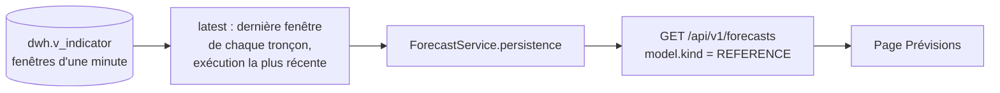

# API des prévisions : la référence par persistance (IA-06, première tranche)

Dernière mise à jour : 10/11/2026 · Contrat : `GET /api/v1/forecasts` (`listForecasts`) de `contracts/openapi/traitement.openapi.yaml`

Abréviations : IA (intelligence artificielle), API (Application Programming Interface), DWH (Data WareHouse, entrepôt de données), UTC (Temps universel coordonné).

## 1. Ce qui est servi

Le service de traitement sert la route avec une **référence par persistance**, pas un modèle entraîné : la vitesse prévue est la dernière vitesse connue. C'est la référence que tout modèle doit battre ([ADR-015](../01-architecture/adr/ADR-015-modeles-ia.md)). Le contrat n'a pas changé.

| Champ de la réponse | Valeur |
|---|---|
| `predicted_speed_ratio` | `speed_ratio` de la dernière fenêtre d'une minute du tronçon, identique à tous les horizons |
| `predicted_state` | état de congestion de cette même fenêtre |
| `issued_at` | fin de cette fenêtre (début + 60 s), en UTC : c'est l'instant de la **dernière donnée**, pas de la requête |
| `target_time` | `issued_at` + `horizon_min` |
| `model` | `kind` = `REFERENCE`, `name` = `persistance`, `version` = `1`, `run_id` = `null` |
| `provenance` | celle de la fenêtre lue (type de source, exécution, scénario, graine) |

## 2. Règles

| Cas | Comportement |
|---|---|
| Tronçon inconnu, ou dont la dernière fenêtre n'a pas de ratio (route vide) | absent de la liste ; aucune valeur inventée |
| Aucun tronçon demandé | tous les tronçons de l'exécution la plus récente, triés par identifiant |
| Entrepôt vide | 503 `FORECAST_UNAVAILABLE` (CE-21) |
| `horizon_min` hors de 5 à 60, tronçon mal formé, plus de 50 tronçons | 422 `VALIDATION_ERROR`, champ `query.…` nommé |
| Sans jeton | 401 `UNAUTHENTICATED` ; rôle `viewer` suffisant |
| Les données sont anciennes | la réponse est quand même servie : `issued_at` dit l'âge de la donnée |

## 3. Ce qui n'est pas fait

| Sujet | État |
|---|---|
| Modèle entraîné (IA-10, jeu METR-LA), moyenne glissante | non fait ; `model.kind` = `MODEL` n'est jamais rendu |
| Date du dernier entraînement et métrique du modèle | absentes du contrat (`model` = `kind`, `name`, `version`, `run_id`) : à ajouter avec un modèle entraîné |
| Script de dérive et alerte locale (autres tâches d'IA-06) | faits : [Surveillance de la dérive](surveillance-derive.md) ; IA-06 (#82) reste ouverte tant que le modèle entraîné (IA-05, IA-10) et la date et la métrique du modèle manquent |
| Comparaison prévu contre observé | impossible sur cette référence : l'instant prévu est dans le futur de la dernière donnée, la page écrit « Pas encore observé » |

## 4. Preuves

| Preuve | Contenu |
|---|---|
| `services/traitement/tests/unit/test_forecast_service.py` | persistance, émission, horizon, tri, tronçon inconnu, route vide, exécution la plus récente, fenêtres de 5 minutes ignorées, entrepôt vide |
| `services/traitement/tests/contract/test_forecasts_contract.py` | réponses valides contre le schéma `Forecast`, bornes des paramètres identiques au contrat, 401, 422, 503, audit, aucun champ d'entraînement inventé |
| `services/traitement/tests/contract/test_errors_contract.py` | chaque erreur documentée du contrat a un test (401, 422, 503), les erreurs 500 et 503 de base se comportent comme celles des indicateurs |
| Pile Docker, via le front (`:8080`) | connexion, `GET /api/v1/forecasts` : 23 prévisions, 200 ; un tronçon à 60 minutes ; tronçon inconnu : liste vide ; `horizon_min=4` : 422. Le code de chargement de la page lit cette réponse : 23 tronçons, 6 horizons, 10 fenêtres observées |

Limite de la preuve : la page n'a pas été rouverte dans un navigateur après cette tranche (pas de captures nouvelles) ; seul son code de chargement et de comparaison a été exécuté contre l'API réelle.
