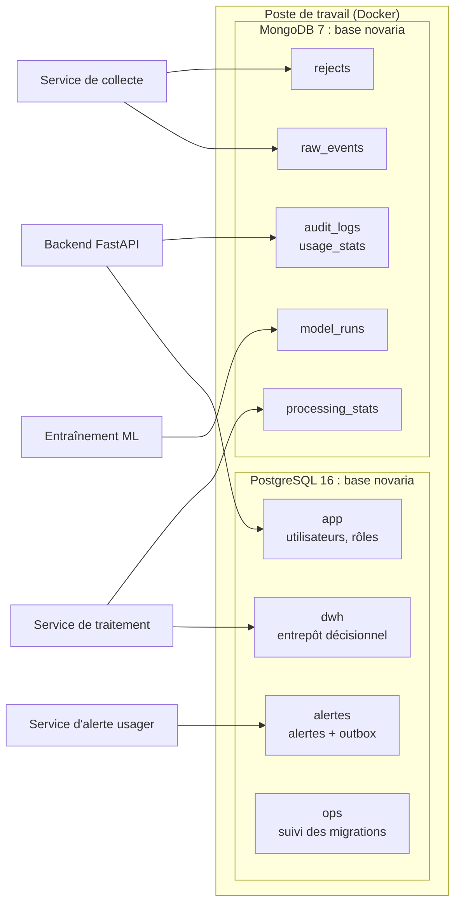

# Bases de données locales : PostgreSQL et MongoDB

Les deux bases tournent dans Docker sur le poste de chaque membre du binôme (décision [ADR-023](../01-architecture/adr/ADR-023-execution-locale-d-abord.md), détail dans [ADR-024](../01-architecture/adr/ADR-024-bases-de-donnees-locales.md)). Les mêmes fichiers servent sous Linux et sous Windows : seule la façon de lancer les commandes change.

## 1. Vue d'ensemble

| Élément | Valeur locale |
|---|---|
| Adresse PostgreSQL | `127.0.0.1:5432` (changer avec `POSTGRES_PORT` dans `.env` si le port est pris) |
| Adresse MongoDB | `127.0.0.1:27017` (changer avec `MONGO_PORT`) |
| Accès depuis le réseau | Aucun : les ports ne sont publiés que sur la boucle locale |
| Mots de passe | Générés au hasard dans `.env` (jamais versionné, jamais affiché) |
| Données | Volumes Docker `pgdata` et `mongodata` (survivent à `down`) |

## 2. Démarrer (première fois)

Prérequis : Docker, Git et Python 3.12. Vérification : `check-tools` liste ce qui manque et comment l'installer.

| Étape | Linux (Ubuntu) | Windows (PowerShell) |
|---|---|---|
| 1. Vérifier le poste | `python3 scripts/dev/dev.py check-tools` | `py -3 scripts/dev/dev.py check-tools` |
| 2. Créer `.env` (une seule fois) | `python3 scripts/dev/dev.py init-env` | `py -3 scripts/dev/dev.py init-env` |
| 3. Démarrer les bases et migrer | `python3 scripts/dev/dev.py db-up` | `py -3 scripts/dev/dev.py db-up` |
| 4. Vérifier rôles et droits | `python3 scripts/dev/dev.py db-check` | `py -3 scripts/dev/dev.py db-check` |

Résultat attendu à l'étape 4 : 21 lignes `[OK]`, puis « Toutes les vérifications passent. ». Sous Linux, `make db-up` et `make db-check` font la même chose.

> Docker Desktop doit être **ouvert** avant l'étape 3 sous Windows (icône de la baleine stable dans la barre des tâches).

## 3. Commandes du quotidien

| Besoin | Commande (après `python3 scripts/dev/dev.py` sous Linux, `py -3 scripts/dev/dev.py` sous Windows) |
|---|---|
| Tout démarrer (bases, backend, frontend) | `up` |
| Tout arrêter, données conservées | `down` |
| État des conteneurs | `ps` |
| Suivre les journaux d'un service | `logs backend` |
| Appliquer les nouvelles migrations | `db-migrate` |
| Voir les migrations appliquées | `db-status` |
| Ouvrir une console PostgreSQL | `psql` |
| Ouvrir une console MongoDB | `mongosh` |
| Sauvegarder les deux bases | `backup` (voir [sauvegarde et restauration](../08-exploitation/sauvegarde-restauration-locale.md)) |
| Effacer toutes les données locales | `db-reset` (confirmation demandée) |

## 4. Ce que contient PostgreSQL

Une seule base `novaria`, quatre schémas. Chaque service n'écrit que dans son schéma ([ADR-008](../01-architecture/adr/ADR-008-microservices.md), règle 1).

| Schéma | Propriétaire des écritures | Tables | Créées par |
|---|---|---|---|
| `app` | API (Application Programming Interface, interface de programmation) métier (`svc_app`) | utilisateurs, rôles (aucune table à ce jour : BE-02) | Alembic (outil de migration du backend) |
| `dwh` | Service de traitement (`svc_traitement`) | `dim_source`, `dim_congestion_state`, `dim_date`, `dim_intersection`, `dim_road_segment`, `dim_sensor`, `fact_traffic_window`, `fact_congestion_episode`, `etl_reject` | Migrations `0001`, `0002`, `0004`, `0005` |
| `alertes` | Service d'alerte usager (`svc_alerte`) | `alert_rule`, `alert`, `alert_history`, `outbox_event` | Migration `0003` |
| `ops` | Administrateur | `schema_migrations` | `db/postgres/migrate.sh` |

Le détail des colonnes, unités et règles de qualité se trouve dans le [dictionnaire de données](dictionnaire-de-donnees.md).

### Qui peut quoi (PostgreSQL)

| Rôle de connexion | `app` | `dwh` | `alertes` | `ops` |
|---|---|---|---|---|
| `svc_app` (API métier) | tout | aucun | aucun | aucun |
| `svc_traitement` | aucun | lire, écrire | aucun | aucun |
| `svc_alerte` | aucun | aucun | lire, écrire | aucun |
| `svc_lecture` (consultation, analyses) | aucun | lire | lire | aucun |
| `novaria_admin` (administrateur local) | tout | tout | tout | tout |

Aucun rôle de service ne peut créer d'objet dans le schéma `public`. L'application se connecte toujours avec un rôle de service, jamais avec l'administrateur.

## 5. Ce que contient MongoDB

| Collection | Contenu | Écrit par | Durée de conservation |
|---|---|---|---|
| `raw_events` | Événements bruts validés, tels que publiés sur `iot.raw` | collecte | 14 jours (TTL : *Time To Live*, durée de vie, `RAW_EVENTS_TTL_SECONDS`) |
| `rejects` | Messages rejetés, motif et charge d'origine (archive de `errors.dlq`) | collecte, traitement | 30 jours (`REJECTS_TTL_SECONDS`) |
| `audit_logs` | Qui a fait quoi, quand, avec quel résultat | réponse extérieure, backend | illimitée en local |
| `usage_stats` | Compteurs d'usage de l'API par point d'accès | backend | illimitée en local |
| `processing_stats` | Qualité, retards, rejets par fenêtre | traitement | illimitée en local |
| `model_runs` | Un document par entraînement (version du code, empreinte du jeu de données, graine, métriques) | ML (Machine Learning, apprentissage automatique) | illimitée en local |

Chaque collection a un **validateur** : un document mal formé est refusé à l'écriture, l'erreur est visible tout de suite. Les champs inconnus restent permis pour accepter les ajouts compatibles du contrat d'événement.

| Utilisateur | Rôle | Droits |
|---|---|---|
| `svc_collecte` | `role_collecte` | `raw_events` et `rejects` : lire, insérer |
| `svc_traitement` | `role_traitement` | `raw_events` : lire ; `rejects` : lire, insérer ; `processing_stats` : lire, insérer, modifier |
| `svc_reponse` | `role_reponse` | `audit_logs` : lire, insérer |
| `svc_backend` | `role_backend` | `audit_logs` : lire, insérer ; `usage_stats` : lire, insérer, modifier |
| `svc_ml` | `role_ml` | `model_runs` : lire, insérer, modifier ; `raw_events` et `processing_stats` : lire |

## 6. Ajouter une table ou une collection

| Cas | Marche à suivre |
|---|---|
| Nouvelle table dans `dwh` ou `alertes` | Créer `db/postgres/migrations/NNNN_description.sql` (numéro suivant, jamais renuméroter), puis `db-migrate`. Une migration déjà appliquée ne se modifie jamais : le runner refuse (empreinte SHA-256 — *Secure Hash Algorithm*, algorithme de hachage — enregistrée). Ajouter une nouvelle migration à la place. |
| Nouvelle table dans `app` | Migration Alembic du backend (`backend/`), pas de fichier SQL (Structured Query Language) ici. |
| Nouvelle collection MongoDB | Ajouter validateur, index et droits dans `db/mongo/init/01-collections-et-utilisateurs.js`, puis recréer la base locale (`db-reset`) : le script ne s'exécute qu'au premier démarrage d'un volume vide. Prévoir aussi la version qui s'applique à une base existante dans une issue dédiée. |
| Nouveau droit | Même fichier d'initialisation, plus le test correspondant dans `build_checks()` de `scripts/dev/dev.py`. |

Les droits par défaut (`ALTER DEFAULT PRIVILEGES`) s'appliquent aux tables créées par l'administrateur : une nouvelle table de `dwh` est lisible par `svc_lecture` sans autre action.

## 7. Se connecter depuis le code

Les adresses de connexion sont assemblées par `docker-compose.yml` pour le backend. Pour un script lancé sur le poste (hors Docker), lire les valeurs dans `.env`, sans jamais les copier dans un fichier versionné.

| Variable lue par l'application | Forme |
|---|---|
| `POSTGRES_URL` | `postgresql+psycopg://svc_app:<mot de passe>@postgres:5432/novaria` (dans Docker) ou `...@127.0.0.1:5432/...` (sur le poste) |
| `MONGO_URL` | `mongodb://svc_backend:<mot de passe>@mongo:27017/novaria?authSource=novaria` |

Outils graphiques facultatifs : DBeaver (PostgreSQL) et MongoDB Compass, connectés à `127.0.0.1`. Utiliser un rôle de service pour tester ce que verra l'application, l'administrateur pour inspecter.

## 8. Dépannage

| Symptôme | Cause probable | Correction |
|---|---|---|
| `Docker est introuvable` | Docker non installé ou non dans le chemin | `check-tools` indique l'installation selon le système |
| `Cannot connect to the Docker daemon` | Docker Desktop fermé (Windows) ou service arrêté (Linux) | Ouvrir Docker Desktop ; sous Linux : `sudo systemctl start docker` |
| `permission denied` sur le socket Docker (Linux) | Utilisateur absent du groupe `docker` | `sudo usermod -aG docker $USER`, puis rouvrir la session |
| `port is already allocated` | Un autre PostgreSQL ou MongoDB écoute déjà | Changer `POSTGRES_PORT` ou `MONGO_PORT` dans `.env`, puis `down` et `db-up` |
| `required variable ... is missing` | `.env` absent ou ancien | `init-env` ; si `.env` date d'avant le 20/10/2026, le recréer (`init-env --force`) puis `db-reset` |
| `password authentication failed` | `.env` recréé alors que les volumes gardent les anciens mots de passe | `db-reset`, puis `db-up` |
| `exec ... no such file or directory` au démarrage d'un script `.sh` (Windows) | Fins de ligne CRLF (*Carriage Return Line Feed*) au lieu de LF (*Line Feed*) | `.gitattributes` impose LF ; exécuter `git add --renormalize .` puis `git checkout -- db` et relancer. Ne pas éditer les `.sh` avec un éditeur qui force CRLF. |
| Les scripts d'initialisation « ne servent à rien » | Volume déjà initialisé | Ils ne s'exécutent qu'au premier démarrage : `db-reset` pour repartir de zéro |
| `db-check` signale un `[KO]` | Droit trop large ou trop étroit | Lire le libellé : « ne lit PAS » en échec signifie un droit en trop ; ouvrir une issue avec la ligne |

## 9. Ce qui est vérifié, et comment

| Élément | Vérification | Où |
|---|---|---|
| Initialisation PostgreSQL, migrations, idempotence, refus d'une migration modifiée | Exécutés sur un serveur PostgreSQL 16 réel | Poste de développement, 20/10/2026 |
| Droits par rôle et contraintes des tables | Cas positifs et négatifs exécutés sur ce serveur | idem |
| Sauvegarde, rotation, restauration dans une base jetable, détection d'un écart | Exécutés sur ce serveur | idem |
| Syntaxe du fichier Compose | `docker compose config` | idem |
| Script d'initialisation MongoDB | Syntaxe et appels simulés (collections, index, rôles, utilisateurs) | idem |
| Création à vide sous Windows 11 (Docker Desktop 29.1.3) : script d'initialisation PostgreSQL 16.13 et MongoDB 7 montés depuis le disque Windows, 5 migrations, 2e passe sans effet, 6 collections, 5 utilisateurs de service | Conteneurs jetables `postgres:16-alpine` et `mongo:7` démarrés à vide avec les fichiers du dépôt, mots de passe aléatoires, volumes du projet non touchés | Poste Windows, 27/10/2026 (DAT-02) |
| Contraintes et droits du modèle sur ces bases : 6 940 jours de calendrier, 6 carrefours, 24 tronçons, 24 capteurs, 3 règles d'alerte ; 9 refus de contraintes de l'entrepôt (vitesse sans véhicule, fenêtre de 120 s, date hors calendrier…) et 4 de contraintes d'alerte (RESOLVED sans date, deuxième alerte ouverte, cause hors liste, événement en double) ; rejeu d'un fait sans doublon ; 11 cas de droits par rôle SQL ; 29 cas de validateurs, d'index uniques et de droits MongoDB | Requêtes exécutées dans ces conteneurs, cas positifs et négatifs | idem |
| Fins de ligne des scripts `.sh`, `.sql`, `.js` du dossier `db/` | Aucun caractère CR dans les fichiers de l'arbre de travail Windows | idem |
| Sonde de santé MongoDB de `docker-compose.yml` | Même commande rejouée dans un conteneur à vide : réussit après 23 s | idem |
| **`db-up` puis `db-check`** (Compose, volumes du projet) | Non relancés pour DAT-02 : ils utilisent les volumes `pgdata` et `mongodata` existants | **À lancer sur chaque poste** après avoir lu l'avertissement de `db-reset` |

Si `db-check` échoue sur votre poste, copier la sortie dans l'issue [LOC-01](https://github.com/RobelManoa/novaria-core/issues) (PostgreSQL) ou LOC-02 (MongoDB) ; sans secret, car la commande n'en affiche aucun.
