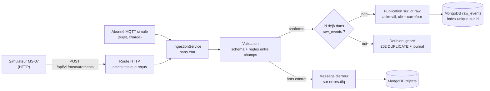

# Service de collecte : réception, validation, publication et stockage brut (MS-08)

Projet : Novaria Core, socle d'UrbanHub (bloc de compétences BC05)
Responsables : Daddy Luciano et Manoa Robel (relecture croisée)
Dernière mise à jour : 04/11/2026
Issue de suivi : MS-08 (#127)
Statut : à valider par les deux membres (relecture de la pull request)

Critère d'acceptation (ADR-009) : **tous les messages valides arrivent sur `iot.raw`, tous les invalides dans le sujet d'erreurs `errors.dlq`, les doublons sont ignorés.** Preuve : les sections 7 et 8 de ce document.

Abréviations : **DLQ** (Dead Letter Queue, file des messages refusés : ici le sujet `errors.dlq`), **HTTP** (HyperText Transfer Protocol), **IoT** (Internet of Things), **MQTT** (Message Queuing Telemetry Transport, protocole habituel des capteurs), **QoS** (Quality of Service, qualité de service de MQTT), **TCP** (Transmission Control Protocol).

## 1. En bref

| Tâche de l'issue | Réalisé | Où | Preuve |
|---|---|---|---|
| Réception HTTP des mesures, sans état entre deux requêtes | `POST /api/v1/measurements` ; rien n'est conservé en mémoire d'une requête à l'autre | `app/api/v1/measurements.py` | Section 3, tests de l'API et d'intégration |
| Réception « MQTT simulé » | Un abonné MQTT simulé (sujet, charge, redélivrance) confie le message à la même logique ; rejeu d'un fichier du simulateur | `app/adapters/mqtt_sim.py`, `app/cli.py` | Section 3.2, section 8 |
| Validation contre le schéma ; invalides vers le sujet d'erreurs avec le motif | Schéma puis règles entre champs ; message `novaria.error.rejected.v1` sur `errors.dlq`, copie dans `rejects` | `app/services/validation.py`, `app/services/ingestion.py` | Sections 4 et 5, mêmes décisions que `validate_events.py` |
| Publication sur `iot.raw` et copie brute dans MongoDB | Clé = carrefour ; accusé du broker attendu ; `raw_events` | `app/adapters/` | Section 5 |
| Idempotence : un doublon n'est traité qu'une fois | Recherche de l'`id`, verrou par `id`, index unique de MongoDB | `app/services/ingestion.py` | Section 6 |
| Tests unitaires et d'intégration, débit maximal sur un poste | 434 tests (425 sans base, 9 contre Kafka et MongoDB réels), couverture 99,19 % ; débit mesuré : section 10 | `tests/`, `scripts/dev/bench_collecte.py` | Sections 7 et 10 |

## 2. Architecture



Le cœur (`services/validation.py`, `services/ingestion.py`) ne connaît ni HTTP, ni Kafka, ni MongoDB : il reçoit des octets et trois **ports** (publier, lire et écrire `raw_events`, écrire `rejects`). Les adaptateurs les branchent ([ADR-010](../01-architecture/adr/ADR-010-architecture-hexagonale.md)). C'est ce qui permet de tester toute la logique avec de faux ports, puis le même code contre le vrai bus et la vraie base.

## 3. Réception

### 3.1 HTTP

| Cas | Réponse | Suite |
|---|---|---|
| Mesure conforme et nouvelle | `202` `{"event_id": ..., "status": "ACCEPTED"}` | publiée sur `iot.raw`, copie dans `raw_events` |
| Même `id` déjà reçu | `202` `{"status": "DUPLICATE"}` | ignorée sans erreur, journalisée |
| Mesure hors contrat | `422` `application/problem+json`, code `VALIDATION_ERROR`, liste `errors` (champ et message) | message sur `errors.dlq`, copie dans `rejects` |
| Bus ou base injoignable | `503` `UPSTREAM_UNAVAILABLE` | rien n'a été perdu : l'émetteur renvoie |
| Erreur imprévue | `500` `INTERNAL_ERROR`, sans détail technique, avec l'identifiant de corrélation | journal : type et lignes de la pile, jamais le message de l'exception |

- Le corps est lu **tel quel** (octets), pas par FastAPI : un JSON illisible reste illisible sur `errors.dlq`, il n'est pas remplacé par une erreur de cadre. Le type de contenu n'est pas exigé.
- Taille bornée à 64 Kio (`MAX_BODY_BYTES`) : au-delà, la lecture s'arrête après `limite + 1` octets, le message est refusé (`UNREADABLE`) et sa charge conservée tronquée. Une mesure en fait environ 600 octets.
- Les erreurs ont le format `Problem` (RFC 9457) du contrat, avec `correlation_id` ; une route ou une méthode inconnue aussi (`404`, `405`).
- Le point d'entrée est **interne** (`x-internal`) : la passerelle ne l'expose pas (elle répond `404`), et il n'a pas d'authentification de service en v1 (CLD-18).

### 3.2 « MQTT simulé »

Le projet n'a pas de courtier MQTT : aucun conteneur, aucun paquet. L'entrée est donc **simulée** ([ADR-008](../01-architecture/adr/ADR-008-microservices.md) : « HTTP ou MQTT simulé »). L'adaptateur reçoit ce qu'un abonné recevrait, un sujet et une charge, et les confie au **même** service d'ingestion que HTTP.

| MQTT | Ici |
|---|---|
| Abonnement `novaria/iot/measurements/+` | `+` remplace exactement un niveau, `#` termine le filtre (`a/#` correspond aussi à `a`, MQTT 3.1.1) |
| Un message hors abonnement n'est pas livré | l'adaptateur rend `None` : rien n'est lu, rien n'est écrit |
| QoS 1 : au moins une livraison, donc des doublons | une redélivrance est un doublon, ignoré par l'idempotence |
| Pas d'accusé tant que le traitement n'a pas réussi | `PublishFailed` et `StoreFailed` remontent à l'appelant, qui ne doit pas acquitter |

Rejeu d'un fichier du simulateur (`mesures.jsonl`), chaque message livré deux fois pour simuler la redélivrance :

| Linux (bash) | Windows (PowerShell) |
|---|---|
| `python -m app.cli replay-mqtt mesures.jsonl --redeliver` (depuis `services/collecte`, variables `KAFKA_BOOTSTRAP_SERVERS` et `MONGO_URL` ; le fichier doit être dans le répertoire courant ou dans `REPLAY_DIR`, sinon la commande le refuse) | idem ; ou dans le conteneur : `docker compose exec -e REPLAY_DIR=/tmp collecte python -m app.cli replay-mqtt /tmp/mesures.jsonl --redeliver` |

**Limite assumée** : ce n'est pas un client MQTT. Le protocole (paquets, QoS, sessions, authentification) n'est pas implémenté ; seule la **frontière** (un sujet, une charge, une livraison au moins une fois) l'est. Brancher un vrai courtier demanderait un client MQTT dans un nouvel adaptateur, sans toucher au cœur.

## 4. Validation et motifs de rejet

Une mesure est **acceptée** ou **rejetée avec un motif** ; il n'y a pas de troisième issue.

| Motif (`reason_code`) | Cas | Exemple |
|---|---|---|
| `UNREADABLE` | ni UTF-8 ni JSON valide ; constante `NaN` ou `Infinity` ; imbrication trop profonde ; message de plus de 64 Kio. La charge d'origine est conservée **sous forme de texte** | JSON tronqué |
| `UNKNOWN_TYPE` | `type` présent mais autre que `novaria.iot.measurement.v1` : seul ce type entre sur `iot.raw` | un indicateur envoyé à la collecte |
| `CONTRACT_VIOLATION` | schéma non respecté : champ inconnu ou manquant, type, borne, date sans fuseau ou impossible, règle conditionnelle (DQ-01) ; un JSON qui n'est pas un objet | `occupancy_rate` à 1,7 |
| `SEMANTIC_VIOLATION` | règle entre champs que le schéma ne sait pas exprimer : `subject` = `data.intersection_id`, `id` = `<run_id>:<sensor_id>:<ms de time>` (DQ-03), drapeaux `PARTIAL` (DQ-06) et `SUSPECT` (DQ-05) | `subject` d'un autre carrefour |

- Le motif donne le **chemin** et le **message** de chaque défaut (`data/occupancy_rate : Input should be less than or equal to 1`), sans jamais recopier la valeur refusée. Au plus 20 défauts sont listés dans la réponse `422`, 2 000 caractères dans le message d'erreur.
- Un test compare la collecte à `contracts/validate_events.py` sur les exemples du contrat, sur 34 messages dégradés et sur la sortie réelle du simulateur : **mêmes décisions**. Un seul écart, voulu : une date impossible (`2026-13-45T...`) est refusée par la collecte et acceptée par `validate_events.py`, parce que `jsonschema` ne contrôle le format `date-time` qu'avec un paquet optionnel (`rfc3339-validator`) absent.

### Ce que la collecte ne juge pas, et pourquoi

| Motif de l'énumération | Jugé par | Raison |
|---|---|---|
| `UNKNOWN_SENSOR` (DQ-02) | le traitement | exige le référentiel des capteurs (`dwh.dim_sensor`), que la collecte n'a pas |
| `LATE` (DQ-04) | le traitement | le retard se juge sur le **temps d'événement du flux**, avec un filigrane ([ADR-011](../01-architecture/adr/ADR-011-temps-reel-et-batch.md)) : il faut connaître les messages déjà vus, ce qu'une collecte sans état entre deux requêtes ne fait pas. Comparer à l'horloge refuserait tout rejeu d'historique |
| `FUTURE_TIMESTAMP` (DQ-10) | le consommateur | « hors rejeu » : même raison |

**Écart avec le README du simulateur** (MS-07), qui écrit que pour un retard de 45 s « la collecte doit le rejeter » : la collecte l'**accepte** (le test `test_a_late_message_is_accepted_by_the_collecte...` le fixe) et le traitement le jugera. À confirmer par les deux membres (section 9).

## 5. Publication et stockage

### 5.1 `iot.raw`

- Message : **l'objet JSON reçu**, sérialisé sans espace, pas une réécriture. Clé : `subject` (le carrefour), donc l'ordre est garanti par carrefour (une clé, une partition). Un test lit le sujet et vérifie que les messages d'un carrefour sont sur une seule partition, dans l'ordre d'envoi.
- Producteur : `acks=all` (le message n'est « publié » que quand le broker l'a écrit) et idempotent (une nouvelle tentative interne ne duplique pas). La requête HTTP attend l'accusé : un `202` signifie « sur le bus ».
- Chaque message publié est contrôlé par le banc du dépôt, `contracts/conformance.py` (`assert_publication("collecte", sujet, message)`) : droit de publier, type du sujet, contrat, signature.

### 5.2 `errors.dlq` et `rejects`

Un rejet produit un message `novaria.error.rejected.v1` (source `collecte`, clé = carrefour s'il est identifiable, `UNKNOWN` sinon) :

```json
{"id": "dlq:collecte:iot.raw:1793788210000:3fa9c1d2", "source": "collecte", "type": "novaria.error.rejected.v1",
 "time": "2026-11-04T17:30:10Z", "subject": "INT_01", "schema_version": "1.0", "correlation_id": "<identifiant de la requête>",
 "domain": "error",
 "data": {"source_topic": "iot.raw", "rejected_at": "2026-11-04T17:30:10Z", "reason_code": "CONTRACT_VIOLATION",
          "reason": "data/occupancy_rate : Input should be less than or equal to 1", "attempts": 1,
          "original_key": "INT_01", "intersection_id": "INT_01", "original_payload": { "...": "le message tel que reçu" }}}
```

- Le message d'erreur est lui-même validé contre son modèle avant d'être publié. Chaque rejet a son propre `id` (suffixe aléatoire) : deux rejets dans la même milliseconde ne se confondent pas. Un rejet n'est **pas** dédoublonné : chaque tentative laisse sa trace.
- Copie dans MongoDB `rejects` (`source_topic`, `rejected_at`, `reason`, `service`, `attempts`, `original_payload`, plus `reason_code`, `correlation_id`, `event_id`). Une charge que BSON refuse (clé contenant un octet nul, par exemple) est archivée **sous forme de texte JSON** plutôt que perdue ; le message sur `errors.dlq` garde l'objet.
- Si la publication sur `errors.dlq` échoue, la réponse est `503` et rien n'est archivé : un rejet n'est jamais perdu en silence. Si seule la copie dans `rejects` échoue, le rejet compte (le message est sur le sujet) et l'échec est journalisé.

### 5.3 `raw_events`

Le document est l'événement reçu, avec `time` converti en vraie date (BSON) et `received_at` (réception par la collecte, base de la durée de vie de 14 jours). Les validateurs et l'index unique `uniq_event_id` de `db/mongo/init/` s'appliquent ; les tests d'intégration vérifient que MongoDB accepte ce document et refuse une seconde copie.

## 6. Idempotence

Un message est identifié par son `id` (`<run_id>:<sensor_id>:<instant en millisecondes>`, règle DQ-03). Pour une mesure nouvelle, dans l'ordre :

1. **chercher** l'`id` dans `raw_events` : déjà là, c'est un doublon (`202 DUPLICATE`), rien d'autre ne se passe ;
2. **publier** sur `iot.raw` et attendre l'accusé du broker ;
3. **écrire** la copie dans `raw_events`.

**Pourquoi publier avant de stocker.** Le compte MongoDB de la collecte n'a que `find` et `insert` ([ADR-024](../01-architecture/adr/ADR-024-bases-de-donnees-locales.md)) : il ne peut ni modifier ni supprimer. Dans l'ordre inverse, un `id` stocké mais jamais publié (le bus tombe entre les deux) ne pourrait plus être réparé : le client renverrait, la collecte répondrait « doublon », et la mesure serait **perdue**. Un test d'intégration vérifie que le compte ne peut en effet ni modifier ni supprimer.

| Situation | Effet | Résultat |
|---|---|---|
| Même message reçu deux fois | recherche positive à la seconde | ignoré, `DUPLICATE` |
| 100 copies simultanées dans un processus | le verrou par `id` les fait passer l'une après l'autre | 1 publication, 99 `DUPLICATE` (testé : 100 fils, puis 50 contre le vrai Kafka) |
| Deux instances du service reçoivent le même message en même temps | le verrou ne traverse pas les processus ; l'index unique de MongoDB n'accepte qu'une copie | 1 copie stockée ; **au plus une publication par instance** (mesuré : 1 ou 2 publications pour 2 instances, une seule copie stockée) |
| Redémarrage du service | aucun état en mémoire n'est nécessaire | un nouveau processus reconnaît les doublons (testé) |
| Bus indisponible | rien n'est stocké | `503`, l'émetteur renvoie, la mesure est acceptée ensuite |
| MongoDB indisponible avant la recherche | rien n'est publié | `503` |
| MongoDB tombe **après** la publication | la mesure est sur `iot.raw` mais pas dans `raw_events` | `503` ; au renvoi elle est publiée une **seconde fois** puis stockée : le seul cas de double publication |

La garantie vers le bus est donc **« au moins une fois »** (hypothèse de l'[ADR-009](../01-architecture/adr/ADR-009-bus-evenements.md)) : le traitement dédoublonne aussi par `id` (DQ-03). Les doublons sont **comptés dans les journaux** : une ligne `doublon ignoré` avec `event_id` et `counter=duplicates` (pas dans `processing_stats`, voir la section 9).

## 7. Preuves : tests

| Exécution | Résultat (05/11/2026, poste Windows) |
|---|---|
| `pytest` sans bus ni base (comme la CI) | 425 réussis, 9 ignorés (les tests d'intégration) ; couverture **99,19 %** (instructions et branches) ; barrière de 70 % atteinte |
| `dev.py test-integration --service collecte` (Kafka et MongoDB en conteneur jetable) | **434 réussis, 0 ignoré**, couverture 99,19 %, 2 minutes ; projet Compose supprimé ensuite |
| Image réelle + simulateur + rejeu MQTT simulé (section 8) | critère atteint : 714 valides sur 714, 8 invalides sur 8, doublons ignorés |
| `scripts/dev` | 444 réussis (dont 15 de l'outil de débit et 12 de la commande `test-integration` pour la collecte) |

| Preuve | Contenu |
|---|---|
| `tests/unit/test_validation.py` | 64 tests : chaque famille de défaut du contrat et des règles entre champs, charges illisibles, motif et chemin, valeur refusée jamais recopiée |
| `tests/unit/test_ingestion.py` | Le critère avec de faux ports : valides sur `iot.raw`, invalides sur `errors.dlq`, doublons ignorés ; concurrence (100 fils) ; ordre publier puis stocker ; chaque panne (bus, base avant, base après, sujet d'erreurs, archive) |
| `tests/unit/test_measurements_api.py` | Réponses `202`, `422`, `503`, `500`, `404`, `405` validées contre le contrat OpenAPI ; limite de taille à l'octet près |
| `tests/unit/test_adapters.py` | Producteur Kafka (réglages, **une seule tentative d'amorçage partagée**, attente bornée) et MongoDB (index unique, repli en texte) avec de faux clients |
| `tests/unit/test_mqtt_cli.py` | Filtre d'abonnement MQTT, redélivrance, rejeu d'un fichier, codes de sortie |
| `tests/contract/test_measurements_contract.py` | Mêmes décisions que `validate_events.py` ; **sortie réelle du simulateur avec ses quatre anomalies** : exactement les identifiants distincts sur `iot.raw`, les copies du simulateur ignorées |
| `tests/integration/test_stack_flow.py` | **Vrai Kafka et vrai MongoDB** : le critère de bout en bout, instance neuve, 50 copies simultanées, deux instances en course, ordre par carrefour, charge refusée par BSON, droits du compte, rejeu MQTT simulé |
| `scripts/dev/test_dev.py`, `test_bench_collecte.py` | La commande `test-integration --service collecte` (12 tests, dont la régression du port) et l'outil de débit (15 tests, avec un faux serveur) |

Contrôle par mutations : 47 défauts introduits volontairement (validation, ordre des opérations, verrou par `id`, lecture bornée, réglages du producteur Kafka, filtre MQTT, câblage, configuration). **43 détectés**, dont 8 après correction : 6 ont révélé un vrai manque de test, dont un important (retirer le verrou par `id` ne faisait échouer aucun test : le test à 100 fils passait « par chance » avec des faux trop rapides ; il utilise maintenant un accusé du broker lent), les autres étaient des motifs de mutation à reformuler. **2 équivalents** (sans effet observable : une option que le code ne lit jamais, une copie d'un objet identique) et **2 portant sur du code retiré** depuis. Les 9 mutations rejouées après correction sont toutes détectées

## 8. Preuve de bout en bout (image réelle)

Image de la collecte construite avec le verrou à empreintes (`pip install --require-hashes --only-binary :all:`, Python 3.15), vrai Kafka, vrai MongoDB, vrai simulateur MS-07 (scénario `heure-de-pointe`, graine 42, 5 minutes, **les quatre anomalies** : valeur aberrante, capteur muet, doublon, retard), messages invalides écrits à la main, puis rejeu « MQTT simulé » dans le conteneur. Projet Compose jetable, supprimé ensuite.

```text
Projet Compose jetable : novaria-ms08-eb6451 (collecte :54181, MongoDB :54182, Kafka :54183)
Sujets : conformes
GET /api/v1/health -> 200 {"status":"ok","version":"0.1.0","revision":"local","environment":"local"}
=== 1. Simulateur MS-07 (heure-de-pointe, graine 42, 5 min, 4 anomalies) : 716 messages émis, 714 identifiants distincts
  résumé du simulateur : {"run_id": "run-ms08", "messages": 716, "truth_rows": 720, "collecte": {"accepted": 714, "duplicates": 2, "rejected": 0, "errors": 0, "last_error":...
  code de sortie du simulateur : 0
=== 3. Messages invalides envoyés à la main
  borne dépassée (CONTRACT_VIOLATION)        -> 422 VALIDATION_ERROR  (Mesure refusée (CONTRACT_VIOLATION) : envoyée sur errors.dlq)
  champ inconnu (CONTRACT_VIOLATION)         -> 422 VALIDATION_ERROR  (Mesure refusée (CONTRACT_VIOLATION) : envoyée sur errors.dlq)
  sujet incohérent (SEMANTIC_VIOLATION)      -> 422 VALIDATION_ERROR  (Mesure refusée (SEMANTIC_VIOLATION) : envoyée sur errors.dlq)
  autre type d'événement (UNKNOWN_TYPE)      -> 422 VALIDATION_ERROR  (Mesure refusée (UNKNOWN_TYPE) : envoyée sur errors.dlq.)
  JSON tronqué (UNREADABLE)                  -> 422 VALIDATION_ERROR  (Mesure refusée (UNREADABLE) : envoyée sur errors.dlq.)
  octets illisibles (UNREADABLE)             -> 422 VALIDATION_ERROR  (Mesure refusée (UNREADABLE) : envoyée sur errors.dlq.)
  pas un objet (CONTRACT_VIOLATION)          -> 422 VALIDATION_ERROR  (Mesure refusée (CONTRACT_VIOLATION) : envoyée sur errors.dlq)
  trop gros (UNREADABLE)                     -> 422 VALIDATION_ERROR  (Mesure refusée (UNREADABLE) : envoyée sur errors.dlq.)
=== 4. Renvoi de 30 mesures déjà reçues
  réponses : {(202, 'DUPLICATE'): 30}
=== 5. Constat sur Kafka et MongoDB
  iot.raw : 714 messages, 714 identifiants distincts, doublon le plus fréquent : 1 fois
  iot.raw == identifiants du simulateur : True
  errors.dlq : 8 messages, motifs : {'CONTRACT_VIOLATION': 3, 'SEMANTIC_VIOLATION': 1, 'UNKNOWN_TYPE': 1, 'UNREADABLE': 3}
  invalides envoyés : 8 ; reçus sur errors.dlq : 8
  message invalide arrivé sur iot.raw : 0
  conformité au contrat de chaque message (conformance.assert_publication) : OK
  MongoDB raw_events : 714 documents ; rejects : 8 documents
=== 6. Rejeu « MQTT simulé » dans le conteneur (redélivrance : chaque message deux fois)
  Rejeu terminé : ACCEPTED=0, DUPLICATE=1432, REJECTED=0, FAILED=0  (code 0)
  iot.raw après le rejeu : 714 messages (avant : 714) -> aucun doublon publié : True
Critère : valides sur iot.raw = 714/714, invalides sur errors.dlq = 8/8, doublons ignorés = 32 -> ATTEINT
=== 7. Débit maximal (client Python à fils d'exécution sur le même poste)
Collecte : http://127.0.0.1:54181, 3000 messages valides distincts par palier
  1 connexion(s)                 55.1 msg/s   médiane   16.9 ms   p95   27.7 ms   p99   37.2 ms   max   167.5 ms  UC max 151 %   {'202 ACCEPTED': 3000}
  4 connexion(s)                 79.7 msg/s   médiane   44.1 ms   p95   90.4 ms   p99  141.5 ms   max   214.5 ms  UC max 174 %   {'202 ACCEPTED': 3000}
  16 connexion(s)                87.2 msg/s   médiane  162.7 ms   p95  299.1 ms   p99  426.8 ms   max  1351.1 ms  UC max 194 %   {'202 ACCEPTED': 3000}
  32 connexion(s)                97.2 msg/s   médiane  311.7 ms   p95  537.7 ms   p99  595.7 ms   max   750.7 ms  UC max 200 %   {'202 ACCEPTED': 3000}
  64 connexion(s)                94.1 msg/s   médiane  650.9 ms   p95  982.3 ms   p99 1200.1 ms   max  1507.9 ms  UC max 168 %   {'202 ACCEPTED': 3000}
Débit maximal mesuré : 97.2 msg/s à 32 connexion(s).
  mêmes messages (doublons)     142.1 msg/s   médiane  208.3 ms   p95  359.1 ms   p99  448.2 ms   max   592.0 ms  UC max 125 %   {'202 DUPLICATE': 3000}
  messages invalides            117.7 msg/s   médiane  247.0 ms   p95  470.0 ms   p99  583.2 ms   max   689.9 ms  UC max 169 %   {'422 VALIDATION_ERROR': 3000}
Réponses inattendues ou erreurs de transport : 0
Projet novaria-ms08-eb6451 supprimé.
```

## 9. Écarts et décisions à valider

| Sujet | Décision prise | Pourquoi | À valider |
|---|---|---|---|
| Doublons « comptés dans `processing_stats` » (contrat, DQ-03) | Comptés dans les **journaux** (`counter=duplicates`) | `role_collecte` n'a pas accès à `processing_stats` (ADR-024) et `kind` n'a pas de valeur pour cela. Lui donner `insert` et `update` change `db/mongo/init/` (appliqué seulement sur un volume neuf, donc `db-reset`) : décision de données, pas prise ici. Contrat et dictionnaire (DQ-03) corrigés pour dire ce qui est fait | Les deux membres |
| Retard (DQ-04), référentiel (DQ-02), futur (DQ-10) | Jugés par le traitement | Section 4. Contredit une phrase du README du simulateur | Les deux membres, avec MS-09 |
| Ordre publier puis stocker, publication « au moins une fois » | Choisis | Section 6 | Les deux membres |
| Entrée « MQTT simulé » | Frontière seulement, pas un client MQTT | Pas de courtier dans le projet | Les deux membres |
| Taille maximale 64 Kio | Valeur de départ | Une mesure fait 600 octets ; la borne protège la mémoire | — |
| Le point d'entrée n'a pas d'authentification | Interne, port publié sur 127.0.0.1, absent de la passerelle | Contrat (`x-internal`), CLD-18 | CLD-18 |
| `kafka-python` 3 (paquet pur Python, roue `py3-none-any`) | Retenu | `confluent-kafka` n'a pas de roue pour Python 3.15 (l'image) et le Dockerfile impose `--only-binary`. Trois paquets ajoutés au verrou : `kafka-python`, `pymongo`, `dnspython` | Manoa Robel (verrous) |

**Une fausse piste à ne pas répéter : le « blocage » des tests d'intégration.** Les premières exécutions de `dev.py test-integration --service collecte` semblaient bloquées pendant plus de 10 minutes dans l'amorçage du producteur Kafka. Ce n'était **pas** `kafka-python` : l'outil visait le port `9094` du poste, où rien n'écoute, au lieu du port du projet jetable. Cause : `etl_environment()` ne recopie les variables du shell que si leur nom est dans `.env`, et `KAFKA_PORT` n'y figure pas sur ce poste (variable facultative). Chaque requête échouait donc en 5 s (délai d'amorçage), et une soixantaine de requêtes à la suite ressemblaient à un blocage. Corrigé dans `dev.py` (les ports du projet jetable priment) avec un test de régression qui échoue sans la correction. Mesures faites pour trancher : `KafkaProducer` respecte `bootstrap_timeout_ms` sur un port fermé (3,0 s) comme sur un écouteur qui accepte la connexion sans répondre (3,0 s), et avec les réglages du service sur le mauvais port (5,0 s).

**Conséquence pour le service** : sans courtier, une publication échoue en 5 s au plus (`503`), et les requêtes simultanées **partagent une seule tentative d'amorçage** au lieu de se la passer l'une après l'autre sous un verrou (50 requêtes pendant une panne attendraient sinon 50 amorçages).

## 10. Débit maximal sur un poste

Mesure demandée par l'[ADR-001](../01-architecture/adr/ADR-001-python-fastapi.md), consignée ici et dans le README du service.

| Élément | Valeur |
|---|---|
| Poste | AMD Ryzen 7 3700U (4 cœurs, 8 threads), 5,9 Go de mémoire, Windows 11 Pro ; Docker Desktop 29.1.3 (8 processeurs logiques, 3 Go de mémoire pour la machine virtuelle) |
| Service | l'image de MS-08 telle que livrée : **un** processus `uvicorn`, aucun réglage |
| Bus et base | Kafka (un courtier, trois partitions par sujet, `acks=all`) et MongoDB 7 dans le même Docker Desktop, sur le même poste |
| Client | `scripts/dev/bench_collecte.py` : fils d'exécution Python, connexions HTTP persistantes, mesures conformes distinctes |
| Date | 05/11/2026 (deux mesures) |

| Connexions simultanées | Messages par seconde | Médiane (ms) | p95 (ms) | p99 (ms) | Maximum (ms) | Processeur du conteneur (max) | Réponses |
|---|---|---|---|---|---|---|---|
| 1 | 55,1 | 16,9 | 27,7 | 37,2 | 167,5 | 151 % | 3 000 × `202 ACCEPTED` |
| 4 | 79,7 | 44,1 | 90,4 | 141,5 | 214,5 | 174 % | 3 000 × `202 ACCEPTED` |
| 16 | 87,2 | 162,7 | 299,1 | 426,8 | 1 351,1 | 194 % | 3 000 × `202 ACCEPTED` |
| 32 | **97,2** | 311,7 | 537,7 | 595,7 | 750,7 | 200 % | 3 000 × `202 ACCEPTED` |
| 64 | 94,1 | 650,9 | 982,3 | 1 200,1 | 1 507,9 | 168 % | 3 000 × `202 ACCEPTED` |
| 32, mêmes messages | 142,1 | 208,3 | 359,1 | 448,2 | 592,0 | 125 % | 3 000 × `202 DUPLICATE` |
| 32, messages invalides | 117,7 | 247,0 | 470,0 | 583,2 | 689,9 | 169 % | 3 000 × `422 VALIDATION_ERROR` |

**Lecture.**

- **Débit maximal mesuré : 97 messages par seconde** pour une mesure complète (validation, accusé de Kafka, copie dans MongoDB), à partir de 16 à 32 connexions simultanées. Mesuré deux fois (97,0 puis 97,2) ; au-delà, seule la latence augmente (64 connexions : 94 messages par seconde, médiane 0,65 s) : le service fait la queue.
- Avec une seule connexion : environ 55 messages par seconde, 17 ms en médiane. C'est la latence d'une mesure (recherche de l'`id`, publication avec accusé `acks=all`, écriture), pas un plafond.
- Le chemin « doublon » (pas de publication) atteint 142 messages par seconde et le chemin « invalide » 118 : la publication avec accusé n'est qu'une partie du coût. Une requête HTTP avec une recherche MongoDB plafonne déjà à environ 140 messages par seconde sur ce poste.
- **Marge** : le simulateur émet 24 capteurs toutes les 10 s, soit **2,4 messages par seconde**. La collecte absorbe donc environ **40 fois** ce débit (l'exigence EXG-NFR-04 demande au moins 10 fois, sans perte, pour toute la chaîne : la collecte n'en est qu'un maillon).
- **Aucune perte, aucune erreur** dans la mesure finale (0 réponse inattendue). Dans une première mesure, 3 requêtes sur 3 000 à 64 connexions ont reçu `503` après plus de 10 s (saturation) ; elles n'avaient rien stocké, et ont été **acceptées au renvoi** (3 `ACCEPTED` dans la phase « mêmes messages ») : c'est la règle « `503` = rien de perdu, l'émetteur renvoie » en situation réelle.
- Le processeur du conteneur monte à environ 200 % (deux cœurs logiques sur les huit donnés à Docker), mais le poste entier est partagé entre le client, Kafka, MongoDB et le service : ce chiffre ne dit pas à lui seul quel élément sature. **Non établi** : si la limite vient du service, de Kafka, de MongoDB ou du client ; l'explication par la taille du pool de fils d'exécution (40 par défaut) reste une hypothèse non vérifiée.

**Limites de la mesure.** Elle borne le débit par le bas : le client est un programme Python à fils d'exécution sur le même processeur que le service, Kafka et MongoDB ; le premier à saturer peut être le client ou Docker Desktop plutôt que le service. L'utilisation du processeur du conteneur est échantillonnée (`docker stats`) pour le dire. Un seul courtier Kafka avec `acks=all` : en production avec plusieurs réplicas, la latence de publication, donc le débit par connexion, serait différente. Le débit nominal du simulateur est de 2,4 messages par seconde (24 capteurs toutes les 10 s) : la marge est donnée dans la lecture ci-dessus. **Non mesuré** : plusieurs processus `uvicorn`, plusieurs courtiers, Linux.

## 11. Rejouer les preuves

| Action | Linux (bash) | Windows (PowerShell) |
|---|---|---|
| Tests unitaires et de contrat (sans bus ni base ; couverture et barrière de 70 %) | `cd services/collecte && pytest` | `cd services\collecte; pytest` |
| Tests contre Kafka et MongoDB jetables (le critère de bout en bout) | `python3 scripts/dev/dev.py test-integration --service collecte` | `py -3 scripts/dev/dev.py test-integration --service collecte` |
| Démarrer la pile complète | `python3 scripts/dev/dev.py up` | `py -3 scripts/dev/dev.py up` |
| Envoyer un scénario du simulateur à la collecte | `python3 simulator/app.py run --scenario heure-de-pointe --collecte-url http://127.0.0.1:8001` | `py -3 simulator/app.py run --scenario heure-de-pointe --collecte-url http://127.0.0.1:8001` |
| Mesurer le débit | `python3 scripts/dev/bench_collecte.py --url http://127.0.0.1:8001 --container <nom du conteneur collecte>` | `py -3 scripts/dev/bench_collecte.py --url http://127.0.0.1:8001 --container <nom>` |
| Lire `iot.raw` ou `errors.dlq` | `docker compose exec kafka /opt/kafka/bin/kafka-console-consumer.sh --bootstrap-server localhost:9092 --topic errors.dlq --from-beginning --max-messages 5` | idem |

Preuve sous Linux : [À COMPLÉTER par Manoa Robel].

## 12. Limites et points ouverts

| Sujet | Position actuelle | Suite |
|---|---|---|
| Publication « au moins une fois » | Une double publication est possible si MongoDB tombe entre la publication et la copie, ou si deux instances reçoivent le même message en même temps | Le traitement dédoublonne par `id` (MS-09) |
| Plusieurs instances | Le verrou par `id` est local à un processus ; l'index unique arbitre le stockage, pas la publication | Acceptable en local (une instance) ; clé d'idempotence côté producteur Kafka ou transactions si le besoin apparaît |
| Un `id` réutilisé avec un contenu différent | Traité comme un doublon (le second est ignoré), sans comparer les contenus | Comparer et journaliser l'écart si la qualité des données le demande |
| MQTT | Simulé (section 3.2) | Client MQTT réel dans un nouvel adaptateur |
| Authentification du point d'entrée | Aucune en v1 | CLD-18 |
| Compteur de doublons | Dans les journaux seulement | Décision de la section 9 |
| Débit | Section 10 : un processus, un poste Windows | Mesurer sous Linux et avec plusieurs processus |
| Services `alerte` et `reponse` | Toujours des squelettes : sécurité applicative (BE-08) et masquage des secrets restent à reprendre | MS-11, MS-12 |
