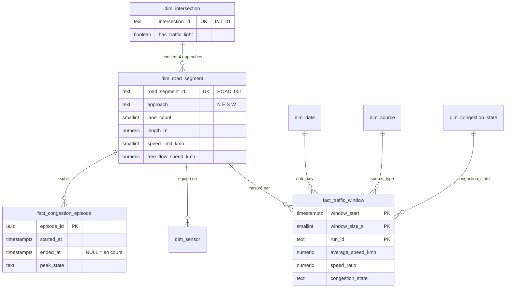
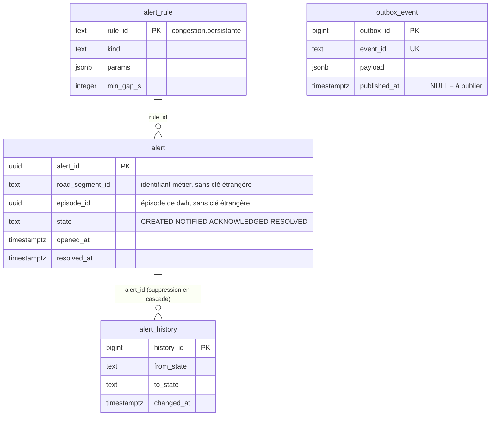
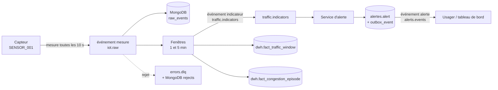
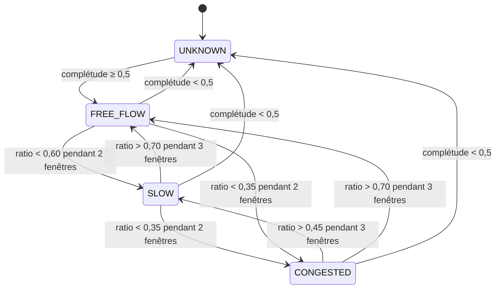

# Dictionnaire de données

Une définition par terme, une unité par grandeur, une règle par calcul. Ce document fait foi pour les bases (`db/`), les événements (`contracts/`), le simulateur et le modèle. Version du 27/10/2026 (relue et complétée : issues DAT-02 et DAT-10 ; compte rendu de la relecture croisée : [revue DAT-10](revue-croisee-dat-10.md)) ; toute modification passe par pull request et met à jour les trois endroits à la fois.

**Complétude vérifiée par un test** : chaque table et chaque colonne des migrations `db/postgres/migrations/`, chaque collection, champ et index de `db/mongo/init/` doivent figurer ici (`scripts/dev/test_dictionnaire.py`, voir « Vérifier » en fin de document). Ajouter une colonne sans la décrire fait échouer le test.

Lire ensuite : [bases locales](base-de-donnees-locale.md), [contrats d'événements](../../contracts/README.md), [ADR-028](../01-architecture/adr/ADR-028-etats-de-congestion-et-alertes.md) (pourquoi ces règles), [ADR-027](../01-architecture/adr/ADR-027-jeux-de-donnees-et-provenance.md) (provenance).

## 1. Vocabulaire

| Terme | Définition | Identifiant |
|---|---|---|
| Carrefour | Point où se croisent des routes ; il peut avoir des feux. Clé de partition des sujets Kafka. | `INT_01` |
| Tronçon | Approche d'un carrefour : la portion de route qui y mène depuis un côté (N, E, S, W). **Unité d'analyse de la circulation.** | `ROAD_001` |
| Capteur | Dispositif qui compte les véhicules et mesure leur vitesse sur un tronçon. | `SENSOR_001` |
| Mesure brute | Ce qu'un capteur envoie pour un court intervalle (10 s par défaut). | événement `novaria.iot.measurement.v1` |
| Fenêtre | Intervalle de 1 ou 5 minutes sur lequel on agrège les mesures d'un tronçon. | `window_start` + `window_size_s` |
| Indicateur | Résultat de l'agrégation d'une fenêtre (débit, vitesse, ratio, état). | événement `novaria.traffic.indicator.v1` |
| Ratio de vitesse | Vitesse moyenne de la fenêtre divisée par la vitesse en circulation fluide du tronçon. Sans unité. | `speed_ratio` |
| État de congestion | Qualification de la circulation d'un tronçon : fluide, ralenti, congestionné, inconnu. | `congestion_state` |
| Épisode | Période continue pendant laquelle un tronçon est ralenti ou congestionné. | `episode_id` |
| Alerte | Notification d'un épisode à l'usager : **une par épisode**, jamais une par mesure. | `alert_id` |
| Run | Une exécution du simulateur (ou un chargement de jeu historique). Deux runs ne s'écrasent jamais. | `run_id` |
| Scénario | Paramètres d'un run simulé (heure de pointe, incident, journée calme…). | `scenario_id` |
| Graine | Nombre qui rend un run aléatoire reproductible à l'identique. | `seed` |
| Provenance | Origine de la donnée : simulée, réelle historique, réelle en direct. | `source_type` |
| Vérité terrain | État de congestion réel d'un tronçon connu du simulateur, utilisé comme réponse à retrouver par le modèle. | `label_state` |

## 2. Conventions

| Sujet | Règle |
|---|---|
| Date et heure | norme ISO 8601 (International Organization for Standardization) en UTC (Coordinated Universal Time, temps universel coordonné), fuseau explicite : `2026-10-20T08:00:10Z`. En base : `timestamptz`. Aucune heure locale stockée. |
| Vitesse | Kilomètres par heure (km/h), 0 à 200 |
| Débit | Véhicules par minute (veh/min) |
| Taux d'occupation | Nombre de 0 à 1 (jamais un pourcentage) |
| Longueurs | Mètres |
| Durées techniques | Secondes, suffixe `_s` |
| Nombres de véhicules | Entiers positifs ou nuls |
| Identifiants | Texte opaque à motif fixe (`INT_`, `ROAD_`, `SENSOR_` + numéro) ; jamais déduits d'un nombre |
| Valeur absente | `null`, jamais `0` ni `-1`. **Une vitesse n'existe que si au moins un véhicule est passé** : route vide ⇒ vitesse `null` (une route vide n'est pas une route arrêtée). |
| Noms techniques | Anglais, `snake_case`. Libellés affichés à l'usager : français. |
| Provenance | Obligatoire sur chaque mesure, indicateur, alerte et jeu de données ; une donnée simulée n'est jamais présentée comme réelle |

## 3. Modèle de l'entrepôt décisionnel

L'entrepôt décisionnel (DWH, *Data Warehouse*) est le schéma PostgreSQL `dwh`, en étoile ([ADR-014](../01-architecture/adr/ADR-014-architecture-decisionnelle.md)).

Le schéma `alertes` n'a **aucune clé étrangère vers `dwh`** : chaque service est propriétaire de ses données ([ADR-008](../01-architecture/adr/ADR-008-microservices.md), règle 1). Les liens entre services sont des identifiants textuels (`road_segment_id`, `episode_id`).

`outbox_event` n'a pas de lien SQL avec `alert` : l'événement porte lui-même ce dont les consommateurs ont besoin (motif « outbox », [ADR-009](../01-architecture/adr/ADR-009-bus-evenements.md)). Les tables `etl_reject` (section 8.1) et `schema_migrations` (section 11) sont des tables de service, sans lien avec les autres.

### Circulation d'une donnée

## 4. Référentiel du réseau (`dwh.dim_*`)

| Table | Colonne | Type | Règle | Sens |
|---|---|---|---|---|
| `dim_intersection` | `intersection_key` | entier généré | clé primaire | Clé technique (voir 4.1) |
| | `intersection_id` | texte, unique | `^INT_[0-9]{2,}$` | Identifiant métier, partagé avec les événements |
| | `name` | texte | obligatoire | Nom affiché |
| | `latitude`, `longitude` | décimal | les deux ou aucune ; −90 à 90, −180 à 180 | Vides pour le réseau fictif |
| | `has_traffic_light` | booléen | défaut vrai | Carrefour à feux |
| `dim_road_segment` | `road_segment_key` | entier généré | clé primaire | Clé technique (voir 4.1) |
| | `road_segment_id` | texte, unique | `^ROAD_[0-9]{3,}$` | Identifiant du tronçon |
| | `intersection_key` | entier | obligatoire ; clé étrangère vers `dim_intersection` | Carrefour auquel le tronçon mène |
| | `name` | texte | obligatoire | Nom affiché |
| | `approach` | texte | N, E, S, W ; un seul tronçon par côté et par carrefour | Côté d'où arrive la circulation |
| | `road_type` | texte | MOTORWAY, ARTERIAL, COLLECTOR, LOCAL | Catégorie de route |
| | `lane_count` | entier | 1 à 8 | Voies de l'approche |
| | `length_m` | décimal | > 0 | Longueur de l'approche (m) |
| | `speed_limit_kmh` | entier | 5 à 130 | Vitesse limite (km/h) |
| | `free_flow_speed_kmh` | décimal | > 0 | Vitesse en circulation fluide : dénominateur du ratio. **Simulation : égale à la vitesse limite.** Données réelles : à estimer (quantile élevé des vitesses de nuit). |
| `dim_sensor` | `sensor_key` | entier généré | clé primaire | Clé technique (voir 4.1) |
| | `sensor_id` | texte, unique | `^SENSOR_[0-9]{3,}$` | Identifiant du capteur |
| | `road_segment_key` | entier | obligatoire ; clé étrangère vers `dim_road_segment` | Tronçon équipé (un tronçon peut avoir plusieurs capteurs) |
| | `sensor_type` | texte | LOOP, CAMERA, RADAR, SIMULATED | Technologie |
| | `reporting_interval_s` | entier | 1 à 3600, défaut 10 | Durée couverte par chaque mesure |
| `dim_source` | `source_type` | texte | SIMULATED, REAL_HISTORICAL, REAL_LIVE | Provenance (voir [ADR-027](../01-architecture/adr/ADR-027-jeux-de-donnees-et-provenance.md)) |
| | `description` | texte | obligatoire | Sens de l'origine, en français |
| `dim_congestion_state` | `state_code`, `severity_rank` | texte, 0 à 3 | UNKNOWN 0, FREE_FLOW 1, SLOW 2, CONGESTED 3 ; rang unique | États ordonnés par gravité |
| | `label_fr` | texte | obligatoire | Libellé affiché : Inconnu, Fluide, Ralenti, Congestionné |
| `dim_date` | `date_key` | entier | AAAAMMJJ ; la contrainte accepte 2000 à 2099, la migration `0004` charge 2012 à 2030 (6 940 jours) | Clé du calendrier, en UTC. Un fait daté hors du calendrier chargé est **refusé** (clé étrangère). |
| | `full_date` | date | unique | Jour calendaire |
| | `year`, `month`, `day` | entiers | mois 1 à 12, jour 1 à 31 | Année civile, mois, jour |
| | `iso_day_of_week` | entier | 1 (lundi) à 7 (dimanche), norme ISO 8601 | Jour de la semaine |
| | `iso_week` | entier | 1 à 53 | Semaine ISO ; la semaine 1 peut commencer fin décembre, donc `year` et `iso_week` ne forment pas une semaine ISO complète |
| | `is_weekend` | booléen | vrai le samedi et le dimanche | Fin de semaine |
| | `is_holiday`, `holiday_name` | booléen, texte | `is_holiday` faux par défaut ; `holiday_name` vide tant que le calendrier n'est pas chargé | Jour férié (limite connue) |

Le réseau de démonstration (fictif) : 6 carrefours, 24 tronçons, 24 capteurs, généré par `scripts/dev/gen_reseau.py` (migration `0005`).

| Carrefours | Type de route | Voies | Longueur d'approche | Vitesse limite |
|---|---|---|---|---|
| INT_01, INT_02 | ARTERIAL | 2 | 300 m | 50 km/h |
| INT_03, INT_04 | COLLECTOR | 1 | 250 m | 50 km/h |
| INT_05, INT_06 | LOCAL | 1 | 150 m | 30 km/h |

### 4.1 Clés techniques

| Clé | Table | Règle |
|---|---|---|
| `intersection_key`, `road_segment_key`, `sensor_key` | `dim_intersection`, `dim_road_segment`, `dim_sensor` | Entier généré par la base (`GENERATED ALWAYS AS IDENTITY`), propre à l'entrepôt. **Jamais** employé dans un événement, une API ou un fichier d'échange : on y échange les identifiants métier (`INT_`, `ROAD_`, `SENSOR_`), qui restent stables si l'entrepôt est reconstruit. |
| `date_key` | `dim_date`, `fact_traffic_window` | Entier AAAAMMJJ, calculé : dans `fact_traffic_window` la base le déduit de `window_start`, il ne s'écrit pas. |

## 5. Mesure brute (`novaria.iot.measurement.v1`)

Grain : un capteur, un intervalle. Stockée dans MongoDB `raw_events` (14 jours), jamais dans PostgreSQL.

| Champ (`data`) | Type | Règle | Sens |
|---|---|---|---|
| `sensor_id`, `road_segment_id`, `intersection_id` | texte | motifs ci-dessus ; doivent exister dans le référentiel | Qui mesure, où |
| `interval_s` | entier | 1 à 3600 | Durée couverte, qui **se termine** à `time` |
| `vehicle_count` | entier | ≥ 0 | Véhicules passés pendant l'intervalle |
| `average_speed_kmh` | nombre ou `null` | 0 à 200 ; **`null` si `vehicle_count` = 0** ; obligatoire si qualité `VALID` et `vehicle_count` ≥ 1 | Vitesse moyenne |
| `occupancy_rate` | nombre ou `null` | 0 à 1 ; obligatoire si qualité `VALID` | Part de l'intervalle où le capteur était occupé |
| `queue_length_m` | nombre | 0 à 10 000, facultatif | File observée |
| `quality.status` | énumération | VALID, PARTIAL, SUSPECT | Voir section 8 |
| `quality.flags` | liste | MISSING_SPEED, MISSING_OCCUPANCY, IMPLAUSIBLE_VALUE, LATE, GAP_BEFORE ; sans doublon. **PARTIAL exige** MISSING_SPEED ou MISSING_OCCUPANCY ; **SUSPECT exige** IMPLAUSIBLE_VALUE (règles DQ-06 et DQ-05, contrôlées par `validate_events.py`) | Détail de la qualité |
| `provenance` | objet | `source_type` + `run_id` ; si SIMULATED : `scenario_id` et `seed` ; si REAL_HISTORICAL : `dataset_id` | Origine |

Attributs de l'enveloppe, communs à tous les événements :

| Attribut | Règle |
|---|---|
| `id` | Clé d'idempotence. Mesure : `<run_id>:<sensor_id>:<instant en millisecondes>`. Indicateur : `<run_id>:<road_segment_id>:<window_size_s>:<début de fenêtre en millisecondes>`. Recommandation : son `recommendation_id`. Alerte : un identifiant par changement d'état, format non fixé (section 12). Un même `id` reçu deux fois est ignoré (index unique `uniq_event_id`). |
| `source` | Producteur : `simulateur/<run_id>`, `collecte`, `traitement`, `alerte`, `reponse`. Sauf pour les mesures, c'est le service qui publie |
| `type` | `novaria.<domaine>.<sujet>.v<majeure>` |
| `time` | Instant de l'observation (temps d'événement), UTC. Mesure : fin de l'intervalle. Indicateur : fin de la fenêtre. |
| `subject` | **= `intersection_id`** : clé de partition Kafka, ordre garanti par carrefour. Seul `errors.dlq` admet `UNKNOWN`, quand le carrefour du message rejeté n'est pas identifiable |
| `schema_version` | `majeure.mineure` |
| `correlation_id` | Facultatif : relie une mesure à l'indicateur et à l'alerte qu'elle a produits |
| `domain` | iot, traffic, alert, signal ou error |

## 6. Indicateur par fenêtre (`dwh.fact_traffic_window` et `novaria.traffic.indicator.v1`)

Grain : un tronçon, une fenêtre, un run. **Clé primaire** (`road_segment_key`, `window_start`, `window_size_s`, `run_id`) = clé d'idempotence : rejouer un chargement met à jour la ligne, ne la duplique pas.

| Événement (`data`) | Colonne SQL (Structured Query Language) | Sens et règle |
|---|---|---|
| `road_segment_id` | `road_segment_key` (clé technique) | Tronçon |
| `window_start` | `window_start` | Début, UTC ; la fenêtre couvre [début, début + taille[ ; alignée sur la taille (minute ronde ou multiple de 5 min) |
| `window_size_s` | `window_size_s` | 60 ou 300 |
| (déduit de la provenance) | `run_id`, `source_type` | Exécution et origine |
| (calculé) | `date_key` | AAAAMMJJ de `window_start` en UTC |
| `vehicle_count` | `vehicle_count` | Somme des véhicules des mesures retenues |
| `flow_veh_per_min` | `flow_veh_per_min` | `vehicle_count` / (`window_size_s` / 60) |
| `average_speed_kmh` | `average_speed_kmh` | Moyenne **pondérée par le nombre de véhicules** ; `null` si `vehicle_count` = 0 |
| `occupancy_rate` | `occupancy_rate` | Moyenne des taux d'occupation non nuls |
| `max_queue_length_m` | `max_queue_length_m` | Maximum des files observées |
| `speed_ratio` | `speed_ratio` | `average_speed_kmh` / `free_flow_speed_kmh` ; `null` si la vitesse est `null` ; 0 à 9,999 |
| `sample_count` | `sample_count` | Mesures retenues (qualité VALID ou PARTIAL, doublons exclus) |
| `expected_sample_count` | `expected_sample_count` | (`window_size_s` / `reporting_interval_s`) × capteurs du tronçon |
| (calculé) | `completeness` | min(1, `sample_count` / `expected_sample_count`) |
| `congestion_state` | `congestion_state` | **État stabilisé** (voir section 7), pas le classement brut de la fenêtre |
| `classifier_version` | `classifier_version` | Version de la règle ou du modèle (`regles-v0`) ; permet de comparer deux classificateurs |
| (système) | `loaded_at` | Date de chargement |

Une ligne peut être refusée par ses contraintes (vitesse sans véhicule, fenêtre de 2 minutes, état inconnu…) : l'erreur est visible à l'écriture, pas plus loin.

## 7. Règles de calcul et d'états

### 7.1 État de congestion d'un tronçon (valeurs de départ)

L'état se calcule sur les fenêtres de **1 minute** et change par **hystérésis** : un seuil franchi une seule fois ne suffit pas, pour éviter un état qui clignote. Les valeurs sont des hypothèses de départ, à fixer définitivement dans `docs/06-ia-mlops/cadrage-ml.md` avant tout entraînement ([ADR-028](../01-architecture/adr/ADR-028-etats-de-congestion-et-alertes.md)).

| Règle | Valeur |
|---|---|
| Fenêtre sans véhicule (`speed_ratio` `null`, complétude suffisante) | Comptée comme fluide (une route vide est fluide) |
| Complétude inférieure à 0,5 | État `UNKNOWN` : on ne conclut pas avec la moitié des données |
| Décalage entre événement réel et état | 2 à 3 minutes : coût assumé de la stabilité |
| Fenêtres de 5 minutes | Servent aux tendances et à l'apprentissage ; l'état d'alerte vient des fenêtres de 1 minute |

### 7.2 Épisodes (`dwh.fact_congestion_episode`)

| Moment | Action |
|---|---|
| L'état stabilisé passe à SLOW ou CONGESTED | Ouverture : `started_at` = début de la première fenêtre dégradée, `ended_at` = `null` |
| L'état monte à CONGESTED | `peak_state` = CONGESTED |
| L'état revient à FREE_FLOW | Clôture : `ended_at` renseigné ; `window_count` et `min_speed_ratio` finalisés |
| Clé d'unicité | (`road_segment_key`, `run_id`, `started_at`) : un rejeu ne duplique pas l'épisode |

| Colonne `dwh.fact_congestion_episode` | Type | Règle | Sens |
|---|---|---|---|
| `episode_id` | uuid | clé primaire, générée | Identifiant de l'épisode ; repris par `alertes.alert.episode_id` (sans clé étrangère) |
| `road_segment_key` | entier | obligatoire ; clé étrangère vers `dim_road_segment` | Tronçon concerné |
| `run_id`, `source_type` | texte | obligatoires ; `source_type` : clé étrangère vers `dim_source` | Exécution et origine |
| `started_at` | date et heure | obligatoire, UTC | Début de la première fenêtre dégradée |
| `ended_at` | date et heure | `null` ou ≥ `started_at` | `null` : épisode en cours |
| `peak_state` | texte | obligatoire ; clé étrangère vers `dim_congestion_state` | État le plus grave atteint |
| `min_speed_ratio` | décimal | ≥ 0 | Plus faible ratio de vitesse de l'épisode |
| `window_count` | entier | ≥ 1, défaut 1 | Fenêtres dégradées comptées |

### 7.3 Alertes (`alertes.*`)

| Règle | Valeur |
|---|---|
| Déclencheur de congestion | Règle `congestion.persistante` : état stabilisé CONGESTED (l'hystérésis a déjà confirmé 2 fenêtres) |
| Une alerte par épisode | Index unique partiel : une seule alerte non résolue par type, tronçon et run |
| Délai minimal entre deux notifications | `min_gap_s` de la règle (300 s pour la congestion) |
| Cycle de vie | CREATED → NOTIFIED → ACKNOWLEDGED → RESOLVED ; chaque changement écrit une ligne dans `alert_history` et un événement dans `outbox_event` (même transaction) |
| Résolution | AUTO quand l'épisode se clôt, MANUAL sur action d'un opérateur ; `resolved_at` et `resolution` sont renseignés **si et seulement si** l'état est RESOLVED |
| Cause | `UNKNOWN` par défaut. Une baisse de vitesse ne prouve pas un accident : `CONFIRMED_INCIDENT`, `ROADWORKS`, `SPECIAL_EVENT` ne s'attribuent que sur un événement confirmé. |
| Gravité | INFO, WARNING, CRITICAL |
| Autres règles | `anomalie.circulation` (3 fenêtres anormales), `capteur.muet` (silence de 60 s) |

| Colonne `alertes.alert` | Sens |
|---|---|
| `alert_id` | Identifiant unique de l'alerte (uuid généré) |
| `rule_id`, `kind` | Règle déclenchée (clé étrangère vers `alert_rule`) et type (CONGESTION, TRAFFIC_ANOMALY, SENSOR_FAULT) |
| `road_segment_id`, `intersection_id` | Tronçon et carrefour concernés (texte, pas de clé étrangère inter-services) |
| `episode_id` | Épisode d'origine, s'il existe |
| `run_id`, `source_type` | Provenance |
| `severity` | INFO, WARNING ou CRITICAL |
| `cause` | UNKNOWN (défaut), CONFIRMED_INCIDENT, ROADWORKS, SPECIAL_EVENT ou SENSOR_FAULT |
| `state` | CREATED (défaut), NOTIFIED, ACKNOWLEDGED ou RESOLVED |
| `opened_at`, `notified_at`, `acknowledged_at`, `acknowledged_by`, `resolved_at` | Jalons du cycle de vie (UTC) ; `acknowledged_by` : texte libre en attendant la table des utilisateurs |
| `resolution` | AUTO ou MANUAL, renseignée avec `resolved_at` |
| `correlation_id` | Trace de bout en bout |
| `updated_at` | Dernière modification (UTC), posée par le service |

Ce que la base **garantit** : valeurs des énumérations, couple (`state` RESOLVED, `resolved_at`, `resolution`) cohérent, `acknowledged_at` présent si l'état est ACKNOWLEDGED, `resolved_at` ≥ `opened_at`, une seule alerte non résolue par type, tronçon et run. Ce qu'elle **ne garantit pas** : l'ordre des transitions (CREATED vers NOTIFIED vers ACKNOWLEDGED vers RESOLVED) et la présence de `notified_at` à l'état NOTIFIED. Ils relèvent du service d'alerte, qui écrit chaque transition dans `alert_history`.

| Colonne `alertes.alert_rule` | Type | Règle | Sens |
|---|---|---|---|
| `rule_id` | texte | clé primaire ; `^[a-z0-9_.-]{3,60}$` | Nom de la règle (`congestion.persistante`, `anomalie.circulation`, `capteur.muet`) |
| `kind` | texte | CONGESTION, TRAFFIC_ANOMALY ou SENSOR_FAULT | Type d'alerte produit |
| `enabled` | booléen | défaut vrai | Règle active |
| `params` | jsonb | défaut `{}` | Seuils propres à la règle (par exemple `min_windows`, `silence_s`) |
| `min_gap_s` | entier | ≥ 0, défaut 300 | Délai minimal entre deux notifications d'un même tronçon (secondes) |
| `updated_at` | date et heure | défaut maintenant, UTC | Dernière modification |

Les trois règles ci-dessus sont chargées par la migration `0003`.

| Colonne `alertes.alert_history` | Type | Règle | Sens |
|---|---|---|---|
| `history_id` | entier long | clé primaire, générée | Ordre d'écriture |
| `alert_id` | uuid | obligatoire ; clé étrangère vers `alert`, suppression en cascade | Alerte concernée |
| `from_state` | texte | `null` à la création, sinon un état du cycle de vie | État quitté |
| `to_state` | texte | obligatoire, état du cycle de vie | État atteint |
| `changed_at` | date et heure | défaut maintenant, UTC | Moment du changement |
| `actor` | texte | obligatoire | Qui : service ou identifiant d'opérateur |
| `details` | jsonb | facultatif | Contexte du changement (motif, valeurs observées) |

| Colonne `alertes.outbox_event` | Type | Règle | Sens |
|---|---|---|---|
| `outbox_id` | entier long | clé primaire, générée | Ordre de publication |
| `topic` | texte | obligatoire | Sujet Kafka cible (par exemple `alerts.events`) |
| `event_key` | texte | obligatoire | Clé de partition : le `subject` de l'événement, soit `intersection_id` |
| `event_id` | texte | obligatoire, **unique** | Attribut `id` de l'enveloppe : garantit l'idempotence côté consommateur |
| `payload` | jsonb | obligatoire | Événement complet, conforme à `contracts/events/` |
| `created_at` | date et heure | défaut maintenant, UTC | Écrit dans la même transaction que le changement d'état |
| `published_at` | date et heure | `null` tant que non publié | Publication confirmée par Kafka ; l'index partiel sur les lignes à `null` sert le relais |

### 7.3.1 Événement d'alerte (`novaria.alert.state_changed.v1`, sujet `alerts.events`)

Grain : un changement d'état d'une alerte. Publié par le service d'alerte via `alertes.outbox_event` (colonne `payload`), dans la même transaction que le changement ; consommé par le flux du tableau de bord. Les attributs de l'enveloppe sont ceux de la section 5 (`subject` = `intersection_id`, `domain` = `alert`).

| Champ (`data`) | Colonne ou source | Règle | Sens |
|---|---|---|---|
| `alert_id` | `alertes.alert.alert_id` | UUID | Alerte concernée |
| `rule_id`, `kind` | `alert.rule_id`, `alert.kind` | motif de `rule_id` : voir `alert_rule` ; `kind` : CONGESTION, TRAFFIC_ANOMALY, SENSOR_FAULT | Règle déclenchée et type |
| `state` | `alert.state` | CREATED, NOTIFIED, ACKNOWLEDGED, RESOLVED | État atteint |
| `previous_state` | `alert_history.from_state` | `null` **si et seulement si** `state` vaut CREATED ; sinon un état strictement antérieur dans l'ordre ci-dessus (l'état n'est jamais rejoué ni reculé) | État quitté |
| `severity`, `cause` | `alert.severity`, `alert.cause` | comme ci-dessus ; `cause` vaut UNKNOWN sans événement confirmé | Gravité et cause |
| `road_segment_id`, `intersection_id` | `alert.road_segment_id`, `alert.intersection_id` | motifs `ROAD_xxx`, `INT_xx` | Tronçon et carrefour |
| `episode_id` | `alert.episode_id` | UUID ou `null` | Épisode d'origine, s'il existe |
| `opened_at` | `alert.opened_at` | UTC | Ouverture de l'alerte |
| `resolved_at`, `resolution` | `alert.resolved_at`, `alert.resolution` | renseignés **si et seulement si** `state` vaut RESOLVED (AUTO ou MANUAL) ; `resolved_at` ≥ `opened_at` | Clôture |
| `provenance` | `alert.run_id`, `alert.source_type` (+ `scenario_id`, `seed` ou `dataset_id`) | comme la section 5 | Origine |

Volontairement **absents** de l'événement : `acknowledged_by` (texte libre, qui peut désigner une personne), `notified_at`, `acknowledged_at` et `updated_at` (lisibles dans l'API et dans `alert_history`).

## 8. Règles de qualité

| Code | Règle | Action | Où se voit le résultat |
|---|---|---|---|
| DQ-01 | Message qui ne respecte pas le contrat (champ inconnu, type, borne, date sans fuseau) | Rejet vers `errors.dlq`, archive dans MongoDB `rejects`, motif = chemin et message de l'erreur | Compteur de rejets, collection `rejects` |
| DQ-02 | Capteur ou tronçon absent du référentiel | Rejet, motif `UNKNOWN_SENSOR` | idem |
| DQ-03 | Même `id` reçu deux fois | Ignoré sans erreur ; compté | `processing_stats` (`kind` = quality) |
| DQ-04 | Message plus tardif que le retard autorisé (30 s, valeur de départ) | Rejet, motif `LATE` | idem |
| DQ-05 | Valeur plausible en forme mais douteuse : vitesse > 1,5 × vitesse fluide, plus de 40 veh/min par voie, vitesse nulle avec véhicules passés | Mesure acceptée avec qualité `SUSPECT` (drapeau `IMPLAUSIBLE_VALUE`) et **exclue** des indicateurs | `processing_stats`, drapeaux |
| DQ-06 | Champ facultatif absent (vitesse malgré des véhicules, occupation) | Qualité `PARTIAL` + drapeau ; retenue dans les indicateurs | idem |
| DQ-07 | Complétude de fenêtre < 0,5 | État `UNKNOWN` | `dwh.fact_traffic_window` |
| DQ-08 | Capteur muet plus de 60 s | Alerte `SENSOR_FAULT` (règle `capteur.muet`) | `alertes.alert` |
| DQ-09 | Ligne d'un chargement ETL (Extract, Transform, Load) qui viole une contrainte | Refus, ligne dans `dwh.etl_reject` avec règle et motif ; taux de rejet publié | `dwh.etl_reject` |
| DQ-10 | Horodatage dans le futur (plus de 5 s après l'horloge du consommateur, hors rejeu) | Rejet, motif `FUTURE_TIMESTAMP` | `rejects` |

Un drapeau de qualité n'est pas un motif de rejet : DQ-05 et DQ-06 acceptent la mesure en la marquant (le contrat impose le drapeau), DQ-01, DQ-02, DQ-04 et DQ-10 la rejettent. Le drapeau `LATE` est à clarifier (section 12).

Le taux de rejet, la complétude moyenne et le nombre de mesures `SUSPECT` par run se mesurent dès le premier run : ils entrent dans la fiche de provenance du jeu de données.

### 8.1 Table `dwh.etl_reject`

Une ligne par ligne refusée lors d'un chargement par lots (DQ-09). Écrite par le nettoyage de `data/etl` avec le compte `svc_traitement` ([nettoyage du comptage de Paris](nettoyage-paris.md)). Un fichier nettoyé de nouveau **remplace** ses rejets (suppression puis insertion dans une transaction) : rejouer ne les duplique pas. Le taux de rejet d'un chargement se calcule ici (`count(*)` du fichier) et se retrouve dans MongoDB `processing_stats` (section 10.5).

| Colonne | Type | Règle | Sens |
|---|---|---|---|
| `reject_id` | entier long | clé primaire, générée | Identifiant du rejet |
| `rejected_at` | date et heure | défaut maintenant, UTC | Moment du refus |
| `dataset` | texte | obligatoire | Identifiant du jeu (`paris-comptages-routiers`) |
| `source_ref` | texte | facultatif, toujours renseigné par le nettoyage | `<nom du fichier brut>#<rang de la ligne de données>` ; le rang 1 est la première ligne après l'en-tête. Retrouve la ligne dans le fichier rangé par DAT-03 |
| `rule` | texte | obligatoire | Code de la règle violée : l'un des sept codes de la section 8.2 |
| `reason` | texte | obligatoire | Motif lisible, avec les valeurs en cause (par exemple `q = -1 hors de 0 à 15000 véhicules par heure`) |
| `payload` | jsonb | facultatif, toujours renseigné par le nettoyage | La ligne d'origine, colonne par colonne, valeurs textuelles telles que reçues |

### 8.2 Règles de qualité de l'ETL (DAT-04)

Sept règles pour le comptage routier de Paris, évaluées dans cet ordre ; une ligne est refusée pour la **première** règle violée. Détail, seuils, justification et chiffres observés : [nettoyage du comptage de Paris](nettoyage-paris.md).

| Code | Famille (ADR-013) | Règle | Sort |
|---|---|---|---|
| `MISSING_REQUIRED` | valeur manquante | `iu_ac`, `t_1h` ou `q` vide | Rejet |
| `TYPE_INVALID` | type | `iu_ac` entier ; `t_1h` horodatage ISO 8601 avec fuseau ; `q` et `k` nombres finis ; `date_debut` et `date_fin` au format AAAA-MM-JJ ; `etat_trafic` et `etat_barre` dans leur liste (ou leur rang) | Rejet |
| `OUT_OF_RANGE` | borne | `q` de 0 à 15 000 véhicules par heure ; `k` de 0 à 100 % ; `t_1h` de 2012 à 2030 (calendrier de `dwh.dim_date`) | Rejet |
| `NOT_ON_THE_HOUR` | cohérence | `t_1h` est une heure pleine en UTC (pas de temps : 1 h) | Rejet |
| `FUTURE_TIMESTAMP` | cohérence | `t_1h` n'est pas postérieur à l'horloge (tolérance de 5 s, comme DQ-10) | Rejet |
| `STATE_MISMATCH` | cohérence | `etat_trafic` s'accorde avec `k` selon les seuils officiels (moins de 15 %, 15 à 30, 30 à 50, 50 et plus) ; `Inconnu` si et seulement si `k` est vide | Rejet |
| `DUPLICATE_KEY` | doublon | un seul enregistrement par (`iu_ac`, `t_1h`) dans un fichier | Rejet de la seconde ligne ; la première est gardée |

Une ligne retenue dont `k` est vide porte le drapeau `MISSING_OCCUPANCY` : ce n'est pas un rejet (DQ-06), mais le décompte est publié avec le taux de rejet.

### 8.3 Contrôle des fenêtres avant chargement (DAT-06)

Sept règles évaluées dans cet ordre avant l'écriture dans `dwh.fact_traffic_window` ; une ligne refusée va dans `dwh.etl_reject` avec `dataset` = `fenetres_trafic` et `source_ref` = `<fichier>#<rang>`. Détail : [ETL planifié en local](etl-planifie-local.md), section 3.

| Code | Refus si |
|---|---|
| `MISSING_REQUIRED` | une colonne obligatoire de la table est vide |
| `TYPE_INVALID` | tronçon hors `ROAD_nnn`, instant sans fuseau ou illisible, nombre illisible |
| `OUT_OF_RANGE` | valeur hors des bornes de la table, taille de fenêtre autre que 60 ou 300 s |
| `NOT_ALIGNED` | début de fenêtre non multiple de sa taille |
| `SPEED_WITHOUT_VEHICLE` | vitesse donnée avec 0 véhicule |
| `UNKNOWN_REFERENCE` | tronçon, état ou source absent des dimensions |
| `DUPLICATE_KEY` | même tronçon et même fenêtre qu'une ligne précédente du fichier (la première est gardée) |

## 9. Jeu d'entraînement (IA-08)

Un jeu = un ensemble de runs, enregistré en Parquet sous `data/datasets/`, accompagné de sa fiche de provenance et de son empreinte SHA-256 (*Secure Hash Algorithm*, algorithme de hachage) consignée dans MongoDB `model_runs`.

| Groupe | Colonnes | Remarque |
|---|---|---|
| Clé | `run_id`, `scenario_id`, `seed`, `road_segment_id`, `window_start` | Une ligne par tronçon et fenêtre de 1 minute |
| Mesures | `vehicle_count`, `flow_veh_per_min`, `average_speed_kmh`, `occupancy_rate`, `max_queue_length_m`, `speed_ratio` | Mêmes définitions que la section 6 |
| Historique | `speed_ratio_lag1` à `lag5`, `flow_lag1` à `lag5`, moyennes mobiles sur 5 et 15 minutes | Uniquement du **passé** de la ligne |
| Calendrier | `hour_of_day`, `iso_day_of_week`, `is_weekend`, `is_holiday` | UTC |
| Tronçon | `lane_count`, `length_m`, `free_flow_speed_kmh`, `road_type` | Statiques |
| Réponse (détection) | `label_state` | **Vérité terrain du simulateur**, pas la sortie de la règle de seuils |
| Réponse (prévision) | `speed_ratio_h5`, `speed_ratio_h15` | Valeur 5 ou 15 minutes plus tard ; `null` en fin de run |

| Règle d'évaluation | Détail |
|---|---|
| Découpage | **Par run et par scénario** (par exemple 70 % / 15 % / 15 % des runs), jamais par lignes tirées au hasard : des fenêtres voisines d'un même run se ressemblent, un tirage aléatoire ferait fuir l'information du test vers l'entraînement |
| Références à battre | Règle de seuils (détection) ; moyenne glissante et valeur de l'heure précédente (prévision) |
| Seuil d'acceptation | Fixé avant l'entraînement dans `cadrage-ml.md` |
| Limite | Un modèle entraîné sur le simulateur apprend le simulateur : le résultat prouve la chaîne de bout en bout, pas la précision en conditions réelles |

## 10. Collections MongoDB

Sept collections, créées avec un validateur strict par `db/mongo/init/01-collections-et-utilisateurs.js` : un document mal formé est refusé à l'écriture (erreur de validation, code 121). Les champs inconnus restent permis, pour accepter les ajouts compatibles du contrat d'événement. Les droits par utilisateur de service sont dans [bases locales](base-de-donnees-locale.md).

| Collection | Contenu | Conservation |
|---|---|---|
| `raw_events` | Événements bruts validés, tels que publiés sur `iot.raw` | 14 jours |
| `rejects` | Messages rejetés, avec motif et charge d'origine | 30 jours |
| `audit_logs` | Qui a fait quoi, quand, avec quel résultat | illimitée en local |
| `usage_stats` | Compteurs d'usage de l'API | illimitée en local |
| `processing_stats` | Qualité, retards, rejets par fenêtre | illimitée en local |
| `ingestion_runs` | Un document par fichier brut reçu d'un jeu ouvert | illimitée en local |
| `model_runs` | Un document par entraînement | illimitée en local |

Les dates sont des dates MongoDB (UTC), jamais du texte. La colonne « Obligatoire » indique ce que le validateur exige.

### 10.1 `raw_events`

Grain : un événement de mesure (section 5). Écrit par la collecte.

| Champ | Type | Obligatoire | Règle | Sens |
|---|---|---|---|---|
| `id` | texte | oui | 1 à 200 caractères ; unique | Clé d'idempotence de l'enveloppe |
| `type` | texte | oui | `^novaria\.[a-z0-9_.]+\.v[0-9]+$` | Type d'événement |
| `source` | texte | oui | non vide | Producteur |
| `subject` | texte | non | | `intersection_id` |
| `time` | date | oui | | Instant de l'observation |
| `schema_version` | texte | oui | | `majeure.mineure` |
| `domain` | texte | oui | | iot, traffic, alert, signal ou error (ici `iot`, seul domaine publié sur `iot.raw`) |
| `correlation_id` | texte | non | | Trace de bout en bout |
| `received_at` | date | oui | | Réception par la collecte ; sert à la durée de vie |
| `data` | objet | oui | contient `provenance` | Charge utile de l'événement |
| `data.provenance` | objet | oui | contient `source_type` | Origine de la donnée |
| `data.provenance.source_type` | texte | oui | SIMULATED, REAL_HISTORICAL, REAL_LIVE | Provenance (ADR-027) |
| `data.provenance.run_id` | texte | non | | Exécution d'origine |
| `data.provenance.scenario_id` | texte | non | | Scénario du simulateur |
| `data.provenance.seed` | nombre | non | | Graine du simulateur |

| Index | Clés | Rôle |
|---|---|---|
| `uniq_event_id` | `id`, unique | Un même événement reçu deux fois est refusé : idempotence |
| `subject_time` | `subject`, `time` décroissant | Relire les mesures d'un carrefour |
| `ttl_received_at` | `received_at`, expire après 14 jours (`RAW_EVENTS_TTL_SECONDS`) | Purge automatique |

### 10.2 `rejects`

Archive du sujet `errors.dlq`. Écrit par la collecte et le traitement.

| Champ | Type | Obligatoire | Règle | Sens |
|---|---|---|---|---|
| `source_topic` | texte | oui | | Sujet d'origine (par exemple `iot.raw`) |
| `rejected_at` | date | oui | | Moment du rejet |
| `reason` | texte | oui | non vide | Motif : code de la section 8 (`UNKNOWN_SENSOR`, `LATE`, `FUTURE_TIMESTAMP`) ou chemin et message de l'erreur de contrat |
| `original_payload` | tout type | oui | | Message tel que reçu, pour analyse et rejeu |
| `service` | texte | non | | Service qui a rejeté |
| `attempts` | nombre | non | | Nombre de tentatives |

| Index | Clés | Rôle |
|---|---|---|
| `topic_time` | `source_topic`, `rejected_at` décroissant | Lister les rejets d'un sujet |
| `ttl_rejected_at` | `rejected_at`, expire après 30 jours (`REJECTS_TTL_SECONDS`) | Purge automatique |

### 10.3 `audit_logs`

Journal d'audit : jamais de secret ni de donnée personnelle. Écrit par la réponse extérieure et l'API métier.

| Champ | Type | Obligatoire | Règle | Sens |
|---|---|---|---|---|
| `ts` | date | oui | | Moment de l'action |
| `service` | texte | oui | | Service qui journalise |
| `actor` | texte | oui | | Qui agit : utilisateur ou service |
| `action` | texte | oui | | Ce qui est fait |
| `outcome` | texte | oui | ok, denied, error | Résultat |
| `correlation_id` | texte | non | | Trace de bout en bout |
| `details` | objet | non | | Contexte libre |

| Index | Clés | Rôle |
|---|---|---|
| `ts_desc` | `ts` décroissant | Dernières actions |
| `actor_ts` | `actor`, `ts` décroissant | Actions d'une personne ou d'un service |
| `correlation` | `correlation_id`, clairsemé | Retrouver une chaîne d'événements |

### 10.4 `usage_stats`

Compteurs d'usage de l'API par point d'accès et par tranche de temps. Écrit par l'API métier.

| Champ | Type | Obligatoire | Règle | Sens |
|---|---|---|---|---|
| `endpoint` | texte | oui | | Point d'accès (méthode et chemin) |
| `bucket_start` | date | oui | | Début de la tranche de temps |
| `count` | nombre | oui | ≥ 0 | Appels comptés dans la tranche |

| Index | Clés | Rôle |
|---|---|---|
| `uniq_endpoint_bucket` | `endpoint`, `bucket_start` décroissant, unique | Une ligne par point d'accès et par tranche ; on incrémente `count` |

### 10.5 `processing_stats`

Statistiques de traitement par fenêtre. Écrit par le service de traitement.

| Champ | Type | Obligatoire | Règle | Sens |
|---|---|---|---|---|
| `kind` | texte | oui | quality, lateness, rejects | Famille de statistique |
| `window_start` | date | oui | | Début de la fenêtre |
| `road_segment_id` | texte | non | | Tronçon, si la statistique est par tronçon |
| `values` | objet | oui | | Valeurs mesurées (doublons, retards, rejets…) ; contenu pour `rejects` ci-dessous |

| Index | Clés | Rôle |
|---|---|---|
| `kind_window` | `kind`, `window_start` décroissant | Relire une famille de statistiques dans le temps |

**`kind` = `rejects` pour un fichier nettoyé** (DAT-04) : un document par fichier brut (clé : `kind`, `window_start` = début de la fenêtre du fichier, `values.source_sha256`) ; nettoyer de nouveau le même fichier met le document à jour sur place. Contenu de `values` :

| Clé de `values` | Type | Sens |
|---|---|---|
| `dataset`, `source_file`, `source_sha256` | texte | Jeu, fichier brut nettoyé et son empreinte entière |
| `rows_read`, `rows_clean`, `rows_rejected` | nombre | Lignes lues, retenues, refusées : `rows_read` = `rows_clean` + `rows_rejected` |
| `reject_rate` | nombre | `rows_rejected` / `rows_read` (0 pour un fichier vide) |
| `by_rule` | objet | Nombre de rejets par code de règle (section 8.2) |
| `flags` | objet | Lignes retenues avec un drapeau (`MISSING_OCCUPANCY`) |
| `alert_threshold`, `alert` | nombre, booléen | Seuil de taux de rejet (0,5 au départ) et dépassement |
| `cleaned_at`, `run_id` | date, texte | Dernière exécution (`net-<horodate>-<hasard>`) |

### 10.6 `model_runs`

Suivi des entraînements (MLOps, ADR-017) : un document par exécution. Écrit par le module d'apprentissage.

| Champ | Type | Obligatoire | Règle | Sens |
|---|---|---|---|---|
| `run_id` | texte | oui | unique | Identifiant de l'entraînement |
| `created_at` | date | oui | | Début de l'entraînement |
| `git_sha` | texte | oui | | Version du code utilisé |
| `dataset_sha256` | texte | oui | 64 caractères hexadécimaux minuscules | Empreinte du jeu d'entraînement (section 9) |
| `seed` | nombre | oui | | Graine de l'entraînement |
| `params` | objet | oui | | Hyperparamètres |
| `metrics` | objet | oui | | Métriques d'évaluation |
| `model_sha256` | texte | non | 64 caractères hexadécimaux minuscules | Empreinte du modèle enregistré |
| `status` | texte | oui | trained, rejected, registered | État du modèle |

| Index | Clés | Rôle |
|---|---|---|
| `uniq_run_id` | `run_id`, unique | Un entraînement, un document |
| `created_desc` | `created_at` décroissant | Derniers entraînements |

### 10.7 `ingestion_runs`

Journal des ingestions d'un jeu ouvert (DAT-03) : un document par **fichier brut reçu**, reconnu par son empreinte. Écrit par les pipelines de `data/etl` avec le compte `svc_traitement` ; le fichier lui-même reste sous `data/datasets/` (non versionné). Recevoir une seconde fois le même fichier ne crée aucun document : `executions` augmente et `last_seen_at` avance. Une donnée corrigée à la source change l'empreinte, donc crée un nouveau document. Procédure et garanties : [ingestion du comptage routier de Paris](ingestion-paris.md).

| Champ | Type | Obligatoire | Règle | Sens |
|---|---|---|---|---|
| `load_key` | texte | oui | non vide ; unique | `<dataset_id>:<début AAAAMMJJTHHMMSSZ>:<fin>:<sha256>` : identifie ce fichier |
| `run_id` | texte | oui | non vide | Exécution qui a reçu ce fichier la première fois (`ing-<horodate>-<hasard>`) |
| `last_run_id` | texte | oui | non vide | Dernière exécution qui l'a reçu |
| `dataset_id` | texte | oui | non vide | Jeu ouvert (`paris-comptages-routiers`) |
| `source_type` | texte | oui | SIMULATED, REAL_HISTORICAL, REAL_LIVE | Provenance (ADR-027) ; `REAL_HISTORICAL` pour Paris |
| `source_url` | texte | oui | commence par `https://` | Adresse exacte demandée au portail, fenêtre comprise |
| `source_modified_at` | date | non | | Dernière mise à jour des données annoncée par le portail ; absente si le portail n'a pas répondu |
| `license` | texte | oui | non vide | Licence du jeu (`ODbL`) |
| `window_start` | date | oui | | Début de la fenêtre demandée, inclus |
| `window_end` | date | oui | | Fin de la fenêtre demandée, exclue |
| `file_path` | texte | oui | non vide | Fichier brut, relatif à `data/datasets/` |
| `sha256` | texte | oui | 64 caractères hexadécimaux minuscules | Empreinte du fichier reçu, octet pour octet |
| `bytes` | nombre | oui | ≥ 0 | Taille du fichier |
| `rows` | nombre | oui | ≥ 0 | Lignes de données, hors en-tête (aucune n'est écartée à ce stade) |
| `ingested_at` | date | oui | | Première réception de ce fichier |
| `last_seen_at` | date | oui | | Dernière réception de ce fichier |
| `executions` | nombre | oui | ≥ 1 | Nombre de fois où ce fichier a été reçu |

| Index | Clés | Rôle |
|---|---|---|
| `uniq_load_key` | `load_key`, unique | Un fichier, un document : idempotence de l'ingestion |
| `dataset_time` | `dataset_id`, `ingested_at` décroissant | Dernières ingestions d'un jeu |

## 11. Schémas `ops` et `app`

### 11.1 `ops.schema_migrations`

Créée par `db/postgres/migrate.sh`, qui l'écrit seul : aucun rôle de service n'y a accès.

| Colonne | Type | Règle | Sens |
|---|---|---|---|
| `filename` | texte | clé primaire | Nom de la migration appliquée (`NNNN_description.sql`) |
| `sha256` | texte | obligatoire | Empreinte du fichier appliqué : modifier une migration déjà appliquée est refusé |
| `applied_at` | date et heure | défaut maintenant, UTC | Moment de l'application |

### 11.2 Schéma `app`

Le schéma est créé vide à l'initialisation. Ses tables sont créées par Alembic dans `services/traitement/` ([ADR-024](../01-architecture/adr/ADR-024-bases-de-donnees-locales.md)), **pas par un fichier SQL de `db/postgres/migrations/`**. À ce jour `services/traitement/migrations/` ne contient aucune révision : le schéma n'a pas de table (BE-02).

Cible, déduite du contrat [OpenAPI](../../contracts/openapi/api-metier.openapi.yaml) (schéma `User`), à confirmer par BE-02 :

| Colonne visée | Règle visée | Sens |
|---|---|---|
| `user_id` | uuid, clé primaire | Identifiant exposé par l'API |
| `username` | texte unique, 3 à 64 caractères | Identifiant de connexion |
| mot de passe | **empreinte seulement**, jamais le mot de passe en clair | Authentification (BE-03) |
| `role` | viewer, operator ou admin | Droit d'accès |
| `is_active` | booléen | Compte utilisable |
| `created_at` | date et heure, UTC | Création |

Le dictionnaire sera complété avec les colonnes réelles au moment où BE-02 les crée.

## 12. Points ouverts

| Sujet | Position actuelle | À fixer par |
|---|---|---|
| Seuils et durées de l'hystérésis | Valeurs de départ de la section 7.1 | `cadrage-ml.md` (IA-01) après un premier run |
| Retard autorisé (30 s), délai de désordre (10 s) | Valeurs de départ ([ADR-011](../01-architecture/adr/ADR-011-temps-reel-et-batch.md)) | Mesure (MS-15) |
| Vitesse en circulation fluide des données réelles | Estimée par un quantile des vitesses nocturnes | Fiche de provenance de chaque jeu |
| Jours fériés | Non chargés (`is_holiday` faux) | DAT-10, si le jeu de données le justifie |
| Durée de conservation de `raw_events` (14 jours) | Valeur de départ | Volume observé |
| Bornes des contrats `traffic.recommendations` et `signal.status` (durée de phase 1 à 600 s, plan de 2 à 8 phases) | Valeurs de départ (section 13), à remplacer par les règles de sécurité des feux | MS-12 |
| Tables du schéma `app` | Aucune révision Alembic (section 11.2) | BE-02 |
| Transitions d'une alerte | Ordre non contrôlé par la base : c'est le service d'alerte qui le garantit (section 7.3). Une contrainte supplémentaire serait une nouvelle migration. | MS-11 |
| Calendrier `dim_date` | 2012 à 2030 : un fait daté hors de cette période est refusé. L'étendre = nouvelle migration. | Choix du jeu de données (DAT-01) |
| Lignes de Paris sans débit (`q` vide) | Refusées (`MISSING_REQUIRED`), conformément à la fiche du jeu (« rejet si absent ») : 41 % des lignes du 17/10/2026. Celles qui ont un taux d'occupation (stations de taux d'occupation seul) ne rejoignent donc pas l'entrepôt, qui exige un comptage | Les deux membres (DAT-05, IA-10) |
| Bornes de départ du nettoyage | Débit de 0 à 15 000 véhicules par heure (maximum observé le 17/10/2026 : 6 648) ; taux de rejet d'alerte à 0,5 | Les deux membres, après quelques jours de mesure |
| Doublon dans un fichier | Écrit comme rejet `DUPLICATE_KEY` (la première ligne est gardée), alors que l'ADR-013 dit « ignorée, comptée ». Les doublons entre deux fichiers ne sont pas détectés au nettoyage : c'est la clé du chargement (DAT-05) | Les deux membres |
| Durée de la tranche de `usage_stats` | Non fixée | BE-05 |
| Drapeau `LATE` d'une mesure et rejet `LATE` (DQ-04) | Un message trop tardif est rejeté (DQ-04), mais le drapeau `LATE` existe dans la qualité d'une mesure acceptée. Proposition : le drapeau marque une mesure en retard **dans la tolérance** (entre le délai de désordre de 10 s et le retard autorisé de 30 s) ; au-delà, rejet | Les deux membres, puis MS-15 |
| État d'une fenêtre de 5 minutes | Le schéma impose `congestion_state` aussi pour 300 s, alors que l'état se calcule sur 1 minute (section 7.1). Proposition : l'état stabilisé à la fin de la fenêtre de 5 minutes | Manoa (traitement), IA-01 |
| Retour de `UNKNOWN` et épisodes | Le diagramme 7.1 revient de `UNKNOWN` à `FREE_FLOW`, ce qui **clôturerait** un épisode (7.2) alors que la route peut rester bloquée : alerte résolue puis recréée. Proposition : `UNKNOWN` ne clôt pas l'épisode ; au retour des données, l'état est reclassé d'après le ratio avec les seuils d'entrée | MS-09, MS-11 |
| Identifiant d'un événement d'alerte | L'exemple utilise `alerte-<8 premiers caractères de alert_id>-<état>` : risque de collision, format non contrôlé. Proposition : `<alert_id>:<state>` (une alerte ne repasse jamais deux fois par le même état) | Les deux membres, puis MS-11 |
| Validateur MongoDB de `raw_events` moins strict que le contrat | Il n'exige que `data.provenance.source_type` ; `run_id` (obligatoire dans le contrat) et `scenario_id`, `seed` (si SIMULATED) ne sont pas imposés. Le contrat est vérifié avant l'écriture | LOC-02 / MS-07, si la défense en profondeur le justifie |

## 13. Autres événements du bus (MS-03)

Les trois sujets suivants complètent les deux premiers contrats (sections 5 et 6, et alertes en 7.3). Schémas dans `contracts/events/`, exemples dans `contracts/events/examples/`, matrice des sujets dans `contracts/topics.json`. Les attributs de l'enveloppe sont ceux de la section 5.

### 13.1 Recommandation de plan de feux (`novaria.traffic.recommendation.v1`, sujet `traffic.recommendations`)

Grain : un carrefour, un instant de calcul. Publiée par le traitement, consommée par la réponse extérieure, qui la soumet aux garde-fous. Un modèle ne commande jamais seul : la durée des phases vient du calcul de référence (formule de Webster, [ADR-015](../01-architecture/adr/ADR-015-modeles-ia.md)).

| Champ (`data`) | Type | Règle | Sens |
|---|---|---|---|
| `recommendation_id` | UUID (Universally Unique Identifier) | égal à l'`id` de l'événement | Clé d'idempotence |
| `intersection_id` | texte | motif `INT_xx` | Carrefour concerné |
| `valid_until` | date et heure UTC | postérieure à `time` | Fin de validité ; passé ce délai sans nouvelle recommandation, retour possible au plan fixe |
| `cycle_s` | entier | 2 à 1200 ; **égal à la somme des `duration_s`** | Durée du cycle, en secondes |
| `phases` | liste | 2 à 8 éléments, `phase_id` distincts | Phases dans l'ordre d'application |
| `phases[].phase_id` | texte | `P1`, `P2`… | Phase |
| `phases[].green_approaches` | liste | N, E, S, W ; au moins une, sans doublon | Approches au vert |
| `phases[].duration_s` | entier | 1 à 600 (valeur de départ) | Durée de la phase |
| `method` | objet | `kind` = WEBSTER_REFERENCE, `version` | Calcul qui a produit les durées |
| `model` | objet ou `null` | `name`, `version`, `run_id`, `score` de 0 à 1 ; facultatif | Score d'un modèle, entrée du calcul (jamais la décision) |
| `inputs` | objet | `indicator_ids` (au moins un, sans doublon), `window_start`, `window_size_s` (60 ou 300), `congestion_state` | Indicateurs sur lesquels repose la recommandation |
| `provenance` | objet | comme la section 5 | Origine |

### 13.2 État des feux (`novaria.signal.status.v1`, sujet `signal.status`)

Grain : un carrefour, une décision. Publié par la réponse extérieure après chaque décision ; reflète le contrôleur de feux simulé. Une décision refusée publie l'état inchangé avec son motif.

| Champ (`data`) | Type | Règle | Sens |
|---|---|---|---|
| `intersection_id` | texte | motif `INT_xx` | Carrefour concerné |
| `mode` | énumération | AUTOMATIC, MANUAL, DEGRADED_FIXED_PLAN ; DEGRADED_FIXED_PLAN si la décision est FIXED_PLAN_FALLBACK | AUTOMATIC : suit les recommandations. MANUAL : commande d'un opérateur. DEGRADED_FIXED_PLAN : plan à durées fixes |
| `current_phase_id` | texte | une des `phases` | Phase en cours |
| `phase_started_at` | date et heure UTC | au plus tard `time` | Début de la phase en cours |
| `phases` | liste | 2 à 8 éléments, `phase_id` distincts | Plan appliqué |
| `phases[].min_duration_s` | entier | 1 à 600 | Durée minimale de sécurité |
| `phases[].duration_s` | entier | 1 à 600, au moins `min_duration_s` | Durée appliquée |
| `decision.origin` | énumération | RECOMMENDATION, MANUAL_COMMAND, FIXED_PLAN_FALLBACK, STARTUP | Ce qui a produit l'état |
| `decision.reference_id` | UUID ou `null` | obligatoire pour RECOMMENDATION et MANUAL_COMMAND, `null` sinon | `recommendation_id` ou `command_id` |
| `decision.outcome` | énumération | APPLIED, REFUSED | Résultat des garde-fous |
| `decision.refusal_reason` | texte ou `null` | majuscules et `_` ; obligatoire si REFUSED, `null` sinon | Code du refus (par exemple UNSAFE_COMMAND) |
| `provenance` | objet | comme la section 5 | Origine |

### 13.3 Message rejeté (`novaria.error.rejected.v1`, sujet `errors.dlq`)

Grain : un message rejeté. Publié par le service qui rejette (`source`), après les tentatives prévues. Archive : collection `rejects` (section 10.2), qui reçoit les champs `source_topic`, `rejected_at`, `reason`, `attempts` et `original_payload`, et `source` sous le nom `service`.

| Champ (`data`) | Type | Règle | Sens |
|---|---|---|---|
| `source_topic` | énumération | iot.raw, traffic.indicators, traffic.recommendations, alerts.events, signal.status | Sujet d'où vient le message |
| `rejected_at` | date et heure UTC | égale à `time` | Moment du rejet |
| `reason_code` | énumération | CONTRACT_VIOLATION (DQ-01), SEMANTIC_VIOLATION, UNREADABLE, UNKNOWN_TYPE, UNKNOWN_SENSOR (DQ-02), LATE (DQ-04), FUTURE_TIMESTAMP (DQ-10), PROCESSING_FAILED | Famille du rejet |
| `reason` | texte | 1 à 2000 caractères | Chemin et message de l'erreur de contrat, ou explication ; ni secret ni donnée personnelle |
| `attempts` | entier | 1 à 100 | Tentatives avant le rejet |
| `original_key` | texte ou `null` | au plus 200 caractères | Clé du message d'origine |
| `intersection_id` | texte ou `null` | motif `INT_xx` ; `subject` vaut ce carrefour, ou `UNKNOWN` si `null` | Carrefour du message d'origine, s'il est identifiable |
| `original_payload` | tout type | un texte si `reason_code` est UNREADABLE | Message tel que reçu, pour analyse et rejeu |

## Vérifier

| Contrôle | Linux (bash) | Windows (PowerShell) |
|---|---|---|
| Le dictionnaire couvre migrations et collections | `python3 -m unittest discover -s scripts/dev -p "test_dictionnaire.py"` | `py -3 -m unittest discover -s scripts/dev -p "test_dictionnaire.py"` |
| Les bases se créent à vide et les droits sont corrects | `python3 scripts/dev/dev.py db-up` puis `db-check` | `py -3 scripts/dev/dev.py db-up` puis `db-check` |

Le test lit les migrations SQL (bibliothèque standard) et, si Node.js est installé, exécute le script d'initialisation MongoDB avec une base simulée pour en extraire collections, champs et index. Sans Node.js, la partie MongoDB est ignorée, pas en échec.
