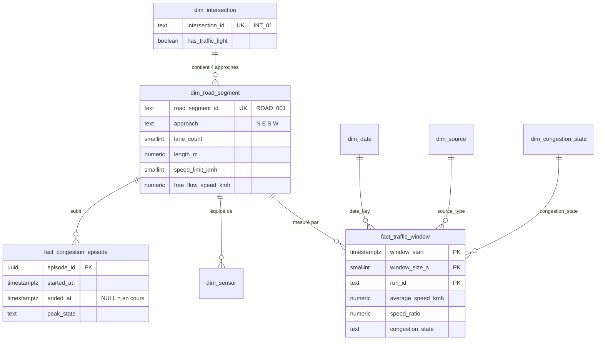
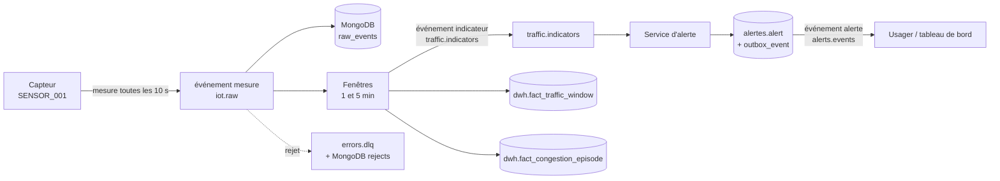
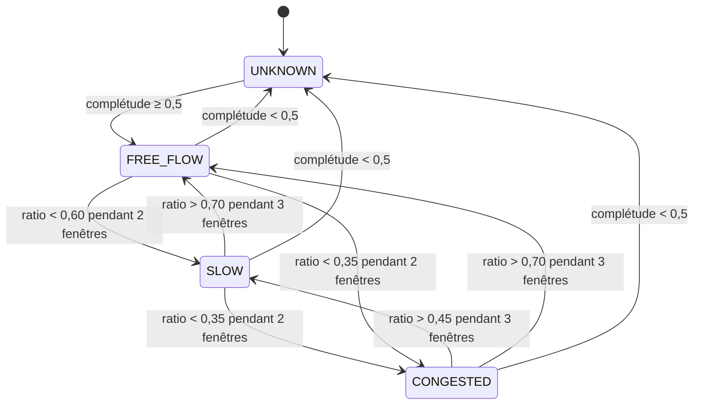

# Dictionnaire de données

Une définition par terme, une unité par grandeur, une règle par calcul. Ce document fait foi pour les bases (`db/`), les événements (`contracts/`), le simulateur et le modèle. Version du 20/10/2026 ; toute modification passe par pull request et met à jour les trois endroits à la fois.

Lire ensuite : [bases locales](base-de-donnees-locale.md), [contrats d'événements](../../contracts/README.md), [ADR-028](../01-architecture/adr/ADR-028-etats-de-congestion-et-alertes.md) (pourquoi ces règles), [ADR-027](../01-architecture/adr/ADR-027-jeux-de-donnees-et-provenance.md) (provenance).

## 1. Vocabulaire

| Terme | Définition | Identifiant |
|---|---|---|
| Carrefour | Point où se croisent des routes ; il peut avoir des feux. Clé de partition des sujets Kafka. | `INT_01` |
| Tronçon | Approche d'un carrefour : la portion de route qui y mène depuis un côté (N, E, S, W). **Unité d'analyse de la circulation.** | `ROAD_001` |
| Capteur | Dispositif qui compte les véhicules et mesure leur vitesse sur un tronçon. | `SENSOR_001` |
| Mesure brute | Ce qu'un capteur envoie pour un court intervalle (10 s par défaut). | événement `novaria.iot.measurement.v1` |
| Fenêtre | Intervalle de 1 ou 5 minutes sur lequel on agrège les mesures d'un tronçon. | `window_start` + `window_size_s` |
| Indicateur | Résultat de l'agrégation d'une fenêtre (débit, vitesse, ratio, état). | événement `novaria.traffic.indicator.v1` |
| Ratio de vitesse | Vitesse moyenne de la fenêtre divisée par la vitesse en circulation fluide du tronçon. Sans unité. | `speed_ratio` |
| État de congestion | Qualification de la circulation d'un tronçon : fluide, ralenti, congestionné, inconnu. | `congestion_state` |
| Épisode | Période continue pendant laquelle un tronçon est ralenti ou congestionné. | `episode_id` |
| Alerte | Notification d'un épisode à l'usager : **une par épisode**, jamais une par mesure. | `alert_id` |
| Run | Une exécution du simulateur (ou un chargement de jeu historique). Deux runs ne s'écrasent jamais. | `run_id` |
| Scénario | Paramètres d'un run simulé (heure de pointe, incident, journée calme…). | `scenario_id` |
| Graine | Nombre qui rend un run aléatoire reproductible à l'identique. | `seed` |
| Provenance | Origine de la donnée : simulée, réelle historique, réelle en direct. | `source_type` |
| Vérité terrain | État de congestion réel d'un tronçon connu du simulateur, utilisé comme réponse à retrouver par le modèle. | `label_state` |

## 2. Conventions

| Sujet | Règle |
|---|---|
| Date et heure | norme ISO 8601 (International Organization for Standardization) en UTC (Coordinated Universal Time, temps universel coordonné), fuseau explicite : `2026-10-20T08:00:10Z`. En base : `timestamptz`. Aucune heure locale stockée. |
| Vitesse | Kilomètres par heure (km/h), 0 à 200 |
| Débit | Véhicules par minute (veh/min) |
| Taux d'occupation | Nombre de 0 à 1 (jamais un pourcentage) |
| Longueurs | Mètres |
| Durées techniques | Secondes, suffixe `_s` |
| Nombres de véhicules | Entiers positifs ou nuls |
| Identifiants | Texte opaque à motif fixe (`INT_`, `ROAD_`, `SENSOR_` + numéro) ; jamais déduits d'un nombre |
| Valeur absente | `null`, jamais `0` ni `-1`. **Une vitesse n'existe que si au moins un véhicule est passé** : route vide ⇒ vitesse `null` (une route vide n'est pas une route arrêtée). |
| Noms techniques | Anglais, `snake_case`. Libellés affichés à l'usager : français. |
| Provenance | Obligatoire sur chaque mesure, indicateur, alerte et jeu de données ; une donnée simulée n'est jamais présentée comme réelle |

## 3. Modèle de l'entrepôt décisionnel

L'entrepôt décisionnel (DWH, *Data Warehouse*) est le schéma PostgreSQL `dwh`, en étoile ([ADR-014](../01-architecture/adr/ADR-014-architecture-decisionnelle.md)).

Le schéma `alertes` n'a **aucune clé étrangère vers `dwh`** : chaque service est propriétaire de ses données ([ADR-008](../01-architecture/adr/ADR-008-microservices.md), règle 1). Les liens entre services sont des identifiants textuels (`road_segment_id`, `episode_id`).

### Circulation d'une donnée

## 4. Référentiel du réseau (`dwh.dim_*`)

| Table | Colonne | Type | Règle | Sens |
|---|---|---|---|---|
| `dim_intersection` | `intersection_id` | texte, unique | `^INT_[0-9]{2,}$` | Identifiant métier, partagé avec les événements |
| | `name` | texte | non vide | Nom affiché |
| | `latitude`, `longitude` | décimal | les deux ou aucune ; −90 à 90, −180 à 180 | Vides pour le réseau fictif |
| | `has_traffic_light` | booléen | défaut vrai | Carrefour à feux |
| `dim_road_segment` | `road_segment_id` | texte, unique | `^ROAD_[0-9]{3,}$` | Identifiant du tronçon |
| | `approach` | texte | N, E, S, W ; un seul tronçon par côté et par carrefour | Côté d'où arrive la circulation |
| | `road_type` | texte | MOTORWAY, ARTERIAL, COLLECTOR, LOCAL | Catégorie de route |
| | `lane_count` | entier | 1 à 8 | Voies de l'approche |
| | `length_m` | décimal | > 0 | Longueur de l'approche (m) |
| | `speed_limit_kmh` | entier | 5 à 130 | Vitesse limite (km/h) |
| | `free_flow_speed_kmh` | décimal | > 0 | Vitesse en circulation fluide : dénominateur du ratio. **Simulation : égale à la vitesse limite.** Données réelles : à estimer (quantile élevé des vitesses de nuit). |
| `dim_sensor` | `sensor_id` | texte, unique | `^SENSOR_[0-9]{3,}$` | Identifiant du capteur |
| | `sensor_type` | texte | LOOP, CAMERA, RADAR, SIMULATED | Technologie |
| | `reporting_interval_s` | entier | 1 à 3600, défaut 10 | Durée couverte par chaque mesure |
| `dim_source` | `source_type` | texte | SIMULATED, REAL_HISTORICAL, REAL_LIVE | Provenance (voir [ADR-027](../01-architecture/adr/ADR-027-jeux-de-donnees-et-provenance.md)) |
| `dim_congestion_state` | `state_code`, `severity_rank` | texte, 0 à 3 | UNKNOWN 0, FREE_FLOW 1, SLOW 2, CONGESTED 3 | États ordonnés par gravité |
| `dim_date` | `date_key` | entier | AAAAMMJJ, 2012 à 2030 | Calendrier en UTC. `is_holiday` vaut faux tant que le calendrier des jours fériés du jeu n'est pas chargé (limite connue). |

Le réseau de démonstration (fictif) : 6 carrefours, 24 tronçons, 24 capteurs, généré par `scripts/dev/gen_reseau.py` (migration `0005`).

| Carrefours | Type de route | Voies | Longueur d'approche | Vitesse limite |
|---|---|---|---|---|
| INT_01, INT_02 | ARTERIAL | 2 | 300 m | 50 km/h |
| INT_03, INT_04 | COLLECTOR | 1 | 250 m | 50 km/h |
| INT_05, INT_06 | LOCAL | 1 | 150 m | 30 km/h |

## 5. Mesure brute (`novaria.iot.measurement.v1`)

Grain : un capteur, un intervalle. Stockée dans MongoDB `raw_events` (14 jours), jamais dans PostgreSQL.

| Champ (`data`) | Type | Règle | Sens |
|---|---|---|---|
| `sensor_id`, `road_segment_id`, `intersection_id` | texte | motifs ci-dessus ; doivent exister dans le référentiel | Qui mesure, où |
| `interval_s` | entier | 1 à 3600 | Durée couverte, qui **se termine** à `time` |
| `vehicle_count` | entier | ≥ 0 | Véhicules passés pendant l'intervalle |
| `average_speed_kmh` | nombre ou `null` | 0 à 200 ; **`null` si `vehicle_count` = 0** ; obligatoire si qualité `VALID` et `vehicle_count` ≥ 1 | Vitesse moyenne |
| `occupancy_rate` | nombre ou `null` | 0 à 1 ; obligatoire si qualité `VALID` | Part de l'intervalle où le capteur était occupé |
| `queue_length_m` | nombre | 0 à 10 000, facultatif | File observée |
| `quality.status` | énumération | VALID, PARTIAL, SUSPECT | Voir section 8 |
| `quality.flags` | liste | MISSING_SPEED, MISSING_OCCUPANCY, IMPLAUSIBLE_VALUE, LATE, GAP_BEFORE | Détail de la qualité |
| `provenance` | objet | `source_type` + `run_id` ; si SIMULATED : `scenario_id` et `seed` ; si REAL_HISTORICAL : `dataset_id` | Origine |

Attributs de l'enveloppe, communs à tous les événements :

| Attribut | Règle |
|---|---|
| `id` | Clé d'idempotence. Mesure : `<run_id>:<sensor_id>:<instant en millisecondes>`. Un même `id` reçu deux fois est ignoré (index unique `uniq_event_id`). |
| `source` | Producteur : `simulateur/<run_id>`, `collecte`, `traitement`, `alerte` |
| `type` | `novaria.<domaine>.<sujet>.v<majeure>` |
| `time` | Instant de l'observation (temps d'événement), UTC. Mesure : fin de l'intervalle. Indicateur : fin de la fenêtre. |
| `subject` | **= `intersection_id`** : clé de partition Kafka, ordre garanti par carrefour |
| `schema_version` | `majeure.mineure` |
| `correlation_id` | Facultatif : relie une mesure à l'indicateur et à l'alerte qu'elle a produits |
| `domain` | iot, traffic, alert ou signal |

## 6. Indicateur par fenêtre (`dwh.fact_traffic_window` et `novaria.traffic.indicator.v1`)

Grain : un tronçon, une fenêtre, un run. **Clé primaire** (`road_segment_key`, `window_start`, `window_size_s`, `run_id`) = clé d'idempotence : rejouer un chargement met à jour la ligne, ne la duplique pas.

| Événement (`data`) | Colonne SQL (Structured Query Language) | Sens et règle |
|---|---|---|
| `road_segment_id` | `road_segment_key` (clé technique) | Tronçon |
| `window_start` | `window_start` | Début, UTC ; la fenêtre couvre [début, début + taille[ ; alignée sur la taille (minute ronde ou multiple de 5 min) |
| `window_size_s` | `window_size_s` | 60 ou 300 |
| (déduit de la provenance) | `run_id`, `source_type` | Exécution et origine |
| (calculé) | `date_key` | AAAAMMJJ de `window_start` en UTC |
| `vehicle_count` | `vehicle_count` | Somme des véhicules des mesures retenues |
| `flow_veh_per_min` | `flow_veh_per_min` | `vehicle_count` / (`window_size_s` / 60) |
| `average_speed_kmh` | `average_speed_kmh` | Moyenne **pondérée par le nombre de véhicules** ; `null` si `vehicle_count` = 0 |
| `occupancy_rate` | `occupancy_rate` | Moyenne des taux d'occupation non nuls |
| `max_queue_length_m` | `max_queue_length_m` | Maximum des files observées |
| `speed_ratio` | `speed_ratio` | `average_speed_kmh` / `free_flow_speed_kmh` ; `null` si la vitesse est `null` ; 0 à 9,999 |
| `sample_count` | `sample_count` | Mesures retenues (qualité VALID ou PARTIAL, doublons exclus) |
| `expected_sample_count` | `expected_sample_count` | (`window_size_s` / `reporting_interval_s`) × capteurs du tronçon |
| (calculé) | `completeness` | min(1, `sample_count` / `expected_sample_count`) |
| `congestion_state` | `congestion_state` | **État stabilisé** (voir section 7), pas le classement brut de la fenêtre |
| `classifier_version` | `classifier_version` | Version de la règle ou du modèle (`regles-v0`) ; permet de comparer deux classificateurs |
| (système) | `loaded_at` | Date de chargement |

Une ligne peut être refusée par ses contraintes (vitesse sans véhicule, fenêtre de 2 minutes, état inconnu…) : l'erreur est visible à l'écriture, pas plus loin.

## 7. Règles de calcul et d'états

### 7.1 État de congestion d'un tronçon (valeurs de départ)

L'état se calcule sur les fenêtres de **1 minute** et change par **hystérésis** : un seuil franchi une seule fois ne suffit pas, pour éviter un état qui clignote. Les valeurs sont des hypothèses de départ, à fixer définitivement dans `docs/06-ia-mlops/cadrage-ml.md` avant tout entraînement ([ADR-028](../01-architecture/adr/ADR-028-etats-de-congestion-et-alertes.md)).

| Règle | Valeur |
|---|---|
| Fenêtre sans véhicule (`speed_ratio` `null`, complétude suffisante) | Comptée comme fluide (une route vide est fluide) |
| Complétude inférieure à 0,5 | État `UNKNOWN` : on ne conclut pas avec la moitié des données |
| Décalage entre événement réel et état | 2 à 3 minutes : coût assumé de la stabilité |
| Fenêtres de 5 minutes | Servent aux tendances et à l'apprentissage ; l'état d'alerte vient des fenêtres de 1 minute |

### 7.2 Épisodes (`dwh.fact_congestion_episode`)

| Moment | Action |
|---|---|
| L'état stabilisé passe à SLOW ou CONGESTED | Ouverture : `started_at` = début de la première fenêtre dégradée, `ended_at` = `null` |
| L'état monte à CONGESTED | `peak_state` = CONGESTED |
| L'état revient à FREE_FLOW | Clôture : `ended_at` renseigné ; `window_count` et `min_speed_ratio` finalisés |
| Clé d'unicité | (`road_segment_key`, `run_id`, `started_at`) : un rejeu ne duplique pas l'épisode |

### 7.3 Alertes (`alertes.*`)

| Règle | Valeur |
|---|---|
| Déclencheur de congestion | Règle `congestion.persistante` : état stabilisé CONGESTED (l'hystérésis a déjà confirmé 2 fenêtres) |
| Une alerte par épisode | Index unique partiel : une seule alerte non résolue par type, tronçon et run |
| Délai minimal entre deux notifications | `min_gap_s` de la règle (300 s pour la congestion) |
| Cycle de vie | CREATED → NOTIFIED → ACKNOWLEDGED → RESOLVED ; chaque changement écrit une ligne dans `alert_history` et un événement dans `outbox_event` (même transaction) |
| Résolution | AUTO quand l'épisode se clôt, MANUAL sur action d'un opérateur ; `resolved_at` et `resolution` sont renseignés **si et seulement si** l'état est RESOLVED |
| Cause | `UNKNOWN` par défaut. Une baisse de vitesse ne prouve pas un accident : `CONFIRMED_INCIDENT`, `ROADWORKS`, `SPECIAL_EVENT` ne s'attribuent que sur un événement confirmé. |
| Gravité | INFO, WARNING, CRITICAL |
| Autres règles | `anomalie.circulation` (3 fenêtres anormales), `capteur.muet` (silence de 60 s) |

| Colonne `alertes.alert` | Sens |
|---|---|
| `alert_id` | Identifiant unique de l'alerte |
| `rule_id`, `kind` | Règle déclenchée et type (CONGESTION, TRAFFIC_ANOMALY, SENSOR_FAULT) |
| `road_segment_id`, `intersection_id` | Tronçon et carrefour concernés (texte, pas de clé étrangère inter-services) |
| `episode_id` | Épisode d'origine, s'il existe |
| `run_id`, `source_type` | Provenance |
| `opened_at`, `notified_at`, `acknowledged_at`, `acknowledged_by`, `resolved_at` | Jalons du cycle de vie (UTC) |
| `correlation_id` | Trace de bout en bout |

## 8. Règles de qualité

| Code | Règle | Action | Où se voit le résultat |
|---|---|---|---|
| DQ-01 | Message qui ne respecte pas le contrat (champ inconnu, type, borne, date sans fuseau) | Rejet vers `errors.dlq`, archive dans MongoDB `rejects`, motif = chemin et message de l'erreur | Compteur de rejets, collection `rejects` |
| DQ-02 | Capteur ou tronçon absent du référentiel | Rejet, motif `UNKNOWN_SENSOR` | idem |
| DQ-03 | Même `id` reçu deux fois | Ignoré sans erreur ; compté | `processing_stats` (`kind` = quality) |
| DQ-04 | Message plus tardif que le retard autorisé (30 s, valeur de départ) | Rejet, motif `LATE` | idem |
| DQ-05 | Valeur plausible en forme mais douteuse : vitesse > 1,5 × vitesse fluide, plus de 40 veh/min par voie, vitesse nulle avec véhicules passés | Mesure acceptée avec qualité `SUSPECT` (drapeau `IMPLAUSIBLE_VALUE`) et **exclue** des indicateurs | `processing_stats`, drapeaux |
| DQ-06 | Champ facultatif absent (vitesse malgré des véhicules, occupation) | Qualité `PARTIAL` + drapeau ; retenue dans les indicateurs | idem |
| DQ-07 | Complétude de fenêtre < 0,5 | État `UNKNOWN` | `dwh.fact_traffic_window` |
| DQ-08 | Capteur muet plus de 60 s | Alerte `SENSOR_FAULT` (règle `capteur.muet`) | `alertes.alert` |
| DQ-09 | Ligne d'un chargement ETL (Extract, Transform, Load) qui viole une contrainte | Refus, ligne dans `dwh.etl_reject` avec règle et motif ; taux de rejet publié | `dwh.etl_reject` |
| DQ-10 | Horodatage dans le futur (plus de 5 s après l'horloge du consommateur, hors rejeu) | Rejet, motif `FUTURE_TIMESTAMP` | `rejects` |

Le taux de rejet, la complétude moyenne et le nombre de mesures `SUSPECT` par run se mesurent dès le premier run : ils entrent dans la fiche de provenance du jeu de données.

## 9. Jeu d'entraînement (IA-08)

Un jeu = un ensemble de runs, enregistré en Parquet sous `data/datasets/`, accompagné de sa fiche de provenance et de son empreinte SHA-256 (*Secure Hash Algorithm*, algorithme de hachage) consignée dans MongoDB `model_runs`.

| Groupe | Colonnes | Remarque |
|---|---|---|
| Clé | `run_id`, `scenario_id`, `seed`, `road_segment_id`, `window_start` | Une ligne par tronçon et fenêtre de 1 minute |
| Mesures | `vehicle_count`, `flow_veh_per_min`, `average_speed_kmh`, `occupancy_rate`, `max_queue_length_m`, `speed_ratio` | Mêmes définitions que la section 6 |
| Historique | `speed_ratio_lag1` à `lag5`, `flow_lag1` à `lag5`, moyennes mobiles sur 5 et 15 minutes | Uniquement du **passé** de la ligne |
| Calendrier | `hour_of_day`, `iso_day_of_week`, `is_weekend`, `is_holiday` | UTC |
| Tronçon | `lane_count`, `length_m`, `free_flow_speed_kmh`, `road_type` | Statiques |
| Réponse (détection) | `label_state` | **Vérité terrain du simulateur**, pas la sortie de la règle de seuils |
| Réponse (prévision) | `speed_ratio_h5`, `speed_ratio_h15` | Valeur 5 ou 15 minutes plus tard ; `null` en fin de run |

| Règle d'évaluation | Détail |
|---|---|
| Découpage | **Par run et par scénario** (par exemple 70 % / 15 % / 15 % des runs), jamais par lignes tirées au hasard : des fenêtres voisines d'un même run se ressemblent, un tirage aléatoire ferait fuir l'information du test vers l'entraînement |
| Références à battre | Règle de seuils (détection) ; moyenne glissante et valeur de l'heure précédente (prévision) |
| Seuil d'acceptation | Fixé avant l'entraînement dans `cadrage-ml.md` |
| Limite | Un modèle entraîné sur le simulateur apprend le simulateur : le résultat prouve la chaîne de bout en bout, pas la précision en conditions réelles |

## 10. Collections MongoDB

Champs principaux ; les validateurs complets sont dans `db/mongo/init/01-collections-et-utilisateurs.js`.

| Collection | Champs obligatoires | Index notables |
|---|---|---|
| `raw_events` | enveloppe de l'événement + `received_at` (date) + `data.provenance` | unique sur `id` ; durée de vie 14 jours sur `received_at` |
| `rejects` | `source_topic`, `rejected_at`, `reason`, `original_payload` | durée de vie 30 jours sur `rejected_at` |
| `audit_logs` | `ts`, `service`, `actor`, `action`, `outcome` (ok, denied, error) | `ts` décroissant ; `actor` + `ts` |
| `usage_stats` | `endpoint`, `bucket_start`, `count` | unique sur `endpoint` + `bucket_start` |
| `processing_stats` | `kind` (quality, lateness, rejects), `window_start`, `values` | `kind` + `window_start` |
| `model_runs` | `run_id`, `created_at`, `git_sha`, `dataset_sha256`, `seed`, `params`, `metrics`, `status` | unique sur `run_id` |

## 11. Points ouverts

| Sujet | Position actuelle | À fixer par |
|---|---|---|
| Seuils et durées de l'hystérésis | Valeurs de départ de la section 7.1 | `cadrage-ml.md` (IA-01) après un premier run |
| Retard autorisé (30 s), délai de désordre (10 s) | Valeurs de départ ([ADR-011](../01-architecture/adr/ADR-011-temps-reel-et-batch.md)) | Mesure (MS-15) |
| Vitesse en circulation fluide des données réelles | Estimée par un quantile des vitesses nocturnes | Fiche de provenance de chaque jeu |
| Jours fériés | Non chargés (`is_holiday` faux) | DAT-10, si le jeu de données le justifie |
| Durée de conservation de `raw_events` (14 jours) | Valeur de départ | Volume observé |
| Contrats `traffic.recommendations` et `signal.status` | Non écrits | MS-11 |
