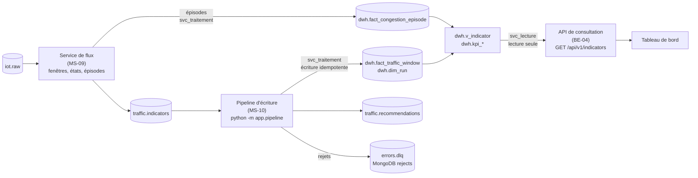
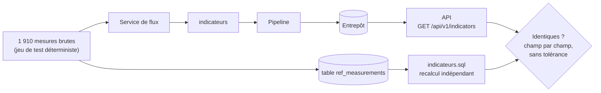

# Service de traitement (2/2) : entrepôt, API de lecture et recommandations (MS-10)

Projet : Novaria Core, socle d'UrbanHub (bloc de compétences BC05)
Responsables : Daddy Luciano et Manoa Robel (relecture croisée)
Dernière mise à jour : 05/11/2026
Issue de suivi : MS-10 (#129)
Statut : à valider par les deux membres (relecture de la pull request)

Critère d'acceptation : **les indicateurs servis par l'API sont identiques à un recalcul SQL de référence sur un jeu de test.** Preuve : [`services/traitement/tests/`](../../services/traitement/tests/), surtout [`tests/integration/test_pipeline_recalcul_postgres.py`](../../services/traitement/tests/integration/test_pipeline_recalcul_postgres.py) et [`reference/indicateurs.sql`](../../services/traitement/tests/integration/reference/indicateurs.sql) ; résultats en section 8.

Abréviations : **API** (Application Programming Interface, interface de programmation), **DAT** (tâche de l'équipe Données du backlog), **DLQ** (Dead Letter Queue, file des messages refusés : ici le sujet `errors.dlq`), **JSON** (JavaScript Object Notation), **KPI** (Key Performance Indicator, indicateur clé de performance), **ML** (Machine Learning, apprentissage automatique), **SQL** (Structured Query Language), **UTC** (Coordinated Universal Time, temps universel coordonné), **UUID** (Universally Unique IDentifier).

## 1. En bref

| Tâche de l'issue | Réalisé | Où | Preuve |
|---|---|---|---|
| Charger faits et dimensions dans l'entrepôt (reprend DAT-05) | Le **pipeline d'écriture** lit `traffic.indicators`, enregistre l'exécution dans `dwh.dim_run` et écrit `dwh.fact_traffic_window`, de façon idempotente. Les dimensions sont celles des migrations (réseau, états, sources, dates) ; les épisodes sont écrits par le service de flux (MS-09) | `app/pipeline/` | Sections 3 et 8 |
| Séparer écriture (pipeline) et lecture (API, reprend BE-04) | Deux comptes : l'écriture se fait avec `svc_traitement`, l'API lit avec `svc_lecture` (lecture seule, vérifié avec les vrais rôles). Aucun code commun entre l'écriture et la lecture | `docker-compose.yml`, `app/pipeline/adapters/postgres.py`, `app/api/` | Sections 2 et 4 |
| Définir 3 à 5 indicateurs avec source, formule et limites (reprend DAT-07) | Cinq indicateurs décisionnels, déjà définis et vérifiés par DAT-07 ; l'un d'eux est ici recalculé sur les faits écrits par le pipeline | [kpi.md](kpi.md) | Section 5 |
| Publier `traffic.recommendations` : règle simple d'abord, puis score du modèle (IA-06) | **Règle de Webster** déterministe, publiée tant qu'une approche est dégradée. Le score du modèle n'existe pas encore (IA-06) : le contrat le prévoit (`model`), il reste `null` | `app/pipeline/webster.py`, `recommender.py` | Section 6 |
| **Critère** : indicateurs de l'API = recalcul SQL de référence | Mesures brutes → flux → pipeline → entrepôt → API, comparés champ par champ, sans tolérance, à un recalcul SQL indépendant | `tests/integration/` | Sections 7 et 8 |

## 2. Architecture : l'écriture et la lecture ne se touchent pas

| | Écriture | Lecture |
|---|---|---|
| Processus | `traitement-flux`, `traitement-pipeline` | `traitement` (l'API) |
| Compte PostgreSQL | `svc_traitement` : `SELECT`, `INSERT`, `UPDATE`, `DELETE` sur `dwh` | `svc_lecture` : `SELECT` seulement |
| Objets touchés | tables de faits et dimensions | vues `dwh.v_indicator` et `dwh.kpi_*` |
| Connexion | normale | session en lecture seule (`default_transaction_read_only=on`) **en plus** du compte |

Deux protections indépendantes : même si le code de l'API essayait d'écrire, la session le refuserait, et le compte n'en a pas le droit. Le test d'intégration `test_le_compte_de_lecture_lit_l_entrepot_et_ne_peut_rien_y_ecrire` le prouve avec les vrais rôles (un `INSERT`, un `DELETE` et un `UPDATE` sont refusés : *permission denied*).

## 3. Le pipeline d'écriture

Le pipeline lit `traffic.indicators` (groupe `traitement-entrepot`, validation manuelle des offsets) et, à chaque point de contrôle :

| Étape | Ce qui se passe | Si ça échoue |
|---|---|---|
| 1 | Chaque message est relu : JSON, type, schéma, puis règles entre champs (`subject`, `id`, fenêtre alignée, `time` = fin de fenêtre, `sample_count` au plus double de l'attendu) | Rejet sur `errors.dlq` (`UNREADABLE`, `UNKNOWN_TYPE`, `CONTRACT_VIOLATION`, `SEMANTIC_VIOLATION`), copie dans MongoDB `rejects`, compteur |
| 2 | Les faits valides sont écrits **en une transaction**, chacun sous un point de sauvegarde | Une ligne refusée par une contrainte est rejetée seule (`PROCESSING_FAILED`) ; les autres sont écrites. Base indisponible : le service s'arrête sans valider d'offset |
| 3 | La première fois qu'un `run_id` apparaît, il est enregistré dans `dwh.dim_run` avec sa provenance complète | Un `run_id` déjà connu avec **une autre** provenance est rejeté (ses faits seraient invisibles pour l'API) |
| 4 | Les recommandations des carrefours complets sont publiées | — |
| 5 | Le broker accuse réception de tout | Panne : aucun offset n'est validé |
| 6 | Les offsets sont rendus, sans dépasser le plus ancien indicateur qui attend ses voisins pour une recommandation | — |

Idempotence : la clé de `fact_traffic_window` est (tronçon, début de fenêtre, taille, run). Rejouer un message met la ligne à jour (c'est ainsi qu'une **correction tardive** du flux, republiée avec le même `id`, remplace la ligne), ne la duplique pas. Le test rejoue tous les indicateurs et vérifie que le nombre de lignes, la somme des véhicules et celle des mesures ne bougent pas, et que `dim_run` garde une seule ligne.

### 3.1 Une valeur, un seul arrondi

L'entrepôt garde le débit à 2 décimales, la vitesse à 1, l'occupation à 3, la file à 1 et le ratio à 3 (`numeric(8,2)`, `(5,1)`, `(4,3)`, `(7,1)`, `(4,3)`). Si le flux publiait des valeurs plus fines, PostgreSQL arrondirait une seconde fois en écrivant : un arrondi puis un autre ne donnent pas toujours celui d'un seul (38,449 → 38,45 → 38,5, alors que 38,4 est juste). Le flux arrondit donc **une seule fois, à la précision des colonnes**, et PostgreSQL stocke la valeur telle quelle.

Deux autres précautions, découvertes en préparant la comparaison :

| Risque | Parade | Test |
|---|---|---|
| Sommes en nombres flottants (0,1 + 0,2 = 0,30000000000000004) | Cumuls en **décimaux exacts** (`Decimal`) | `test_les_sommes_sont_exactes_pas_flottantes` |
| `round()` de Python arrondit une égalité au pair (0,3125 → 0,312), PostgreSQL vers le haut (0,313) | Arrondi **moitié vers le haut** explicite | `test_une_egalite_exacte_est_arrondie_vers_le_haut_comme_postgresql` |

Sans cela, l'API et un recalcul SQL sur les mêmes mesures auraient divergé d'un millième sur certaines fenêtres, sans qu'aucun des deux ait « tort ».

## 4. L'API de lecture

L'API de consultation est celle de BE-04 ([api-indicateurs.md](api-indicateurs.md)) : `GET /api/v1/indicators`, `GET /api/v1/indicators/{id}` et `GET /api/v1/indicators/latest`, sur la vue `dwh.v_indicator`, avec filtres de période et de zone, pagination par curseur et provenance complète. MS-10 ne change rien à son contrat. Ce qui change :

- elle lit désormais avec le compte `svc_lecture` (variable `POSTGRES_URL` du service `traitement` dans `docker-compose.yml`) ;
- l'enregistrement des exécutions dans `dwh.dim_run`, laissé ouvert par BE-04, est fait par le pipeline : une exécution écrite par le flux apparaît dans l'API sans geste manuel.

## 5. Les indicateurs décisionnels (reprend DAT-07)

Les cinq indicateurs sont définis dans [kpi.md](kpi.md), chacun avec sa source, sa formule, son grain et ses limites, et leur recalcul indépendant est vérifié par `dev.py db-check-kpi`. Cette issue ne les redéfinit pas.

| # | Indicateur | Source |
|---|---|---|
| KPI-01 | Part du temps en état CONGESTED, par tronçon et par jour | `fact_traffic_window` |
| KPI-02 | Durée moyenne des épisodes, par tronçon | `fact_congestion_episode` |
| KPI-03 | Délai de détection d'une congestion | alertes, épisodes, fenêtres |
| KPI-04 | Alertes par jour et par type | `alertes.alert` |
| KPI-05 | Vitesse relative par tronçon et par heure | `fact_traffic_window` |

Ce que MS-10 ajoute : KPI-01 est lu sur les faits **écrits par le pipeline** et comparé aux états du recalcul SQL (`test_kpi_01_part_du_temps_congestionne_suit_les_etats_du_recalcul`). Les quatre autres dépendent des épisodes, des alertes ou d'autres jeux et gardent leur vérification de DAT-07.

## 6. Les recommandations de feux

Un modèle ne commande jamais seul ([ADR-015](../01-architecture/adr/ADR-015-modeles-ia.md)) : les durées de phase viennent d'un calcul déterministe, la formule de Webster, version `webster-v0`.

### 6.1 Quand

Pour un carrefour et une fenêtre d'une minute, quand **toutes** ses approches ont leur indicateur :

| Situation | Suite |
|---|---|
| aucune approche `SLOW` ni `CONGESTED` | rien (le plan fixe suffit) |
| une approche `UNKNOWN` | rien : pas de recommandation sur des données insuffisantes |
| un seul axe (nord-sud ou est-ouest) | rien : une phase ne fait pas un plan |
| sinon | recommandation, valable 5 minutes (`valid_until`) |

Tant que la dégradation dure, une recommandation par minute ; quand elle cesse, plus rien : passé `valid_until`, la réponse extérieure revient au plan fixe (EXG-REP-03). Une fenêtre qui reste incomplète est abandonnée dès qu'une plus récente se complète (compteur `reco_incomplete_group`). Une correction tardive d'une fenêtre déjà jugée ne change pas la décision.

### 6.2 Comment (`webster-v0`)

| Étape | Calcul |
|---|---|
| Charge d'une approche | y = q ÷ (s × voies), q en véhicules par heure (débit de la minute × 60), s = 1 800 véhicules par heure et par voie |
| Phases | P1 : nord et sud ; P2 : est et ouest. Charge de phase = celle de son approche la plus chargée |
| Charge totale | Y = somme des charges de phase, plafonnée à 0,9 |
| Temps perdu | L = 4 s par phase |
| Cycle | C = (1,5 × L + 5) ÷ (1 − Y), arrondi à l'entier (vers le haut), borné à 30–120 s et à au moins L plus 6 s de vert par phase |
| Vert utile | G = C − L, réparti proportionnellement à la charge de phase (plus forts restes), au moins 6 s par phase |
| Durée de phase | vert + 4 s : la somme vaut exactement C |

Le calcul est exact (fractions) et ne dépend que des entrées : mêmes charges, même plan, quel que soit l'ordre d'arrivée. L'identifiant de la recommandation dérive du run, du carrefour et de la fenêtre : rejouer redonne la même.

**Exemple résolu à la main** (deux voies par approche) : nord 24, sud 20, est 15, ouest 18 véhicules par minute.

| | Nord-sud (P1) | Est-ouest (P2) |
|---|---|---|
| Charges y | 0,4 et 0,333 | 0,25 et 0,3 |
| Charge de phase | 0,4 | 0,3 |
| Vert utile (G = 57 − 8 = 49) | 49 × 0,4 ÷ 0,7 = 28 | 49 × 0,3 ÷ 0,7 = 21 |
| **Durée de phase** | **32 s** | **25 s** |

Y = 0,7, C = (1,5 × 8 + 5) ÷ 0,3 = 56,67, soit 57 s. Test : `test_exemple_resolu_a_la_main`.

### 6.3 Ce qui n'est pas fait : le score du modèle (IA-06)

Le contrat porte déjà le champ `model` (nom, version, run d'entraînement, score de 0 à 1), mais **aucun modèle n'existe** (IA-06 est ouverte, `ml/` est vide). Le champ reste `null`. Quand le modèle existera, son score sera une **entrée** du calcul (par exemple pour décider de publier), jamais la décision : `webster_plan` ne le lira pas pour fixer les durées. Non vérifié, parce que non réalisé.

### 6.4 Constantes et limites

| Constante | Valeur | Statut |
|---|---|---|
| Débit de saturation | 1 800 véhicules par heure et par voie | valeur usuelle, à valider avec des mesures |
| Temps perdu | 4 s par phase | hypothèse |
| Cycle minimal, maximal | 30 s, 120 s | **bornes de départ** : les bornes de sécurité définitives sont celles de MS-12 (EXG-REP-02) |
| Vert minimal | 6 s | idem |
| Validité | 5 minutes | exemple du contrat |

Limites : deux phases seulement (pas de phase protégée de tourne-à-gauche) ; les voies viennent de `dim_road_segment.lane_count` ; une approche hors du réseau connu est ignorée et comptée (`reco_unknown_segment`).

## 7. Le critère : l'API contre un recalcul SQL de référence

### 7.1 Principe

Le recalcul SQL ne partage aucune ligne de code avec le service : il relit les mesures brutes (table `ref_measurements`) et réécrit en SQL les règles du [dictionnaire](dictionnaire-de-donnees.md), y compris l'état stabilisé de l'[ADR-028](../01-architecture/adr/ADR-028-etats-de-congestion-et-alertes.md) (hystérésis par requête récursive).

| Ce que le recalcul refait | Règle |
|---|---|
| Mesures retenues | `VALID` et `PARTIAL` ; `SUSPECT` exclue ; fenêtre = celle qui contient le **début** de l'intervalle |
| Véhicules, débit | somme ; débit = véhicules ÷ (taille ÷ 60), arrondi à 2 décimales |
| Vitesse | moyenne pondérée par les véhicules, sur les mesures qui ont une vitesse et des véhicules, 1 décimale |
| Occupation, file | moyenne des valeurs renseignées (3 décimales) ; maximum (1 décimale) |
| Ratio | vitesse **non arrondie** ÷ vitesse fluide du tronçon, 3 décimales, plafonné à 9,999 ; `NULL` sans vitesse |
| Mesures attendues, complétude | Σ (taille ÷ intervalle) sur les capteurs du tronçon ; min(1, reçues ÷ attendues) |
| Fenêtre fermée | sa fin ne dépasse pas (plus grand début vu du carrefour) − 10 s |
| État | hystérésis sur les minutes fermées : 2 fenêtres pour dégrader, 3 pour récupérer, seuils 0,60 / 0,35 / 0,45 / 0,70, complétude minimale 0,5, route vide fluide, reclassement avec les seuils d'entrée après un trou ; une fenêtre de 5 minutes prend l'état de sa dernière minute |

### 7.2 Le jeu de test

Quarante minutes de mesures sur deux carrefours et huit tronçons du réseau de démonstration, générées avec une graine fixe (`tests/integration/scenario.py`). Il contient exprès ce qui ferait diverger un calcul approximatif :

| Cas | Pourquoi il est là |
|---|---|
| Ralentissement, congestion, puis retour au fluide (ROAD_001) | Toutes les transitions de l'hystérésis |
| Route vide **en pleine congestion** (ROAD_001) | Fenêtre retenue : le contrat exige un ratio, la route vide n'en a pas (section 9, point 1) |
| Trou de données pendant la congestion, puis retour (ROAD_001) | `UNKNOWN`, puis reclassement avec les seuils d'entrée |
| Occupations qui moyennent 0,3125 (ROAD_002) | Égalité d'arrondi : 0,313 et non 0,312 |
| Vitesses qui moyennent 38,25 (ROAD_004) | Égalité d'arrondi : 38,3 et non 38,2 |
| Quatre mesures sur six, puis deux sur six (ROAD_002) | Complétude partielle, puis `UNKNOWN` |
| Mesures `PARTIAL` (vitesse absente) et une mesure `SUSPECT` (190 km/h) (ROAD_003) | Retenue avec drapeau ; exclue |
| Ratios 0,606, 0,352, 0,452, 0,704 (ROAD_006, 007, 008) | Collés aux seuils 0,60, 0,35, 0,45 et 0,70 |
| Deuxième congestion sur l'autre carrefour (ROAD_005) | Carrefours indépendants |

Un test garde-fou (`test_le_jeu_de_test_exerce_bien_les_cas_difficiles`) échoue si le jeu perd un de ces cas : une comparaison sur des données trop faciles ne prouverait rien.

### 7.3 Ce qui est comparé

Pour chaque taille de fenêtre (1 et 5 minutes), à partir de tout ce que l'API sert page après page :

1. chaque fenêtre servie existe dans le recalcul, et ses dix champs (`vehicle_count`, `flow_veh_per_min`, `average_speed_kmh`, `occupancy_rate`, `max_queue_length_m`, `speed_ratio`, `sample_count`, `expected_sample_count`, `completeness`, `congestion_state`) sont **égaux en décimaux exacts** ;
2. chaque fenêtre que le recalcul ferme est servie, sauf celles que le contrat interdit de publier (état dégradé sans vitesse) ;
3. rien n'est servi avant d'être fermé.

## 8. Preuves

Poste de Manoa : Linux (Ubuntu), Python 3.14.4, Docker 29.9.2. **Non vérifié : Windows et macOS.**

### 8.1 Résultats

| Contrôle | Résultat |
|---|---|
| **API = recalcul SQL**, fenêtres de 1 et de 5 minutes | **identiques** sur toutes les fenêtres du jeu de test, dix champs, sans tolérance |
| KPI-01 lu sur les faits écrits | égal aux états du recalcul |
| Rejouer tous les indicateurs | aucune ligne ajoutée ni modifiée, une seule exécution dans `dim_run` |
| Compte de lecture (vrais rôles) | lit `v_indicator`, `dim_road_segment`, `kpi_*` ; `INSERT`, `DELETE`, `UPDATE` refusés |
| Kafka → flux → pipeline → entrepôt, lu par `svc_lecture` | faits égaux aux indicateurs publiés ; recommandations conformes au contrat ; redémarrage du pipeline sans ajout |
| Vraie image Docker (`traitement-flux`, `traitement-pipeline`, `traitement`) | voir 8.3 |

### 8.2 Les tests détectent des défauts

Au niveau des modules, chaque calcul a été mis à l'épreuve par injection de défauts (Webster : 10, lecture des indicateurs : 5, recommandeur : 10, processeur du pipeline : 6, arrondis : 2). Au niveau du critère, **12 défauts injectés dans la chaîne** ont chacun fait échouer la comparaison :

| Défaut injecté | Échec |
|---|---|
| arrondi moitié-pair au lieu de moitié vers le haut | oui |
| vitesse moyenne non pondérée | oui |
| mesures attendues fausses (+1) | oui |
| débit écrit décalé de 0,01 | oui |
| état écrit toujours `FREE_FLOW` | oui |
| seuils 0,60 → 0,61, 0,35 → 0,36, 0,45 → 0,46, 0,70 → 0,71 | oui, chacun |
| dégrader en 3 fenêtres au lieu de 2 ; récupérer en 2 au lieu de 3 | oui, chacun |
| complétude minimale 0,5 → 0,7 | oui |

Le premier passage en avait laissé survivre un (0,60 → 0,61) : aucune fenêtre du jeu n'avait un ratio entre 0,60 et 0,61. Des fenêtres collées à chaque seuil ont été ajoutées (section 7.2), puis le défaut a été détecté.

Le recalcul SQL lui-même a eu deux défauts, trouvés par la comparaison et corrigés : un type de colonne récursive, et `least(9.999, NULL)` qui vaut 9,999 en PostgreSQL (les `NULL` sont ignorés), donnant un ratio à une route vide.

### 8.3 Avec la vraie image

Les trois conteneurs construits par Compose (`traitement-flux`, `traitement-pipeline`, `traitement`) dans un projet jetable, avec les mêmes 1 910 mesures :

| Constat | Résultat |
|---|---|
| État des conteneurs | les trois `healthy` (sonde du fichier de vie pour les deux services d'écriture) |
| Compte de l'API, lu **dans** le conteneur `traitement` | `svc_lecture` ; une écriture est refusée (`ReadOnlySqlTransaction`) |
| Faits lus par le compte de lecture | 367 (états d'une minute : 286 fluides, 10 ralenties, 13 congestionnées, 2 inconnues) |
| Exécution enregistrée par le pipeline | `SIMULATED`, scénario `heure-de-pointe`, graine 42 |
| `traffic.recommendations` | 19 recommandations, toutes conformes au contrat |

Le projet est supprimé ensuite. Cette vérification ne compare pas à nouveau avec le recalcul SQL (c'est le rôle des tests de la section 8.1) ; elle prouve que l'image, les variables d'environnement et les comptes de `docker-compose.yml` font tourner la chaîne.

### 8.4 Tests du service

| Niveau | Tests |
|---|---|
| Unitaires du flux (MS-09, mis à jour) | 172 |
| Unitaires du pipeline : lecture des indicateurs 16, Webster 16, recommandeur 18, processeur 11 | 61 |
| Suite du service (`tests/unit`, `tests/contract`) | 1 318, couverture 91,4 % (barrière 70 %) |
| Intégration PostgreSQL (`make test-integration`) : critère 7, dont KPI-01 | 7 |
| Intégration Kafka, PostgreSQL, MongoDB (`make test-integration-flux`) | 9 (dont 2 nouveaux pour le pipeline et les rôles) |

### 8.5 Non vérifié

| Point | Pourquoi |
|---|---|
| Windows et macOS | seule la variante Linux a été exécutée |
| Score du modèle dans la recommandation | le modèle (IA-06) n'existe pas |
| Bornes de sécurité des durées de phase | relèvent de MS-12 ; ici des bornes de départ |
| Les quatre autres KPI sur des données du flux | dépendent des épisodes et alertes ; gardent la vérification de DAT-07 |
| Les tests d'intégration dans la CI | ils demandent Docker ; ils tournent par `make`, pas dans le job `backend` |

## 9. Lancer et vérifier

| Besoin | Linux (bash) | Windows (PowerShell) |
|---|---|---|
| Démarrer bases, bus et services | `python3 scripts/dev/dev.py up` | `py -3 scripts/dev/dev.py up` |
| Journaux du pipeline | `docker compose logs -f traitement-pipeline` | `docker compose logs -f traitement-pipeline` |
| Tests unitaires du pipeline (sans base) | `cd services/traitement && python3 -m pytest tests/unit/pipeline` | `cd services/traitement; py -3 -m pytest tests/unit/pipeline` |
| **Critère : API contre recalcul SQL** (PostgreSQL jetable) | `python3 scripts/dev/dev.py test-integration -- tests/integration/test_pipeline_recalcul_postgres.py` | `py -3 scripts/dev/dev.py test-integration -- tests/integration/test_pipeline_recalcul_postgres.py` |
| Chaîne avec Kafka et les vrais comptes | `python3 scripts/dev/dev.py test-integration --service flux` (ou `make test-integration-flux`) | `py -3 scripts/dev/dev.py test-integration --service flux` |
| Vérifier les cinq KPI (DAT-07) | `python3 scripts/dev/dev.py db-check-kpi` | `py -3 scripts/dev/dev.py db-check-kpi` |

## 10. Écarts et points ouverts pour la relecture croisée

| N° | Point | Décision proposée | Qui |
|---|---|---|---|
| 1 | **Route vide pendant une congestion** : le contrat exige un ratio pour `SLOW` et `CONGESTED`, une route vide n'en a pas. La fenêtre n'est pas publiée (donc absente de l'API et de l'entrepôt), comptée et tracée ([flux](flux.md), 6.3) | Trancher entre un ratio nul autorisé (contrat 1.1) et l'état actuel | Daddy et Manoa |
| 2 | **Arrondis alignés sur l'entrepôt** : le flux publie désormais vitesse à 1 décimale, débit à 2, occupation à 3 (avant : 2, 3 et 4). Les événements du contrat restent valides ; les valeurs d'un run produit avant MS-10 ne se rejouent plus à l'identique | À confirmer ; sinon élargir les colonnes de l'entrepôt (nouvelle migration) | Daddy |
| 3 | **Webster** : constantes de départ (saturation 1 800, 4 s perdues, 30–120 s) et deux phases seulement | À valider avec des mesures ; bornes de sécurité = MS-12 | Daddy et Manoa |
| 4 | **Score du modèle** (IA-06) absent ; `model` reste `null` | À brancher quand le modèle existe | Manoa |
| 5 | **Recommandation sur approche `UNKNOWN`** : aucune. Un capteur muet sur une approche prive donc le carrefour de recommandation | Choix prudent (retour au plan fixe) ; à confirmer | Daddy |
| 6 | **Une instance par service d'écriture** (flux et pipeline) : l'état des fenêtres et des groupes est en mémoire | Suffisant en local | — |
| 7 | **L'état d'hystérésis n'est pas conservé** au redémarrage du flux ([flux](flux.md), limite 1) | Conserver l'état avec les offsets | Daddy et Manoa |
| 8 | **L'API sert les fenêtres, pas les recommandations** : elles circulent sur le bus vers la réponse extérieure (MS-12) | Si le tableau de bord doit les afficher, ajouter une route et un contrat | Daddy |
