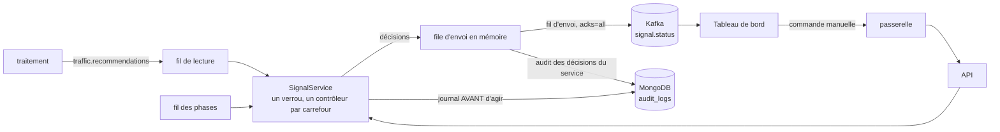
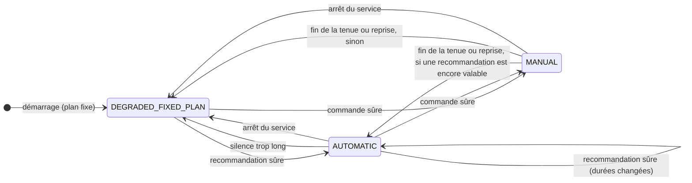

# Service de réponse extérieure : gestion des feux de circulation (MS-12)

| Champ | Valeur |
|---|---|
| Issue | #131 |
| Exigences | EXG-REP-01 à EXG-REP-04, EXG-NFR-05 (isolation des pannes, partiel) |
| Décisions | [ADR-008](../01-architecture/adr/ADR-008-microservices.md) (règle 6 : aucune commande sans garde-fous ; mode dégradé), [ADR-015](../01-architecture/adr/ADR-015-modeles-ia.md) (un modèle ne commande jamais seul), [ADR-009](../01-architecture/adr/ADR-009-bus-evenements.md) (bus), [ADR-010](../01-architecture/adr/ADR-010-architecture-hexagonale.md) (cœur et adaptateurs) |
| Code | [`services/reponse/`](../../services/reponse/README.md), index MongoDB [`intersection_ts`](dictionnaire-de-donnees.md) |
| Contrat | [`reponse.openapi.yaml`](../../contracts/openapi/reponse.openapi.yaml), [`signal-status.schema.json`](../../contracts/events/signal-status.schema.json), [`traffic-recommendation.schema.json`](../../contracts/events/traffic-recommendation.schema.json) |

## 1. En bref

Le service lit les recommandations de plan de feux de `traitement` (`traffic.recommendations`), les soumet à des **garde-fous de sécurité**, les applique à un **contrôleur de feux simulé** (un par carrefour) et publie l'état sur `signal.status`. Un opérateur peut aussi envoyer une **commande manuelle**, prioritaire, soumise aux mêmes garde-fous et **journalisée dans MongoDB avant d'agir**. Quand les recommandations manquent, ou quand le service s'arrête, les feux **reviennent au plan à durées fixes**.

| Critère de l'issue | Résultat | Où |
|---|---|---|
| Aucune commande violant une règle de sécurité n'est appliquée | **Atteint** : chaque règle a un test qui la viole (recommandation et commande), le contrôleur est inchangé après le refus, le refus est publié et journalisé ; 1 000 séquences aléatoires de commandes, de recommandations et d'attente ne produisent jamais deux verts qui se croisent, ni de changement de phase sans dégagement, ni de phase écourtée sous 10 s | sections 3 et 10 |
| La perte des recommandations ramène au plan fixe | **Atteint** : sans recommandation valable, retour au plan fixe, publié sur `signal.status` et journalisé, **même si Kafka est injoignable** ; à l'arrêt du service aussi ; au redémarrage, le plan fixe | sections 5 et 10 |
| Preuve : `services/reponse/tests/` | **377 tests unitaires et de contrat** (couverture 98 %), **23 tests d'intégration** sur Kafka et MongoDB réels, 70 mutations dont 69 détectées et 1 équivalente, et une épreuve en temps réel avec l'image Docker (section 10) | section 10 |

## 2. Architecture



**Un seul processus, trois fils.** L'état des feux est en mémoire et une commande manuelle doit le modifier : l'API et les trois fils (phases, envoi, lecture) partagent donc un processus et un verrou. Les fils ne dépendent pas les uns des autres : le fil des phases ne touche jamais Kafka, c'est lui qui ramène au plan fixe. **Une seule instance** : deux instances auraient deux états de feux qui divergent (comme `alerte-worker`).

Cœur et adaptateurs (ADR-010) : `app/domain/` (garde-fous, contrôleur : fonctions pures, l'heure en paramètre) et `app/services/` ne connaissent ni Kafka ni MongoDB ; `app/adapters/` fournit les versions réelles.

## 3. Règles de sécurité (EXG-REP-02)

Cette liste a été écrite **avant le code** (point ouvert S2) ; chaque règle porte un code stable, repris par `signal.status` (`refusal_reason`), par la réponse `422` (`detail`) et par le journal d'audit. Les valeurs sont des valeurs de départ, à valider.

| Code | Règle | Pourquoi | Appliquée à |
|---|---|---|---|
| `CONFLICTING_GREENS` | Deux approches qui se croisent ne sont jamais au vert ensemble : l'axe nord-sud (N, S) croise l'axe est-ouest (E, W) ; N avec S, et E avec W, sont permis | Un vert conflictuel est un accident | Recommandation |
| `PHASE_LAYOUT_MISMATCH` | Les phases d'un plan sont celles du carrefour : mêmes identifiants (`P1` N-S, `P2` E-W), mêmes approches, même ordre | Un modèle ne redessine pas un carrefour ; aucune approche n'est oubliée (ADR-015) | Recommandation |
| `PHASE_TOO_SHORT` | Une phase dure au moins **10 s** (6 s de vert + 4 s de dégagement, les valeurs de départ de Webster dans `traitement`) | Un piéton ne traverse pas en moins | Recommandation, commande |
| `PHASE_TOO_LONG` | Une phase dure au plus **90 s** | Une file qui attend trop longtemps brûle les feux | Recommandation, commande |
| `CYCLE_MISMATCH` | `cycle_s` est la somme des phases | Un plan incohérent n'est pas un plan | Recommandation |
| `CYCLE_OUT_OF_BOUNDS` | Le cycle dure de **30 à 120 s** (bornes de Webster) | Idem | Recommandation |
| `UNKNOWN_PHASE` | Une commande vise une phase qui existe sur le carrefour | Aucune commande sur un état inconnu | Commande |
| `MIN_DURATION_NOT_ELAPSED` | On ne quitte une phase qu'après **10 s** de phase | La durée minimale est aussi celle d'un changement ordonné | Commande, reprise automatique |
| `CLEARANCE_IN_PROGRESS` | Pendant le dégagement (les **4 dernières secondes** de chaque phase, tout au rouge), une commande est refusée : réessayer à la phase suivante | Le dégagement vide le carrefour avant que l'autre axe passe au vert | Commande |
| `COMMAND_IN_PROGRESS` | Une seconde commande manuelle pendant la première est refusée (`409`) | EXG-REP-04 | Commande |
| `MANUAL_OVERRIDE` | Une recommandation reçue pendant une commande manuelle est refusée : l'opérateur est prioritaire | EXG-REP-04 | Recommandation |
| `RATE_LIMITED` | Au plus **10 commandes par minute et par opérateur**, refus compris (`429`, `Retry-After`) | On ne martèle pas les feux | Commande |

**Invariants du contrôleur** (vérifiés chaque seconde par 1 000 séquences aléatoires, section 10.1) : jamais deux approches qui se croisent au vert ; tout changement de phase est précédé d'un dégagement ; aucune phase ne finit avant 10 s ; un plan s'applique à la phase en cours **sans jamais la couper sous 10 s ni sans dégagement**.

**Les messages hors contrat ne sont pas des refus** : un message illisible, d'un autre type, hors schéma ou pour un carrefour sans feux part sur `errors.dlq` (`UNREADABLE`, `UNKNOWN_TYPE`, `CONTRACT_VIOLATION`, `SEMANTIC_VIOLATION`) ; une recommandation valable mais dangereuse, elle, est **refusée par le contrôleur** et le dit sur `signal.status`.

## 4. Le contrôleur



**Cycle.** Les phases se suivent dans l'ordre (`P1` nord-sud, `P2` est-ouest). Une phase dure `duration_s` et **finit par 4 s de dégagement** (`signal` vaut `ALL_RED`, aucune approche au vert) : la durée compte le dégagement, comme le calcul de Webster de `traitement`. Le plan fixe donne 30 s à chaque phase.

**Une recommandation sûre** change les durées. Elle s'applique tout de suite à la phase en cours, mais sans la couper en dessous de 10 s ni sans son dégagement ; les approches au vert d'une phase en cours ne changent jamais (la recommandation ne peut que changer des durées, `PHASE_LAYOUT_MISMATCH`). Une recommandation déjà vue (identifiant), plus ancienne que la dernière ou déjà périmée est **ignorée sans bruit**.

**Une commande manuelle** (`SET_PHASE`, phase et durée, ou `RESUME_AUTOMATIC`) :

- vers une phase **différente** : la phase en cours passe au dégagement (4 s), puis la phase demandée démarre pour `duration_s` ; cela exige que la phase en cours ait duré 10 s ;
- vers la phase **en cours** : elle est tenue `duration_s` à partir de maintenant, sans dégagement ;
- à la fin de la tenue, le contrôleur revient aux recommandations si l'une d'elles est encore valable, sinon au plan fixe ;
- `RESUME_AUTOMATIC` rend la main plus tôt (même règle de durée minimale) ; sans commande en cours, il est sans effet, journalisé mais non publié ;
- la commande est appliquée tout de suite : la réponse `202` porte `status: APPLIED`.

## 5. Mode dégradé et retour au plan fixe (EXG-REP-03)

Le délai sans recommandation (point ouvert S3) est **le plus court de** la validité annoncée par la recommandation (`valid_until` − `time`, 5 minutes pour `traitement`) **et de 180 s** après sa réception. La mesure part de la **réception** et non de `valid_until` : une simulation dont les dates sont d'octobre n'est ainsi jamais « périmée » à l'arrivée. 180 s sont trois minutes de recommandations manquées : `traitement` en publie une par minute tant que la dégradation dure.

| Événement | Ce que fait le contrôleur | Ce que le service publie |
|---|---|---|
| Aucune recommandation valable depuis le délai | Retour au plan fixe, sans couper la phase en cours sous 10 s ; la prochaine recommandation sûre reprend le mode `AUTOMATIC` | `signal.status` : `FIXED_PLAN_FALLBACK`, `DEGRADED_FIXED_PLAN` |
| Kafka injoignable | Idem : le fil des phases ne dépend pas du bus | Les événements attendent dans la file d'envoi (dans l'ordre) et partent au retour du bus |
| Arrêt volontaire du service (SIGTERM) | Tous les carrefours au plan fixe, commande manuelle comprise | Un `signal.status` par carrefour concerné (identifiant `reponse-shutdown-…`) avant de partir |
| Arrêt brutal, puis redémarrage | L'état est perdu : tous les carrefours démarrent au plan fixe | `STARTUP` par carrefour |
| Péremption pendant une commande manuelle | Sans effet : la commande est prioritaire ; au terme de la tenue, retour au plan fixe | `FIXED_PLAN_FALLBACK` à la fin de la tenue |

**Ce que « dégradé » veut dire ici.** `traitement` ne publie **rien** quand tous les carrefours sont fluides (« le plan fixe suffit »). Le mode `DEGRADED_FIXED_PLAN` couvre donc deux situations que le bus ne distingue pas : « pas de recommandation parce qu'il n'y a rien à recommander » et « pas de recommandation parce que la chaîne est coupée ». Dans les deux cas le comportement est le bon (plan fixe) ; c'est le **nom** du mode qui peut inquiéter à tort un opérateur la nuit. À trancher (section 9).

## 6. Commande manuelle (EXG-REP-04)

`POST /api/v1/signals/{intersection_id}/commands` (rôle `operator`), contrat [`reponse.openapi.yaml`](../../contracts/openapi/reponse.openapi.yaml).

| Réponse | Quand |
|---|---|
| `202` | Commande appliquée (`status: APPLIED`, en-tête `Location`) |
| `409 COMMAND_IN_PROGRESS` | Une commande manuelle est déjà en cours |
| `422 UNSAFE_COMMAND` | Un garde-fou refuse ; `detail` commence par le code, `errors[0]` nomme le champ (`body.duration_s`, `body.phase_id`) |
| `422 VALIDATION_ERROR` | Corps invalide : champ inconnu, `reason` de moins de 3 caractères, `SET_PHASE` sans phase ni durée, saut de ligne dans le motif |
| `429 RATE_LIMITED` | Plus de 10 commandes en une minute pour cet opérateur |
| `503 UPSTREAM_UNAVAILABLE` | Le journal d'audit est indisponible : **la commande n'est pas appliquée** |
| `401`, `403`, `404` | Jeton absent ou invalide ; rôle insuffisant ; carrefour sans feux |

**Le journal passe avant l'effet.** La commande est décidée par le contrôleur, **écrite dans `audit_logs`**, et seulement alors rendue effective ; si MongoDB ne répond pas, l'état est rétabli et la réponse est `503`. Un opérateur ne peut pas agir sans laisser de trace. C'est le contraire de l'API métier ([journalisation d'audit](../02-specifications/journalisation-audit.md), section 4 : écriture « au mieux »), et c'est voulu pour les feux. Un **refus**, lui, reste un refus : si le journal est en panne, il est renvoyé quand même (et compté `audit_lost`).

**Qui peut commander** : `operator` et `admin` ; le `viewer` lit l'état et l'historique. L'acteur du journal est le `sub` du jeton (un identifiant de compte, jamais un nom).

## 7. Journal d'audit (MongoDB)

Collection `audit_logs` (validateur : `ts`, `service`, `actor`, `action`, `outcome` obligatoires ; [dictionnaire](dictionnaire-de-donnees.md), section 10.3). Le compte `svc_reponse` peut **lire et insérer** : une entrée ne se modifie ni ne se supprime (testé sur la vraie base : erreur 13).

| `action` | Écrite quand | `actor` | `outcome` |
|---|---|---|---|
| `signal.command.SET_PHASE`, `signal.command.RESUME_AUTOMATIC` | Chaque commande manuelle, **avant** d'agir | `sub` du jeton | `ok` ; `denied` si un garde-fou ou la limite de débit la refuse |
| `signal.recommendation` | Chaque recommandation appliquée ou refusée | `reponse` | `ok` ; `denied` si refusée |
| `signal.fixed_plan_fallback` | Retour au plan fixe | `reponse` | `ok` |
| `signal.manual_command_ended` | Fin d'une tenue, avec retour aux recommandations | `reponse` | `ok` |
| `signal.startup` | Démarrage du service, par carrefour | `reponse` | `ok` |

`details` : `intersection_id` toujours ; pour une commande `command_id`, `phase_id`, `duration_s`, `reason` (le motif saisi), `role`, `mode`, `refusal_reason`, `refusal_detail` ; pour une décision du service `reference_id` (la recommandation), `event_id`. Index `intersection_ts` (`details.intersection_id`, `ts` décroissant) pour relire l'historique d'un carrefour.

**Le motif d'une commande est un texte libre** saisi par l'opérateur (3 à 500 caractères, sans saut de ligne) : il est journalisé, **jamais** écrit sur le bus ni dans les journaux applicatifs. Rien n'empêche un opérateur d'y écrire un nom ; la consigne d'usage (« une phrase sur la situation, pas sur une personne ») est à rappeler dans le formulaire du tableau de bord (MS-14).

**Lecture** : `GET /api/v1/signals/{intersection_id}/commands` (rôle `viewer`), du plus récent au plus ancien, pagination par curseur (`ts`, identifiant de l'entrée). Commandes acceptées et refusées. `503` si MongoDB est indisponible.

## 8. Événements `signal.status`

Un événement après chaque décision : démarrage, recommandation appliquée ou refusée, commande appliquée ou refusée, retour au plan fixe, fin de tenue, arrêt. Pas un par changement de phase : `current_phase_id` et `phase_started_at` disent la phase **au moment de la décision**, l'état en direct se lit par `GET /api/v1/signals` (calculé depuis l'horloge, sans événement).

| Propriété | Valeur |
|---|---|
| Sujet, clé | `signal.status`, clé = carrefour (ordre garanti par carrefour) |
| Identifiant | Stable quand la décision a une référence : `reponse-recommendation-<recommendation_id>`, `reponse-command-<command_id>` ; horodaté sinon (`reponse-fallback-<carrefour>-<ms>`) |
| Livraison | Au moins une fois : le producteur est `acks=all` et idempotent ; l'offset d'une recommandation n'est validé qu'**après** l'accusé de ses événements ; une recommandation rejouée est ignorée (identifiant) |
| Corrélation | Celle de la recommandation (`correlation_id`) ou de la requête de l'opérateur |
| Provenance | Celle de la dernière recommandation du carrefour ; au démarrage, `SIMULATED`, scénario `plan-fixe`, graine 0 ([choix à valider](#9-choix-à-valider-écarts-et-limites)) |

La file d'envoi est en mémoire, bornée à 10 000 événements (les plus anciens sont abandonnés et comptés). Elle ne survit pas à un arrêt brutal : l'état des feux non plus, et il est annoncé au redémarrage (`STARTUP`).

## 9. Choix à valider, écarts et limites

| # | Point | Ce qui est fait | À trancher | Qui |
|---|---|---|---|---|
| 1 | **Clé de signature des jetons partagée** | Le contrat exige `bearerAuth` ; le service vérifie lui-même les jetons (HS256) et reçoit `JWT_SECRET`, comme `alerte`. Il pourrait aussi en émettre. `test_compose.py` nomme l'exception (`VERIFIE_LES_JETONS`) | MS-13 : la passerelle vérifie maintenant le jeton avant le service, qui garde le sien ; lever l'exception demande une signature asymétrique | Daddy et Manoa |
| 2 | **Valeurs des règles de sécurité** (S2) | 10 à 90 s par phase, dégagement de 4 s, cycle de 30 à 120 s, 10 commandes par minute | Valider avec un référentiel de signalisation ; borner chaque carrefour séparément si nécessaire | Daddy |
| 3 | **Délai de retour au plan fixe** (S3) | 180 s au plus après la réception, ou la validité de la recommandation si elle est plus courte | Valider ; ou le faire dépendre de la cadence réelle du traitement (MS-15) | Daddy |
| 4 | **Le nom du mode dégradé** | `DEGRADED_FIXED_PLAN` couvre « rien à recommander » et « chaîne coupée » (section 5) | Un champ distinct dans le contrat 1.1, ou un autre nom, ou un signal de vie du traitement | Daddy et Manoa |
| 5 | **Structure du carrefour en configuration** | Toujours deux phases, `P1` N-S et `P2` E-W, comme le calcul de Webster ; une recommandation qui en diffère est refusée | Un carrefour à trois phases ou en T demanderait de lire la structure ailleurs (base de référence) | Manoa |
| 6 | **État en mémoire, une instance** | Un redémarrage ramène au plan fixe ; deux instances sont à proscrire | Persister l'état si une reprise à chaud devient nécessaire | — |
| 7 | **Recommandation rejouée après une longue panne** | Elle est appliquée (sûre, sinon refusée) pour au plus 180 s, puis le plan fixe revient | Écarter les recommandations dont l'instant est trop ancien : demande une horloge commune avec `traitement` (les dates simulées d'octobre l'interdisent aujourd'hui) | Manoa |
| 8 | **Provenance sans recommandation** | `SIMULATED`, scénario `plan-fixe`, graine 0, run `reponse` au démarrage | Un autre schéma de provenance pour une décision qui ne vient d'aucune donnée | Daddy et Manoa |
| 9 | **Le motif d'une commande est un texte libre** | Journalisé seulement ; 3 à 500 caractères | Consigne dans le formulaire du tableau de bord (MS-14) | Daddy |
| 10 | **Statuts `ACCEPTED` et `EXPIRED` d'une commande** | Réservés : la commande est appliquée ou refusée tout de suite. Le journal ne se modifie pas, la fin d'une tenue est une autre entrée | Retirer ces valeurs au contrat 1.0.0 | Manoa |
| 11 | **Index MongoDB `intersection_ts`** | Ajouté au script d'initialisation (`db/mongo/init/`) : s'applique à une base neuve ; une base existante doit être recréée (`db-reset`) | Confirmer qu'on ne migre pas MongoDB en place | Manoa |
| 12 | **Pas d'écran de commande** | Le tableau de bord n'a pas encore de formulaire ni de carte des feux (MS-14) ; l'API est prête et testée | — | Manoa (MS-14) |

## 10. Preuves

### 10.1 Tests

| Niveau | Fichiers | Tests | Ce qu'ils prouvent |
|---|---|---|---|
| Unitaires et de contrat (sans base ni bus) | `services/reponse/tests/unit`, `tests/contract` | **377 réussis**, couverture des lignes et branches **98 %** (seuil du projet : 70 %) | Garde-fous (une règle, un plan ou une durée qui la viole, et ses limites exactes), contrôleur (cycle, dégagement, recommandations, retour au plan fixe, commande manuelle, **1 000 séquences aléatoires** et leurs invariants), service (journal avant effet, rétablissement de l'état, accès simultanés, limite de débit, publication, ordre), lecture des messages (rejets sur `errors.dlq`), fils d'exécution, adaptateurs Kafka et MongoDB sur faux clients, API (rôles, codes d'erreur, contrat OpenAPI comparé route par route) |
| Intégration (vrai Kafka, vrai MongoDB) | `services/reponse/tests/integration` | **23 réussis** | section 10.2 |
| Dépôt (`scripts/dev`) | `scripts/dev/test_*.py` | **493 réussis**, 5 ignorés | Exigences, dictionnaire (index MongoDB compris), C4, Compose (exception `JWT_SECRET`), commande `test-integration --service reponse`, code partagé identique |

### 10.2 Tests d'intégration contre un vrai Kafka et un vrai MongoDB

`py -3 scripts/dev/dev.py test-integration --service reponse` monte un projet Compose jetable (Kafka avec ses six sujets, MongoDB initialisé avec ses comptes de service, ports propres) et le supprime ensuite. Le service est le vrai : consommateur de groupe, producteur `acks=all`, compte `svc_reponse`, les trois fils. Seule l'**horloge** est accélérée (×10) pour que les phases de 10 s et les silences de plusieurs minutes se jouent en secondes ; aucune règle n'est modifiée.

| Ce qui est prouvé sur le vrai système | Tests |
|---|---|
| Démarrage : un `STARTUP` par carrefour sur `signal.status`, conforme au contrat | 1 |
| Recommandation sûre lue sur Kafka : appliquée, annoncée (clé = carrefour), journalisée | 1 |
| **Recommandation dangereuse** (verts conflictuels, phase trop courte, phase trop longue) : refusée, annoncée `REFUSED` avec son motif, contrôleur inchangé, **entrée `denied` dans MongoDB** | 3 |
| Message illisible : `errors.dlq`, la lecture continue | 1 |
| **Perte des recommandations** : retour au plan fixe publié et journalisé ; la recommandation suivante reprend le mode automatique | 2 |
| **Arrêt du service** : plan fixe annoncé avant de partir ; redémarrage dans le même groupe : pas de rejeu des recommandations déjà traitées, celle arrivée pendant l'arrêt est appliquée | 2 |
| **Kafka injoignable** : les feux reviennent quand même au plan fixe, les événements attendent | 1 |
| Commande manuelle : appliquée, **journalisée dans MongoDB avec l'opérateur et le motif**, publiée ; seconde commande `409` ; recommandation refusée `MANUAL_OVERRIDE` ; fin de la tenue | 3 |
| **Commande dangereuse** (3 motifs) : `422 UNSAFE_COMMAND`, état inchangé, entrée `denied` dans MongoDB, `REFUSED` sur le bus | 3 |
| Historique des commandes relu dans la vraie base, du plus récent au plus ancien, page par page | 1 |
| **MongoDB injoignable** : la commande n'est pas appliquée (`503`), un refus reste un refus | 1 |
| Rafale de 12 commandes simultanées : une seule appliquée, les 12 journalisées | 1 |
| Droits du compte `svc_reponse` : il ajoute et relit, mais ne modifie ni ne supprime (erreur 13) et ne lit pas `raw_events` ; le validateur de la collection refuse une entrée mal formée (121) ; l'index `intersection_ts` existe | 3 |

**Défauts que seule l'intégration pouvait voir.** Le masquage des secrets des journaux lit les réglages au premier message : un fil Kafka qui journalise avant que la clé de signature soit dans l'environnement les fige sans elle (le test échouait en `503`) ; la clé est donc posée avant tout démarrage dans les tests. En production l'environnement est fixé avant le processus : sans effet.

### 10.3 Image réelle, en temps réel

L'image construite par Compose (`reponse`), un vrai Kafka et un vrai MongoDB (mémoire réduite : la machine virtuelle de développement n'a que 3 Go), **sans horloge accélérée**, avec le silence maximal réduit à 20 s (`MAX_SILENCE_S`, 180 s en production). Les recommandations sont publiées par un script, conformes au contrat et datées de maintenant : ce ne sont **pas** celles de `traitement`.

```
=== 1. Le conteneur et son authentification
kafka  Up 3 minutes (healthy)
mongo  Up 6 minutes (healthy)
reponse  Up 18 seconds (healthy)

  GET /api/v1/signals sans jeton -> 401
  GET /api/v1/signals avec jeton lecteur -> 200, 6 carrefours
  POST commande avec un jeton lecteur -> 403
  signal.status INT_01 au démarrage : ['STARTUP/APPLIED']

=== 2. Une recommandation sûre est appliquée, une dangereuse est refusée
  INT_01 : ['STARTUP/APPLIED', 'RECOMMENDATION/APPLIED'] ; mode = AUTOMATIC
  INT_02 : refusée, motif CONFLICTING_GREENS ; mode = DEGRADED_FIXED_PLAN
  MongoDB audit_logs : signal.recommendation outcome=denied refusal_reason=CONFLICTING_GREENS

=== 3. Commande manuelle : appliquée, 409, 422, journal MongoDB
  SET_PHASE P2 25 s -> 202 APPLIED
  seconde commande pendant la première -> 409 COMMAND_IN_PROGRESS
  SET_PHASE 9 s -> 422 UNSAFE_COMMAND : PHASE_TOO_SHORT : durée de phase 9 s sous le minimum de 10 s
  MongoDB INT_03 : [('signal.command.SET_PHASE', 'ok', 'op-demo'), ('signal.command.SET_PHASE', 'denied', 'agent-demo')]
  GET /commands INT_03 -> [('REFUSED', 'agent-demo'), ('APPLIED', 'op-demo')]
  fin de la tenue -> mode = DEGRADED_FIXED_PLAN

=== 4. Perte des recommandations (silence maximal réduit à 20 s pour la preuve)
  INT_04 : AUTOMATIC 0.1 s après l'envoi de la recommandation (plan 50/30)
  INT_04 : ['STARTUP/APPLIED', 'MANUAL_COMMAND/REFUSED', 'RECOMMENDATION/APPLIED', 'FIXED_PLAN_FALLBACK/APPLIED'] ; mode = DEGRADED_FIXED_PLAN ; retour au plan fixe vu sur le bus 22 s après la dernière recommandation

=== 5. Kafka coupé : les feux reviennent au plan fixe, les événements attendent
  kafka arrêté
  INT_05 : retour au plan fixe 9 s après l'arrêt de Kafka, sans bus
  Kafka revenu : INT_05 ['STARTUP/APPLIED', 'RECOMMENDATION/APPLIED', 'FIXED_PLAN_FALLBACK/APPLIED'] (événements publiés dans l'ordre après la panne)

=== 6. Arrêt volontaire (SIGTERM) puis redémarrage
  docker compose stop reponse -> code 0
  INT_06 : FIXED_PLAN_FALLBACK/APPLIED, mode = DEGRADED_FIXED_PLAN, publié avant de partir
  redémarré : STARTUP/APPLIED ; mode = DEGRADED_FIXED_PLAN ; 2 démarrage(s) annoncés

CRITÈRES : ATTEINTS
```

Retour au plan fixe observé sur le bus **22 s** après la dernière recommandation (silence maximal de 20 s, plus la période du fil des phases et la publication).

### 10.4 Les tests détectent des défauts : mutations

On casse volontairement le code (70 mutations : comparaisons inversées, garde retirée, journal contourné, état non rétabli, publication modifiée) et on relance les tests unitaires et de contrat : une mutation doit en faire échouer au moins un.

| Résultat | Nombre | Détail |
|---|---|---|
| Tuées dès la première série | 59 | |
| Survivantes, tuées par un test ajouté ensuite | 10 | limite exacte du dégagement (4 s), deux recommandations au même instant, arrêt qui libère une commande manuelle, commande journalisée une seule fois, identifiants d'événement stables, validité annoncée plus courte que le silence maximal, arrêt qui constate d'abord une perte non vue, pause du journal après un échec, et deux gardes dont le motif de mutation avait changé avec la mise en forme |
| **Équivalente** (aucun comportement observable ne change) | 1 | Le plancher « 10 s écoulées » du recalage de la phase en cours : toute durée reçue ou fixe est déjà validée à 10 s au moins, le plancher est une seconde ceinture |

### 10.5 Non vérifié

- **Toute la chaîne** simulateur → collecte → traitement → réponse : les recommandations de l'épreuve en image réelle sont fabriquées par un script. Les vraies recommandations de `traitement` (calcul de Webster, une par minute pendant une dégradation) n'ont pas alimenté le service. Le format est celui du contrat, vérifié par le banc de conformité.
- **Linux** et la **CI GitHub** : tout a été exécuté sous Windows. **SonarQube** : non exécuté avant l'envoi.
- **Le formulaire de commande du tableau de bord** et la capture de bout en bout de EXG-REP-04 : MS-14.
- **Les valeurs des règles de sécurité** (10 à 90 s, dégagement de 4 s, cycle de 30 à 120 s, 180 s de silence) sont des valeurs de départ choisies pour être cohérentes avec le calcul de Webster ; aucun référentiel de signalisation n'a été consulté.
- **Un vrai contrôleur de feux** : le contrôleur est simulé en mémoire ; son interface (ports) est prête pour un adaptateur réel, qui n'existe pas.
- **Arrêt brutal** (kill -9) : l'état est perdu et le redémarrage annonce le plan fixe ; entre l'arrêt et le redémarrage, rien n'est publié (un contrôleur physique garderait son propre minuteur de sécurité).


## 11. Lancer et vérifier

| Action | Commande |
|---|---|
| Tests unitaires et de contrat (sans base ni bus) | `cd services/reponse` puis `pytest` |
| Tests d'intégration (Kafka et MongoDB jetables) | `py -3 scripts/dev/dev.py test-integration --service reponse` (Windows) ou `make test-integration-reponse` |
| Tout démarrer | `py -3 scripts/dev/dev.py up` |
| Lire l'état des feux | `curl -H "Authorization: Bearer <jeton>" http://127.0.0.1:8000/api/v1/signals` |
| Envoyer une commande | `curl -X POST -H "Authorization: Bearer <jeton opérateur>" -H "Content-Type: application/json" -d '{"action":"SET_PHASE","phase_id":"P2","duration_s":30,"reason":"Évacuation"}' http://127.0.0.1:8000/api/v1/signals/INT_01/commands` |
