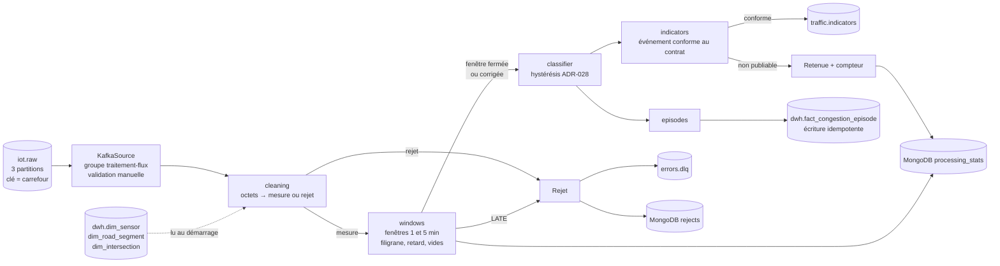
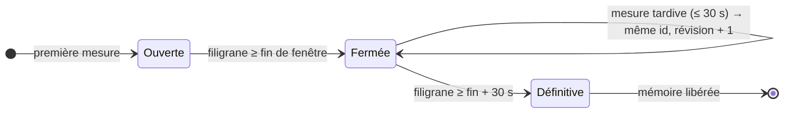
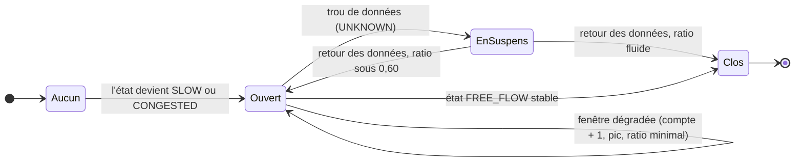

# Service de traitement en flux : nettoyage, fenêtres, état de congestion et épisodes (MS-09)

Projet : Novaria Core, socle d'UrbanHub (bloc de compétences BC05)
Responsables : Daddy Luciano et Manoa Robel (relecture croisée)
Dernière mise à jour : 05/11/2026
Issue de suivi : MS-09 (#128)
Statut : à valider par les deux membres (relecture de la pull request)

Critère d'acceptation : **les indicateurs par fenêtre sont publiés dans un délai défini ; les cas tardifs et aberrants sont comptés et tracés.** Preuve : les sections 5 (délai défini), 8 (cas comptés et tracés) et 10 (tests et exécution réelle) de ce document.

Abréviations : **ADR** (Architecture Decision Record, fiche de décision d'architecture), **API** (Application Programming Interface, interface de programmation), **BSON** (Binary JSON, format binaire de MongoDB), **CI** (Continuous Integration, intégration continue), **DLQ** (Dead Letter Queue, file des messages refusés : ici le sujet `errors.dlq`), **DQ** (Data Quality, qualité des données : règles DQ-01 à DQ-10 du dictionnaire), **JSON** (JavaScript Object Notation), **KRaft** (Kafka Raft, mode de Kafka sans ZooKeeper), **ML** (Machine Learning, apprentissage automatique), **ms** (milliseconde), **SQL** (Structured Query Language), **UUID** (Universally Unique IDentifier).

## 1. En bref

| Tâche de l'issue | Réalisé | Où | Preuve |
|---|---|---|---|
| Consommer `iot.raw`, nettoyer et enrichir avec le référentiel des carrefours | Lecture en groupe, validation de chaque message, contrôle capteur et tronçon dans `dwh.dim_*`, moyenne rapportée à la vitesse fluide du tronçon | `app/flux/cleaning.py`, `adapters/kafka_io.py`, `adapters/warehouse.py` | Sections 4 et 10 |
| Agréger par fenêtres de 1 et 5 minutes : débit, vitesse moyenne, taux d'occupation | Fenêtres fixes en temps d'événement ; moyenne de vitesse pondérée par les véhicules | `app/flux/windows.py`, `indicators.py` | Section 5 |
| Publier `traffic.indicators` ; messages tardifs et en désordre | Filigrane de 10 s, retard autorisé de 30 s, correction d'une fenêtre déjà publiée, fenêtres vides, vidage sur inactivité | `app/flux/windows.py`, `processor.py` | Sections 5 et 8 |
| Moteur de flux : Python, ou Flink si l'ADR-009 le retient | **Python** (repli prévu par l'ADR-011) | tout `app/flux/` | Section 3 |
| Rejets de qualité tracés | `errors.dlq` + MongoDB `rejects` + `processing_stats` | `app/flux/processor.py`, `adapters/mongo_store.py` | Section 8 |
| État de congestion stabilisé (ADR-028) et épisodes dans `dwh.fact_congestion_episode` | Hystérésis pure ; ouverture, mise à jour et clôture idempotentes | `app/flux/classifier.py`, `episodes.py`, `adapters/warehouse.py` | Section 6 |

Ce que cette issue ne fait pas :

| Hors périmètre | Où c'est traité |
|---|---|
| Charger `dwh.fact_traffic_window` depuis `traffic.indicators`, enregistrer le run dans `dwh.dim_run` | Fait par MS-10 : [entrepôt](entrepot.md) |
| Créer et résoudre les alertes (`alertes.*`), recommander un plan de feux | MS-11 et suivantes |
| Mesurer le débit maximal du flux (messages par seconde) | MS-15 |

## 2. Architecture

Le cœur (`cleaning`, `windows`, `classifier`, `episodes`, `indicators`) ne connaît ni Kafka, ni PostgreSQL, ni MongoDB. `processor` le branche à quatre **ports** (publier, archiver un rejet, écrire un épisode, ajouter des compteurs) définis dans `ports.py`. `adapters/` fournit les versions réelles ; les tests utilisent des doublures en mémoire, puis le même code tourne contre le vrai bus et les vraies bases ([ADR-010](../01-architecture/adr/ADR-010-architecture-hexagonale.md)).

| Module | Rôle | Dépend de |
|---|---|---|
| `rules.py` | Toutes les valeurs de réglage, chacune nommée | rien |
| `model.py` | Mesure nettoyée, rejet, référentiel | rien |
| `cleaning.py` | Octets vers mesure ou rejet motivé (DQ-01, 02, 10) | `model`, modèles du contrat |
| `windows.py` | Agrégation, filigrane, retard, fenêtres vides, inactivité | `model`, `rules` |
| `classifier.py` | État stabilisé (fonction pure) | `rules` |
| `episodes.py` | Ouverture, suivi et clôture des épisodes | `classifier` |
| `indicators.py` | Fenêtre vers événement conforme, ou retenue motivée | `windows`, `classifier` |
| `processor.py` | Enchaîne le tout, compte et trace | tous les précédents, `ports` |
| `runner.py`, `__main__.py` | Boucle de lecture, point d'entrée, arrêt propre | `processor` |

## 3. Moteur : Python, et non Flink

L'[ADR-011](../01-architecture/adr/ADR-011-temps-reel-et-batch.md) retient Apache Flink **sous condition** et prévoit un repli : « si Flink n'est pas opérationnel au 01/11/2026, le service de traitement utilise un consommateur Python avec fenêtres écrites dans l'adaptateur d'entrée (MS-09 le prévoit) ; l'écart est consigné dans les limites ». Cette section consigne l'écart.

| Constat au 05/11/2026 | Valeur |
|---|---|
| Date du point de décision de l'ADR-011 | 01/11/2026, dépassée |
| Flink dans `docker-compose.yml` | absent (aucun JobManager ni TaskManager) |
| Prototype Flink (DAT-09) | ouvert, non réalisé |
| Conséquence | **le moteur est un consommateur Python** ; domaine, contrats et sujets sont ceux prévus |

| Ce que Flink apportait | Ce que fait ce service à la place | Écart |
|---|---|---|
| Temps d'événement, filigranes, fenêtres | `windows.py` : mêmes notions, écrites à la main et testées (section 10) | aucun sur la sémantique |
| Points de contrôle de l'état | **Aucun** : l'état des fenêtres est en mémoire, reconstruit en relisant `iot.raw` depuis le dernier offset sûr (section 7) | l'état d'hystérésis n'est pas conservé (limite 1, section 11) |
| « Exactement une fois » avec Kafka | **Au moins une fois**, avec des écritures idempotentes (clé d'idempotence = `id` de l'événement) | un indicateur peut être publié deux fois avec le même `id` |
| Même code en flux et en lot | Le rejeu d'un jeu historique passe par le même service (`FLUX_REPLAY=true`) | pas de mode « lot borné » à part |
| Montée en charge | Un seul processus lit les trois partitions | débit à mesurer en MS-15 |

L'ADR-011 n'est pas modifié par cette issue : sa mise à jour (statut du repli) est à décider avec Daddy lors de la relecture.

## 4. Nettoyage et rejets

`cleaning.clean(octets, référentiel)` rend une `Measurement` ou une `Rejection`. La collecte a déjà validé le message ; le service le revérifie, car un message publié par un autre producteur ou rejoué depuis un fichier n'a pas ce filet. Il juge en plus ce que la collecte ne peut pas juger ([collecte](collecte.md), section 4).

| Ordre | Contrôle | Règle | Code de rejet |
|---|---|---|---|
| 1 | UTF-8 et JSON lisibles, sans `NaN` ni `Infinity` | DQ-01 | `UNREADABLE` (charge gardée en texte) |
| 2 | Le message est un objet JSON | DQ-01 | `CONTRACT_VIOLATION` |
| 3 | `type` = `novaria.iot.measurement.v1` | DQ-01 | `UNKNOWN_TYPE` |
| 4 | Conforme au schéma (champs, types, bornes, dates réelles) | DQ-01 | `CONTRACT_VIOLATION` (chemin et message de l'erreur, jamais la valeur) |
| 5 | `subject` = carrefour ; `id` = `<run>:<capteur>:<instant en ms>` ; drapeaux de qualité cohérents | contrat | `SEMANTIC_VIOLATION` |
| 6 | Capteur connu, rattaché au tronçon et au carrefour déclarés ; tronçon connu | DQ-02 | `UNKNOWN_SENSOR` |
| 7 | Horodatage au plus 5 s après l'horloge du service (désactivé en rejeu) | DQ-10 | `FUTURE_TIMESTAMP` |
| 8 | Fenêtre déjà définitive au regard du filigrane (section 5) | DQ-04 | `LATE` |

Les codes sont ceux de `novaria.error.rejected.v1` ([dictionnaire](dictionnaire-de-donnees.md), section 13.3). Un rejet porte le carrefour du message quand il est lisible, sinon le sujet `UNKNOWN`.

Ce qui n'est **pas** un rejet :

| Cas | Règle | Traitement |
|---|---|---|
| Mesure `SUSPECT` (valeur douteuse, drapeau `IMPLAUSIBLE_VALUE`) | DQ-05 | Exclue des indicateurs, comptée (`excluded_suspect`) ; elle fait quand même avancer le temps |
| Mesure `PARTIAL` (vitesse ou occupation absente) | DQ-06 | Retenue ; comptée (`partial`) ; sans vitesse elle ne pèse pas dans la moyenne |
| Même `id` reçu deux fois | DQ-03 | Ignorée, comptée (`duplicates`) |

## 5. Fenêtres

### 5.1 Agrégation

Une fenêtre = un tronçon, une taille (60 ou 300 s), un début aligné sur la taille, un run. Elle couvre [début, début + taille[. Une mesure appartient à la fenêtre qui contient le **début** de son intervalle (son instant moins `interval_s`).

| Champ de l'indicateur | Calcul | Arrondi |
|---|---|---|
| `vehicle_count` | Somme des véhicules des mesures retenues | entier |
| `flow_veh_per_min` | `vehicle_count` ÷ (taille ÷ 60) | centième |
| `average_speed_kmh` | Σ (vitesse × véhicules) ÷ Σ véhicules, sur les mesures qui ont une vitesse et des véhicules ; `null` sans véhicule | dixième |
| `occupancy_rate` | Moyenne des taux d'occupation renseignés ; `null` si aucun | millième |
| `max_queue_length_m` | Maximum des files renseignées ; `null` si aucune | dixième |
| `speed_ratio` | `average_speed_kmh` ÷ vitesse fluide du tronçon, plafonné à 9,999 ; `null` si la vitesse est `null` | millième |
| `sample_count` | Mesures retenues (`VALID` ou `PARTIAL`, doublons exclus) | entier |
| `expected_sample_count` | Σ sur les capteurs du tronçon de (taille ÷ intervalle de rapport) | entier |
| `congestion_state` | État stabilisé (section 6) ; les fenêtres de 5 minutes reprennent l'état du tronçon à leur fermeture | — |
| `classifier_version` | `regles-v0` | — |

Les arrondis sont ceux des colonnes de l'entrepôt, moitié vers le haut, sur des cumuls décimaux exacts : voir [entrepôt](entrepot.md), section 3.1 (MS-10).

La complétude (`sample_count` ÷ `expected_sample_count`, plafonnée à 1) sert à la règle DQ-07 (section 6). Tout le détail d'un champ se retrouve dans le [dictionnaire](dictionnaire-de-donnees.md), section 6. Un test (`test_indicators.py`) reconstruit **les quatre exemples d'indicateurs du contrat** (congestionné, fluide, route vide, données insuffisantes) à partir de mesures et obtient exactement les mêmes événements.

### 5.2 Temps d'événement, désordre et retard

Le temps de référence est celui des mesures (pas l'horloge du service). Le **filigrane** d'un couple (run, carrefour) est le plus grand début d'intervalle vu, moins 10 s.

| Valeur (`rules.py`) | Défaut | Effet |
|---|---|---|
| `OUT_OF_ORDERNESS_S` | 10 s | Désordre toléré : une mesure en retard de moins de 10 s sur la plus récente est rangée sans bruit |
| `ALLOWED_LATENESS_S` | 30 s | Une fenêtre déjà publiée reste **corrigeable** jusqu'à sa fin + 30 s de filigrane |
| `FUTURE_TOLERANCE_S` | 5 s | DQ-10 |
| `IDLE_FLUSH_S` | 15 s | Sans message depuis 15 s (horloge du service), les fenêtres en cours sont publiées |
| `IDLE_RETIRE_S` | 600 s | Sans message depuis 10 min, l'état du run est libéré |
| `MAX_CATCHUP_WINDOWS` | 60 | Au plus 60 fenêtres vides par tronçon et par taille lors d'un seul avancement du temps |

Ces valeurs sont celles de l'[ADR-011](../01-architecture/adr/ADR-011-temps-reel-et-batch.md) (« à régler par mesure sur MS-15 »).

| Cas | Comportement |
|---|---|
| Mesure tardive, fenêtre non définitive | Ajoutée ; la fenêtre est republiée avec **le même `id`** (le contrat n'a pas de champ de révision : l'abonné écrase la ligne). L'état déjà publié est conservé, la fenêtre n'est pas reclassée |
| Mesure tardive, fenêtre définitive | Refusée : `LATE` (DQ-04), comptée. Le refus vaut pour la minute **et** pour la fenêtre de 5 minutes qui la contient, afin que les deux tailles restent cohérentes |
| Doublon | Ignoré et compté tant que la fenêtre est corrigeable. Reçu **après** que la fenêtre est devenue définitive, il est indiscernable d'une mesure tardive : il est refusé `LATE` |
| Tronçon muet | Une **fenêtre vide** est publiée pour chaque fenêtre fermée (`sample_count` 0, état `UNKNOWN`) tant que le carrefour avance : un capteur qui se tait ne produit pas un silence |
| Trou de plusieurs jours | Au plus 60 fenêtres vides, le reste est compté (`skipped_windows`) : pas de flot de lignes |

### 5.3 Délai de publication (le « délai défini »)

| Situation | Délai | D'où il vient |
|---|---|---|
| Flux continu | **au plus 20 s après la fin de la fenêtre**, plus la latence de traitement | 10 s de désordre toléré + un intervalle de rapport (10 s) : la fenêtre se ferme quand un message dont l'intervalle commence au moins 10 s après sa fin est arrivé |
| Flux interrompu | **au plus 15 s** (horloge du service) après le dernier message | `IDLE_FLUSH_S` |
| Latence de traitement (message qui ferme la fenêtre → événement sur `traffic.indicators`) | **5 à 20 ms** mesurés (16 mesures, section 10) | boucle de lecture, publication, accusé du broker |
| Correction tardive | publiée dès la mesure tardive, au plus 30 s de filigrane après la fin de la fenêtre | `ALLOWED_LATENESS_S` |

La cible de l'ADR-011 (« capteur → alerte visible ≤ 10 s en p95 **hors délai de fenêtre** ») concerne le chemin complet jusqu'à l'alerte : le délai de fenêtre ci-dessus s'y ajoute et n'est pas inclus dans les 10 s.

## 6. État stabilisé et épisodes

### 6.1 Hystérésis (ADR-028)

L'état se calcule sur les fenêtres de **1 minute** à partir du ratio de vitesse. `classifier.advance` est une fonction pure : état précédent et fenêtre en entrée, état suivant en sortie.

| Transition | Condition | Constante |
|---|---|---|
| `UNKNOWN` → `FREE_FLOW` | complétude ≥ 0,5 | `MIN_COMPLETENESS` |
| `FREE_FLOW` → `SLOW` | ratio < 0,60 pendant 2 fenêtres | `slow_below`, `degrade_windows` |
| `FREE_FLOW` ou `SLOW` → `CONGESTED` | ratio < 0,35 pendant 2 fenêtres | `congested_below`, `degrade_windows` |
| `CONGESTED` → `SLOW` | ratio > 0,45 pendant 3 fenêtres | `recover_to_slow_above`, `recover_windows` |
| `SLOW` ou `CONGESTED` → `FREE_FLOW` | ratio > 0,70 pendant 3 fenêtres | `free_above`, `recover_windows` |
| tout état → `UNKNOWN` | complétude < 0,5 | `MIN_COMPLETENESS` |

Les seuils sont ceux de l'[ADR-028](../01-architecture/adr/ADR-028-etats-de-congestion-et-alertes.md), valeurs de départ « à fixer dans le cadrage ML » ; ils sont regroupés dans `Thresholds` (`rules.py`) et se changent sans toucher au calcul.

Ce que le tableau ne dit pas, et le choix fait (**à confirmer à la relecture**) :

| Question | Choix | Test |
|---|---|---|
| La première fenêtre complète compte-t-elle dans les séries ? | Oui : elle sort de `UNKNOWN` et compte déjà | `test_la_fenetre_d_entree_compte_dans_la_serie` |
| Un seuil franchi sert-il à plusieurs transitions ? | Oui : chaque série (sous 0,60 ; sous 0,35 ; au-dessus de 0,45 ; au-dessus de 0,70) ne dépend que des ratios ; l'état décide laquelle compte | `test_fluide_vers_congestionne_directement…` |
| Les deux transitions possibles depuis `FREE_FLOW` | La congestion l'emporte sur le ralentissement | idem |
| Route vide (aucun véhicule, complétude suffisante) | Fluide : compte pour la reprise, jamais pour la dégradation (ADR-028) | `test_une_route_vide_est_fluide` |
| Vitesse absente alors que des véhicules ont passé | Aucune preuve : les séries sont interrompues, l'état ne change pas | `test_un_ratio_absent_malgre_des_vehicules…` |
| Fenêtre de complétude insuffisante | `UNKNOWN`, toutes les séries sont interrompues | `test_une_fenetre_inconnue_interrompt_les_series` |
| Retour des données après un trou **pendant un ralentissement ou une congestion** | Pas de retour automatique à `FREE_FLOW` : la première fenêtre complète est reclassée avec les seuils d'entrée (sous 0,35 : `CONGESTED`, sous 0,60 : `SLOW`, sinon `FREE_FLOW` ; route vide : fluide ; vitesse absente : on attend). Proposition du dictionnaire (section 12), appliquée ici | `test_apres_un_trou_en_congestion_le_retour_est_reclasse…` |
| Retour après un trou pendant un état fluide | `UNKNOWN` → `FREE_FLOW` comme le diagramme du dictionnaire | `test_apres_un_trou_en_fluide_le_retour_suit_le_diagramme` |
| Fenêtres de 5 minutes | Reprennent l'état du tronçon à leur fermeture ; elles ne l'alimentent pas. C'est la proposition du dictionnaire (section 12, « État d'une fenêtre de 5 minutes ») | `test_les_cinq_minutes_reprennent_l_etat…` |
| Oscillation autour d'un seuil | Aucune transition (au plus une transition sur une série qui oscille) | `test_une_serie_qui_oscille…` |

### 6.2 Épisodes

| Moment | Écriture dans `dwh.fact_congestion_episode` |
|---|---|
| Ouverture | `started_at` = début de la **première fenêtre dégradée** (début de la série qui a déclenché la transition, pas la fenêtre où l'état change) ; `window_count` = longueur de la série ; `min_speed_ratio` = plus faible ratio de la série |
| Chaque fenêtre dégradée | `window_count` + 1 ; `peak_state` monte vers `CONGESTED`, ne redescend pas ; ratio minimal |
| Clôture au retour du fluide | `ended_at` = début de la première fenêtre de la série de retour ; `window_count` = nombre de fenêtres entre `started_at` et `ended_at` |
| Après un trou de données | L'épisode reste ouvert et n'est pas prolongé pendant le trou. Au retour, un ratio sous 0,60 le **prolonge** (même `episode_id`, le trou n'est pas compté) ; sinon il est **clos au début du trou**, car on ne sait pas ce qui s'est passé pendant |
| Rejeu | Même `episode_id` (UUID dérivé du run, du tronçon et du début) ; tant que l'épisode est ouvert, l'écriture ne fait baisser ni le compte ni le pic et ne relève pas le ratio minimal ; une fois clos, plus rien ne change et la première clôture fait foi |

Trou de données : le diagramme du dictionnaire (section 7.1) revient de `UNKNOWN` à `FREE_FLOW`, ce qui clôturerait l'épisode alors que la route peut rester bloquée (alerte résolue puis recréée). Le dictionnaire (section 12) propose que `UNKNOWN` ne clôture pas l'épisode et que le retour des données soit reclassé avec les seuils d'entrée : c'est ce que fait le service (**à confirmer**).

`window_count` est **provisoire** tant que l'épisode est ouvert (il compte aussi les fenêtres de confirmation du retour au fluide) et **définitif** à la clôture (fenêtres entre `started_at` et `ended_at`). Il peut donc baisser une fois, à la clôture.

### 6.3 Point ouvert : route vide pendant une congestion

Le contrat d'événement exige un `speed_ratio` numérique quand l'état est `SLOW` ou `CONGESTED`. L'ADR-028 compte une route vide comme fluide, mais l'état stabilisé reste `CONGESTED` jusqu'à trois fenêtres fluides. Pendant ces fenêtres, il n'y a pas de vitesse, donc pas de ratio : les deux règles se contredisent.

| Option | Effet |
|---|---|
| **Retenue ici** : ne pas publier la fenêtre, la compter (`withheld_degraded_without_ratio`) et la tracer dans le journal | Jamais d'événement invalide, jamais de ratio inventé ; un trou de une à deux minutes dans les indicateurs publiés |
| Autoriser `speed_ratio` nul pour `SLOW` et `CONGESTED` | Change le contrat (version 1.1) : à décider avec Daddy |
| Publier l'état `FREE_FLOW` pour ces fenêtres | Contredit l'état stabilisé de l'ADR-028 |

Test : `test_une_route_vide_en_congestion_est_retenue_sans_inventer_de_ratio`.

## 7. Garanties de livraison

| Étape | Comportement |
|---|---|
| Lecture | Groupe `traitement-flux`, **validation manuelle** des offsets, lecture depuis le début si le groupe est nouveau |
| Publication | `acks=all`, idempotence du producteur ; les accusés sont attendus **avant** chaque validation d'offset |
| Offset validé | Pour chaque partition, le prochain message à lire, **sans dépasser le plus ancien message d'une fenêtre encore corrigeable** (publiée ou non) |
| Panne d'une dépendance (broker, PostgreSQL) | Le service s'arrête sans valider ; le conteneur redémarre et relit depuis le dernier offset sûr |
| Panne de MongoDB | Copie d'un rejet ou compteurs non écrits : journalisé, le flux continue (le rejet est déjà sur `errors.dlq`) |
| Sorties idempotentes | Indicateur : `id` = `<run>:<tronçon>:<taille>:<début en ms>` ; épisode : clé d'unicité (tronçon, run, début) ; rejet archivé : `_id` = `dlq:traitement:iot.raw:<partition>:<offset>` |

Conséquence : l'offset validé reste en retard de quelques minutes sur la lecture (jusqu'à la fin de la fenêtre de 5 minutes en cours, plus 30 s de retard autorisé). C'est le prix de l'absence de points de contrôle.

Une seule instance doit lire `iot.raw` : les fenêtres sont en mémoire, deux instances du même groupe se partageraient les partitions et ne verraient que des morceaux de fenêtre.

## 8. Cas tardifs et aberrants : comptés et tracés

C'est le second volet du critère d'acceptation. Chaque cas écarté laisse une trace dans trois endroits au plus : le sujet `errors.dlq` (si c'est un rejet), l'archive MongoDB `rejects`, et un compteur de `processing_stats`.

| Cas | Où il est tracé | Compteur (`processing_stats`) |
|---|---|---|
| Message illisible, hors contrat, sujet inattendu, incohérent | `errors.dlq` + `rejects` | `kind` = `rejects`, clé = code du rejet, et `total` |
| Capteur ou tronçon inconnu (DQ-02) | idem | idem |
| Horodatage dans le futur (DQ-10) | idem | idem |
| **Trop tardif (DQ-04)** | idem, motif `LATE` avec le retard et la charge d'origine | `kind` = `rejects` (`LATE`, `total`) et `kind` = `lateness` (`late_rejected`) |
| Tardif accepté (fenêtre corrigée) | republication du même `id` | `kind` = `lateness` (`late_accepted`) |
| **Aberrant (`SUSPECT`, DQ-05)** | exclu des indicateurs | `kind` = `quality` (`excluded_suspect`) |
| Partiel (DQ-06) | retenu | `kind` = `quality` (`partial`) |
| Doublon (DQ-03) | ignoré | `kind` = `quality` (`duplicates`) |
| Fenêtre vide (capteur muet) | indicateur `UNKNOWN`, `sample_count` 0 | `kind` = `quality` (`empty_windows`) |
| Indicateur non publiable | journal d'avertissement | `kind` = `quality` (`withheld_*`) |
| Indicateurs publiés | — | `kind` = `quality` (`indicators_published`) |

Un document de `processing_stats` = (`kind`, début de minute, tronçon) ; il porte `values` avec les compteurs, incrémentés (`$inc`). Les compteurs sont **au moins une fois** : un rejeu après panne peut compter deux fois les messages relus. Les rejets sans fenêtre lisible sont rangés à la minute du rejet, sans tronçon.

Un rejet qui ne respecterait pas lui-même le contrat (cas qui ne devrait pas se produire) est remplacé par un rejet `PROCESSING_FAILED` : un message empoisonné ne fait pas redémarrer le service en boucle.

## 9. Lancer et vérifier

| Besoin | Linux (bash) | Windows (PowerShell) |
|---|---|---|
| Créer `.env` (une fois) | `python3 scripts/dev/dev.py init-env` | `py -3 scripts/dev/dev.py init-env` |
| Démarrer bases et bus, appliquer les migrations | `python3 scripts/dev/dev.py up` | `py -3 scripts/dev/dev.py up` |
| Journaux du flux | `docker compose logs -f traitement-flux` | `docker compose logs -f traitement-flux` |
| Rejouer un jeu historique (horodatages passés) | mettre `FLUX_REPLAY=true` dans `.env`, puis `docker compose up -d traitement-flux` | idem |
| Tests unitaires du flux (sans base) | `cd services/traitement && python3 -m pytest tests/unit/flux` | `cd services/traitement; py -3 -m pytest tests/unit/flux` |
| Tests contre Kafka, PostgreSQL, MongoDB réels (projet jetable) | `python3 scripts/dev/dev.py test-integration --service flux` | `py -3 scripts/dev/dev.py test-integration --service flux` |
| Tests de `dev.py` | `python3 -m unittest discover -s scripts/dev` | `py -3 -m unittest discover -s scripts/dev` |

Le service `traitement-flux` est le même conteneur que l'API (`services/traitement`), lancé avec `python -m app.flux`. Il écrit un fichier de vie à chaque tour ; la sonde de Compose le lit (vivant = écrit il y a moins d'une minute). Variables lues : `KAFKA_BOOTSTRAP_SERVERS`, `POSTGRES_URL` et `MONGO_URL` (comptes `svc_traitement`), `FLUX_REPLAY`.

## 10. Preuves

Poste de Manoa : Linux (Ubuntu), Python 3.14.4, Docker 29.9.2, Kafka 4.3 (mode KRaft). **Non vérifié : Windows et macOS** (les commandes de la section 9 existent dans les deux variantes, seule la variante Linux a été exécutée).

### 10.1 Tests

| Niveau | Fichier | Tests | Ce qu'ils prouvent |
|---|---|---|---|
| Unitaire | `test_cleaning.py` | 33 | Chaque contrôle de la section 4, dans l'ordre ; la valeur refusée n'est jamais reprise dans le motif |
| Unitaire | `test_windows.py` | 33 | Formules, filigrane (bornes exactes), retard autorisé (bornes exactes), désordre, doublons, fenêtres vides, vidage sur inactivité, offsets retenus, mémoire bornée |
| Unitaire | `test_classifier.py` | 33 | Chaque transition et chaque seuil (bornes strictes), oscillation, route vide, retour après un trou |
| Unitaire | `test_episodes.py` | 15 | Ouverture datée de la première fenêtre dégradée, comptes, pic, clôture, identité stable au rejeu, trou de données |
| Unitaire | `test_indicators.py` | 24 | **Reconstruit les quatre exemples d'indicateurs du contrat à l'identique** ; arrondis, plafond du ratio, fenêtres retenues |
| Unitaire | `test_processor.py` | 18 | Scénario complet de congestion (états, épisode, événements conformes), rejets, retard refusé et toléré, doublon, suspect, inactivité, offsets, pannes |
| Unitaire | `test_kafka_io.py`, `test_runner.py` | 16 | Réglages du producteur et du consommateur, validation d'offsets, arrêt sur panne |
| **Total unitaire du flux** | `tests/unit/flux/` | **172** | |
| Intégration (réels) | `tests/integration/test_flux_stack.py` | 9 (7 du flux, 2 du pipeline de MS-10) | Voir 10.3 |
| Suite du service | `tests/unit` et `tests/contract` | 1 318 (avec les 61 tests du pipeline de MS-10) | Couverture 91,4 % (barrière de la CI : 70 %) ; les adaptateurs ne sont couverts que par l'intégration |
| Outil | `scripts/dev` | 454 (dont 9 nouveaux pour `--service flux`) | Le mode `flux` de `test-integration` |

Lint : `ruff check .` et `ruff format --check .` passent sur tout `services/traitement` (les mêmes contrôles que la CI).

### 10.2 Les tests détectent des défauts : mutations

Après chaque module, des défauts ont été injectés un par un dans le code (borne rendue non stricte, formule modifiée, contrôle supprimé, valeur permutée) et la suite relancée : **48 défauts injectés**. Neuf ont survécu au premier passage : 2 sont équivalents (sans effet sur le comportement), 1 reposait sur une condition redondante (supprimée), 6 révélaient un test manquant (alignement des fenêtres, élagage de la mémoire, second vidage, mesure ancienne arrivée en premier, validation d'un rejet, borne de 0,35 au retour d'un trou). Chacun a reçu son test, puis a été tué.

### 10.3 Contre un vrai Kafka, un vrai PostgreSQL, un vrai MongoDB

`python3 scripts/dev/dev.py test-integration --service flux` : projet Compose jetable, migrations SQL appliquées, six sujets créés, **comptes réels `svc_traitement`** (leurs droits de production suffisent).

| Test | Résultat |
|---|---|
| Le référentiel est lu dans l'entrepôt | Capteur, tronçon, carrefour, intervalle et vitesse fluide conformes à la migration 0005 |
| Un épisode s'écrit et se rejoue | Une seule ligne, `window_count` provisoire 6 remplacé par le définitif 4 à la clôture, aucun rejeu ne la rouvre ni ne la modifie |
| Un épisode sur un tronçon inconnu | Refusé (`StoreFailed`) |
| Rejets et statistiques dans MongoDB | Réinsertion du même rejet ignorée ; une charge que BSON refuse est gardée en texte ; compteurs incrémentés ; document sans tronçon distinct |
| **Scénario de congestion de bout en bout** | 10 indicateurs d'une minute (`FREE_FLOW` ×2, `CONGESTED` ×5, `FREE_FLOW` ×3) tous conformes au contrat ; quatre rejets sur `errors.dlq` (`UNREADABLE`, `UNKNOWN_SENSOR`, `FUTURE_TIMESTAMP`, `LATE`) conformes, copiés dans `rejects` ; un épisode du 15/09/2026 08:01 au 08:05 (pic `CONGESTED`, ratio minimal 0,300, 4 fenêtres) ; offset validé = premier message de la minute 5 (celui de la fenêtre encore corrigeable) ; **redémarrage** : un seul épisode, aucun rejet archivé en double |
| **Run du simulateur avec cinq anomalies** | 1 412 messages (aberrante, doublon, capteur muet, retard de 45 s, retard de 120 s) : 1 408 acceptés, 2 doublons, 1 mesure suspecte exclue, 1 retard corrigé, 1 retard rejeté `LATE` avec sa charge, fenêtres vides `UNKNOWN` pour le capteur muet, tous les compteurs égaux aux anomalies injectées |
| Latence de publication | Du message qui ferme la fenêtre à l'événement lu sur `traffic.indicators` : **5, 9, 7, 8 / 6, 5, 20, 8 / 6, 6, 7, 6 / 9, 11, 8, 12 ms** (quatre exécutions de quatre mesures) |

Deux défauts que les tests unitaires ne pouvaient pas voir ont été trouvés par cette intégration et corrigés : un réglage du producteur refusé par `kafka-python` (délai de livraison trop court pour l'attente de requête), et une écriture d'épisode qui gardait le plus grand `window_count` au lieu de la valeur définitive de la clôture. Chacun a maintenant son test.

### 10.4 Avec la vraie image

Même run du simulateur que ci-dessus, mais traité par le **conteneur `traitement-flux`** construit par Compose (image du service, utilisateur non-root, variables d'environnement de `docker-compose.yml`) dans un projet jetable : le conteneur devient sain (`healthy`, sonde du fichier de vie), traite les 1 412 messages (1 408 acceptés), publie 241 indicateurs (217 d'une minute : 24 tronçons × 9 minutes, plus la fenêtre corrigée), rejette un message `LATE`, compte 2 doublons, 1 mesure suspecte, 1 retard accepté, 1 retard refusé, et laisse des fenêtres `UNKNOWN` pour le capteur muet. Le projet est supprimé ensuite.

### 10.5 Non vérifié

| Point | Pourquoi |
|---|---|
| Windows et macOS | Seule la variante Linux a été exécutée |
| Débit maximal du flux | Hors de cette issue (MS-15) ; un seul processus lit les trois partitions |
| Égalité avec un recalcul SQL de référence (EXG-TRA-01) | Suppose le chargement de `fact_traffic_window` depuis le flux (MS-10) |
| Comportement après un redémarrage de l'état d'hystérésis | Non conservé (limite 1, section 11) ; seule l'idempotence des écritures est prouvée |
| Les tests d'intégration dans la CI | Ils demandent Docker ; ils tournent par `make test-integration-flux`, pas dans le job `backend` |

## 11. Écarts, limites et points ouverts pour la relecture croisée

| N° | Point | Décision proposée | Qui |
|---|---|---|---|
| 1 | **L'état d'hystérésis n'est pas conservé** : après un redémarrage, le service relit depuis l'offset sûr, repart de `UNKNOWN` et republie les fenêtres relues (même `id`) avec un état recalculé, qui peut différer de celui déjà publié | Accepté pour l'instant (local, une instance). Parade : conserver l'état par tronçon avec les offsets (MS-10) | Daddy et Manoa |
| 2 | Route vide pendant une congestion : contrat et ADR-028 se contredisent (section 6.3) | Fenêtre retenue et comptée ; trancher entre une version 1.1 du contrat et l'état actuel | Daddy et Manoa |
| 3 | Python et non Flink (section 3) | Écart prévu par l'ADR-011 ; mettre à jour le statut de l'ADR | Daddy et Manoa |
| 4 | Trou de données : application de la proposition du dictionnaire (section 12) ; clôture « au début du trou » quand la circulation redevient fluide (section 6.2) | À confirmer ; la date de clôture après un trou n'est pas dans la proposition | Manoa |
| 5 | Interprétations de l'hystérésis (section 6.1) | À confirmer ; les tests les figent | Manoa |
| 6 | Le référentiel est lu **au démarrage** : un nouveau capteur demande un redémarrage | Acceptable pour le réseau de démonstration | Daddy |
| 7 | Les compteurs de `processing_stats` sont « au moins une fois » | Acceptable : ce sont des statistiques de suivi | — |
| 8 | Une mesure tardive refusée l'est pour la minute **et** les 5 minutes | Garde les deux tailles cohérentes ; à confirmer | Manoa |
| 9 | Le dictionnaire (section 8, DQ-04) dit « 30 s, valeur de départ » : réglage par mesure en MS-15 | Valeurs nommées dans `rules.py` | MS-15 |
